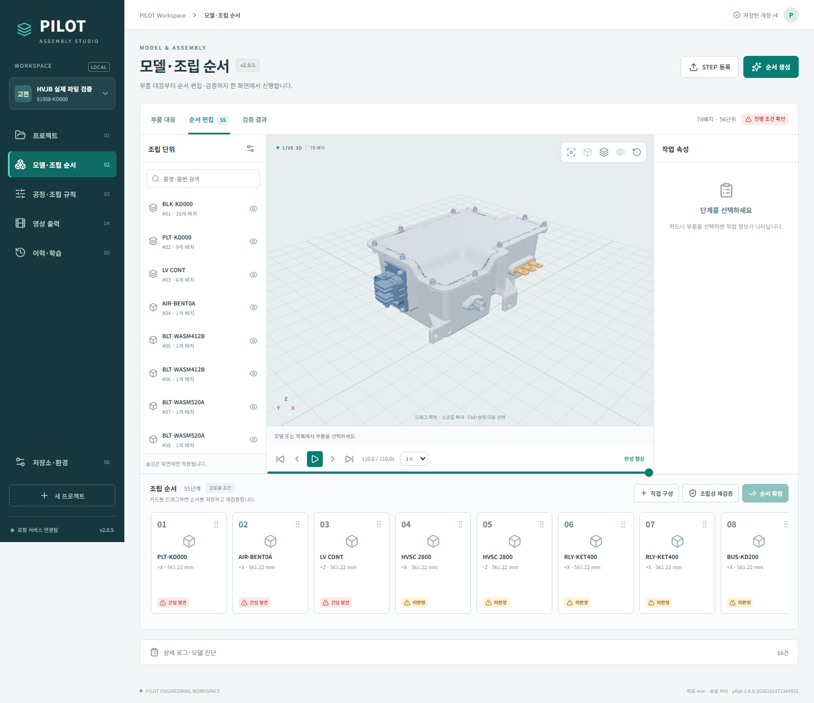

# PILOT Studio 2.0.5

완제품 STEP과 부품 STEP을 대응시켜 조립 단위를 만들고, 자체 간섭 검사로 조립순서를 추천·편집·재검증하는 Windows 프로그램입니다. 왼쪽 메뉴, 중앙 3D, 오른쪽 작업 정보와 하단 순서 카드를 유지했습니다.

**팀원은 아래 설치 파일만 받아 실행하면 됩니다. Python·Node.js·MariaDB를 따로 설치할 필요가 없습니다.**

## 바로 설치하기

1. [2.0.5 설치 파일 다운로드](https://github.com/gyuwon-k/15-thn_project/releases/download/v2.0.5/PILOT-Studio-2.0.5-Setup.exe)를 받습니다. 약 742 MB이며 CAD·DB·브라우저·영상 인코더가 포함되어 있습니다.
2. 설치 파일을 실행한 뒤 **PILOT Studio** 바로가기를 엽니다. Windows x64용입니다.
3. **저장소·환경**에서 앱 버전 `2.0.5`와 빌드 `pilot-2.0.5-20261014T134453Z`를 확인합니다.
4. **프로젝트**에서 차종·품목·품번을 입력하고 **모델·조립 순서**에서 완제품 STEP 및 필요한 부품 STEP을 등록합니다.

[최신 Release와 전체 다운로드](https://github.com/gyuwon-k/15-thn_project/releases/latest) · [사용 안내](docs/PILOT_2.0.5_사용안내.md) · [구현·검증 보고서](docs/PILOT_2.0.5_구현검증_보고서.md)

설치 파일 SHA-256:

```text
01addffb3e2898109e32ab9e3577a056b0418fbc35f1d966ab2634f045b3f668
```

PowerShell에서 확인할 수 있습니다.

```powershell
Get-FileHash -Algorithm SHA256 .\PILOT-Studio-2.0.5-Setup.exe
```

## 작업 순서

1. **프로젝트:** 제품 정보를 입력합니다. 품번은 문자열로 저장해 앞자리 0을 유지합니다.
2. **모델·조립 순서:** STEP 등록 후 부품 대응과 모델 진단을 확인합니다. 품명, 조립 단위 묶기·해제와 고정품을 조정합니다. 표시에서 숨겨도 간섭 검사에는 포함됩니다.
3. **공정·조립 규칙:** 고정품, 선후 관계, 진입 방향·거리와 계산 예산을 설정합니다.
4. **순서 생성·편집:** 생성한 카드를 확인하거나 직접 순서를 구성합니다. 카드 드래그 시 재검증하며 방향·거리·규칙을 저장한 뒤에는 재검증 버튼을 누릅니다.
5. **확정:** 현재 순서 전체가 검증을 통과하고 토크/해당 없음, 주의사항/검토 결과 없음, 작업 정보 검토가 완료되면 확정합니다.
6. **영상 출력:** 검토한 양식을 선택하고 필요한 시점을 저장한 뒤 MP4를 출력합니다.
7. **이력·학습:** 수정·확정 이력, 전문가 선호, 회사 평가와 필드테스트 결과를 축적합니다.

## 실제 정션박스 시험 결과와 현재 범위

제공된 고전압 정션박스 STEP 및 부품 STEP 18개로 **78개 배치·176개 솔리드 → 56개 조립 단위 → 고정품 제외 55단계 전체 검토 순서** 생성을 최종 패키지에서 확인했습니다.

**이 실제 제품의 전체 조립성 검증은 `BLOCKED`입니다.** 원본 최종 배치의 겹침, 6개 배치의 표현 검사 차이와 시간 내 판정하지 못한 경로가 남아 있습니다. 검토 순서 생성과 물리적 조립 검증 통과를 구분하며 미통과 순서의 공식 확정은 차단합니다. 최적 순서의 보장도 제공하지 않습니다.

현재는 최종 자세를 유지한 축 방향 직선 이동을 검사합니다. 회전·경유점 경로, 공구 접근, 탄성 변형 해석은 범위에 포함하지 않습니다. 상세 공정 편집, 자유로운 템플릿 필드 배치, 과거 확정본 선택 재출력 UI, 전체 계획의 휴리스틱/ML 자동 비교 등 잔여 항목은 [보고서](docs/PILOT_2.0.5_구현검증_보고서.md)와 [설계서 §0.0](docs/PILOT_구현설계_v0.6.md)에 명시했습니다.

회귀 시험 **49개**, 합성 STEP의 등록→PASS→확정→MP4→수정→재검증, 영상 출력 후 설치 자원 무결성, 실제 Electron 3D 재생 후 두 차례 재시작, 독립 시험 폴더의 2.0.2→2.0.5 업데이트·데이터 보존을 확인했습니다. 별도 신규 PC 인수와 실제 작업자 필드테스트는 남아 있습니다.



회사 원본 CAD, 프로젝트 DB와 원본 CAD가 포함된 검토 백업은 이 공개 저장소 및 Release에 포함하지 않았습니다. 필요한 STEP은 팀 내 제공 자료로 등록하세요. 제공 영상의 참고 이미지는 회사의 최종 승인 양식으로 간주하지 않으며 공식 출력 전에 양식을 검토해야 합니다.

## 업데이트와 데이터

새 버전이 나오면 [Releases](https://github.com/gyuwon-k/15-thn_project/releases/latest)의 설치 파일을 실행합니다. 앱을 종료하고 업데이트한 뒤 **저장소·환경**에서 실제 버전을 확인하세요.

동일 세대 앱은 새 릴리스를 별도 폴더에 준비하고 사전 검사 후 활성 버전을 전환합니다. 실패한 새 릴리스로 기존 정상 버전을 바꾸지 않습니다. 프로젝트 데이터는 기본적으로 `%LOCALAPPDATA%\PILOT Studio\data-v2`에 보관하며 설치 폴더와 분리됩니다. 업데이트 전 앱에서 백업하세요.

**기존 1.x DB를 2.x로 자동 변환하지 않습니다.** 기존 운영 자료는 별도로 백업·보존하고 2.x에서 STEP을 등록해 새 프로젝트로 검증하세요. 저장소 복원은 별도 저장소를 검증해 전환하는 방식이며 프로젝트 병합 기능은 아닙니다.

영상 브라우저는 사용자 데이터에 준비한 빌드별 검증 사본으로 실행해 설치 파일을 변경하지 않습니다. 재사용 시 파일 해시를 다시 확인합니다.

## 개발자가 소스 실행하기

일반 사용자는 위 설치 파일을 사용하세요. 아래는 소스 수정·빌드용입니다. Windows x64, **Python 3.12**, Node.js/npm과 Inno Setup 6이 필요합니다. 저장소 루트에서 실행합니다.

```powershell
git clone https://github.com/gyuwon-k/15-thn_project.git
cd 15-thn_project
py -3.12 -m venv .venv
.venv\Scripts\python.exe -m pip install -r requirements.lock.txt
.venv\Scripts\python.exe -m pip install -r requirements-test.txt
npm --prefix frontend ci
npm --prefix desktop ci
$env:PLAYWRIGHT_BROWSERS_PATH = Join-Path $PWD 'work\playwright-cache'
.venv\Scripts\python.exe -m playwright install chromium
```

MariaDB **12.3.2 Windows x64 ZIP 배포본**을 [공식 다운로드](https://mariadb.org/download/)에서 받아 압축을 풉니다. 아래 `<MariaDB압축해제폴더>`를 해당 폴더로 바꿉니다. 시스템 DB 서비스 설치 대신 앱 전용 인스턴스를 실행합니다.

```powershell
.venv\Scripts\python.exe scripts/stage_runtime.py --mariadb '<MariaDB압축해제폴더>' --browsers $env:PLAYWRIGHT_BROWSERS_PATH
$env:PILOT_PYTHON = (Resolve-Path .venv\Scripts\python.exe).Path
$env:PILOT_RESOURCE_DIR = (Resolve-Path packaging\resources).Path
$env:PLAYWRIGHT_BROWSERS_PATH = (Resolve-Path packaging\resources\browsers).Path
$env:PILOT_DATA_DIR = Join-Path $PWD 'work\dev-data'
npm --prefix frontend run build
npm --prefix desktop start
```

버전은 `release.json`, Python 및 npm 의존성은 lock 파일을 기준으로 합니다. 소스 ZIP은 런타임 바이너리와 개발환경을 포함하지 않습니다.

## 시험과 설치 패키지 빌드

런타임 준비 후 회귀 시험을 실행합니다. 시험 DB·자료는 `work/`에 생성합니다.

```powershell
.venv\Scripts\python.exe -m unittest discover -s tests -v
```

Inno Setup을 설치하고 아래 경로를 실제 `ISCC.exe` 위치로 바꿉니다. Windows 경로 길이를 줄이기 위해 소스는 짧은 폴더에 두는 편이 좋습니다.

```powershell
.venv\Scripts\python.exe scripts/build_release.py --python .venv/Scripts/python.exe --inno '<InnoSetup폴더>/ISCC.exe' --skip-stage
```

생성 파일은 `dist/PILOT-Studio-Setup-<버전>.exe`입니다. 릴리스 배포명은 `PILOT-Studio-<버전>-Setup.exe`로 통일합니다. 새 코드를 배포할 때 `release.json`의 앱 버전·고유 build ID·구성 요소 ID와 변경된 알고리즘 버전을 갱신합니다. 이미 완성된 동일 build ID를 덮어쓰지 않습니다. UI·백엔드·런처 ID와 파일 해시가 일치해야 활성화됩니다.

## 저장소 구성

- `backend/`: STEP 전처리·매칭·경로 검사·추천·업무 API·DB·영상·학습
- `frontend/`: React·TypeScript·Three.js 작업 화면
- `desktop/`, `launcher.py`: 데스크톱과 버전 실행 연결
- `packaging/`, `scripts/`: 런타임 준비·설치 빌드·실행 검증
- `tests/`: 회귀·DB 통합 시험
- `docs/`: 구현설계 v0.6, 사용 안내, 실제 검증 결과와 화면

[서드파티 고지](THIRD_PARTY_NOTICES.md)를 확인하고 재배포 시 동봉된 라이선스를 유지하세요.
