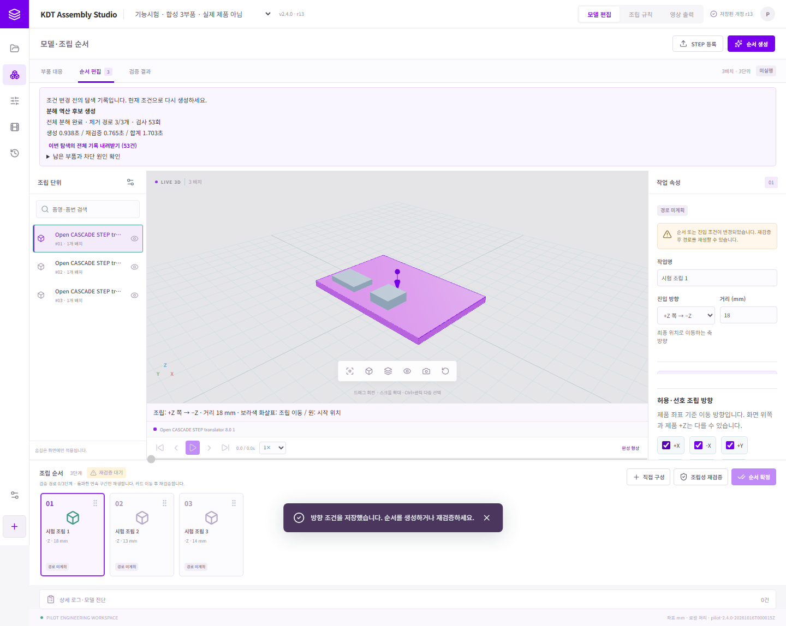

# PILOT Studio 2.4.0

STEP 모델을 등록하고 완제품·부품 대응, 조립순서 추천·검증, 순서 편집, 작업 안내 영상 출력을 수행하는 Windows 데스크톱 프로그램입니다.

**팀원은 소스를 빌드할 필요 없이 아래 Setup 파일을 설치하면 됩니다.**

## 1. 설치 파일 다운로드

- **[PILOT Studio 2.4.0 설치 파일 다운로드](https://github.com/gyuwon-k/15-thn_project/releases/download/v2.4.0/PILOT-Studio-2.4.0-Setup.exe)** — 약 742 MB
- [2.4.0 릴리스와 첨부 자료](https://github.com/gyuwon-k/15-thn_project/releases/tag/v2.4.0)

설치 대상은 Windows 64비트 PC입니다. 실제 설치·실행 검증 환경은 Windows 11입니다. Python, Node.js, MariaDB를 별도로 설치할 필요가 없습니다. 실행에 필요한 CAD 라이브러리, 데이터베이스, 영상 처리 도구가 설치 패키지에 포함됩니다.

GitHub의 **Code → Download ZIP**은 개발용 소스입니다. 프로그램을 사용하려면 위의 **Setup.exe**를 받으세요.

## 2. 설치하고 실행하기

1. 기존 PILOT Studio가 실행 중이면 작업을 저장하고 종료합니다.
2. `PILOT-Studio-2.4.0-Setup.exe`를 실행하여 설치합니다.
3. 설치 후 시작 메뉴 또는 바탕화면의 **PILOT Studio** 바로가기로 실행합니다.
4. 첫 실행 시 로컬 데이터베이스와 작업 화면이 준비될 때까지 기다립니다.
5. 화면의 버전이 **2.4.0**인지 확인합니다. 실행 빌드는 **`pilot-2.4.0-20261016T000015Z`**입니다. 저장소·환경 화면과 화면 하단에서 확인할 수 있습니다.

새 PC에는 프로젝트가 들어 있지 않습니다. 새 프로젝트를 만들고 전달받은 STEP 파일을 등록하세요. 회사 원본 CAD와 운영 DB는 이 저장소 및 릴리스에 포함하지 않습니다.

## 3. 팀원 작업 순서

1. **프로젝트 등록:** 프로젝트명과 차종·품목·품번을 입력합니다.
2. **STEP 등록:** 완제품 STEP을 등록하고, 필요한 개별 부품 STEP을 함께 등록합니다.
3. **모델·부품 확인:** 3D 모델과 부품 목록에서 대응 상태 및 조립최소단위를 확인합니다. 함께 조립할 묶음과 고정품도 확인합니다.
4. **공정·조립 규칙:** 제품에 필요한 선후 관계, 고정·체결 조건, 허용 진입 방향을 설정합니다. 정션박스의 필수 흐름은 메인바디 → 플레이트 → 릴레이이며, 각 부품을 고정한 뒤 다음 부품을 조립하는 조건을 사용합니다. 릴레이 고정 볼트는 실제 위치가 높은 것부터, 높이가 거의 같으면 순서를 강제하지 않습니다.
5. **순서 생성:** 완제품에서 분해 경로를 찾고, 통과한 전체 분해 순서의 역순으로 조립순서를 만듭니다. 다른 부품을 관통하거나 지지 연결을 잃는 후보는 통과시키지 않습니다.
6. **순서 확인·편집:** 하단 카드를 선택해 재생합니다. 드래그로 순서를 바꾸거나 진입 방향·거리를 수정하면 현재 조건으로 다시 검증합니다.
7. **순서 확정:** 최신 전체 조립성 검증을 통과한 순서를 확정합니다. 토크·주의사항·작업정보 체크·기록자 이름은 선택 입력이며, 비어 있다는 이유만으로 순서 확정을 막지 않습니다.
8. **영상 출력:** 회사 영상 템플릿을 선택하고 필요한 토크·주의사항과 단계별 카메라를 설정하여 MP4를 생성합니다.

모델을 화면에서 숨겨도 해당 부품은 간섭 검사에 포함됩니다. 검사하지 않은 경로를 실행 가능한 조립 동작으로 재생하지 않습니다.



위 이미지는 화면 기능을 확인하기 위한 합성 3부품 시험입니다. 회사 정션박스의 조립 승인 결과가 아닙니다.

## 4. 계산 시간과 결과 확인

- 기본 제한은 **순서 생성 30분**, 완성 후보의 **전체 재검증 30분**입니다. 두 단계가 모두 오래 걸리면 전체 작업이 약 60분 걸릴 수 있습니다.
- 형상 연산과 후보 검사는 각각 기본 120초입니다. 필요한 기존 형상 재평가 시간은 해당 단계의 분석 시간에 포함합니다.
- 오래 걸리는 작업은 현재 상태와 로그에서 확인하고 취소할 수 있습니다.
- `미판정`, `시간 도달`, `통과 순서 미발견`은 물리적으로 조립 불가능하다는 판정이 아닙니다. 결과의 대상 부품과 원인을 확인하세요.
- 순서를 수정한 경우 재검증이 필요합니다. 검증되지 않은 순서를 통과 상태로 바꾸는 승인 체크는 제공하지 않습니다.

## 5. 업데이트와 데이터 보존

업데이트할 때도 새 Setup 파일을 설치하고 기존 **PILOT Studio** 바로가기로 실행합니다. 과거 배포 폴더의 exe를 직접 실행하면 옛 프로그램이 열릴 수 있으므로, 설치된 바로가기를 사용하고 실행 버전을 확인하세요.

설치기는 새 릴리스 파일 검증과 데이터 백업을 수행한 뒤 활성 버전을 전환합니다. 사용자 프로젝트·원본·확정본·영상은 설치 프로그램과 별도의 데이터 폴더에 저장합니다. 이번 개발 PC에서는 **2.3.0 → 2.4.0 업데이트**, 기존 프로젝트 3개 유지, 백업 ZIP 무결성 및 업데이트 실패 시 기존 버전·자료 유지 시험을 통과했습니다.

기존 프로젝트에서 **순서 생성 또는 재검증**을 누르면 남아 있는 형상 오류만 새 기준으로 자동 재평가합니다. 이번 표현 보정 정책 변경만으로 STEP을 다시 등록할 필요는 없습니다. 분석 형상이 바뀌면 과거 검증 결과는 현재 형상으로 다시 확인합니다.

기본 데이터 폴더는 `%LOCALAPPDATA%\PILOT Studio\data-v2`입니다. 팀원에게 프로젝트를 전달할 때는 프로그램의 백업·복원 기능을 사용하고, 운영 중인 DB 파일을 임의로 복사하지 마세요. 다른 PC로 복원한 뒤에는 모델·매칭·규칙을 확인하고 조립성을 다시 검증하세요. 구형 1.x DB의 자동 변환은 지원하지 않습니다.

## 6. 현재 확인된 결과와 남은 제한

2.4.0에서 확인한 결과는 다음과 같습니다.

- 회귀시험 **199개 통과**.
- 실제 회사 모델의 잔여 형상 2개를 외형·배치 변경 없이 자동 보정하여 **78/78 형상 정밀 검사 통과**.
- 별도 실제 CAD의 **39개 조립단위 → 38단계 생성·전체 조립성 검증·38단계 재생 통과**.
- 캐시 없는 STEP 등록 → 생성 → 검증 → 확정 → MP4 출력의 최종 패키지 시험 통과.
- 새 설치본의 UI·백엔드·런처 빌드 일치와 업데이트 시험 통과.

**회사 정션박스의 전체 조립순서 생성은 아직 미완료입니다.** 실링 `SEL-KD000`의 지지 관계를 확정하지 못했고, 부품 매칭 6건도 형상 비교 시간 초과 또는 Boolean 연산 미완료로 검토 상태입니다. 매칭이 틀렸다고 확인된 것은 아닙니다. 형상 검사 통과와 전체 제품의 조립성 검증 통과를 구분해야 합니다.

STEP 변환 경고가 있어도 외형 보존 보정과 일반·정밀 검사에 통과하면 순서 분석을 진행합니다. 큰 형상 손상·구성원 누락·실제 이동 간섭·판정되지 않은 지지 관계는 계속 보류합니다. 임의 회전·곡선 경로, 공구 접근성, 질량·마찰·체결력의 물리 해석은 현재 검사 범위에 포함하지 않습니다.

## 7. 문제가 생겼을 때

- **설치 후 옛 버전이 보임:** 실행 중인 앱을 닫고 최신 Setup으로 다시 설치한 뒤, 과거 폴더의 exe 대신 설치된 바로가기로 실행합니다. 버전과 실행 빌드를 확인합니다.
- **형상 보류가 남음:** 순서 생성·재검증으로 자동 재평가한 뒤 모델의 보정 수·보류 수와 진단을 확인합니다. 보관된 원본이 바뀌었다는 안내가 나오면 STEP을 다시 등록합니다.
- **순서가 생성되지 않음:** 매칭 검토, 간섭, 지지·체결 관계, 허용 방향, 계산 시간 중 어떤 조건인지 결과와 상세 로그를 확인합니다. 위의 회사 제품 제한도 참고하세요.
- **순서 확정이 비활성:** 현행 순서의 전체 검증 결과와 누락·중복 단위를 확인합니다. 토크·주의사항 입력은 해결 조건이 아닙니다.
- **DB 또는 저장 오류:** 앱을 중복 실행하지 않았는지와 저장소·환경 상태를 확인합니다. 기존 데이터 폴더를 삭제하지 말고 오류 내용과 버전·빌드를 함께 전달하세요.

## 8. 문서와 소스

- [구현설계 v0.11](docs/PILOT_구현설계_v0.11.md)
- [2.4.0 사용 안내](docs/PILOT_2.4.0_사용안내.md)
- [구현·검증 보고서](docs/PILOT_2.4.0_구현검증_보고서.md)
- [검증 결과 JSON](docs/PILOT_2.4.0_검증결과.json)
- [개발 환경·빌드 안내](docs/DEVELOPMENT.md)
- [서드파티 라이선스 안내](THIRD_PARTY_NOTICES.md)

릴리스에는 Setup, 해당 커밋의 소스 ZIP, 안내·설계·검증 문서, 검증 증적 ZIP과 `SHA256SUMS.txt`를 제공합니다. 설치 파일의 SHA-256은 다음과 같습니다.

```text
64c68deb60de92c88b5b341a549c8ac91278f7a8b021373db88c8fc92abf0acf  PILOT-Studio-2.4.0-Setup.exe
```

파일 확인이 필요하면 PowerShell에서 실행하세요.

```powershell
Get-FileHash .\PILOT-Studio-2.4.0-Setup.exe -Algorithm SHA256
```
