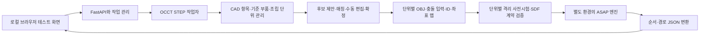

# ASAP 자동 전처리·조립순서 확인용 구현설계 v0.4

- 문서 ID: ASAP-TEST-DESIGN-001
- 작성일: 2026-10-12
- 버전: v0.4
- 필수 구현 범위: 두 입력 방식의 선택·파일 등록·조립 단위 구성·부품 매칭·자동 전처리·상세 진단·실제 ASAP·3D 결과 확인
- 용도: 이 파일 하나로 두 입력 방식, 조립 단위 편집·부품 매칭, 단위별 OBJ 변환, 격리된 네이티브 사전시험, ASAP 실행, 3D 순서 확인을 구현하는 독립된 테스트 명세
- 실행 형태: 개발 환경의 Python 로컬 서버와 브라우저 화면. 설치 EXE와 독립 데스크톱 패키징은 요구하지 않는다.
- 상태: 제작할 기능의 설계. 프로그램 제작·ASAP 설치·실제 제품 실행 결과를 보고하는 문서가 아니다.

## 1. 목표와 최소 범위

**완제품 STEP 또는 완제품과 개별 부품 STEP을 등록하여 실제 함께 설치하는 조립 단위를 확정하고, 그 단위의 원본 형상을 유지한 채 OBJ·충돌 입력을 생성하여 실제 ASAP의 조립순서와 이동 경로를 확인한다.**

**방식 A(완제품만)와 방식 B(완제품＋하위 부품)를 모두 필수 기능으로 구현한다.** 등록 화면에 두 방식의 선택과 서로 구분되는 파일 입력 칸을 제공한다. 방식 B의 다중 파일 등록·매칭·사용자 확정·반복 배치 구분이 제공되지 않으면 이 문서의 프로그램 구현 완료로 판정하지 않는다. 일부 하위 부품만 있는 혼합 입력도 방식 B 안에서 지원한다. 개발 작업은 순차 진행할 수 있지만 어느 한 방식만 제공하는 상태를 전체 완료로 표시하지 않는다.

여기서 하위 부품 파일은 완제품의 조립 단위를 식별하는 기준 CAD이며, Assembly Flow나 순서 정답 자료가 아니다. 문서의 기능은 이 파일만으로 제작할 수 있는 최종 요구사항이며 다른 버전이나 대화 이력을 참조할 필요가 없다.

조립 단위 보정은 엔진의 적절한 입력을 만드는 과정이다. 보정 완료만으로 전체 순서 생성, 물리적 조립 가능성 또는 현장 적용을 보장하지 않는다. 조립 단위 확정·메시/충돌 입력 준비·엔진 실행·전체 순서 생성·경로 출력은 각각 독립 상태로 판정한다.

핵심 흐름은 `완제품/기준 부품 STEP 등록 → 원본 CAD 확인 → 조립 단위 후보/매칭 → 편집·확정 → 단위별 OBJ·원본 솔리드 충돌 입력 → 격리된 네이티브 사전시험 → ASAP 탐색 → 순서·3D 재생`이다. HVJB·PRA의 제품명·품번·부품 수·트리 이름에 의존하지 않는다. 완제품 내부에 구분 가능한 형상이 있으면 개별 부품 STEP 없이 조립 단위를 구성할 수 있다. CAD 말단 항목이나 솔리드 개수를 실물 부품 수 또는 공정 작업 수로 간주하지 않는다. 품번·부품명이 없어도 원본 CAD명 또는 임시 표시명과 배치 ID로 확인한다.

### 포함

- 입력 방식 선택 화면, 완제품 `.stp/.step` 한 파일 등록, 방식 B에서 필수인 하위 부품 STEP 다중 등록. 원본 파일별 해시와 형상·배치·단위 진단.
- CAD 항목과 조립 단위의 별도 목록, 다중 선택 묶기·해제·구성원 편집·되돌리기·3D 미리보기·확정.
- 조립 단위 후보 제안과 개별 부품 기준의 형상/배치 매칭. 일부 기준 부품만 있는 혼합 방식.
- 구성원 중복·누락 방지, 반복 체결재의 개체 ID 유지, 조립 단위 리비전별 저장·재실행.
- 반복 볼트를 포함한 배치별 목록·ID·3D 선택/강조.
- 조립 단위별 OBJ 생성, 좌표·수량·메시 폐합 상태·원본 대비 배치 확인.
- ASAP의 `learn` 실행과 `heur-out` 비교 실행. 가중치 동결, 파인튜닝 없음.
- 실행 조건·시간·평가 횟수·종료 이유·로그 표시와 취소.
- 전체 조립순서 목록, 이전/다음 단계, 재생/정지, 단계 내 슬라이더, 속도 조절.
- 실제 출력 경로, 현재 이동 부품, 이미 조립된 부품, 지지할 부품, 조립체 자세 확인.
- 입력·설정·순서·경로·결과를 파일로 저장하고 다시 열기.
- 부품별 진단 배지, 검사 내역 탭, 부품/부품 쌍 3D 강조·격리·확대·개별 보기.
- 간섭·미검사·계산 실패·메시 처리·OCCT 경고·엔진 오류·이전 실행의 구분과 한국어 설명·원문·수치 조회.
- 작업별 프로세스 분리·제한시간·취소·복구 상태와 원본 보존. 모든 입력의 계산 성공을 보장한다는 표현은 사용하지 않는다.

### 제외

MP4/GIF 생성, 영상 인코딩, 공법서 문구/토크 편집, Web 게시, 설치 EXE, Electron, 기업 DB·학습 이력, 파인튜닝, 공구 교체 최적화, 장비/로봇 제어, 와이어 변형·가스켓 압축·나사 체결력 해석은 구현하지 않는다.

이 테스트는 **ASAP의 원래 기계적 계획 결과를 확인**하는 목적이다. MBD→Plate→Relay, 상단 체결 우선 등 현장 규칙을 자동으로 넣어 결과를 바꾸지 않는다. 화면에 `현장 규칙·공구·토크·유연체 공정 미검증`을 표시한다. 정식 공정 설계와 테스트의 결과 범위를 구분한다.

Assembly Flow·기존 순서·예제 품목 JSON을 자동 순서 생성 입력으로 사용하지 않는다. 사용자가 외부 자료를 보고 조립 단위 구성원을 수동 확정할 수 있으나, 자료의 순서·단계 번호를 ASAP의 우선순위나 결과에 주입하지 않는다. Flow 자동 분석·순서 가져오기 기능은 포함하지 않는다. 실행 실패는 해당 실행의 미해결/오류 결과로 저장하고 다른 생성기의 출력을 실제 ASAP 결과로 대체하지 않는다.

## 2. 실행 구조와 개발 환경



### 2.1 최소 기술 구성

- 화면: React/TypeScript/Three.js. 장면 탐색과 선택 기능은 PILOT의 UI 코드를 재사용할 수 있다.
- 서버: Python/FastAPI. 프런트 빌드와 API를 한 로컬 서버에서 제공한다.
- STEP: cadquery-ocp/OCCT XDE. 형상 정의와 개별 사용 배치를 구분한다.
- 엔진: 공식 ASAP 저장소의 고정 커밋, RedMax 시뮬레이터, PyTorch/PyG, 사전학습 가중치.
- 저장: 실행별 폴더와 JSON/NPY/OBJ. SQLite는 필요하지 않다.
- 실행: `python launcher.py` 또는 같은 동작의 테스트 시작 스크립트. 기본 포트는 8767이며 충돌 시 변경한다. 루프백에서만 서비스한다.

테스트 코드는 별도 `asap-unit-test/` 폴더로 만든다. 다른 프로그램의 DB·프로젝트·확정본을 읽거나 수정하는 것을 실행 전제로 삼지 않는다. 특정 등록 프로젝트를 자동으로 여는 기능도 넣지 않는다.

### 2.2 ASAP 환경과 브라우저 실행

ASAP 공식 환경은 오래된 Python·추론 패키지를 포함하므로, CAD/API 환경과 엔진 환경을 분리한다. 각각의 실행 Python 경로와 ASAP 루트를 설정 파일로 지정하고 JSON 파일로 주고받는다. [공식 환경 파일](https://github.com/yunshengtian/ASAP/blob/main/environment.yml)

참조 개발 경로는 **Linux 또는 WSL2에서 CAD/API와 ASAP 엔진을 별도 환경으로 실행하고 로컬 브라우저로 접속**하는 방식이다. Windows 네이티브 엔진은 빌드와 예제 시험에 성공한 경우 선택할 수 있다. 테스트에는 WSL2·개발 도구 사용이 허용되며 설치형 배포 요건을 적용하지 않는다. 현재 PC에 WSL이나 ASAP가 설치되었다고 가정하지 않는다.

WSL2 서버도 Windows 브라우저에서 localhost로 접근할 수 있다. 첫 환경 점검에서 실제 연결을 확인하고 실패하면 네트워크 설정 원인을 안내한다. 일반 사용자에게 외부 공개 서버나 방화벽 전체 해제를 요구하지 않는다. [Microsoft WSL 네트워크 문서](https://learn.microsoft.com/en-us/windows/wsl/networking)

첫 환경 구성에는 의존성 설치와 가중치 확보가 필요할 수 있다. 이후 추론에서 CAD를 외부 API로 전송하지 않는다. 가중치가 없으면 화면에 누락을 표시하고, 확보한 공식 파일의 해시를 기록한다. 핵심 작업자가 임의로 모델을 다시 다운로드하거나 조용히 다른 모델로 바꾸지 않는다.

개발자는 실제 성공한 환경의 lock 파일과 설정 예시를 제공한다. CMake/C++·OpenGL 등 RedMax 빌드 의존성은 엔진 환경에서 준비하고, CAD/API 환경과 엔진의 Python 실행파일을 명시한다. 프런트는 개발 때 한 번 빌드해 서버의 정적 파일로 제공한다. 일상 테스트에서는 별도 Vite 개발 서버를 필수로 실행하지 않는다. launcher는 백엔드 health 확인 후 접속 주소를 안내하고, 네이티브 Windows에서는 브라우저를 열 수 있다. WSL에서는 Windows 브라우저로 같은 localhost 주소에 접속한다.

### 2.3 실행 전 환경 점검

빠른 health와 입력 목록 조회는 엔진 환경 점검의 완료를 기다리지 않는다. 환경 점검은 별도 작업/상태로 제공하고 STEP 등록·저장 목록·뷰어와 독립적으로 갱신한다.

`환경 확인` 버튼으로 CAD 라이브러리, ASAP 루트·커밋, 엔진 Python, RedMax 로딩, torch/PyG, 가중치 파일·호환성을 검사한다. 각각 `정상/누락/호환 실패`로 표시한다.

개발 초기에는 공식 빔 예제를 `heur-out`과 `learn`으로 실행해 엔진을 확인한다. 이 예제는 환경 점검용이며 사용자 파일에 그 부품수·이름·순서를 적용하지 않는다. 엔진이 준비되지 않아도 STEP 뷰어와 OBJ 진단은 사용할 수 있다.

## 3. 화면과 사용 순서

한 페이지에서 등록·변환·실행·재생을 처리한다. 다중 프로젝트 관리·계정·승인 화면은 만들지 않는다.

```text
입력   [방식 A: 완제품만] [방식 B: 완제품＋하위 부품]
       [완제품 STEP 1개 선택] [하위 부품 STEP 여러 개 선택 / 추가·교체·제거]
상단   [등록·해석] [부품 매칭] [조립 단위 편집·확정] [OBJ 변환] [자동 전처리·ASAP 실행] [취소] [결과 열기]
       현재 파일 / 입력 상태 / 엔진·가중치 상태

좌측   [원본 CAD] [조립 단위] [기준 부품] 탭 / 검색 / 현재 단계 / 생성된 순서
중앙   3D 장면 / 회전·확대·격리 / 원본·OBJ 비교 / 경로
우측   [단위 편집] [검사 내역] / 매칭 후보 / 실행 설정 / 결과·로그

하단   [조립·분해] [처음] [이전] [재생·정지] [다음] [마지막]
       단계 번호 / 단계 내 슬라이더 / 0.5×·1×·2× 속도
```

### 3.0 두 입력 방식의 선택과 파일 등록

화면 상단에 `완제품만 사용`과 `완제품＋하위 부품 사용`을 선택하는 컨트롤을 항상 표시한다. 현재 방식과 준비 상태를 세션에 저장하고 재열기에서 복원한다. 하위 부품 업로드는 엔진 환경 설정 창이나 숨은 개발 기능으로 배치하지 않는다.

**방식 A: 완제품만 사용**

- 완제품 STEP 입력 칸 1개와 `등록·해석` 버튼을 제공한다.
- 하위 부품 파일은 요구하지 않는다. 자동 묶음 후보 제안과 수동 편집으로 실제 조립 단위를 확정한다.
- 같은 이름·정의·접촉/겹침만으로 병합을 확정하지 않는다.

**방식 B: 완제품＋하위 부품 사용**

- `완제품 STEP 1개`와 `하위 부품 STEP 여러 개`를 시각적으로 분리한 입력 칸을 제공한다.
- 하위 부품 칸은 다중 파일 선택과 누적 추가를 지원한다. 등록 목록에 파일명·크기·해시·품번/표시명·파싱 상태·솔리드 수·매칭 상태·검토 수량을 표시한다.
- 완제품 등록 전 함께 선택할 수 있고 완제품 해석 후에도 하위 부품을 추가할 수 있다. 같은 세션의 기준 부품으로 관리한다.
- 파일별 미리보기·이름/품번 수정·템플릿 범위 편집·교체·제거·재시도를 제공한다. 한 파일의 실패가 정상 등록된 다른 파일을 삭제하지 않는다.
- 사용 가능한 템플릿이 하나 이상 준비되면 `부품 매칭` 버튼을 활성화한다. 완제품 해석, 기준 파일 해석, 매칭의 진행 상태를 각각 표시한다.
- 등록 파일 수는 부품 종류의 기준 수이며 완제품 배치 수나 실제 설치 수로 사용하지 않는다. 동일 볼트 기준 파일 1개는 여러 위치의 배치에 대응할 수 있다.
- 하위 부품이 없는 방식 B는 `TEMPLATES_REQUIRED`로 안내한다. 사용자가 방식 A를 선택하면 완제품만으로 진행한다. 프로그램이 입력 방식을 조용히 변경하지 않는다.
- 모든 종류의 하위 부품을 갖출 필요는 없다. 제공한 템플릿을 매칭하고 잔여 원본 형상은 같은 세션에서 수동으로 구성·확정한다.

방식 변경 시 기준 파일·확정 단위·기존 실행을 삭제하지 않는다. 저장된 입력을 보존하고 활성 방식, 매칭 근거와 영향받는 단위를 보여준다. 형상 소속이나 템플릿 근거가 바뀌는 작업은 새 단위 리비전을 만든다. 파일을 선택했다는 이유만으로 확정 구성을 덮어쓰거나 엔진을 자동 실행하지 않는다.

### 3.1 STEP 등록과 부품 확인

1. `.stp/.step` 파일을 선택한다. 파일 확장자 대소문자를 구분하지 않는다.
2. 해시와 원본 사본을 저장하고 OCCT로 읽는다. 해석 중 단계와 취소를 표시한다.
3. 원본 완제품의 전체 형상과 배치별 목록을 표시한다.
4. 목록 또는 3D를 선택하면 같은 배치 ID를 강조하고 이름·정의 ID·위치·크기·체적·솔리드 수·유효성을 보여준다.
5. 같은 볼트 이름이라도 배치별 ID와 위치를 구분한다. 표시명이 없으면 `부품 <배치 ID의 짧은 값>`으로 표시한다.
6. 한 CAD 항목의 여러 솔리드는 기본적으로 함께 보존한다. 초기 단위는 검토 전 임시 단위이며, 실제 조립 단위로 자동 확정하지 않는다. 사용자가 여러 항목을 묶거나 묶음을 해제할 수 있다. 필요한 경우에만 `독립 솔리드로 분할`을 선택하며 실제 솔리드 경계를 사용하고 원본 항목·솔리드 인덱스를 기록한다.
7. 개별 부품을 추가해도 완제품 장면에 별도 설치 부품으로 중복 추가하지 않는다. 기준 부품은 매칭용 탭/미리보기에서만 표시한다.

융합된 단일 형상이나 독립 단위가 하나뿐인 입력에서는 뷰어는 제공하되 `조립순서 탐색용 분리 부품 부족`으로 표시한다. 실제 분리 경계가 없는 형상을 추측해 잘라내지 않는다. 하네스·가스켓 등이 있어도 자동 삭제하지 않으며 강체 근사의 대상임을 표시한다.

### 3.2 OBJ 변환과 비교

`OBJ 변환·검증`은 현재 리비전에서 확정한 조립 단위 전체를 변환한다. 확인되지 않은 묶음 후보를 실행 단위로 조용히 적용하지 않는다. CAD 배치 개수, 분석 단위 개수, OBJ 개수, 제외된 보조 곡선/점, 오류 단위를 구분한다.

`원본 STEP 보기`, `OBJ 복원 보기`, `겹쳐 보기`를 제공한다. OBJ를 원본 CAD 좌표로 되돌려 위치·방향·크기가 일치하는지 확인한다. 화면상 일치 외에 수량과 좌표·경계/체적 차이를 진단 파일에 기록한다.

닫힌 메시가 아니거나 변환 오차·초기 침투 문제가 있으면 해당 ID와 원인을 보여준다. 일부 부품을 삭제해 전체 변환 성공으로 표시하지 않는다. 단위 보정은 구성원 관계만 변경하며 원본 BREP·형상·배치 변경과 구분한다. 자동 복구를 적용하면 원본과 복구 메시를 다른 파일로 보존하고 변경 범위를 표시한다.

### 3.3 실행 설정

- 기본 전략: **사전학습 ASAP (`learn`)**. GNN 추론과 물리 탐색을 모두 실제 실행한다.
- 비교 전략: **ASAP 휴리스틱 (`heur-out`)**. 공식 ASAP의 같은 물리 검사 구조를 사용한다.
- planner: `dfs`.
- seed: 기본 0. 생성기 초기화 전에 Python/NumPy/torch seed를 적용한다.
- 평가 예산: 기본 400. 사용자 변경 가능. 전체 순서 400개나 정확히 400회의 시뮬레이션 호출이라는 뜻이 아니다.
- 전체 제한시간: 기본 1800초. 초기화·탐색·경로 출력까지 외부 작업 관리자가 제한한다.
- 조립 단위 연결 확인용 실행 프로파일: 제한시간 300초·평가 예산 40을 시작값으로 제공한다. 짧은 실행은 실제 전달/탐색 확인용이며 전체 순서 생성 성능 평가와 구분한다. 사용자가 전체 탐색 프로파일을 선택하면 위의 기본 예산/시간을 사용한다.
- `max-gripper`: 기본 3, 변경 가능. 이동/지지 자원에 관한 엔진 설정이며 작업자 손 수로 설명하지 않는다.
- `base-part`: 기본 미지정. 사용자가 3D에서 기준 부품을 선택하면 고정 대상으로 연결하고 전체 재배향 제한을 표시한다.
- pose 후보: 기본 3, pose reuse 기본 0.
- `plan-grasp=false`, `plan-arm=false`. 로봇 실행·실제 그리퍼 접근 검사를 수행하지 않는다.
- 분석 크기·메시/SDF·접촉 설정은 고급 패널에서 확인하고 모든 실행에 기록한다.

파인튜닝·학습 데이터 등록·기준 순서 입력은 없다. 모델이 없을 때 `learn` 실행은 MODEL_MISSING으로 종료한다. 사용자가 명시적으로 선택한 `heur-out`은 별도 결과로 남긴다.

공식 `learn`은 사전학습 가중치를 로드해 다음 분해 부품의 후보 순위를 정한다. 표시할 결과는 전체 탐색 순서이고, GNN 점수는 조립 가능성이 검증된 확률이 아니다. [사전학습 선택기](https://github.com/yunshengtian/ASAP/blob/main/plan_sequence/generator/learning.py), [공식 선택기 목록](https://github.com/yunshengtian/ASAP/blob/main/plan_sequence/generator/__init__.py)

### 3.4 결과 목록

화면에 다음 값을 표시한다.

- 순서 생성 여부와 경로 출력 여부를 각각 표시.
- 전략·planner·seed·예산·지지/고정 조건·입력과 엔진/가중치 버전.
- 전처리·초기화·탐색·경로 출력 시간, 총 평가 횟수, 종료 이유.
- 조립순서의 단계 번호·원본 이름·배치 ID·이동 부품·지지 부품·자세 변경.
- `로그 보기`, `결과 폴더`, `JSON 저장`, `다른 실행 결과와 비교`.

비교는 동일 입력·좌표/메시·고정/지지 조건에서 전략별 결과를 나란히 보여준다. 가능한 순서가 여러 개이므로 서로 다른 순서 자체를 오답으로 처리하지 않는다.

실패하면 초기 완제품과 실패 이유를 유지한다. 실제 유효한 부분 경로가 있는 경우에만 `부분 탐색 결과`로 표시한다. 임의 순서·PILOT 기본안·랜덤 애니메이션으로 화면을 채우지 않는다.

### 3.5 조립 단위와 식별 체계

다음 네 가지를 독립적으로 관리한다.

- `CAD definition`: 원본 형상 정의. 같은 정의가 여러 위치에서 사용될 수 있다.
- `CAD occurrence`: 완제품에 배치된 항목. 고유 occurrence_id, definition_id, 부모, 누적 변환을 가진다.
- `part type/template`: 동일 품번/설계의 종류 및 선택적인 기준 부품 CAD. 여러 배치와 연결될 수 있다.
- `assembly unit instance`: 현재 공정에서 함께 설치·이동하는 단위. 고유 unit_id와 하나 이상의 구성원 참조를 가진다.

같은 이름·품번·definition_id는 같은 종류의 후보 근거이며 물리적 병합 지시가 아니다. 동일 볼트의 반복 배치는 각각 다른 unit_id로 유지한다. 반대로 서로 다른 이름/정의의 본체·삽입물을 하나의 공급 조립품으로 묶을 수 있다. 부품 종류 수·CAD 항목 수·솔리드 수·조립 단위 배치 수·연결/체결 작업 수를 서로 대체하지 않는다.

이 테스트에서 기본 단위는 공급·준비된 상태로 함께 설치하는 강체이다. 내부 제작 공정을 추가 분석하려면 해당 묶음을 명시적으로 해제하는 별도 리비전을 만든다. 내부 가공·압입·용접 작업을 현재 최종 조립 순서에 자동 추가하지 않는다. 와이어 연결·체결 토크 등 행동은 강체 설치 단위 수와 별개이며 현재 테스트에서 자동 생성하지 않는다.

### 3.6 방식 A: 완제품 기반 조립 단위 편집

기준 부품 없이 원본 CAD 항목을 보존한 상태에서 조립 단위를 구성한다. 최초에는 CAD 항목별 임시 단위를 보여주며, 모든 단위를 검토·확정한 후 엔진 입력을 생성한다. 변경하지 않을 단위는 일괄 확인할 수 있으나 전체 구성원 목록과 수량을 먼저 보여준다.

필수 편집 기능:

1. 목록/3D에서 Ctrl 다중 선택, 체크박스 선택, 검색 결과 선택, 격리·전체 보기·구성원 강조를 제공한다.
2. `조립 단위로 묶기`에서 선택 형상과 포함 항목, 이름·품번·유형·공급 상태 메모를 미리 보여준다.
3. 여러 기존 단위를 묶으면 구성원 집합으로 평탄화한다. 단위 간 순환 참조와 중복 소속을 금지한다.
4. `묶음 해제`, `구성원 추가/제거`, `다른 단위로 이동`, `이름 수정`, `원본 항목 보기`를 제공한다. 제거된 구성원은 임시 단위로 복귀하며 삭제되지 않는다.
5. 솔리드 단위 분할은 사용자가 명시적으로 요청한 경우만 허용한다. 원본 occurrence 전체와 그 솔리드를 동시에 다른 단위에 배정하지 않는다.
6. 편집은 서버에서 원자적으로 검증한다. 실패하면 기존 구성을 유지한다. 되돌리기/다시 실행과 저장·재열기를 지원한다.
7. 저장과 확정을 구분한다. 미확정 변경, 미배정 구성원, 중복 소속이 있으면 확정을 막고 해당 항목을 강조한다.

묶음 제안은 CAD 하위 조립체·품번 관계·형상 포함/근접·내부 삽입물 후보를 함께 사용한다. 상위 트리만 같거나 같은 이름이거나 접촉/겹침이 있다는 이유로 자동 확정하지 않는다. 체결재도 압입·삽입 상태의 구성원인지 별도 설치 대상인지 구분해야 하므로 부품 유형만으로 병합을 금지하거나 허용하지 않는다.

후보마다 근거, 반대 근거, 구성원, 예상 단위 수 변화와 `확인 필요` 상태를 표시한다. 근거 점수는 조립 가능성의 확률이 아니다. 사용자가 수락/수정/거절한다. 자동 후보가 없거나 불확실한 경우에도 수동 편집으로 전체 흐름을 완결할 수 있어야 한다. 후보 생성 기능 자체와 수동 편집 기능은 각각 구현·시험한다.

### 3.7 방식 B: 완제품과 기준 부품 CAD 매칭

방식 B의 완제품 입력 칸과 하위 부품 다중 입력 칸에서 등록한 파일을 사용한다. 하위 부품 등록·템플릿 미리보기·매칭·확정을 실제 UI와 API로 연결한다. 기준 파일 하나의 기본 템플릿은 그 파일 전체의 솔리드/하위 항목이다. 여러 공급 부품을 담은 파일은 사용자가 템플릿 범위를 나누어야 하며 파일 하나=실물 한 개를 무조건 가정하지 않는다. 기준 부품 이름과 파일명은 검색 근거로 사용하되 정답으로 간주하지 않는다.

매칭 순서:

1. 기준 파일과 완제품의 단위를 명시적으로 해석해 동일 물리 단위로 비교한다. 모르는 단위는 확인 전 자동 매칭하지 않는다.
2. 품번·이름·접두어, 경계 크기, 표면적/체적, 솔리드 수와 형상 특징을 캐시한다. PLT 같은 접두어 사전은 설정 가능하게 하고 특정 제품명·예제 품목 수·고정 배치 수를 코드에 넣지 않는다.
3. 확실한 단일 항목 후보를 먼저 찾는다. 기준의 복합 형상은 원본 계층과 공간적 이웃으로 제한한 다중 항목 후보와 비교한다. 모든 부분집합을 무제한 탐색하지 않는다.
4. 이동·회전의 강체 변환으로 기준 형상을 후보에 정합한다. 임의 스케일·비강체 변형·좌우 반사를 허용하지 않는다. STEP 단위 환산은 스케일 정합과 구분한다.
5. 정합 뒤 양방향 표면 거리와 형상 범위/구성원 커버리지를 검토한다. 크기·체적 또는 몇 개 표면점의 일치만으로 확정하지 않는다. 표면 샘플 수·허용 오차·평가 방법을 기록한다.
6. 같은 템플릿이 여러 위치에 맞으면 각 위치에 별도 매칭 인스턴스를 만든다. 대칭 부품의 동등 자세는 같은 배치의 중복 검출과 구분하고 미확정 대안을 유지한다.
7. 후보들의 구성원 중복을 검사하고 충돌하는 매칭은 함께 자동 확정하지 않는다. 명시적 수량이 없으면 파일 수를 완제품 배치 수로 사용하지 않는다.
8. 기준/완제품 겹쳐 보기, 잔여 형상 강조, 후보 위치 목록, 수락/거절/다른 후보 선택을 제공한다. 일부 일치나 여러 동등 후보는 사용자가 확정한다.

정합은 별도 학습 없이 삼각 메시의 면적 가중 공분산/PCA, 주요 면 법선, 고유값·표면적·솔리드 수 특징과 다중 초기 자세의 강체 정합을 사용한다. PCA 축 순열과 부호 조합 중 회전 행렬식이 양수인 자세만 생성하며, 거울 반사·비균일 스케일로 형상을 강제로 일치시키지 않는다. 후보는 원본 CAD 말단, 현재 조립 단위, 하위 조립체와 공간 인접 항목의 제한된 조합에서 만든다. 평면적인 트리에서도 복합 기준 부품을 찾을 수 있어야 한다. 공간 조합에는 이웃 수·조합 수·템플릿 크기·솔리드 수·시간 한도를 둔다. 근접 삼각형 표면과의 양방향 거리, 상위 분위 거리, 허용 오차 내 표면 커버리지를 기록하고 ICP를 제한 횟수로 적용한다. 치수·체적·이름만으로 확정하지 않는다. 자동 검출 결과는 검토 후보이며 사용자가 3D 오버레이와 원본 구성원을 보고 확정한다. 국소 정합 하나만으로 전역 일치를 보장하지 않으며 여러 초기 후보를 평가한다. 대형 파일에는 후보·시간·메모리 예산, 진행 상태·취소, 중간 결과 보존을 둔다. 후보가 없으면 MATCH_NOT_FOUND, 중복/대칭 대안은 AMBIGUOUS_MATCH로 남기고, 시간 제한으로 미평가 항목이 있으면 미매칭으로 단정하지 않고 MATCH_TIME_LIMITED로 표시한다. 이러한 결과는 방식 B의 잔여 단위 편집 또는 명시적인 수동 대응으로 이어간다. 미매칭 파일을 숨기거나 자동으로 방식 A로 바꾸지 않는다. 신규 학습과 파인튜닝을 요구하지 않는다.

확정 후에도 ASAP 형상은 완제품의 원본 구성원으로 만든다. 기준 CAD는 단위 경계와 정체성을 정하는 근거로 사용하며 완제품 형상을 기준 형상으로 대체하지 않는다. 설계 버전·간략화·변형 상태 차이로 기준에만 있는 형상을 자동 삽입하거나 완제품의 잔여 형상을 삭제하지 않는다.

매칭 결과 화면에서 템플릿별 검출 배치 수·확정 수·중복 후보 수·미매칭 이유를 표시한다. 각 배치의 3D 위치·고유 ID·이름을 선택할 수 있어야 한다. 기준 파일의 형상 범위 변경/제거는 해당 템플릿을 사용하는 단위를 먼저 보여준다. 사용 중이면 변경을 차단하고, 사용자가 단위의 템플릿 연결을 해제한 뒤 새 기준을 등록·매칭·확정하도록 한다. 연결 해제는 새 단위 리비전을 만들며 구성원 형상은 유지한다. 표시명과 품번 편집은 형상 범위 변경과 구분한다. 단순한 입력 목록 제거로 원본 완제품의 형상을 삭제하지 않는다.

일부 기준 부품만 등록한 혼합 방식을 지원한다. 매칭된 범위 외의 원본 항목은 임시 단위로 유지하고 방식 A로 확정한다. 기준 파일 추가/교체가 이미 확정한 단위를 자동 덮어쓰지 않도록 영향 범위를 보여준다.

### 3.8 확정 화면과 리비전

확정 전 원본 항목/솔리드/템플릿 종류/조립 단위 배치/미배정/중복 수를 각각 보여준다. 그룹별 구성원·형상·품번·위치·확정 근거를 조회하고, 반복 체결재를 배치별로 선택할 수 있어야 한다.

모든 분석 대상 원본 형상은 정확히 하나의 단위에 속해야 한다. 보조 곡선/점은 별도 진단 목록에 남긴다. 항목 전체/솔리드 참조가 섞일 때는 원본 솔리드 또는 형상 리프 기준으로 커버리지를 계산한다. 부품 수를 임의 목표 숫자로 맞추지 않는다.

변경마다 unit_revision과 unit_manifest_hash를 만든다. 확정 후 구성원을 변경하면 확정과 해당 변환 캐시를 무효화한다. 입력 형상·공통 변환·구성원이 같은 단위만 안전하게 캐시 재사용한다. 숫자 엔진 ID는 리비전 내에서만 유효하고 UI는 안정적인 unit_id를 사용한다. 기존 실행은 원래 리비전의 장면·맵·형상을 유지하며 새 리비전 결과와 혼합하지 않는다.

### 3.9 품명과 형상을 연결하는 상세 진단 화면

`부품·품질` 패널과 `조립 단위 편집` 창에 동일한 진단 데이터와 분류를 사용한다. 품명·짧은 ID만으로 문제 부품을 찾도록 하지 않는다.

- 단위 목록에 `진단 N건 보기` 배지를 표시하고 `진단이 있는 단위만` 필터를 제공한다. N은 관련 안내/경고/오류 내역 수이며 실패 횟수로 표현하지 않는다.
- 편집 창 우측에 `단위 편집 / 검사 내역` 탭을 제공한다. 배지를 클릭하면 해당 단위를 선택하고 검사 내역 탭에서 그 단위의 내역만 보여준다.
- 진단 카드에 한국어 제목·분류·처리 상태·품명·배치 ID·원본 구성원·이유·사용자 확인 사항을 표시한다. 코드와 원문은 함께 보존한다.
- `해당 단위 3D 확인`은 선택·강조·격리·확대를 한 번에 수행한다. 원본 구성원 ID는 현재 조립 단위 소속을 통해 연결한다.
- `부품 쌍 3D 확인`은 두 대상을 동시에 표시하며 A 파랑/B 주황과 이름을 장면에 표기한다. `A만 보기 / B만 보기`로 겹침 뒤에 가려진 부품도 확인한다.
- 전체 완제품으로 복귀·선택 해제·원본 CAD 구성원 보기·OBJ 비교·회전·확대 기능을 제공한다. 진단 확인 자체가 단위를 병합하거나 원본을 수정하지 않는다.
- 간섭·미검사·계산 실패·변환·OCCT·엔진·이전 실행·안내 분류, 품명/코드/원문 검색, 선택 단위만 보기와 페이지 이동을 제공한다.
- 원본 항목·템플릿·조립 단위·실행 스냅샷의 ID 체계를 구분한다. 다른 리비전의 숫자 엔진 ID를 현재 장면 ID로 직접 사용하지 않는다.

검사 집계에는 전체 쌍 수, 경계로 배제한 쌍, 형상 조건을 충족한 후보, 정밀검사 시도, 판정 완료, 공통 체적 검출, 미검사, 계산 실패를 각각 표시한다. 합계에 중복 집계가 없는지 검사한다. 미검사 이유별 수량·검사 한도·실제 경과시간을 제공하며 검사 시도 수를 성공 수로 표시하지 않는다.

정밀검사 쌍에는 A/B의 unit_id·원본 참조·공통 체적(mm³)·판정 기준·방법을 기록한다. `no_volume_penetration`은 검사 조건에서 기준 이상의 공통 체적을 검출하지 않았다는 뜻이며, 실제 조립 경로·공구·유연체의 검증 완료로 확대하지 않는다.

**진단의 설명과 상태 규칙**

- `ZERO_AREA_TRIANGLES_REMOVED`: 면적이 없는 삼각형을 제거한 처리 내역. 제거 수·면적·구멍 채움 수·원본 보존 여부를 제공한다. 그 자체를 부품 삭제나 검사 실패로 표시하지 않는다.
- `INITIAL_PENETRATION`: 두 독립 단위 사이의 공통 체적 검출. 정적 검사 값과 판정 기준을 제공하고 압축·삽입·간략화 등 설계 의도는 별도 검토 대상으로 표시한다.
- `INITIAL_PENETRATION_PARTIAL`: 미검사/계산 실패가 남은 범위 집계. 미검사와 실제 계산 실패를 분리한다.
- `INVALID_OR_NON_SOLID_BREP`, `MISSING_BOUNDS`, `FACE_COMPLEXITY_UNKNOWN`: 형상/경계/복잡도 조건을 확보하지 못해 검사하지 않은 내역. 원본과 분석용 BREP의 상태를 구분한다.
- `FACE_COMPLEXITY_LIMIT`: 면 수·면 수 곱이 한도를 초과해 미검사. 해당 수치와 한도를 표시한다.
- `TIME_BUDGET_EXHAUSTED`, `PAIR_BUDGET_EXHAUSTED`: 시간/쌍 수 예산 종료로 아직 계산하지 않은 내역. 간섭이나 계산 실패로 표시하지 않는다.
- `CALCULATION_FAILED`: 공통 체적 계산을 실제 시도했으나 실패한 내역. 부품 쌍·단계·예외 원문을 제공하고 결과 미확정으로 남긴다.
- `RIGID_APPROXIMATION`: 강체 근사의 분석 범위 안내. 와이어 변형·가스켓 압축·체결력·공구 접근의 미검증 범위를 표시한다.
- 메시 폐합/면 방향/체적 오차, 분석용 토폴로지 보정, 원본 솔리드 합집합 표현, 적응형 테셀레이션은 요청값·적용값·보정 전후 상태·검증 근거를 구분한다.

미검사 쌍의 상세는 기본 최대 5,000쌍을 기록하고 설정된 상세 한도·생략 수·이유별 총수를 저장한다. 큰 결과는 페이지로 조회한다. 상세 기록이 없는 쌍의 품명을 추정하지 않는다. 집계와 상세 수의 차이를 숨기지 않는다.

### 3.10 OCCT 경고와 엔진 오류의 표시

STEP 전송 경고/실패는 메시 변환·정적 간섭 검사·ASAP 경로 탐색·네이티브 충돌 형상 생성 오류와 분리한다. 같은 경고 원문은 묶어서 발생 건수·원문·STEP 엔티티 번호·한국어 설명을 제공한다.

- `Edges were intersecting, corrected`: STEP을 읽으며 교차하는 엣지 곡선을 보정한 내역. 다른 부품 사이의 간섭 검출과 구분한다.
- `Poor result from projection vertex / curve 3d`: 꼭짓점과 3D 곡선의 투영 정확도에 관한 경고. 곡선/꼭짓점 일치와 허용 오차를 검토한다.
- `Surface forced to be periodic`: 곡면을 주기적 곡면으로 처리하도록 해석을 보정한 경고.
- 설명이 등록되지 않은 원문은 원문을 표시하고 추가 검토가 필요하다고 안내한다. 근거 없이 원인을 생성하지 않는다.

STEP 엔티티 번호는 품번이나 배치 ID가 아니다. 엔티티→형상→원본 배치 매핑이 검증된 경우에만 해당 부품으로 연결한다. 연결 근거가 없으면 전체 파일 경고로 표시하고 특정 부품을 확정할 수 없음을 안내한다. 템플릿 파일의 경고는 해당 기준 파일에 연결하며 완제품의 실패 부품으로 단정하지 않는다.

엔진 오류 카드에는 run_id·입력/단위 리비전·실행 단계·종료 코드·로그 원문·마지막 부품 로그를 표시한다. 마지막 로그의 숫자 ID는 해당 실행의 part_map으로 품명에 연결한다. 마지막 로그 부품은 조사 대상이며 원인 부품으로 확정하지 않는다. 단계/부품 로그가 없으면 불명으로 표시한다.

다른 입력 리비전의 오류는 `이전 실행`으로 표시한다. 단위 구성 리비전이 같으면 식별용 3D 조회를 허용할 수 있으나 현재 변환의 실패로 합산하지 않는다. 단위 구성도 다르면 저장된 실행 장면으로 조회하고 현재 형상에 연결하지 않는다.

### 3.11 자동 실행과 준비 상태

`자동 전처리·ASAP 실행`은 현재 확정 리비전을 고정한다. 해당 리비전의 OBJ·충돌 입력이 없으면 먼저 변환 작업을 실행하고, 변환 성공·동일 리비전·필수 커버리지를 확인한 뒤 네이티브 사전시험과 ASAP를 실행한다. 오류·취소·리비전 변경 시 후속 실행을 시작하지 않는다. 방식 B에서는 사용 가능한 기준 템플릿과 하나 이상의 검토·확정된 대응 단위가 있어야 하며 잔여 항목은 수동 단위로 확정할 수 있다.

진행 표시를 `CAD 해석 → 조립 단위 검토 → OBJ 준비 → 단위별 네이티브 준비 → 모델/탐색 → 경로 출력`으로 분리한다. 네이티브 준비에는 전체 단위 수·준비 성공 수·실패 수·원본 솔리드 수와 현재 단위 ID/품명을 표시한다. 한 단위의 준비 실패가 생겨도 다른 단위의 진단을 수집하고, 실패 목록과 저장 로그를 제공한다. 준비 실패가 남으면 전체 탐색을 시작하지 않는다.

CAD 변환의 ready는 OBJ 입력 준비 상태이며 네이티브 사전시험 완료를 뜻하지 않는다. `preprocessing_status=passed`도 순서·경로 성공을 뜻하지 않는다. 전체 탐색의 시간/평가 예산, 실제 사용 시간·평가 수·종료 이유를 별도로 표시한다. 기본 전체 탐색 예산은 평가 400회·전체 실행 1,800초로 시작하되 제품 크기에 맞게 사용자가 변경한다. 3개 단위 등의 짧은 연결 확인 시험은 별도의 작은 예산을 사용할 수 있으며 전체 제품 성공 시험과 구분한다.

## 4. STEP에서 ASAP 입력 만들기

ASAP 공식 로더는 디렉터리의 `.obj`를 읽는다. 최종 위치가 이미 적용된 OBJ를 사용하면 config 배치가 없어도 입력을 구성할 수 있다. STEP은 OCCT 어댑터가 먼저 처리해야 한다. [공식 입력 로더](https://github.com/yunshengtian/ASAP/blob/main/assets/load.py)

### 4.1 변환 계약

1. XDE의 모든 정의/참조/배치를 순회해 부모·자식 변환을 합성한다. 첫 PRODUCT나 첫 솔리드만 추출하지 않는다.
2. 원본 정의와 반복 배치를 나누고, 확정한 조립 단위마다 OBJ 하나와 그에 대응하는 강체 하나를 생성한다. 화면용 원본 구성원 메시와 엔진 단위는 별도로 유지한다.
3. 분석 ID는 `00000`, `00001`처럼 숫자로 만들고 unit_id 및 모든 원본 구성원 참조와 매핑한다. 같은 종류의 볼트도 배치별 OBJ를 유지한다. 묶음 내부 항목의 별도 OBJ를 엔진 입력 디렉터리에 함께 넣지 않는다.
4. 모든 단위에 **하나의 공통 좌표 변환**을 적용한다. 부품마다 중심·크기를 따로 맞추지 않는다.
5. 원본 mm 기준 표시 메시, 엔진 좌표의 OBJ, forward/inverse 변환, 숫자 ID 맵을 저장한다.
6. 원본 개수·위치·간극·크기와 OBJ를 대조한다. 보조 곡선/점은 조립 단위에서 제외하되 목록으로 남긴다.

`OBJ에 완성 배치 적용 + config에 같은 배치 적용`은 금지한다. 변환기는 하나의 방식만 선택한다.

### 4.2 단위와 정밀도

분석 변환은 `x_engine = s · R · (x_cad - c)`로 저장한다. 첫 테스트 프로파일은 R=identity, c=전체 경계의 X/Y 중심과 Z 최저점으로 두어 작업대와 상대 위치를 확인한다. 공통 최대 길이를 엔진 길이 10으로 맞추는 설정은 시험 시작값으로 사용할 수 있으며 모든 부품에 같은 s를 적용한다. 이 숫자는 제품 치수·공차·물리 정확도를 보장하지 않는다.

contact epsilon, 허용 침투, 분리 거리, SDF grid/해상도, 안정성 임계값을 원본 mm로 환산해서 고급 패널에 보여준다. 실제 최소 간극과 비교하고 너무 큰 수치나 형상 손실이 있으면 경고한다. 초기 프로파일의 물성·마찰·지지는 근사 조건으로 표시한다.

공식 전처리 코드의 자동 normalize 호출은 비활성이므로 어댑터가 공통 변환을 명시적으로 적용한다. subdivide는 삼각형을 나누며, 원본 테셀레이션에서 사라진 작은 구멍이나 곡면을 복원하지 않는다. [공식 메시 전처리](https://github.com/yunshengtian/ASAP/blob/main/assets/process_mesh.py)

분석 정밀도는 화면용 메시와 분리한다. watertight·노멀·퇴화 삼각형·초기 침투·원본 BREP 대비 차이를 기록한다. 열린 메시·불량 형상은 상태와 영향을 기록한다. 명확한 좌표 오류·빈 형상·비유한 좌표·누락·잘못된 단위 소속은 차단한다. 경미한 메시 품질/근사 진단은 테스트 프로파일에서 경고와 조건을 기록하고 엔진 호환성을 확인해 실행할 수 있다. 경고 허용을 정상 품질 검증 통과로 표시하지 않는다.

### 4.3 원본 형상을 유지하는 단위 구성

`묶기`의 기본 동작은 원본 구성원의 집합을 하나의 강체로 지정하는 것이다. BREP를 자동 융합하거나 메시를 볼록 껍질로 바꾸는 작업이 아니다. 구성원은 원래 배치에서 같은 강체 변환으로 이동한다. 내부 구멍·슬롯·빈 공간·간극을 유지한다.

각 구성원의 테셀레이션과 누적 변환을 적용한 뒤 한 OBJ에 여러 연결 성분으로 기록할 수 있다. 서로 다른 구성원 정점을 무조건 용접하거나 겹친 면을 임의 삭제하지 않는다. 단순 OBJ 연결은 파일/이동 단위 구성만 해결하며 충돌 표현의 타당성을 보장하지 않는다.

엔진 어댑터는 복합 단위의 충돌 점유를 구성원 점유의 합집합으로 표현한다. 구성원별 폐합 메시/SDF가 있으면 단위 로컬 프레임에 맞춘 점유 OR 또는 호환되는 복합 충돌 표현을 사용한다. 겹치는 구성원을 한 메시의 홀짝 내부 판정으로 처리해 겹친 영역이 빈 공간이 되지 않도록 한다. 공식 엔진에 전달 가능한 표현인지 작은 합성 사례로 검증하고 어댑터/엔진 변경점과 해시를 기록한다.

엔진이 복합 점유를 지원하지 않는 경우 보존 가능한 표현을 먼저 구현한다. 불가하면 해당 단위를 COLLISION_REPRESENTATION_UNSUPPORTED로 표시한다. 빈 공간을 메우는 볼록화나 외부 형상 손실로 조용히 통과시키지 않는다. 불리언 융합은 선택적 수단이며 성공/폐합/원본 대비 형상 차이를 확인한 경우에만 별도 분석 파일로 사용한다.

질량·관성 입력을 사용하는 경우 동일 물성을 가정한 근사와 구성원별 물성을 구분한다. 겹친 체적을 이중 계상하는 계산을 검증값으로 표시하지 않는다. 물성 미확정은 지지·안정성 결과의 근사 조건으로 남긴다.

### 4.4 간섭·품질 진단과 실행 조건

조립 단위 확정, 변환 완료, 엔진 입력 준비를 별도 판정한다. 원본 구성원 누락/중복 없이 공통 좌표를 유지하고, 유한하고 비어 있지 않은 메시·ID 맵·호환되는 충돌 표현이 확보되어야 ready가 된다. 기준 부품이 없어도 이 조건을 충족하면 실행할 수 있다.

진단은 단위 내부 관계와 단위 사이 관계를 구분한다. 내부 접촉/중첩은 외부 독립 단위 사이 초기 충돌 목록에서 제외하되 원본 품질 진단에 보존한다. 외부 부품과의 실제 충돌은 유지한다. 모든 내부 구성원은 묶음의 외부 충돌 형상에 포함한다.

접촉, 허용 오차 범위의 근접, 실제 침투, 메시/SDF 근사 불일치를 구분하고 단위 쌍과 원본 mm 값을 보여준다. 판정에 사용한 방법과 해상도를 남긴다. 경고 허용 실행에서 간섭을 숨기거나 무한 허용 오차를 사용하지 않는다. 간섭을 이유로 사용자 동의 없이 추가 병합하지 않는다.

테스트 기본 프로파일은 원본 보존·ID 커버리지·좌표·엔진 호환성 확인을 우선한다. 장시간 전체 BREP 쌍 검사를 매번 필수로 요구하지 않으며 의심 쌍의 정밀 검사로 보완한다. 엄격 프로파일과 경고 허용 프로파일을 선택할 수 있고 실제 허용 항목을 run_config에 저장한다. 실패 시 이동 단위·남은 단위 집합·진단·탐색 종료 이유를 보여준다. 단일 이동 실패는 전체 조립 불가능의 증명이 아니다.

단위를 하나로 모두 묶어 탐색을 피하지 않는다. 독립 단위가 하나이면 뷰어는 제공하고 NO_SEPARABLE_UNITS로 표시한다. 미해결 전처리는 엔진 실패로, 예산/시간 초과는 기하학적 불가능으로 표시하지 않는다.

### 4.5 경고 허용 실행과 실패 대응

초기 침투와 미검사 경고 자체를 ASAP 실행의 무조건 차단 조건으로 사용하지 않는다. 필수 원본 커버리지·좌표·메시/충돌 입력·확정 리비전·엔진 호환성이 확보되면 경고를 보존하고 실제 ASAP를 실행할 수 있다. 화면에서 실행에 적용하는 품질 프로파일과 미검증 범위를 표시한다.

공식 ASAP의 초기 겹침에 따른 충돌 임계값 보정은 적용값과 부품 쌍을 기록한다. 이 보정은 원본 CAD 간섭을 제거하거나 실제 조립을 보장하는 기능이 아니다. 이동 경로의 충돌·분리·지지 검사는 유지한다. [공식 물리 계획 코드](https://github.com/yunshengtian/ASAP/blob/main/plan_sequence/physics_planner.py)

시간이 긴 정적 정밀검사는 빠른 프로파일에서 생략할 수 있지만 `미검사`와 이유를 기록한다. 무한 허용 오차, 전체 물리 충돌 검사 비활성화, 오류 부품 삭제로 실제 ASAP 성공을 만들어내지 않는다. 물리 검사를 거치지 않은 후보 순서를 별도 실험 기능으로 제공하는 경우에도 `간섭 미검증 후보`로 분리하며 이 문서의 실제 ASAP 성공 인수 조건에 포함하지 않는다.

빈 형상·비유한 좌표·단위 소속 중복/누락·잘못된 변환·미확정 단위·사용할 수 없는 충돌 표현은 해당 단계의 오류로 처리한다. OCCT 경고, 계산 실패, 예산 초과, 네이티브 프로세스 오류는 서로 다른 종료 원인이다. 엔진 프로세스 접근 위반은 정적 간섭 경고를 허용하는 설정으로 해결됐다고 표시하지 않는다.

복구/오류 격리 구현:

1. CAD 파싱·변환·쌍 정밀검사·매칭·ASAP를 작업별 프로세스로 분리한다. UI/API는 원본 장면과 진단을 유지한다.
2. 비용 큰 정밀 부품 쌍 계산은 별도 작업자로 실행하고 쌍별 제한시간/프로세스 종료를 기록한다. 한 쌍 실패 후 나머지 쌍을 계속 검사할 수 있어야 한다. 실패한 쌍은 미확정으로 남긴다.
3. 변환 실패는 결정된 테셀레이션 대안, 검증된 토폴로지 보정, 검증된 복합 충돌 표현 순으로 제한된 후보/재시도를 적용한다. 설정·시도·시간·원본 대비 오차를 남긴다.
4. 복구 시 원본 BREP/STEP과 분석용 후보를 분리한다. 형상 보존 검증을 통과한 후보만 사용한다. 복구가 불가능하면 대상과 단계별 미해결 이유를 보여준다.
5. 불량 하위 부품 파일은 파일별 실패로 격리한다. 정상 템플릿과 완제품 장면을 보존하고 재등록/범위 수정/수동 대응 경로를 제공한다. 실패 파일을 정상 템플릿 수로 계산하지 않는다.
6. 네이티브 충돌/SDF 준비가 실패하면 저장 입력·원본 솔리드·실행 로그·마지막 단계·종료 코드를 보존한다. 검증된 다른 표현/환경의 재시험은 별도 실행으로 기록한다. 자동 무한 재시도나 데이터 누락을 하지 않는다.
7. 취소·시간 초과·오류 후 준비 상태를 다시 확인한다. 실패 중 생성된 일부 파일을 완성된 캐시로 재사용하지 않는다.

모든 파일에서 계산 실패가 발생하지 않는다고 보장하지 않는다. 목표는 처리 가능한 입력의 정상 처리와 실패의 국소화·복구·원인 추적이다. 검사 시도·성공·미검사·실패와 전체 순서 성공을 구분해 표시한다.

### 4.6 자동 전처리 파이프라인

방식 A와 B는 확정한 공통 조립 단위 계약 이후 동일한 전처리기를 사용한다. 제품명·품번·예제의 수량·배치에 따른 분기나 형상 삭제를 두지 않는다. 구성 단계를 독립 모듈과 저장 결과로 분리한다.

1. **원본 고정과 입력 점검:** STEP 원문·SHA-256·단위·트리·누적 배치·원본 BREP·표시 장면을 보존한다. 빈 형상, 비유한 좌표, 알 수 없는 물리 단위, 잘못된 배치·커버리지는 단계별 오류다. 기준 파일은 독립 해석하고 실패 파일을 정상 템플릿으로 등록하지 않는다.
2. **조립 단위 확정:** 단일/복합 단위를 공통 member_refs로 만들고 원본 솔리드가 정확히 한 단위에 속하는지 확인한다. 내부 접촉/중첩은 해당 단위의 내부 관계로 기록한다. 외부 단위 간 간섭은 유지한다. 자동 전처리가 사용자 확정 없이 조립 단위를 추가로 합치지 않는다.
3. **분석용 BREP 준비:** 표준 검사와 exact 검사 결과를 각각 저장한다. 검증된 분석용 곡선·허용 오차·파라미터 보정만 별도 파일에 적용하고 원본 곡면·트림·구멍·배치를 보존하는 근거를 남긴다. 표준 유효성 통과로 exact 통과를 추정하지 않는다. exact 미통과는 테스트 프로파일에서 별도 검토 경고를 허용할 수 있으나 원본 CAD가 완전하게 검증됐다고 표시하지 않는다.
4. **적응형 테셀레이션:** 제한된 설정 후보와 알고리즘으로 다시 메시화한다. 모든 면의 삼각화·면적·원본 솔리드/쉘 수·좌표·경계·체적 차이를 대조한다. 더 성긴 각도 등의 대안을 적용하면 요청값과 실제값을 기록한다. 동일 쉘 내 일치 정점 정리, 면적 0 삼각형 제거와 기존 표면 위 분할은 증적과 함께 허용한다. 면/부품 생략, 임의 구멍 메우기·볼록화는 정상 복구로 사용하지 않는다.
5. **원본 솔리드 충돌 입력:** 단위 OBJ와 구성원별 OBJ·solids_manifest를 생성한다. 원본 전체 수와 출력 전체 수, 해시, 단위/숫자 ID, 로컬 프레임을 점검한다. 내부가 겹치는 다중 솔리드는 구성원별 점유 합집합 SDF로 표현한다. 합집합 정밀도·질량/관성 근사 범위와 강체 프레임을 기록한다.
6. **격자 계약 점검과 네이티브 사전시험:** 각 단위에서 네이티브 필드를 생성·합성·저장·재읽기하고 경계/내부/외부 질의를 별도 프로세스에서 수행한다. 자세와 질량·관성이 유한하고 점유/빈 공간 및 원본 구성원 커버리지 확인을 통과해야 준비 성공이다.
7. **전체 준비 집계와 탐색:** 모든 단위와 원본 솔리드가 준비됐을 때만 실제 ASAP/GNN 탐색을 시작한다. 일부 준비 완료를 전체 준비 완료로 표시하지 않는다. 순서·경로 결과는 별도 상태로 저장한다.

### 4.7 SDF 격자와 캐시 계약

SDF 계약에는 격자 min/max, 양수 spacing, 3축 정수 dimensions, 값 수·유한성, 원본 OBJ 해시, 구성원 해시, 입력/단위 리비전, 공통 좌표 변환, 준비 알고리즘 버전·코드 해시, native binary/source 정보와 SDF 설정을 포함한다. 네이티브 헤더의 범위와 실제 마지막 노드 위치가 항상 같다고 가정하지 않는다.

각 축에서 `qmax=(max-min)/spacing`과 실제 네이티브 인덱싱을 대조한다. 읽기·합성 전·쓰기 전·저장 후 재읽기 시 범위 내 질의 인덱스가 `0..dimensions-1` 안에 있는지 검사한다. 불일치는 SDF_CACHE_DOMAIN_MISMATCH로 처리해 C++ 로더/질의를 호출하기 전에 차단한다. Python 측 인덱스 clamp만으로 계약 오류를 숨기지 않는다.

격자 세분화/합성 시 새 간격 h를 정하고 각 축의 필요 노드 수를 실제 물리 범위에서 다시 산정한다. 기본 합성 정책은 `ceil((max-min)/h)+2` 이상을 확보해 경계 여유를 두고, 기존 필요 노드 수와 비교한다. `(이전 노드 수-1)×2+1` 계산만으로 범위 보존을 가정하지 않는다. 전체 셀 수·메모리 예산을 먼저 검사하고 모든 원본 구성원 필드를 새 격자에 다시 샘플링한다. 오류 난 경계값만 덮어쓰거나 크기만 늘려 미정의 값을 남기지 않는다. 점유 OR와 부호 거리 재구성은 원본 구성원 보존 확인을 포함한다.

저장한 실제 파일의 min/max·spacing·dimensions·필드 값·파일 해시를 다시 확인한다. 단위별 네이티브 사전시험은 내부 점유, 빈 구멍/공간, min/max 경계, max 바로 안쪽·바깥쪽, 여러 축 바깥 좌표, 프레임/질량을 확인한다. 검사에 쓰는 예상 점유는 원본 구성원 필드에서 계산하며 합성 필드 자체를 정답으로 사용하지 않는다. 외부 질의 결과는 그 엔진의 경계 처리 의미와 일치하는지 확인한다.

완성 캐시 재사용을 구현하는 경우 전체 키·계약·사전시험 증적이 동일한 경우만 허용한다. 실행 중 일부 파일, 준비 실패/시간 초과의 캐시, 다른 단위 리비전이나 다른 알고리즘 버전의 캐시는 재사용하지 않는다. 테스트 기본 구현은 매 실행 별도 폴더에서 새로 준비하며 준비된 필드는 해당 실행의 탐색/경로 재생에 사용한다. 이전 입력 캐시를 지우지 않고 실행별로 분리한다.

### 4.8 단위별 프로세스 격리와 진단

CAD/API 작업자와 엔진 Python을 분리하고, 네이티브 준비도 한 조립 단위씩 자식 프로세스에서 실행한다. 부모는 불변 manifest와 원본 커버리지를 먼저 확인한 뒤 해당 단위의 OBJ·원본 구성원만 별도 준비 폴더에 전달한다. 성공 캐시만 원래 실행 입력 폴더에 가져오고 OBJ·STEP·원본 manifest를 수정하지 않는다.

단위별 기본 제한시간은 240초이며 실제 한도는 전체 실행의 남은 시간과 비교해 작은 값이다. 프로세스 시작·현재 숫자 ID/unit_id·단계 이벤트·종료 코드/16진수·elapsed·제한값·로그·결과 JSON을 기록한다. 비정상 종료는 NATIVE_PREFLIGHT_CRASH, 단위 제한시간 종료는 NATIVE_PREFLIGHT_TIMEOUT, 입력 계약 오류는 해당 오류 코드로 구분한다. 내부 생성/합성/저장/재로드/질의 단계별 이벤트를 남겨 가능한 마지막 호출을 추적한다. 로그가 없거나 불완전하면 단계 불명으로 남긴다.

한 단위 실패 시 부모/API와 원본 장면을 유지한다. 전체 시간이 남으면 다른 단위의 사전시험을 계속해 실패 목록을 집계한다. 전체 시간이 끝나면 아직 준비하지 않은 단위를 미완료로 남긴다. 일부 성공을 전체 성공으로 바꾸지 않으며 UNIT_PREPROCESS_FAILED 또는 TIMEOUT로 종료한다. 실패 단위를 제외한 축소 제품의 순서를 정상 전체 결과로 표시하지 않는다. 자식 프로세스의 접근 위반을 완제품 체적 간섭이나 CAD 유효성 경고 때문이라고 로그만으로 단정하지 않는다.

### 4.9 전처리 진단 데이터

- source_brep_valid / source_exact_brep_valid: 원본 STEP 해석 형상의 표준/exact 검사. 알 수 없는 검사는 null 또는 not_checked.
- analysis_brep_valid / analysis_exact_brep_valid: 실제 사용한 분석 후보의 표준/exact 검사. 보정 증적과 적용 설정을 연결한다.
- preprocessing_summary: preprocess_version,source_sha256,conversion_revision,input_unit_count,prepared_body_count,failed_body_count,source_solid_count,original_solid_count,status,failures[],process_isolation.
- body audit: engine_id,unit_id,구성원 해시,원본 솔리드 수,표현 방식,격자 범위/크기/간격,합성 시도,경계 계약·native roundtrip/점유 시험,프레임/질량 근사,elapsed,캐시 해시.
- failure: engine_id,unit_id,reason_code,last_stage?,exit_code,exit_hex,elapsed_s,timeout_s,log_ref,log_tail,evidence_refs.

source/analysis 유효성 경고·exact 미통과·정밀 간섭 미검사·격자 계약 오류·네이티브 프로세스 실패·탐색 예산 초과를 서로 다른 카드/상태로 표시한다. 원본 솔리드 수·준비 성공 수는 준비 증적에서 계산하며 이름/파일 수로 추정하지 않는다.

## 5. ASAP 실행과 경로 출력

### 5.1 엔진 어댑터

공식 ASAP 핵심 탐색/물리 검사기를 사용한다. 테스트 어댑터는 입력 폴더, seed 적용, 실행/취소, 로그 수집, 출력 계약 변환을 담당한다. GNN 파일만 호출해 부품을 정렬한 것을 전체 ASAP 실행으로 표시하지 않는다.

각 실행은 별도 프로세스·실행 폴더와 확정 조립 단위 리비전 스냅샷을 사용한다. 기존 CAD 항목별 입력은 새로운 조립 단위 결과로 재사용하지 않는다. 단위별 준비 감사 결과의 전체 커버리지·준비 성공을 확인한 뒤 생성기 초기화 전에 seed를 적용하고 코드 커밋/가중치/메시/설정 해시를 저장한다. 모델 로딩까지 포함한 외부 wall time 제한을 둔다. 내부 예산 초과와 오류·취소는 다르게 표시한다.

정상 출력의 `stats.json`, `setup.json`, `tree.pkl`을 확인하고 성공 경로와 남은 base part를 추출한다. 반환 값만 보지 않고 유효한 leaf와 순서 길이·ID 집합을 확인한다. [공식 실행기](https://github.com/yunshengtian/ASAP/blob/main/plan_sequence/run_seq_plan.py), [탐색기](https://github.com/yunshengtian/ASAP/blob/main/plan_sequence/planner/base.py)

### 5.2 순서와 경로를 분리해서 확인

일반적으로 N개 확정 조립 단위에 대해 분해 행동은 N−1개이며 마지막 남은 부품이 조립 시작의 base다. 조립 표시 순서는 `남은 base + 분해 행동의 역순`으로 만든다. 각각의 분해 경로 샘플도 반대로 재생한다. base를 빠뜨리거나 첫 부품을 두 번 넣지 않는다.

가능하면 최초 경로 검사 때 실제 경로를 저장한다. 공식 로그에서 경로를 재생성하는 경우에는 다시 성공했는지 확인한다. 공식 결과 스크립트는 경로 출력 과정에서 시뮬레이션을 재실행한다. 순서 성공 뒤 경로 재생성에 실패하면 `순서 생성 성공 / 경로 출력 실패`로 표시한다. [공식 결과 출력 코드](https://github.com/yunshengtian/ASAP/blob/main/plan_sequence/play_logged_plan.py)

영상 없이 경로만 출력하는 방식을 사용한다. 공식 CLI를 참고하는 경우 `--save-path --save-pose --save-part` 등 필요한 아티팩트만 사용하고 `--save-record`, `--make-video`, `--save-all`은 사용하지 않는다. 런타임의 OpenGL 요구나 경로 추출이 화면 렌더와 연결된 경우 최소 행렬 추출 어댑터 또는 검증된 오프스크린 환경을 사용한다. GIF/MP4를 우회 경로로 만들지 않는다.

실제 경로가 없으면 연속 재생을 비활성화하고 단계별 설치 상태 보기만 제공한다. 임의 ±Z 직선 이동을 생성 경로로 표시하지 않는다.

### 5.3 부품별 변환과 표시 좌표

경로는 각 프레임의 부품별 4×4 행렬과 해당 기준 프레임을 출력 계약으로 정규화한다. 실제 기록의 자세가 body frame인지 OBJ frame인지 확인하고 최종 배치와 연결한다.

화면 메시가 최종 CAD 월드 좌표를 가진다면 단순 위치 덧셈 대신 최종 자세 대비 운동을 사용한다. 동일 기준의 엔진 자세를 P(t), 해당 최종 자세를 P_final이라 할 때 `Delta_engine(t)=P(t)·inverse(P_final)`로 구성한다. 공통 CAD→엔진 변환 C에 대해 `Delta_cad=C⁻¹·Delta_engine·C`로 복원한다. 화면 좌표 변환 V도 적용해 baked 메시의 운동을 일관되게 재생한다. 같은 객체의 로컬 프레임이 다르면 그 매핑을 먼저 합성한다.

완성 단계는 기록된 전체 조립체 자세를 원본 완제품에도 적용한 동일 프레임에서 비교한다. 원본 설계 자세로 비교하려면 기록된 전체 자세를 명시적으로 제거한 비교 모드를 제공한다. ASAP가 선택한 안정 자세와 원래 CAD 자세가 다르다는 이유만으로 변환 오류로 판정하지 않는다. 전체 조립체 자세가 바뀌면 현재 설치된 모든 부품의 행렬을 함께 적용한다. 부품 하나만 움직여 자세 변경을 표현하지 않는다.

## 6. 3D 순서 시각화 동작

### 6.1 장면 모드

- 원본 완제품: 전체 배치·선택/격리·치수/ID 확인.
- 조립 단위 편집: 원본 CAD 항목 또는 단위 선택 전환, 다중 선택, 묶음별 색상, 구성원 경계·미배정 강조.
- 부품 매칭 비교: 기준 형상의 정합 오버레이와 후보/잔여 형상. 실행 장면에 기준 형상을 중복 설치하지 않는다.
- 변환 비교: OBJ를 CAD 좌표로 복원하고 원본과 겹쳐서 비교.
- 조립 모드: base가 있는 시작 상태에서 부품을 순서대로 추가.
- 분해 모드: 완제품에서 분해 행동 순서대로 제거.

묶음의 모든 구성원에는 같은 단위 운동을 적용한다. 단위 선택은 구성원 전체를 강조하고, 상세 보기에서는 개별 원본 항목을 조회할 수 있다. 내부 구성원에는 별도 순서 단계를 생성하지 않는다.

기본 결과 모드는 조립이다. 현재 부품은 강조색, 이미 설치한 부품은 중립색, 지지할 부품은 별도 강조와 목록으로 표시한다. 미래 부품은 숨김 또는 옅은 참고 표시를 선택할 수 있으나 실제 설치 상태와 구분한다. 실제 그리퍼 형상이 없으면 지지 강조만 제공한다.

### 6.2 제어와 경로

이전/다음 버튼 또는 순서 목록 클릭으로 해당 단계의 시작 상태를 바로 복원한다. 처음부터 재생해야만 중간 단계에 갈 수 있는 구조로 만들지 않는다. 단계 내 슬라이더는 저장 경로의 위치·회전을 읽는다. 회전 보간은 quaternion slerp를 사용하고 원래 샘플 경로를 넘어가는 장식 곡선/임의 easing을 만들지 않는다.

재생 속도는 화면 관찰 속도이며 작업시간이나 엔진 계산 성능이 아니다. 경로 선은 실제 저장 샘플에서 만들고 현재 부품의 출발점/도착점을 표시한다.

ASAP가 중간 전체 자세를 바꾸면 별도 `조립체 자세 전환` 이벤트와 그 범위를 표시한다. 연속 재배향 경로가 없으면 상태 전환으로 보여주고 물리적으로 검증된 재배향 동작처럼 보간하지 않는다.

### 6.3 단계 직접 복원

```text
render_step(step_index, progress, mode):
  restore_exact_boundary_state(step_index, mode)
  apply_recorded_global_pose_to_installed_parts()
  choose_current_moving_unit()
  apply_recorded_frame_or_interpolated_adjacent_samples(progress)
  update_part_visibility_from_installed_set()
  highlight_current_unit_and_support_units()
  show_same_ids_in_sequence_list_and_details()
```

분해 결과와 조립 결과의 inverse 상태 전이가 일치해야 한다. 이미 설치한 부품이 다음 단계에서 사라지거나 같은 볼트가 여러 위치를 번갈아 이동하면 오류다.

## 7. 파일 구조와 최소 데이터 계약

```text
asap-unit-test/
  launcher.py
  Start-ASAP-Test.ps1
  config.json
  backend/
    api.py
    step_reader.py
    unit_service.py
    matching_service.py
    diagnostics.py
    obj_export.py
    collision_adapter.py
    asap_runner.py
    result_adapter.py
  engine/
    bridge.py
    solid_sdf.py
    preprocess_runner.py
    native_body_worker.py
  frontend/src/
    App.tsx
    InputPanel.tsx
    TemplatePanel.tsx
    MatchReview.tsx
    UnitEditor.tsx
    DiagnosticPanel.tsx
    AssemblyViewer.tsx
  frontend/dist/
  data/sessions/<session_id>/
    source/model.step
    source/templates/<template_file_id>.step
    input_manifest.json
    input_mode.json
    cad_occurrences.json            # 원본 CAD 항목·배치 (불변)
    source_scene.json               # 원본 CAD 표시 장면 (불변)
    source_brep/<occurrence_id>.brep # 원본 형상 캐시 (불변)
    templates.json
    template_geometry/<template_id>/
    transfer_reports/<file_id>.json
    unit_state.json                 # 현재 확정/편집 리비전 선택
    matching/<match_job_id>/candidates.json
    diagnostics/<diagnostic_revision>.json
    unit_revisions/<revision>/
      manifest.json
      units.json
      membership.json
      confirmation.json
      edit_history.json
      display_scene.json            # 해당 조립 단위 구성의 장면
      part_map.json
      coordinate_map.json
      quality_report.json
      conversion.json
      obj_raw/<numeric_id>.obj
      obj_analysis/<numeric_id>.obj
      obj_solids/<numeric_id>/<solid_id>.obj
      solids_manifest.json
      collision/
      input_hashes.json
    runs/<run_id>/
      run_config.json
      input_snapshot/               # 형상·구성원·좌표·진단·확정 맵
      raw_log/
      result.json
      paths/<step_id>.json
      engine.log
      solid_sdf_audit.json
      native_preflight/<numeric_id>/
        request.json
        input/                     # 해당 단위와 원본 솔리드 복사본
        audit.json
        result.json
        worker.log
```

원본 CAD 항목/형상 파일은 불변 자료로 유지한다. 활성 단위 구성은 unit_state의 리비전 포인터로 선택하고 변환·좌표·맵·품질은 해당 unit_revisions 폴더를 정본으로 사용한다. 현재 리비전의 변환 파일을 세션 루트에 별도 정본으로 중복 저장하지 않는다. 실행은 자신의 input_snapshot만 참조한다. 파일명을 달리 구현하는 경우에도 이 소유 관계와 데이터 계약을 유지한다.

설정 경로와 실행 폴더는 실제 환경의 절대 경로로 해석하되 결과 패키지의 파일 참조는 session 상대 경로다. Linux/WSL과 Windows 경로를 그대로 혼용하지 않는다. 파일명을 셸 문자열에 붙이지 않고 인자 배열로 실행한다. 모든 실행은 자신의 폴더만 사용한다.

필수 JSON 계약은 다음과 같다.

- input_manifest: schema_version,session_id,input_mode(assembly_only/assembly_with_parts),source_sha256,source_name,template_file_ids[],unit,definitions_count,instances_count,solids_count,current_unit_revision,diagnostics,conversion_revision.
- input files: file_id,role(assembly/template),original_name,sha256,size,status,parse_job_id,error?,template_ids[],replaced_file_id?.
- diagnostic record: diagnostic_id,category,severity,stage,state(handled/warning/blocked/not_checked/calculation_failed/info),code,title_ko,message_ko,raw_message,source_file_id,source_sha256,source_refs[],unit_ids[],unit_revision,input_revision?,run_id?,pair?,metrics,limits,reason_code?,evidence_refs[],association_basis,details_truncated_count.
- pair diagnostic: A/B의 unit_id/source_refs,method,status,common_volume_mm3?,volume_tolerance_mm3?,face_counts?,reason_code?,exception?,elapsed_s,source_geometry_hash.
- transfer report: file_id,warning_count,failure_count,entries[{kind,entity_number,raw_message,association_refs?,association_verified}],message_groups[].
- preprocessing: 4.9의 summary·body audit·failure 계약. 준비 상태와 순서/경로 상태를 분리한다.
- runtime context: run_id,last_stage,last_event,last_part_event?,last_part_numeric_id?,last_part_name?,last_part_unit_id?,exit_code,association(last_logged_part_not_confirmed_root_cause),log_ref.
- templates: template_id,file_id,source_sha256,display_name,part_number?,type_id,scope_refs[],cad_unit,geometry_hash,feature_version,matching_settings,parse_status,match_status,matched_instance_count,review_required_count. 기준 파일의 내부 형상을 한 번만 분석해 템플릿으로 저장하되 실제 배치는 모두 개별 ID를 가진다.
- units: schema_version,unit_revision,unit_id,type_id?,display_label,part_number?,member_refs[{occurrence_id,solid_indices?}],creation_method(cad_initial/manual_group/template_match),template_id?,match_id?,confirmation_state,reference_frame,assumptions. solid_indices 생략은 해당 원본 항목 전체이며 빈 배열은 금지한다.
- membership: 원본 형상 리프/솔리드 참조→unit_id,unassigned_refs[],duplicate_refs[],coverage_summary,source_geometry_hash.
- matching candidates: candidate_id,template_id,member_refs[],template_to_cad_matrix[16],metrics,symmetry_alternatives[],conflicts[],status,method_version,tolerances_mm.
- confirmation: revision,unit_manifest_hash,confirmed_unit_ids[],actor(local_user),confirmed_at,coverage_status.
- edit_history: edit_id,operation,before_revision,after_revision,affected_refs[],timestamp,undo_parent?.
- part_map: unit_revision,numeric_id,unit_id,member_refs[],member_instance_ids[],definition_ids[],original_names[],display_label,geometry_status,split_source,template_id?,obj_hash,collision_hash. 반복 볼트는 다른 numeric_id/instance_id다.
- coordinate_map: CAD 단위/프레임, R,c,s,forward/inverse matrices,ground_height,display_transform,profile_version.
- run_config: strategy,planner,seed,budget,timeout,max_gripper,max_pose,pose_reuse,base_numeric_id?,input_hash,unit_revision,unit_manifest_hash,collision_profile,quality_warning_overrides[],engine_commit,weights_hash?,python/runtime_versions,assumptions.
- result: session_id,run_id,sequence_status,path_status,stop_reason,base_unit_id?,disassembly_order[],assembly_order[],step_ids[],evaluation_count,times_by_stage,checked_scope,diagnostics,raw_log_ref.
- step/path: step_id,moving_unit_id,installed_before/after[],held_unit_ids[],assembly_pose,start/end_state,frame_convention,frames[{fraction,unit_id,matrix[16]}],source(path_recorded/path_regenerated),path_status.
- job: id,type,state,stage,evaluation_count,elapsed,diagnostic?,cancel_requested. sequence와 path 성공 여부는 별도다.

입력 상태는 uploaded/parsing/parsed/unit_review_required/matching/units_confirmed/converting/converted/quality_review_required/ready로 관리한다. 실행 상태는 queued/running/sequence_found/path_extracting/ready_to_view/unresolved/failed/canceled/interrupted로 별도 관리한다. 입력을 편집해도 과거 실행 상태와 스냅샷을 덮어쓰지 않는다. 각 단계의 실제 성공 아티팩트가 있어야 다음 상태로 간다. 단순 파싱 성공은 OBJ 성공이나 순서 성공이 아니다.

## 8. 최소 API와 작업 관리

- `GET /api/health`: CAD/엔진/가중치/런타임 상태와 버전.
- `POST /api/sessions`: input_mode와 완제품 STEP 1개 업로드 → session_id,parse_job_id. 방식 B의 하위 부품은 같은 세션에 즉시 다중 등록할 수 있다.
- `PATCH /api/sessions/{id}/input-mode`: 명시적인 입력 방식 변경·영향 확인. 원본/템플릿/기존 실행은 보존한다.
- `GET /api/sessions/{id}`: 입력 상태·배치·단위·진단·저장 결과.
- `GET /api/sessions/{id}/scene`: 표시 메시와 배치 ID.
- `GET /api/sessions/{id}/units?revision=...`: 단위·구성원·커버리지·확정 상태.
- `PATCH /api/sessions/{id}/units`: expected_revision과 merge/ungroup/reassign/detach/split/rename 작업 → 새 unit_revision. 충돌 시 409와 최신 리비전을 반환한다.
- `POST /api/sessions/{id}/units/confirm`: expected_revision과 확인 대상 → 커버리지 검사 후 확정.
- `POST /api/sessions/{id}/units/undo` / `redo`: 편집 이력으로 새 리비전 생성.
- `POST /api/sessions/{id}/group-candidates`: 묶음 후보 작업. 후보 생성은 단위 구성을 변경하지 않는다.
- `POST /api/sessions/{id}/templates`: 기준 STEP 다중 업로드·파싱 → template_ids,job_ids.
- `GET /api/sessions/{id}/templates`: 기준 파일·범위·품질·매칭 상태.
- `GET /api/sessions/{id}/templates/{template}/scene`: 기준 부품 3D 미리보기.
- `PATCH /api/sessions/{id}/templates/{template}`: 표시명·품번·범위·매칭 설정 편집.
- `POST /api/sessions/{id}/templates/{template}/replace`: 새 파일 등록과 영향 목록.
- `DELETE /api/sessions/{id}/templates/{template}`: 활성 입력에서 제외. 원본 파일/이력과 완제품 형상은 보존한다.
- `POST /api/sessions/{id}/matches`: template_ids,expected_revision,matching_settings → job_id.
- `GET /api/sessions/{id}/matches/{match_job}`: 후보와 정합·중복·잔여 진단.
- `POST /api/sessions/{id}/matches/{match_job}/accept`: candidate_ids,expected_revision → 검증 후 새 단위 리비전. 거절은 후보 상태만 변경한다.
- `POST /api/sessions/{id}/matches/{match_job}/manual`: 명시적인 template_id·원본 구성원·배치 대응과 확정 근거를 검증해 새 단위 리비전을 생성한다.
- `GET /api/sessions/{id}/diagnostics`: revision/file_id/category/unit_id/query/page 조건으로 진단·집계·원문·부품 소속 조회.
- `GET /api/runs/{id}/diagnostics`: 해당 실행 스냅샷 기준 오류·마지막 부품 로그 조회.
- `POST /api/sessions/{id}/convert`: 확정 unit_revision과 품질 프로파일 → job_id. 현재 편집 리비전과 다르면 영향과 선택 리비전을 명시한다.
- `POST /api/sessions/{id}/runs`: 확정 unit_revision과 실행 설정 → run_id,job_id. ready가 아니면 이유와 준비 항목을 반환한다.
- `GET /api/runs/{id}`: 순서·통계·경로 상태와 결과 참조.
- `GET /api/runs/{id}/steps/{step}`: 해당 단계의 상태·실제 경로.
- `GET /api/jobs/{id}` / `POST /api/jobs/{id}/cancel`: 단계·로그·종료 이유·취소.

UI는 비용 큰 파싱·변환·탐색을 기다리는 동안 회전/선택이 가능해야 한다. CPU 작업은 별도 프로세스다. 처음 버전은 동시에 한 엔진 실행만 허용하고 재실행은 다른 run_id로 보존한다.

취소는 해당 작업과 자식 프로세스 그룹이 종료된 후 완료 표시한다. WSL을 쓸 때 전체 배포판 shutdown으로 다른 업무를 종료하지 않는다. 앱 종료·재시작 때 중단 실행은 interrupted로 표시하고 원본/결과를 보존한다.

오류는 `단계·파일/배치 ID·reason_code·사용자 조치·engine.log 참조`로 반환한다. 최소 이유는 PARSE_FAILED,NO_SEPARABLE_UNITS,UNKNOWN_UNIT,UNITS_NOT_CONFIRMED,UNIT_MEMBERSHIP_DUPLICATE,UNIT_MEMBERSHIP_INCOMPLETE,REVISION_CONFLICT,MATCH_NOT_FOUND,AMBIGUOUS_MATCH,TEMPLATE_VERSION_MISMATCH,TEMPLATES_REQUIRED,TEMPLATE_PARSE_FAILED,TEMPLATE_SCOPE_INVALID,CALCULATION_FAILED,INSPECTION_PAIR_TIMEOUT,COLLISION_REPRESENTATION_UNSUPPORTED,MESH_INVALID,TRANSFORM_MISMATCH,ENGINE_NOT_READY,MODEL_MISSING,MODEL_INCOMPATIBLE,BUDGET_REACHED,TIMEOUT,PATH_EXPORT_FAILED,ENGINE_ERROR,ENGINE_CRASH,CANCELED다.

## 9. 개발 순서와 완료 시험

### 9.1 제작 순서와 완료 기준

1. 두 입력 방식의 선택·완제품 단일 입력·하위 부품 다중 입력·파일별 상태·저장/재열기를 구현한다.
2. 원본 CAD 정의/배치/솔리드와 조립 단위를 분리하고 묶기·해제·구성원 이동·되돌리기·확정·커버리지를 연결한다.
3. 하위 부품의 템플릿 범위·형상 특징·단일/복합 매칭·반복 배치·중복 후보·미매칭·수동 대응·정합 비교를 구현한다.
4. 방식 A의 묶음 후보와 방식 B의 매칭 후보가 공통 단위 관리로 연결되는지 확인한다. 원본 형상·반복 배치 ID를 유지한다.
5. 상세 진단 분류·배지·원문·OCCT 엔티티·부품 쌍의 3D 조회·실행 리비전 연결과 작업별 오류 격리를 구현한다.
6. 확정 단위별 OBJ/복합 충돌 입력·공통 좌표 맵을 만들고 원본 대비 검증과 경고 허용 정책을 확인한다.
7. 공식 엔진 환경을 확인하고 두 입력 방식에서 실제 learn/heur-out 실행·로그·순서/경로·종료 이유를 읽는다.
8. 실제 경로·전체 자세·지지·단계 직접 이동·연속 재생·저장/재열기·취소를 확인한다.
9. 특정 예제에 의존하지 않는 다른 구조의 입력과 실패 사례로 동작·미해결 범위·자원 한도를 확인한다.

**프로그램 구현 완료는 방식 A와 방식 B, 혼합 입력, 상세 진단, 단위 확정·변환, 실제 ASAP 연결과 결과 확인 기능이 모두 제공되고 해당 인수 시험이 수행된 상태다.** 어느 한 입력 방식의 파일 등록 칸이나 매칭 기능을 숨겨 둔 채 전체 완료로 보고하지 않는다. 자동 처리에 실패한 대상은 사용자가 명시적으로 검토·확정할 수 있어야 하며 실패를 정상 매칭/정상 검사로 계산하지 않는다.

개별 입력의 전체 순서 성공은 별도로 판정한다. 프로그램 기능이 구현됐어도 어떤 제품의 전체 순서가 없으면 해당 제품의 순서 생성은 미달성/미해결로 남긴다. 입력 보정 성공이나 제한시간 종료를 전체 순서 성공으로 표시하지 않는다. 작은 시험의 성공을 모든 HVJB/PRA의 성공으로 일반화하지 않는다.

화면 애니메이션은 실제 ASAP 결과와 연결하고 실제 경로가 없으면 연속 재생을 비활성화한다. 학습 가중치가 없으면 learn 실패/미실시를 표시하고 사용자가 선택한 휴리스틱 결과는 별도 출처로 보존한다.

### 9.2 최소 인수 시험

- T-01: 이름과 부품 수가 다른 STEP 두 개 이상을 같은 입력 경로로 등록하고 정의/배치/단위 수와 원본 해시를 확인한다.
- T-02: 반복 볼트와 같은 이름의 부품을 선택해 서로 다른 배치 ID·강조·위치가 유지되는지 확인한다.
- T-03: 중첩 배치·단위 변환·공통 정규화의 원본/OBJ 겹쳐 보기를 대조한다.
- T-04: 열린/불량 형상·복수 솔리드·독립 단위 하나·보조 곡선의 품질과 미해결 범위를 확인한다.
- T-05: 공식 예제에서 `learn`과 `heur-out`을 실제 실행하고 engine.log·커밋·가중치 해시·순서를 확인한다.
- T-06: 가중치 누락/호환 실패를 재현해 모델 실패와 사용자가 선택한 휴리스틱 실행이 구분되는지 확인한다.
- T-07: N단위의 성공 결과에서 분해 N−1행동·마지막 base·역순 조립 N단위의 중복/누락을 검사한다.
- T-08: 실제 경로의 시작/끝과 조립 최종 상태를 같은 전체 자세로 맞춘 원본 완제품과 대조한다. 고정 방향 임의 애니메이션을 결과로 쓰지 않는다.
- T-09: 이전/다음·중간 단계 바로 이동·슬라이더·재생/정지·속도 변경에서 설치 상태·현재/지지 부품이 일치한다.
- T-10: 전체 자세 변경을 포함한 결과에서 모든 설치 부품의 좌표와 단계 전환을 확인한다.
- T-11: 순서 성공/경로 추출 실패를 분리해 연속 재생 비활성 및 정확한 안내를 확인한다.
- T-12: 예산 소진·시간 초과·엔진 오류·취소에서 로그와 부분 아티팩트를 보존하며 거짓 전체 순서를 만들지 않는다.
- T-13: 동일 입력·seed·설정으로 재실행해 점군/결과 의미와 기록을 대조하고 다른 전략은 별도 run으로 비교한다.
- T-14: 저장 결과를 앱 재시작 후 열어 목록·단계·경로를 복원한다. 입력 변경 후 과거 run과 새 run을 혼동하지 않는다.
- T-15: Assembly Flow·기존 프로젝트·품번/이름을 바꿔도 숨은 기준 순서나 고정 수량이 실행 입력에 유입되지 않는지 확인한다.
- T-16: 실제 프로그램에서 STEP 등록→OBJ 검증→ASAP `learn`→조립 순서 목록→3D 실제 경로 재생까지 한 번의 사용자 흐름으로 수행한다.


- U-01: 복합 공급 부품의 여러 CAD 항목을 묶어 단위/OBJ/엔진 강체 수가 일치하고 구성원 형상은 모두 유지되는지 확인한다.
- U-02: 같은 이름/definition의 반복 볼트를 병합하지 않고 위치별 선택·unit_id·경로를 유지한다. 묶음 내부 삽입 체결재와 외부 설치 체결재를 구분한다.
- U-03: 묶기·해제·구성원 이동·솔리드 분할·되돌리기 후 누락/중복이 없고 저장·재열기에서도 동일하다.
- U-04: 구성원 이름을 바꾸거나 원본 트리를 재구성한 입력에서도 수동 방식이 가능하며 자동 후보는 무근거 확정을 하지 않는다.
- U-05: 겹치는 두 내부 구성원을 한 단위로 구성한 합성 사례에서 겹침 영역의 점유가 사라지지 않고, 구멍을 통과하는 별도 부품의 공간이 보존되는지 확인한다. 같은 외형만 보고 통과 판정하지 않는다.
- U-06: 단위 내부 접촉은 외부 충돌 목록과 구분되고, 그 묶음과 외부 부품의 침투는 계속 검출된다. 간섭만으로 자동 병합하지 않는다.
- U-07: 형상/배치 차이가 없는 묶음의 변환 전후 원본 솔리드 참조·구성원 경계·좌표를 대조한다. 체적만의 일치로 보존을 판단하지 않는다.
- U-08: 기준 파일 하나가 여러 CAD 항목으로 매칭되고, 동일 볼트 기준 파일 하나가 여러 위치의 별도 단위로 매칭되는지 확인한다.
- U-09: mm/inch 등 명시적 단위 차이·대칭 후보·같은 크기의 다른 형상·기준 버전 차이에서 오매칭 자동 확정을 막는다.
- U-10: 일부 템플릿만 제공했을 때 잔여 항목을 수동 확정할 수 있고, 기준 형상을 실행 장면에 추가/대체하지 않는다.
- U-11: 매칭 중복·미배정·리비전 충돌과 취소에서 기존 확정 구성을 보존한다.
- U-12: 단위 편집 후 과거 결과가 원래 리비전으로 복원되고 새 결과의 ID/메시/경로와 섞이지 않는다.
- U-13: 실제 HVJB 또는 PRA 입력에서 확정 묶음 내부 항목에 별도 분해 단계가 생성되지 않는지, 전체 원본 형상과 반복 체결재 배치가 유지되는지 확인한다. 제품별 전체 성공/부분 결과/시간 초과/엔진 오류를 그대로 기록한다.
- U-14: 다른 제품명·수량·구조의 분리 가능한 STEP으로 동일 흐름을 확인한다. 자료가 없으면 미실시로 표시하며 일반 입력 검증 완료를 주장하지 않는다.
- U-15: 방식 A와 방식 B의 등록·단위 구성·확정·변환·실제 ASAP 연결을 각각 사용자 화면에서 수행한다. 어느 방식의 기능/시험이 미완료이면 전체 구현 완료로 판정하지 않는다.

조립 단위 시험 증적에는 수정 전후 CAD 항목 수가 아니라 원본 형상 커버리지, 확정 단위 목록/구성원, 반복 배치 ID, 리비전/입력 해시, 실제 엔진 입력 강체 목록, 충돌 표현 점검 결과와 로그를 포함한다. 수량 감소나 시작 화면만으로 성공을 판정하지 않는다.

완료 증적은 사용한 입력 해시·조건·실제 엔진 로그·순서/경로 파일·대표 단계 스크린샷이다. MP4 제출은 요구하지 않는다. 생성 성공을 현장 공구·토크·와이어·전기 공정 검증 완료로 보고하지 않는다.


### 9.3 두 입력 방식과 상세 진단의 필수 인수 시험

- I-01: 처음 화면에서 두 입력 방식을 선택할 수 있고 방식 B에는 완제품 칸과 하위 부품 다중 입력 칸이 동시에 표시된다.
- I-02: 방식 A는 기준 파일 없이 등록부터 실제 ASAP 결과 조회까지 이어진다. 방식 B는 기준 파일이 없으면 필요한 입력을 안내하며 몰래 다른 방식으로 바꾸지 않는다.
- I-03: 하위 부품 다중 선택·누적 추가·파일별 파싱 오류·미리보기·범위 편집·교체·제거·재시도를 확인한다. 정상 입력과 원본 완제품은 보존된다.
- I-04: 기준 파일 하나가 다중 원본 항목에 대응하고, 동일 볼트 기준 하나가 여러 위치의 독립 배치로 검출된다. 매칭 후보 수와 확정 수·중복·미매칭을 구분한다.
- I-05: 하위 부품 일부만 제공한 혼합 방식에서 잔여 단위를 수동 확정하고 중복/누락 없이 동일 ASAP 입력을 만든다.
- I-06: 방식·파일·범위 변경과 저장/재열기에서 템플릿·매칭·단위·진단·이전 실행의 리비전과 근거가 유지된다.
- D-01: 영면적 삼각형 정리, 강체 근사 안내, 체적 겹침, 미검사, 계산 실패, 엔진 종료를 서로 다른 상태로 표시한다.
- D-02: 동일 품명 반복 배치를 구분하고 원본 구성원 진단을 소속 단위로 연결한다. 단위 배지에서 해당 부품의 내역만 확인한다.
- D-03: 진단 카드에서 부품 쌍을 A/B 색상으로 동시에 강조·격리·확대하고 A만/B만 보기와 전체 형상 복귀를 확인한다.
- D-04: 공통 체적·판정 기준·면 수/한도·시간/쌍 예산·예외 원문을 대조한다. 미검사와 계산 실패의 집계가 중복되지 않는다.
- D-05: OCCT 원문 중복 묶기·건수·엔티티 번호·한국어 설명을 확인한다. 검증된 연결이 없는 엔티티에 부품을 임의 배정하지 않는다.
- D-06: 상세 한도 초과/과거 상세 누락을 재현해 생략 수와 미검증 범위를 표시하고 실제 기록 없는 부품 쌍을 추정하지 않는다.
- D-07: 현재와 이전 입력의 오류를 구분한다. 마지막 엔진 부품 로그는 실행 맵으로 조회하되 원인 확정으로 표시하지 않는다.
- D-08: 한 정밀 검사 작업자의 실패/제한시간 종료 후 UI/API·원본 장면·다른 정상 쌍 검사와 저장 결과가 유지된다.
- D-09: 검증된 분석용 복구 후보의 형상 보존·요청/적용값·재시도 한도를 확인하고 복구 불가 대상은 미해결로 남긴다.
- D-10: 초기 침투/미검사 경고를 허용한 실행이 실제 물리 경로 검사와 로그를 유지하는지 확인한다. 빈 형상·누락·호환되지 않는 충돌 입력과 네이티브 오류를 경고 허용으로 통과시키지 않는다.

등록 화면, 기준 부품 목록, 매칭 오버레이, 단위 편집/진단, 확정 단위별 입력, 실제 엔진 실행, 실제 결과 재생을 기능별 증적으로 남긴다. 각 시험의 수행/실패/미실시를 구분하고 고정된 예제 품명·수량·순서를 구현 규칙으로 사용하지 않는다.

### 9.4 자동 전처리 필수 인수 시험

- P-01: 단일/다중 솔리드·내부 중첩·빈 구멍을 포함한 단위에서 원본 커버리지·배치·해시·점유 OR를 확인한다. A/B 모두 같은 준비기로 연결한다.
- P-02: 격자 범위/spacing 비가 비정수인 입력과 반복 세분화에서 3축 domain 계약·실제 저장 후 재읽기·경계/외부 네이티브 질의가 통과한다.
- P-03: 잘못된 dimensions/min/max/spacing 또는 비유한 필드는 네이티브 질의 전에 차단하고 코드와 단위를 표시한다.
- P-04: 표준 유효성 통과/exact 미통과 후보에서 원본과 분석 상태를 별도 표시하며 경고 허용을 exact 통과로 표시하지 않는다.
- P-05: 한 단위의 자식 프로세스 비정상 종료/제한시간 종료를 주입해 부모/API·다른 단위·원본 형상을 보존하고 실패 로그·개수와 전체 탐색 차단을 확인한다.
- P-06: 전체 실행 시간 종료·취소·리비전 변경에서 후속 단계 실행을 막고 불완전 캐시를 재사용하지 않는다. 준비·탐색·경로의 시간을 구분한다.
- P-07: 방식 B에서 평면 CAD 트리의 복합 부품과 동일 템플릿의 반복 배치를 검출하고 중복 참조를 차단한다. 사용자 확정 후 원본 수 보존·OBJ·실제 ASAP 순서/경로를 확인한다.
- P-08: 등록 파일명·품번·수량·좌표를 변경한 별도 형상으로 처리한다. 동일 예제의 숫자만 바꾼 시험을 일반 파일 적용성 증명으로 표시하지 않는다.
- P-09: 실제 사용자 제품을 별도 입력으로 변환/사전시험/탐색한다. 준비 성공과 전체 순서 성공, 시간/예산 종료를 구분한 검증 보고서를 남긴다. 특정 입력의 전처리 성공으로 모든 CAD·HVJB·PRA 성공을 보장하지 않는다.

## 10. 다음 제작에 전달할 기준

이 문서만으로 테스트 프로그램을 제작한다. 정식 제작용 구현설계의 설치·영상·DB·공정 최적화 기능을 테스트에 추가하지 않는다. 원본 STEP→조립 단위 확정→단위별 OBJ·원본 솔리드 충돌 입력→격리된 사전시험→실제 ASAP→3D 결과 확인을 구현한다. 두 방식의 입력 칸·하위 부품 매칭·혼합 입력·구성원 편집·확정·커버리지·상세 진단·리비전은 모두 필수 기능이다.

모듈은 기존 프로그램의 별도 개발본에 통합하거나 새 프로그램으로 작성할 수 있다. 기존 프로그램을 수정할 경우 원본 소스·데이터·실행 결과를 보존하고 분리된 저장소/데이터 폴더에서 검증한다. unit_service, matching_service, diagnostics, collision_adapter, preprocess_runner, native_body_worker의 책임을 분리하되 파일명 자체를 필수로 강제하지 않는다. 원본/매칭/단위/엔진 결과 사이의 ID 계약과 상태를 우선한다.

참고할 공식 코드의 버전과 가중치는 실행 manifest에 고정한다. 테스트에 필요한 환경은 구성 후 실제 확인하고, 설치되지 않은 엔진이나 재현되지 않은 모델 실행을 완료로 표시하지 않는다. 모든 사용자 파일은 같은 처리 경로를 사용하며 특정 제공 예제의 이름·수량·순서를 자동 등록하지 않는다.
