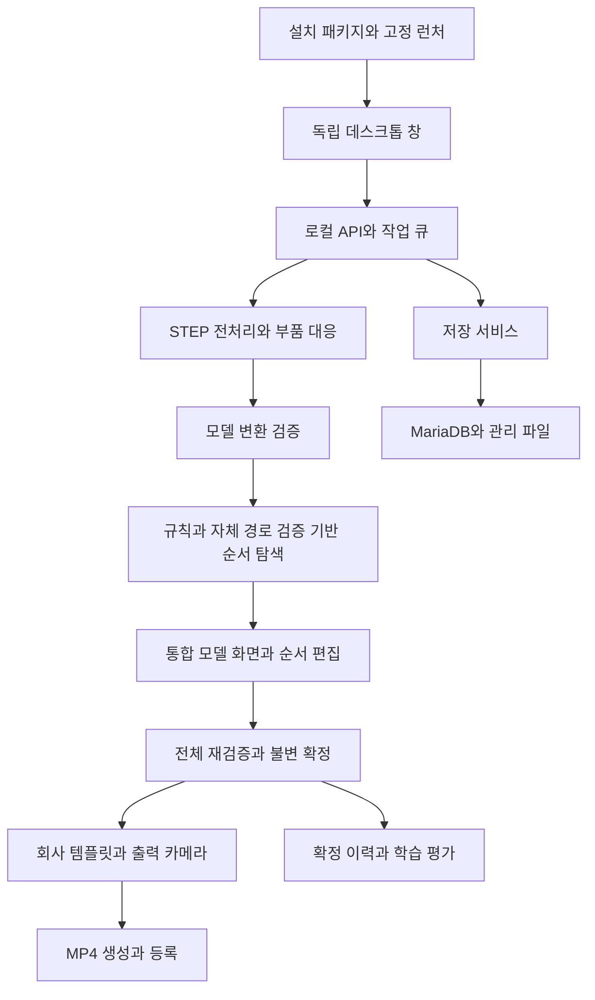

# PILOT HVJB·PRA 동적 공법서 구현설계 v0.6

- 문서 ID: PILOT-DESIGN-001
- 개정일: 2026-10-14
- 대상: 기존 인터페이스와 기능 구조를 개선하여 재제작하는 Windows 설치형 프로그램
- 구현 기준: 이 문서의 기능 범위·화면·데이터·명령·설치·시험 계약
- 입력 범위: 완제품 STEP 필수, 부품 STEP 선택. 차종·품목·품번으로 제품을 식별
- 대응 프로그램: PILOT Studio 2.0.5 / API 2 / 저장 스키마 1
- 상태: 실제 STEP 반복 시험에서 확인한 실패 원인과 수정 계약을 반영한 구현 기준. 시험 결과는 별도 증적에 기록하며 회사 인수를 대신하지 않는다.

## 0. 재제작 적용 원칙과 기존 기능 수정

이 버전은 기존 구현설계의 기능 범위를 축소·재구성한 적용 기준이다. 이전판의 모든 기능과 시험을 그대로 구현해야 하는 것이 아니다. 유지·변경 대상은 이 문서의 현행 계약을 적용하고, 폐기 대상은 화면·명령·데이터 입력·작업 큐·런타임·출시 시험에서 함께 제외한다. 과거 사용자 자료와 확정 이력은 보존한다.

### 0.0 현재 실행 패키지와 후속 구현의 구분

이 문서는 구현 기준과 인수 항목을 포함한다. 본문의 설계 목표를 현재 패키지에서 모두 완료한 것으로 해석하지 않는다. 2.0.5의 실제 화면·동작은 다음 범위를 적용하며, 아래 후속 항목은 잔여 구현으로 관리한다.

- 수동 순서 작성은 고정품을 제외한 전체 단위 목록을 위·아래로 재정렬하고 저장·검증하는 방식이다. 자동 생성 성공을 전제로 하지 않는다.
- 공정 화면은 고정품, 방향·거리, 두 단위의 선후 관계, 국소 접촉 정책을 편집한다. 역할·체결 대상 후보·완료 조건·초기 장애물의 상세 전용 편집 화면은 후속 구현이다.
- 카드 드래그는 즉시 재검증한다. 방향·거리·규칙 변경은 현재 검증을 무효화하며 사용자가 재검증을 실행한다. 연속 편집을 모아 자동 예약하는 기능은 후속 구현이다.
- 영상 양식은 배경 이미지 등록·검토·선택과 지정 레이아웃을 지원한다. 임의 필드 배치 편집기와 과거 확정본/양식 개정을 선택하는 재출력 화면은 후속 구현이다. 기존 MP4와 불변 렌더 입력은 보존한다.
- 학습은 전문가가 검토한 후보 쌍과 제품군 분리 평가를 사용한다. 회사 유사도·현장 시험 결과는 별도 등록한다. 동일 조건 휴리스틱/ML 전체 계획의 자동 비교 보고서와 회사 평가 요청 패키지 생성은 후속 구현이다.
- 구형 세대 DB의 자동 변환, 별도 신규 PC 인수와 실제 작업자 필드테스트는 이번 개발 PC 검증으로 완료 처리하지 않는다.

### 0.1 유지할 기능

- 차종·품목·품번·프로젝트·STEP 연결, 위치별 부품 선택, 원본/개정 관리
- STEP/XDE 구조·배치·좌표 추출, 부품 매칭, 사전 조립 단위·반복 부품 관리
- 제품별 공정 규칙, 자체 간섭 검사, 순서 수정·재검증·확정
- 토크·주의사항·작업 정보, 시퀀스 재생, 불변 확정본 MP4 출력
- 이력·후속 순위 학습, 로컬 처리, 작업 취소·복구, 백업·복원
- 독립 앱 창, 설치 실행 패키지, 업데이트와 사용자 데이터 보존

### 0.2 변경할 기능

- 모델 대응·시퀀스·편집은 하나의 작업 화면으로 통합하고 검증 결과는 해당 단계에 연결한다.
- 생성/비교 중심의 여러 전략 화면은 단일 추천 흐름으로 줄인다. 후속 ML 비교는 이력·학습 영역의 비공개 평가로 이동한다.
- 모델 변환 검증과 조립성 검증을 분리하고, 자동 생성과 사용자 수정에 동일한 자체 검증기를 연결한다.
- 이동은 최종 자세를 유지한 직선 진입 방향·거리로 한정한다. 순위와 경로 후보를 결합한 제한된 탐색으로 효율적인 통과 순서를 찾는다.
- 기본 DB는 로컬 MariaDB와 관리 파일 저장소로 연결한다. 프로그램 설치 자원과 사용자 데이터를 분리한다.
- 영상은 회사 템플릿·토크·주의사항과 단계별 출력 카메라를 적용한다.
- 설치 버전과 실제 실행 빌드의 일치를 확인하고, 릴리스·캐시·스키마 업데이트를 연결한다.

### 0.3 없앨 기능과 인터페이스

- 기존 외부 탐색 엔진·동결 사전학습 전략·물리 런타임·엔진 전용 중간 변환과 준비 화면
- 공구 형상·소켓 모델·접근/회수 검사, 미래 공구 가려짐의 자동 선후관계 추론
- 질량·마찰·중력·지지 자원 기반 안정성 계산과 제품 자동 재배향
- 임의 회전·경유점 경로 편집, 전체 제품 뒤집기·지그 교체 자동 탐색
- 독립된 유사 제품 검색·과거 계획 자동 복사 기능
- Web 패키지 생성·서버 게시·공유 URL 관리. 확정 MP4 파일 출력과 열기만 제공
- ‘프로젝트 기준’, ‘메타데이터 가져오기’, ‘부품 대응 확정’, ‘출처’, ‘작업유형’ 화면 항목

공구 종류·체결 단계·검사 작업은 등록된 작업 정보와 규칙으로 남긴다. 위 기능을 제외해도 토크·주의사항·체결 선후관계를 삭제하지 않는다. 과거 검증/영상 자료는 보관할 수 있지만 현행 통과나 학습 적격 상태를 자동 승계하지 않는다.

### 0.4 기존 화면을 수정하는 기준

- **UI-01 프로젝트:** 품목/파일 연결과 열기·최근 상태 유지. ‘프로젝트 기준’ 삭제. 개요 확장은 후순위.
- **UI-02 모델·부품 대응:** 시퀀스 카드·편집·시뮬레이션을 통합. 대응은 자동 저장과 검토 상태로 관리하며 확정 버튼은 삭제.
- **UI-03 공정·규칙:** 역할·체결 대상·선후 관계·토크·주의사항 유지. 물성·공구 접근 모델·복잡한 지지 설정 삭제.
- **UI-04 조립 시퀀스:** 별도 페이지를 없애고 UI-02에 통합. 다중 전략 비교와 출처 열 삭제.
- **UI-05 분석:** 독립 분석 페이지를 축소해 UI-02의 모델 변환 결과/조립성 결과 패널로 연결. 상세 로그는 별도 패널.
- **UI-06 영상:** 회사 템플릿과 출력 카메라 중심으로 변경. Web 게시 영역 삭제.
- **UI-07 이력·학습:** 확정·편집 이력, 회사 평가·필드테스트·ML 학습/적용 관리 유지. 사전학습 엔진 가중치 관리 삭제.
- **UI-08 설정·운영:** DB·백업/복원·업데이트·실제 build ID·필수 런타임·작업 복구 유지. 외부 엔진 환경/게시 권한 설정 삭제.

### 0.4.1 큰 화면 틀의 유지

기존의 짙은 사이드바·상단 제목/프로젝트 선택·밝은 작업 패널·청록색 선택 강조를 유지한다. 통합 작업 화면은 왼쪽 부품 목록, 중앙 3D, 오른쪽 작업 정보, 하단 시뮬레이션의 위치를 유지한다. 신규 대시보드로 재배치하지 않는다.

메뉴는 프로젝트, 모델·조립순서, 공정·조립 규칙, 영상 출력, 이력·학습, 저장소·환경의 6개로 정리한다. 고급 접촉 정책·표현 검토·학습 평가·복원은 해당 화면의 접이식 상세 영역에 둔다. 일상 작업의 첫 화면에 검사 알고리즘과 저장 내부 구조를 노출하지 않는다.

### 0.5 구현 연결 원칙

기존 UI 컴포넌트·원본 ID·작업/개정·타임라인 계약은 현행 기능에 맞는 부분만 재사용한다. 파일 이름만 바꾸거나 폐기 기능의 서비스 전체를 계속 import하는 방식은 허용하지 않는다. 유지 기능의 입출력을 독립 계약으로 옮기고 호출·설정·캐시·라우트·패키징 의존성을 함께 정리한다.

기존 데이터는 백업 후 복사본에서 변환을 검증한다. 과거 엔진의 입력/경로 자료를 새 검사기의 PASS로 바꾸지 않는다. 현재 스키마로 재현할 수 없는 자료는 원본 이력으로 보관하고, 새 초안에서 현행 모델·규칙·조립성 검증을 실행한다. 과거 자료만을 읽기 위한 신규 전략·런타임은 기본 설치에 추가하지 않는다.

### 0.6 실행 아키텍처

기존 기술 기준인 Electron 독립 창, React·TypeScript·Three.js 화면, Python/FastAPI 백엔드를 사용한다. 네이티브 CAD·검증·렌더·학습은 별도 작업자로 실행한다. Python 작업자는 검증된 onedir 패키지로 묶고 설치기는 Inno Setup의 실행형 패키지로 제공한다. 해당 조합의 지원 버전·재배포 조건은 릴리스 lock/manifest로 고정한다.



Desktop main은 단일 인스턴스·파일 선택·백엔드 시작·작업자 수명·종료를 담당한다. preload에는 검증된 구조화 명령만 노출한다. renderer는 Node 직접 접근을 끄고 context isolation과 sandbox를 사용한다. 세션 토큰·sender 검증을 적용해 다른 로컬 프로세스나 임의 URL이 명령을 실행하지 못하게 한다.

프런트에는 파일 선택으로 발급한 token과 file ID를 전달한다. 임의 경로·SQL·셸 명령을 전달하는 UI는 없다. 서버는 루프백의 가용 포트를 쓰고 현재 런처의 PID·세션·build ID를 확인한다. 기본 브라우저나 CMD 실행을 사용자 절차로 요구하지 않는다.

렌더는 동일 장면 평가 함수를 사용하는 번들 Chromium/Playwright와 FFmpeg로 구현한다. 앱 창의 자유 카메라와 렌더 전용 카메라를 분리한다. 공유 출력은 확정 MP4 파일이며 서버 게시 서비스는 설치하지 않는다.

## 1. 목적·범위·포함 기능·제외 기능

완제품과 부품 STEP을 대응시켜 원본 배치와 조립최소단위를 구성한다. 변환 품질을 확인한 모델에 공정 규칙과 간섭 검사를 적용하여 효율적인 조립순서를 추천한다. 사용자가 순서를 수정하면 해당 순서의 조립성을 다시 확인하고, 통과한 순서를 확정한다. 확정본으로 회사 영상 템플릿을 적용한 작업 안내 영상을 생성하며, 수정·확정·평가 이력을 축적해 후속 순위 모델을 학습한다.

### 1.1 포함 기능

- 차종·품목·품번과 STEP 파일을 연결한 프로젝트 관리
- STEP 원본 보존, 읽기·변환 진단, 제한된 표현 보정과 캐시
- 완제품/부품 매칭, 반복 배치 식별, 조립 단위 구성과 수정
- 모델 변환 품질 검증과 분석용 형상 준비
- 공정 규칙, 고정 조립품, 진입 방향·거리 설정
- 간섭 없는 경로를 검사하면서 순서와 방향의 효율적인 조합 탐색
- 모델·시퀀스 통합 화면, 순서 드래그 편집, 조립 시뮬레이션
- 편집 후 재검증, 통과한 현행 개정의 순서 확정
- 회사 템플릿·토크·주의사항·카메라를 연결한 MP4 출력
- 로컬 MariaDB와 관리 파일 저장소, 개정·로그·백업·복구
- 휴리스틱 운영, 확정 이력 수집, ML 순위 학습·비공개 비교·전환
- 회사 기준 유사도 평가와 현장 필드테스트
- 개발환경 없는 PC의 설치·실행, 버전 업데이트와 장애 복구

### 1.2 제외 기능

- 공구 접근성의 기하 검사
- 로봇·생산장비 제어와 실제 체결 실행
- 토크·체결력·나사산·압입·가스켓·하네스 변형의 물리 시뮬레이션
- 임의 회전/곡선 경로, 제품 뒤집기, 지그 재배치의 자동 탐색
- 제조 공차 전수 분석과 실제 작업 전체의 자동 인증
- 실시간 다중 사용자 공동 편집과 외부 클라우드의 필수 사용
- Web 패키지·서버 게시·공유 URL, 독립 유사 제품 검색·과거 계획 자동 복사

공구 종류와 체결 단계는 작업 정보·공정 규칙·비용·영상에 사용할 수 있다. 공구 접근성은 조립성 통과 조건에 포함하지 않는다.

### 1.3 세 가지 검증 결과의 구분

- **모델 변환 검증:** STEP의 구성원·단위·좌표·형상이 올바르게 추출되고 표시/매칭/간섭 검사에 사용할 수 있는가?
- **조립성 검증:** 등록된 강체·고정 조건·진입 경로·접촉 정책의 범위에서 이미 설치된 부품과 금지 간섭이 없는가?
- **순서 효율 평가:** 통과한 후보 중 등록된 비용 기준과 탐색 예산에서 어떤 조합이 더 효율적인가?

하나의 `완료` 상태로 이 결과들을 대신하지 않는다. 탐색으로 얻은 추천은 기본적으로 지원 범위와 예산 안에서 찾은 최선 후보다. 유한 후보 공간의 전수 탐색 또는 적절한 최적성 증명을 마친 경우에만 해당 공간에서 최적임을 표시한다.

## 2. 전체 업무 흐름과 단계별 진행 조건

```text
차종·품목·품번 등록 + STEP 파일 등록
→ 완제품과 각 부품 매칭 + 조립 단위 구성
→ 모델 변환 품질 검증
→ 공정 규칙·고정 조립품·진입 조건 적용
→ 조립성을 검사하면서 효율적인 조립순서 생성
→ 사용자 순서 확인 또는 드래그 수정
→ 수정된 현행 개정의 전체 조립성 재검증
→ 통과한 순서 확정
→ 회사 영상 템플릿·토크·주의사항·카메라 적용
→ 최종 영상 생성·등록
→ 적격 확정 이력 축적·유사도 평가·ML 재학습
```

### 2.1 등록·매칭·모델 검증의 연결

STEP 읽기 직후에는 매칭에 필요한 최소한의 인벤토리·단위·배치 진단을 수행한다. 사용자가 보는 별도 모델 검증 단계에서는 매칭된 단위 전체의 변환 품질과 분석용 표현을 종합 확인한다. 순서상 모델 검증 화면이 매칭 뒤에 있어도 불량 데이터를 확인 없이 매칭에 사용하지 않는다.

- 완제품 STEP은 필수, 개별 부품 STEP은 선택 입력이다. 이번 버전의 자동 등록 대상은 STEP이며 별도 BOM 파일 파서는 포함하지 않는다.
- 완제품만 등록하면 CAD 말단 배치를 단위 후보로 제공하고 수동 구성도 지원한다.
- 부품 STEP을 등록하면 단일/복합/반복 배치 대응 후보를 만든다. 일부 부품 파일만 있어도 나머지 단위를 검토·구성할 수 있다.
- 현재 분석 범위에서 구성원 누락·중복·배치 오류가 없고, 미확정 매칭이 해결되면 모델 검증을 진행한다.
- 모델의 전체 분석 준비가 확인돼야 자동 순서 생성과 공식 검증을 수행한다. 준비가 불완전하면 원본 확인·매칭 수정·검토용 초안 저장은 허용한다.

### 2.2 계획·확정·영상의 연결

- 자동 생성에는 후보별 간섭 검사를 포함하고, 선택한 완성 순서는 마지막에 전체 재검증한다.
- 사용자가 순서를 바꾸지 않았다면 최신 통과 결과를 사용해 확정할 수 있다.
- 순서·진입 조건·고정품·규칙·형상이 바뀌면 확정 가능 상태를 해제한다.
- 수정 후 검증 통과, 규칙 준수, 필수 작업 정보 충족을 확인한 현행 계획만 확정한다.
- 영상은 확정 계획을 불변 입력으로 선택한다. 영상 생성 실패가 순서 확정을 취소하지 않고, 새 편집 초안도 기존 확정본을 변경하지 않는다.
- 학습 로그는 전 단계에서 수집한다. 학습 적격 판정은 확정·최신 검증·데이터 일관성을 기준으로 별도로 수행한다.

### 2.3 주요 상태

```text
입력: 등록중 / 읽기완료 / 일부누락 / 실패
매칭: 진행중 / 대응완료 / 검토필요 / 탐색제한
모델: 검증대기 / 검증중 / 분석준비완료 / 제한 / 실패
추천: 대기 / 탐색중 / 검증된추천 / 예산도달 / 미발견 / 실패
계획: 초안 / 변경됨 / 재검증중 / 확정가능 / 확정본
조립성: 미실행 / 진행중 / 범위내통과 / 간섭 / 미판정 / 미지원
영상: 설정중 / 렌더중 / 인코딩중 / 등록중 / 완료 / 실패 / 취소
학습: 수집중 / 학습대기 / 학습중 / 비공개평가 / 적용 / 복귀
```

각 상태는 해당 입력·단위·규칙·계획 개정과 연결한다. 저장 성공, 작업 종료, 파일 생성, 검사 통과, 순서 확정을 혼용하지 않는다.

## 3. 화면과 조작 기능

### 3.1 프로젝트·품목 정보

- 차종, 품목, 완제품 품번, 제품명, 프로젝트명을 등록하고 해당 STEP·입력 개정과 연결한다.
- 품번은 문자열로 저장해 앞자리 0을 보존한다. 하나의 품목을 여러 차종과 연결할 수 있다.
- 프로젝트 목록에서 최근 수정, 입력 준비, 확정 계획, 최신 영상 상태를 확인한다.
- 현재 작업에 필요한 품목 정보가 먼저 보이도록 하고 개요 화면의 추가 대시보드 개선은 후순위로 둔다.
- ‘프로젝트 기준’ 항목은 제공하지 않는다. 고정 조립품 설정은 모델·순서 작업의 독립 설정으로 둔다.

### 3.2 통합 모델·부품 대응·조립 시퀀스 화면

- 왼쪽은 파일·조립 트리·부품 목록, 중앙은 3D 모델, 오른쪽은 선택 단계의 작업 정보와 설정으로 구성한다.
- 3D 아래에는 순서 카드와 조립 시뮬레이션 제어를 배치한다.
- 모델 선택, 목록 선택, 카드 선택을 ID 기준으로 양방향 동기화한다. 동일 볼트도 배치별로 선택한다.
- 선택 대상은 높은 대비의 외곽선, 강조색, 배치 라벨을 함께 사용한다. 배경색이나 선택 대상 재질에 묻히지 않도록 확인한다.
- 다중 선택, 선택 대상 중심 보기, 격리, 특정 조립품 숨김, 전체 표시 복원을 제공한다.
- 화면에서 숨긴 이미 설치된 부품은 간섭 검사에서 계속 장애물이다. 화면 가시성과 분석 대상 범위를 같은 필드로 처리하지 않는다.
- 품명 기본값은 대응된 부품 파일명의 확장자를 제외한 이름이다. 해당 파일이 없는 배치는 CAD 이름을 보조 기본값으로 사용하고 사용자가 수정할 수 있다.
- 원래 파일명과 표시명은 분리 저장한다. 표시명 변경으로 ID·매칭을 다시 만들지 않는다.
- ‘메타데이터 가져오기’, ‘부품 대응 확정’, ‘출처’ 항목은 화면에 제공하지 않는다.
- 매칭·묶기·해제·재배정 결과는 자동 저장한다. 별도 확정 버튼 없이도 대응 완전성·중복·검토 상태를 내부에서 확인하고 문제가 있으면 해당 항목에 수정 안내를 제공한다.
- 공정 규칙과 검증에 필요한 내부 작업 분류는 유지하되 ‘작업유형’ 입력·표시 항목은 제공하지 않는다.
- 체결 주의사항, 단계 상태, 작업 정보, 체크 칸을 유지한다. 체크는 사용자의 정보 검토 표시이며 조립성 통과를 대신하지 않는다.

### 3.3 고정 조립품

- 하우징 역할, 크기, 조립 계층, 다른 부품과의 상대 배치 정보를 이용해 고정 후보를 제안한다.
- 자동 후보는 근거를 표시하고 사용자가 고정·해제·대상 변경을 할 수 있다.
- 고정 조립품의 ID·자세·개정과 계획 시작 시 설치 여부를 저장한다.
- 고정은 검증 중 움직이지 않는 조건이다. 지지 안정성이나 실제 지그 고정 능력을 계산한 결과로 표시하지 않는다.
- 초기 정책은 검토된 기준 하우징을 시작 상태의 고정 단위로 둔다. 추가 고정 단위의 시작 설치 여부는 사용자가 설정하고 작업 커버리지에 명시한다.
- 고정 조건을 바꾸면 추천·조립성 검증의 최신성을 무효화한다.

### 3.4 순서 카드

- 번호가 표시된 세로형 직사각형 카드를 가로 한 줄로 배치한다.
- 모든 카드의 비율을 동일하게 유지하고 번호·품명·상태를 읽을 수 있는 최소 너비를 둔다.
- 단계 수가 늘어나도 카드를 최소 너비 아래로 줄이거나 여러 줄로 자동 재배치하지 않는다.
- 화면 폭을 넘으면 가로 스크롤로 다음 구간을 확인한다. 선택 카드로 자동 이동할 수 있다.
- 선택 단계, 재검증 대기, 간섭 단계, 통과 단계를 구분한다. 색에 더해 상태 문구·아이콘을 사용한다.
- 드래그앤드롭으로 순서를 변경하고 번호를 새 순서에 맞게 갱신한다. 긴 구간은 드래그 가장자리 자동 스크롤과 단계 번호 이동을 지원한다.
- 정확한 가로:세로 비율, 최소 너비, 간격은 화면 설정값으로 관리하며 별도 확정한다. 확정되지 않은 값을 회사 지정 규격으로 표기하지 않는다.

### 3.5 현재 상태와 로그의 분리

- 현재 작업 패널에는 작업 ID, 대상 개정, 현재 단계, 진행률 또는 처리 수, 취소 상태, 다음 행동을 표시한다.
- 상세 로그는 별도 접이식 패널에서 시각·대상·코드·원문·진단 ID로 조회한다.
- 진행률을 계산할 수 없는 작업에는 처리 중·현재 대상·경과 시간을 표시하고 가짜 백분율을 만들지 않는다.
- 화면을 이동해도 작업이 유지되고 완료/실패 결과는 해당 작업과 개정에 연결된다.

### 3.6 조립 시뮬레이션과 검증 결과

- 하단 제어는 재생·일시정지·이전/다음 단계·특정 단계·시간 이동·속도 조절을 제공한다.
- 검증된 단계는 저장된 실제 경로를 재생한다. 미판정 단계의 임의 직선을 검증된 경로로 표시하지 않는다.
- 충돌 결과를 선택하면 이동 부품과 상대 부품, 문제 구간을 강조한다. 필요한 경우 문제 직전/시점/직후로 이동한다.
- 경로가 없는 실패는 정적 장면과 사유를 보여준다. 중간으로 바로 이동해도 당시 설치 상태가 정확해야 한다.

## 4. STEP 전처리와 변환 오류 해결

### 4.1 OCCT 실행 환경과 API 호환성

OCCT 파이썬 바인딩의 버전별 API 차이를 처리하고, 실행 환경 문제와 입력 파일 문제를 구분한다.

1. 검증한 OCP 버전을 고정하고 실행 시 버전을 기록한다.
2. Face/Edge/Solid 변환, LabelSequence, bbox 접근은 전처리 모듈의 호환 함수로 통일한다. 런타임 사전 시험은 패키지에 포함한 동일 OCP로 실행한다.
3. 실행 전 작은 기준 형상의 읽기·좌표·특징 추출을 확인한다. 실제 3D 뷰어에 쓰는 표시 삼각형도 생성해 확인한다.
4. 지원하지 않는 바인딩이면 `OCCT_API_INCOMPATIBLE`로 알린다. 이를 사용자 STEP 불량으로 표시하지 않는다.

### 4.2 변환 경고의 취급

- `Poor result from projection vertex / curve 3d`: 곡선과 끝점 대응의 품질 경고. 영향받은 엔티티, 특징·표면 생성 결과와 연결한다.
- `Edges were intersecting, corrected`: 경계 모서리 교차의 보정 기록. 부품 간 충돌 판정으로 해석하지 않는다.
- `Surface forced to be periodic`: 표면 표현 보정 기록. 보정 후 결과를 확인하며 자동 실패로 처리하지 않는다.
- `Entity not mapped to TopoDS`, 곡선 변환 예외: 실체 형상 누락인지 보조 곡선/점의 손실인지 조사한다. 보조 기하라면 물리 조립 단위와 분리 보존한다.
- 좌표 배치 보정 경고: 누적 변환과 최종 치수를 확인한다. 보정됐다는 문구만으로 잘못 배치됐다고 단정하지 않는다.

각 기록은 파일 ID, STEP 엔티티 번호, 경고/실패 구분, 원문, 수량, 연결 가능한 정의·배치 ID를 가진다. 연결하지 못한 메시지는 파일 수준 기록으로 남기고 연결이 완료된 것처럼 표시하지 않는다.

### 4.3 배치 유효성 실패의 해결 절차

형상 검사는 데이터 품질 확인용이다. 부품끼리 조립되는지를 판단하지 않는다.

1. 로컬 정의와 배치 적용 형상의 검사 결과를 따로 보존한다.
2. 이름·ID·배치·계층 추출 성공 여부와 형상 표현 실패를 분리한다.
3. 보정은 원본의 깊은 복사본에서만 실행한다. 특징용 보정본과 원본 참조를 함께 저장한다.
4. 첫 후보는 동일 파라미터/범위 플래그, 면 위 곡선 표현, 국소 허용오차 메타데이터를 다루는 제한된 보정이다.
5. 국소 허용오차 변경에는 해당 모서리/인접 요소의 기존 허용오차 또는 직접 측정한 잔차에 근거한 상한을 적용한다. 무관한 부품의 최대 허용오차를 전역으로 적용하지 않는다.
6. 점·3D 곡선·3D 지지면·트림 범위·배치, 솔리드·면·경계 수, 구성원 추적을 비교한다. 보정 후보가 원래 재료 영역이나 위치를 바꾸면 채택하지 않는다.
7. bbox·면적 변화, 유효 형상의 체적 변화도 보조 지표로 기록한다. 불량 원본에서 계산한 체적은 미검증 비교값일 뿐 신뢰 특징으로 쓰지 않는다.
8. 일반 검사 통과와 exact-method 결과를 구분한다. 두 검사 결과가 불일치하면 결과와 이용 가능한 특징을 함께 기록하고, 완전한 형상 인증으로 표기하지 않는다.
9. 개선되지 않거나 보존을 입증하지 못한 후보는 폐기하고 원본 상태를 유지한다. `FEATURE_UNAVAILABLE`/`MATCH_REVIEW_REQUIRED` 등의 기능 상태로 낮춘다.

솔리드 수가 같다는 것만으로 인덱스가 보존됐다고 가정하지 않는다. 보정본에서 순서가 바뀌면 원본→보정본 구성원 대응을 확인해야 한다. 대응을 확인하지 못하면 원본 솔리드 인덱스 기반 매칭에 보정본을 사용하지 않는다.

입력별로 보정 결과와 보존 조건을 확인한 경우에만 후보를 채택한다. 무제한 ShapeFix, 면 삭제, 자동 구멍 메우기, 임의 좌표 이동·전체 축소는 적용하지 않는다.

### 4.3.1 배치 보정 채택과 표시·분석 계약

깊은 복사본에서 SameParameter와 제한된 모서리/정점 허용오차를 보정한다. 형상·곡선·트림·위치·토폴로지 보존 증적과 허용오차 상한을 기록하고, BREP 저장 후 다시 읽어 일반 유효성을 재검사한다. 저장 전 성공만으로 완료시키지 않는다.

일반 검사에 통과했지만 exact-method 결과가 다른 배치는 `LIMITED`와 해당 ID 목록을 유지한다. 검토자는 `standard_occt_preserved` 정책의 지원 범위, 보정 증적, 검사 차이를 검토하고 이름·근거·대상 ID·정확한 모델 지문을 기록해야 한다. 단순 표시 확인으로 대체하지 않는다. 새 STEP 등록 시 이 검토는 자동 삭제한다. 표현 검토는 조립 경로 통과나 실제 끼워맞춤 승인이 아니다.

### 4.4 복구 실패 시의 운영

- 원본 읽기가 실패하거나 필수 실체 배치가 누락되면 추천 실행을 막고 재내보내기·입력 교체를 안내한다.
- 배치와 작업 대상이 완전하고 역할·단위가 확정됐으나 일부 체적/표면 특징이 실패하면, 그 특징을 제외한 매칭과 검토용 순서 초안을 허용한다. 자동 검증·확정에는 별도로 신뢰할 수 있는 분석 표현이 필요하다. 제외한 특징과 근거를 표시한다.
- 자동 표면 매칭에 실패하면 수동 대응이나 확인된 메타데이터 대응으로 진행할 수 있다. 실패 후보를 자동 일치로 바꾸지 않는다.
- 사용자가 일부 범위만 작업하려면 `selected_scope`를 명시하고 해당 범위의 완성 순서임을 표시한다. 누락된 전체 제품을 완성한 것으로 표현하지 않는다. 범위 밖이지만 실제로 이미 설치된 부품·치구는 초기 환경 장애물로 별도 등록한다. 계획에서 제외됐다는 이유만으로 현장에 없다고 가정하지 않는다.
- 대체 CAD 도구로 다시 내보낸 파일은 새 입력 개정으로 등록한다. 기존 파일·해시·진단 기록은 보존한다.

### 4.5 좌표·구성원·캐시

- 원본은 불변 사본으로 등록하고 파일 해시·역할·입력 개정을 저장한다.
- 길이는 mm로 통일하고 원래 단위를 남긴다. 내부 좌표계와 표시 좌표계 변환을 명시한다.
- 로컬 정의, 부모 변환, 실제 배치 변환을 분리해 누적한다. world 좌표에 배치를 다시 적용하지 않는다.
- 정의와 배치를 별도로 저장해 반복 부품 형상을 재사용하되 위치별 ID는 유지한다.
- API 호환성, 원본 읽기, 변환, 형상 품질, 표시, 분석 준비 실패를 구분한다.
- 캐시 키에 원본 해시, OCCT/OCP 버전, 전처리·보정·표현 정책 버전, 좌표/단위 설정, 정밀도를 포함한다.
- 부분/실패 파일을 정상 캐시로 게시하지 않는다. 네이티브 작업은 별도 프로세스로 감독하며 시간 초과·취소를 구분한다.

## 5. 부품 매칭과 조립최소단위

### 5.1 종류·배치·단위

- 부품 정의는 형상의 종류다. 같은 정의가 여러 곳에 설치될 수 있다.
- 배치는 완제품 내 위치 하나다. 같은 볼트도 각각 구분한다.
- 조립 단위는 한 번에 취급하는 배치/솔리드 집합이다. 한 STEP 파일이나 한 솔리드와 항상 같지는 않다.
- 사전 조립품은 공급·공정 기준으로 구성하고 내부 구성원의 원본 ID를 보존한다.
- 선택 범위의 물리 구성원이 정확히 한 단위에 속하도록 검사한다. 보조 곡선·점과 명시적 비설치 참조는 별도 기록한다.

### 5.2 매칭 단계

1. 파일명·품번·CAD 이름·계층으로 후보를 생성한다.
2. 신뢰할 수 있는 크기·표면적·체적·주축·구멍/원통 특징으로 좁힌다. 불량 형상에서 계산한 체적은 정답 근거로 쓰지 않는다.
3. 부품 파일 전체가 단일 배치나 여러 노드 묶음에 대응하는 경우를 함께 탐색한다. 솔리드 수 차이만으로 정답을 제거하지 않는다.
4. 애매한 후보는 표면 정렬과 다중 초기 자세의 ICP로 비교한다. 작은 구멍·홈에도 표본을 배분하고 양방향 거리와 대응률을 확인한다.
5. 후보 간 중복 구성원·누락·확정 수량을 고려해 전체 대응을 선택한다. 대칭·유사 품목의 동률은 사용자에게 수정 가능한 후보로 제공한다.
6. 실제 배치를 기준으로 매칭 정정과 묶기·해제·재배정을 지원한다. 하나의 배치 내부 솔리드를 임의 분할하는 편집은 이번 범위에 넣지 않는다. 조작 결과는 새 단위 개정으로 저장한다.

`matched`, `ambiguous`, `not_matched`, `search_limited`, `data_unusable`을 구분한다. 템플릿별 예산을 배분하고 정의별 특징·표면 계산을 재사용한다. 후보 제한으로 끝난 탐색을 불일치로 단정하지 않는다.

### 5.2.1 반복 부품이 포함된 묶음 매칭

여러 배치로 구성된 부품 STEP의 후보를 무조건 직교 조합으로 열거하지 않는다. 기준 구성원의 후보를 먼저 선택하고 다른 구성원과의 상대 거리·크기·배치 관계를 이용해 조합을 가지치기한다. 반복 너트/볼트의 조합 폭증 때문에 정상 사전 조립품을 미매칭 처리하지 않도록 한다.

공급 단위 전체의 형상과 상대 배치를 함께 확인하고, 이미 다른 단위에 배정된 실제 배치를 중복 소비하지 않는다. 모든 물리 배치가 정확히 하나의 단위에 포함되는지 서버에서 검사한다. 매칭 정확도는 구성원 완전성과 구별한다. 회사의 정답 대응표가 없는 상태에서 수량 일치만으로 정확도 100%를 주장하지 않는다.

### 5.3 자동 저장과 검토

검사한 신뢰 기준을 충족한 대응은 자동 적용할 수 있다. 낮은 신뢰·충돌 후보는 강조하고 수동 수정하도록 한다. 별도의 ‘부품 대응 확정’ 버튼을 만들지 않으며, 다음 단계 진입 조건은 서버에서 대응 완전성·구성원 추적·미해결 검토 여부로 계산한다.

품명은 부품 파일 이름을 기본값으로 사용하고 수정된 표시명을 개정에 보존한다. 원본 파일명·CAD 이름은 내부 추적 정보로 남기지만 순서 목록에 ‘출처’ 열을 만들지 않는다.

## 6. 모델 변환 검증

### 6.1 검사 대상

매칭된 단위의 구성원 커버리지, 형상/표면 누락, 좌표·회전·단위, 치수·bbox, 원본과 보정본의 표현 보존, 표시 형상과 분석 형상의 대응을 확인한다. 반복 배치와 다중 솔리드의 개수·위치를 따로 확인한다.

변환 경고만으로 모델 전체를 실패 처리하지 않는다. 경고 이후의 결과를 검사하여 표시 가능, 매칭 가능, 조립성 검사 가능 상태를 분리한다. 표시 메시가 보인다는 이유만으로 분석 준비를 통과시키지 않는다.

### 6.2 내부 표현과 품질

- 3D 표시와 표면 매칭은 내부 정점·삼각형 배열을 사용한다.
- 간섭 검사에는 원본/검증된 보정 BREP 또는 오차·폐합·내외부 판정이 확인된 분석 표현을 사용한다.
- 표시용 거친 메시가 작은 간극을 보존한다고 가정하지 않는다. 분석 표현에는 근사 오차와 보존된 작은 특징의 범위를 기록한다.
- 여러 솔리드의 점유 영역은 합집합 의미로 처리한다. 겹치는 솔리드를 홀짝 규칙 때문에 빈 공간으로 해석하지 않는다.
- 비볼록 부품 전체를 단일 convex hull로 대체해 구멍과 통로를 막지 않는다.
- 누락된 면, 열린 경계, 자기 교차 의심, 체적 편차, 표시/분석 위치 불일치가 있으면 해당 기능을 제한한다.
- 외부 3D 중간 파일 변환이나 별도 물리 엔진을 필수로 두지 않는다.

### 6.3 결과와 준비 조건

```text
ModelValidation
  model_validation_id, input_revision, mapping_revision, unit_revision
  preprocess_version, geometry_policy_version, dependency_hash
  inventory_status, transform_status, representation_status
  unit_results[{unit_id, display_ready, matching_ready, collision_ready,
                source_valid, repaired_valid, approximation_scope, diagnostics}]
  status: PASS | LIMITED | FAIL | UNKNOWN
```

`PASS`는 현행 검사 범위에서 분석 준비가 확인된 상태다. 미검사·복구 불가 단위를 누락하고 전체 PASS로 표시하지 않는다. 검사기마다 결과가 다르거나 오차 근거가 부족하면 제한/미판정으로 둔다. 형상을 수동으로 확인했다는 체크만으로 불량 분석 표현을 통과시키지 않는다.

## 7. 공정 및 조립 규칙

### 7.1 적용 원칙

한 규칙 서비스가 자동 생성, 사용자 편집, 조립성 재검증, 최종 확정에 동일한 규칙 개정을 적용한다. 점수가 높아도 필수 규칙을 우회할 수 없다.

공정 규칙은 조립 단위의 선후 관계, 선장착 조건, 사전 조립 단위, 고정품과 초기 설치 상태에 연결한다. 현재 순서 모델은 이동 단위당 한 단계이며 체결 토크와 주의사항은 그 단계 정보로 기록한다. 별도의 가체결·최종 체결·검사 단계를 자동 추가하는 공정 설계는 후속 범위다.

### 7.2 제품별 예시

```text
메인바디 배치/고정 조건
→ 플레이트 배치
→ 필요한 플레이트 체결 단계
→ 릴레이 배치
→ 필요한 릴레이 체결 단계
→ 제품별 후속 조립·검사
```

이 예시를 모든 품종의 보편 순서로 하드코딩하지 않는다. 실제 역할·체결 대상·완료 조건을 연결해 제품별 DAG로 만든다. 선장착 볼트나 릴레이-버스바 체결처럼 예외가 있는 작업은 개별 의존관계로 표현한다.

### 7.3 입력과 오류

- 품명·계층·기하 특징으로 역할과 체결 대상 후보를 만든다. 사용자 수정과 근거를 저장한다.
- 없는 선행 작업, 순환 의존관계, 중복 작업, 잘못된 대상, 단계 역전의 모순을 실행 전에 확인한다.
- 단계 우선순위는 권장 점수와 필수 제약을 구분한다. 미확정 필수 관계는 검토 필요로 둔다.
- ‘작업유형’ UI를 제공하지 않아도 내부 작업 의미와 상태 변경은 명확히 유지한다.
- 규칙은 입력을 어떻게 조립할지 정하는 정보다. 비교용 회사 전체 순서를 자동 생성의 고정 정답으로 사용하지 않는다.

## 8. 자체 조립성 검증

### 8.1 초기 지원 범위

조립 단위를 강체로 취급하고, 최종 위치·자세가 정해진 상태에서 고정 자세의 직선 이동을 검사한다. 한 번에 한 단위를 이동하고 현재 설치된 단위와 활성 고정 조건을 장애물로 사용한다. 미래 부품은 장애물로 넣지 않는다.

범위 밖의 실제 설치 부품과 정적인 치구는 `initial_obstacle_ids`와 `environment_revision`으로 등록한다. 이 정보는 표시 가시성과 별도로 관리하고 경로·전체 검증의 의존성 해시에 포함한다. 초기 환경이 미확인된 부분 범위의 검증을 전체 제품의 무간섭 결과로 표시하지 않는다.

공구 접근성·탄성 변형·실제 지지 안정성은 검사 범위 밖이다. 여섯 직선 방향에서 경로를 찾지 못했다는 결과를 실제 조립 불가능의 증명으로 표시하지 않는다.

### 8.2 진입 방향·거리

사용자 화면의 `진입 방향`은 시작점에서 최종 위치로 이동하는 방향으로 정의한다. `진입 거리`는 같은 좌표계의 mm 거리다.

```text
d_entry = 정규화한 진입 방향
L = 진입 거리(mm)
시작 위치 = 최종 위치 - d_entry × L
종료 위치 = 최종 위치
검사 경로 p(t) = 시작 위치 + d_entry × L × t, 0 ≤ t ≤ 1
```

현재 입력 가능한 방향은 ±X·±Y·±Z의 여섯 축이다. 단위별 방향과 거리 지정은 공통 좌표계의 같은 계약을 따른다. 임의 회전/곡선 경로는 지원하지 않는다. 최종 자세는 유지한다. 시작 위치가 이미 장애물 안이거나 외부 진입 위치가 확인되지 않으면 통과시키지 않는다.

진입 거리는 자동 후보를 제안하고 사용자가 수정할 수 있다. 거리 변경은 실제 경로 변경이므로 재검증한다. 바깥 방향을 내부 계산에 사용하는 경우 `d_outward = -d_entry`를 명시적으로 변환한다.

### 8.3 검사 절차

1. 이동 전체의 swept bbox로 가까운 부품 쌍만 추린다. bbox 겹침 자체는 충돌 판정이 아니다.
2. 입력 표현의 준비 상태와 현재 설치/고정 상태를 확인한다.
3. 지원된 분석 표현으로 시작점·이동 구간·최종 안착을 검사한다. 표면 충돌과 솔리드 내부 포함을 함께 다뤄 완전 포함을 놓치지 않는다.
4. 연속 충돌 검사 또는 검증된 거리·근사 오차로 안전한 이동 간격을 계산하는 보수적 적응형 검사를 사용한다.
5. 고정 자세 평행이동에서 현재 검증된 간격과 이동량의 관계로 다음 구간을 판정할 수 있을 때만 안전 구간으로 건너뛴다. 단순한 고정 표본 간격만으로 전체 무간섭을 주장하지 않는다.
6. 거의 접촉·수치 경계·복잡한 작은 특징은 세분화하거나 BREP으로 정밀 확인한다. 오차 한계나 접촉 정책을 확인하지 못하면 UNKNOWN이다.
7. 실제 검출 쌍, 이동 구간, 검사 범위·정밀도·오차, 경로 파일을 저장한다.

비싼 네이티브 연산은 별도 프로세스에서 실제 시간 제한을 적용한다. 경고·연산 실패·시간 초과를 통과로 바꾸지 않는다. 공간적으로 관련 없는 단위의 불량 때문에 모든 쌍을 일괄 실패 처리하지 않되, 최종 계획에 필요한 단위의 검증은 생략하지 않는다.

### 8.3.1 현재 정밀 검사 구현

충돌은 표시 메시나 OBJ로 판정하지 않는다. OCCT BREP을 사용한다. 이동 전체 bbox가 떨어져 있으면 분리 증명으로 빠르게 통과시키고, 가까운 쌍은 BooleanCommon으로 교차 체적을 확인한다. 거리 계산은 보수적 구간 증명에 필요한 경우에만 실행한다.

평면 면과 지원되는 단조 원통·원뿔 면의 전체 이동 체적을 직접 구성할 수 있는 경우에는 그 체적과 장애물의 교차를 검사한다. 나머지는 거리 변화의 보수적 상한으로 이동 구간을 증명하며, 증명되지 않은 구간만 세분화한다. 유한 개의 점에서 충돌이 없었다는 이유로 구간 전체를 PASS로 바꾸지 않는다.

네이티브 계산은 종료 가능한 별도 프로세스에서 실행한다. 부품 쌍·후보·전체 작업의 시간 예산을 각각 두고 시간 초과는 UNKNOWN으로 남긴다. 같은 어려운 후보가 모든 계산 시간을 소비하지 않도록 한다.

### 8.4 최종 배치 겹침과 접촉 정책

최종 배치의 겹침은 이동 중 새 간섭과 구분한다. 가스켓 압축·압입·표현 단순화 등 의도된 결합은 공정 담당이 등록한 부품 쌍·결합 영역·적용 단계·허용 기준을 갖는 정책으로만 처리한다.

시작 시 이미 설치된 고정 단위·환경 장애물의 관련 쌍과, 분석 범위의 최종 배치 전체를 별도 정적 겹침 감사로 확인한다. 빠른 공간 선별 후 필요한 정밀 검사와 접촉 정책으로 분류한다. 이동 작업이 없는 초기 고정품끼리의 관통도 누락하지 않는다. 이 감사 결과는 경로 검사와 별도로 저장하고 전체 통과 조건에 포함한다.

- 실제 강체 관통이 남으면 순서 변경만으로 해결됐다고 표시하지 않는다.
- 허용 기준이 없는 겹침과 실패한 계산은 보류/UNKNOWN으로 둔다.
- 초기 겹침이 있는 부품 쌍을 전체 경로에서 검사 제외하지 않는다.
- 교차 체적이 최종 교차 체적보다 작다는 조건만으로 허용하지 않는다. 다른 위치의 새 간섭을 놓칠 수 있다.
- 동일 조립 단위 내부 접촉은 다른 단위와의 경로 간섭과 구분하되 구성원 점유 영역은 보존한다.
- 허용 접촉에 의존한 결과에는 해당 정책과 미검증 물리 조건을 명시한다.

### 8.4.1 국소 결합 정책의 실제 필드

정책에는 `unit_a`, `unit_b`, `region_bbox`(world mm 최소/최대 좌표), `terminal_distance_mm`, `approved_by`, `approval_reference`가 필요하다. 실제 교차 영역을 검토용 초안으로 제안할 수 있지만 자동 승인하지 않는다.

검사에서는 지정한 두 단위에 한해, 최종 안착에 가까운 지정 거리 구간에서만 승인 영역을 장애물에서 제외한다. 구간 이전 또는 승인 영역 밖의 관통은 계속 충돌이다. 단위 쌍 전체를 무시하는 화이트리스트를 만들지 않는다. 입력·단위·규칙 변경 시 정책의 최신성을 다시 확인한다.

### 8.5 결과 계약

```text
GeometryVerdict
  status: PASS | COLLISION | UNKNOWN | UNSUPPORTED
  operation_id, moving_unit_ids, installed_unit_ids, fixed_unit_ids
  path_id, path_hash, direction, distance_mm
  checked_scope, checked_segments, unresolved_segments
  geometry_backend_version, tolerance_policy_version
  contact_policy_revision, approximation_error_scope
  interference_pairs, diagnostics, elapsed_ms
```

전체 계획의 `PASS`는 초기/최종 배치 감사, 모든 필수 이동과 선후 규칙이 현행 개정·조건에서 통과하고 미판정 구간이나 승인되지 않은 간섭이 없는 상태다. 정보 체크·저장 성공·작업 종료로 PASS를 대신하지 않는다.

## 9. 조립성을 고려한 순서 생성과 효율 평가

### 9.1 상태와 후보

상태는 완료 작업, 현재 설치 단위, 계획상 체결 상태, 고정 조건, 직전 방향·작업·공구, 누적 비용, 검증된 경로 참조를 가진다. 같은 완료 작업 집합이어도 직전 작업/방향이 다르면 비용 상태를 구분한다.

의존관계가 만족된 작업만 후보로 추린다. 내부 배치/체결/검사 작업은 해당 논리 상태를 변경한다. 체결 작업의 공구 접근은 자동 물리 검사하지 않으며, 이동을 포함한 작업만 지원 경로를 검사한다.

### 9.2 방향별 방해 관계의 재사용

특정 단위의 특정 경로를 방해하는 다른 단위 집합을 캐시할 수 있다. 현재 설치 집합과 방해 집합이 겹치면 해당 경로는 사용할 수 없다. 고정 단위는 항상 현재 장애물에 포함한다.

방향 후보는 OR 조건이다. 한 방향에서 막는 부품을 모든 방향의 고정 선후 제약으로 합치지 않는다. 미판정 쌍은 빈 방해 집합으로 저장하지 않는다. 접촉 정책·경로·형상·고정 조건에 의존하는 계산은 같은 조건에서만 재사용한다.

### 9.3 초기 순위와 비용

검사 전 후보 우선순위는 공정 역할·단계, 관련 작업 묶음, 공구 변경, 최종 배치 기준점의 인접성, 후속 작업 수로 정한다. 기하 검사를 먼저 하지 않고도 얻을 수 있는 특징만 초기 ranker에 사용한다.

통과한 순서/방향의 비용은 등록된 프로필로 계산한다.

```text
비용 = 진입 경로 총 길이의 정규화 비용
     + 방향 변경 비용
     + 작업 대상 간 공간 전환의 대리 비용
     + 등록된 공구/공정 변경 비용
```

물리적으로 통과한 후보만 비용을 비교한다. 공간 전환의 대리 비용을 실제 작업자 이동 시간으로 표현하지 않는다. 실제 작업 시간·교체 시간을 확보하면 별도 버전의 비용 지표로 추가한다. 가중치·정규화·동률 규칙은 실행 전에 고정한다.

### 9.3.1 초기 릴리스의 비용 범위

현재 휴리스틱은 하우징·판·일반 부품·커넥터·릴레이·버스바·체결품·실·커버 역할과 최종 높이를 초기 우선순위로 사용한다. 탐색 비용은 진입 거리 합계와 진입 방향 변경 비용이다. 커넥터/일반 부품은 가까운 외부 경계에서 들어오는 축을 먼저 시도한다. 실제 작업 시간·공구 교체 시간을 측정한 최적화라고 표시하지 않는다. 공정상 순서가 필요하면 명시적 선후 규칙으로 입력한다.

### 9.4 탐색

우선순위 위상 후보 추출과 간섭 검사기를 결합한 제한된 빔 탐색을 기본으로 한다. 실패한 선행 선택 때문에 이후에 막히면 다른 가지를 유지하거나 되돌아가 조사한다. 단순 위상 정렬의 첫 순서를 그대로 최적 결과로 사용하지 않는다.

```python
def generate(snapshot, ranker, budget):
    check_input_model_rules(snapshot)
    check_initial_and_final_placement_audits(snapshot)
    frontier = [initial_state(snapshot)]
    completion_candidates = []

    while frontier and budget.search.has_remaining():
        next_frontier = []
        for state in frontier:
            if all_operations_complete(state):
                completion_candidates.append(state)
                continue

            candidates = eligible_operations(snapshot, state)
            ranked = ranker.rank(state, candidates,
                                 available_ranking_features(snapshot, state, candidates))
            require_exact_candidate_permutation(ranked, candidates)
            for operation in ranked:
                for action in supported_action_candidates(snapshot, state, operation):
                    budget.search.check_and_consume()
                    verdict = validate_action(snapshot, state, action)
                    record_attempt(state, operation, action, verdict)
                    if verdict.status == "PASS":
                        child = apply_action_copy(state, action, verdict)
                        if all_operations_complete(child):
                            completion_candidates.append(child)
                        else:
                            next_frontier.append(child)
        frontier = retain_best_distinct_states(next_frontier, snapshot.search_policy)

    completed = []
    for candidate in sorted_by_registered_cost(completion_candidates):
        budget.final_validation.check_and_consume()
        report = validate_full_plan(snapshot, candidate)
        if report.status == "PASS":
            completed.append((candidate, report))
    return best_verified_plan_or_explained_result(completed, budget)
```

실제 구현에서는 시간 초과·취소를 개별 후보의 실패와 구분해 상위 실행 상태로 전달한다. 상태 복사 또는 명시적인 복원으로 실패한 탐색 가지가 다른 가지의 상태를 오염시키지 않게 한다.

탐색 예산과 최종 전체 검증 예산을 분리해 전체 검증 시간을 확보한다. 마지막 작업 직후 탐색 예산이 끝나도 완성 후보를 잃지 않게 한다. 예산 소진 예외를 처리할 때까지 확보한 후보·통과 결과를 보존하고 종료 이유를 기록한다. 완성 후보 큐는 비용 기준의 설정된 상한으로 관리하며 전체 검증을 마치기 전에는 검증된 추천으로 표시하지 않는다.

추천 결과에는 비용·비교 후보 수·지원 방향·예산·최적성 상태를 보존한다. 예산 도달 전에 검증된 완성 후보가 있으면 그 결과와 탐색 제한을 함께 표시할 수 있다. 완성 후보가 없으면 초안/미발견/UNKNOWN으로 반환한다.

검사 횟수·시간·빔 너비·중복 상태 정책은 설정값이다. 시간이 부족한 가지를 물리적으로 불가능하다는 실패 캐시로 저장하지 않는다.

### 9.5 완전한 검토 초안과 통과 추천의 구분

탐색이 전체 PASS 순서를 찾지 못해도 필수 선후 관계와 전체 단위 커버리지를 유지하는 검토 초안을 만든다. 검증된 앞부분과 미검증 나머지를 분리하고, 미검증 단계에는 UNKNOWN과 원인을 표시한다. 확인된 실제 충돌·시간 초과·표현 검토 미완료를 서로 구분한다.

한 상태에서는 모든 유효 후보의 우선 방향을 한 번씩 검사한 뒤 대체 방향을 시도한다. 앞의 몇 개 부품만 반복 검사해 뒤의 쉬운 후보를 영구히 건너뛰지 않는다. 시도한 단위·방향·설치 집합·결과·시간·쌍별 진단을 `attempt_trace`에 저장한다.

“55단계 생성”은 작업 배열 생성의 결과다. 전체 조립성 통과 여부는 별도 결과이며 미검증 초안은 확정하거나 정식 작업 영상으로 출력할 수 없다. 초안 영상은 미검증 표시를 항상 포함한다. 최종 배치 자체의 관통은 순서만 바꿔 해결되지 않는다.

## 10. 순서 편집·재검증·확정

### 10.1 사용자 흐름

품목 정보 확인→규칙 확인→추천 순서 확인/변경→변경 이력이 있으면 조립성 재검증→통과하면 확정의 흐름으로 구성한다.

드래그를 놓으면 즉시 새 초안 개정과 변경 이벤트를 저장하고 번호를 갱신한다. 규칙을 위반하면 관련 선행 작업과 사유를 표시한다. 검토용 초안은 유지할 수 있지만 규칙 위반 상태로 확정할 수 없다.

연속 편집은 짧은 대기 후 최신 개정의 검증을 예약해 불필요한 중복 실행을 줄인다. 검증 중 다시 바뀌면 이전 결과를 이력으로 보존하고 현행 상태에 적용하지 않는다. 실패/중단 시 수동 재검증 버튼을 제공한다.

### 10.2 재검증 정책

첫 구현에서는 순서·경로·고정품·규칙 변경 후 전체 순서를 재검증한다. 이후 부분 재사용은 변경 이전 설치 상태와 모든 의존성 해시가 같은 경우에만 허용하며, 재사용 근거와 영향 구간을 기록한다.

- 순서·진입 방향·거리·배치·단위·모델·고정 조건·규칙·접촉 정책: 조립성 및 확정 가능 상태 무효화
- 품명·토크·주의사항·체크: 작업 정보 완전성·출력 개정 확인. 경로를 바꾸지 않았으면 동일 의존성의 기하 결과 재사용 가능
- 카메라·자막·재생시간: 출력 개정 갱신. 실제 부품 이동을 바꾸지 않으면 기하 결과를 재사용
- 조립 이동의 회전·경유점·제품 자세: 지원 범위 확인과 새 검증 필요

### 10.2.1 프로그램 개정과 기존 PASS

현재 형상·규칙·순서·경로 해시뿐 아니라 검증 빌드와 알고리즘 버전도 확정 조건에 포함한다. 다른 빌드에서 생성한 초안의 PASS는 현행 버전에서 다시 검증한다. 과거 불변 확정본은 당시 결과로 보존하고 새 확정으로 오인하지 않는다. 가져오기/계산 중에는 확정을 제한한다.

영상 생성·다운로드·작업 상태 갱신만으로 현재 순서의 확정을 풀지 않는다. 확정 내용 해시에는 순서·작업 정보·모델·규칙·검증을 포함하고 출력 목록과 운영용 갱신 시각은 제외한다.

### 10.3 확정 조건과 트랜잭션

구성원·작업 누락/중복이 없고, 필수 선후 관계가 충족되고, 초기/최종 배치 감사와 최신 전체 조립성 PASS가 현행 계획 의존성 해시와 일치해야 한다. 승인되지 않은 간섭·미판정이 있으면 확정을 막는다. 토크·주의사항 등 적용 대상 필수 정보는 입력·검토돼 있어야 한다.

순서 배열, 작업 정보, 고정/환경 조건, 규칙, 경로, 검증, 표시명, 좌표·단위·알고리즘 버전을 가진 확정 스냅샷 파일을 사전 생성·검증해 불변 파일로 준비한다. DB 트랜잭션에서 기대 개정·최신 검증·의존성 해시를 다시 확인하고 파일 참조·확정 상태·확정 이력·요청 응답을 함께 커밋한다. DB 커밋에 실패한 파일은 복구 대상으로 남기고 확정본으로 게시하지 않는다. 요청 ID와 확정 사건 고유성으로 재시도에서 확정본·학습 사례가 중복 생성되지 않게 한다.

확정본은 직접 편집하지 않고 새 초안으로 분기한다. 늦게 도착한 이전 검증 PASS가 새 순서를 확정 가능 상태로 바꾸지 못하게 한다.

## 11. 회사 템플릿 영상과 시점

### 11.1 템플릿 등록·선택

회사에서 제공하는 영상 양식의 배경·로고·서체·정보 영역·배치 기준을 등록하고 템플릿 개정을 관리한다. 원본 자료가 PPT·이미지·영상 등일 수 있으므로 자료 형식에 맞춰 필요한 시각 자산을 준비하고 내부 템플릿 설정으로 연결한다.

필드에는 차종·품목·완제품 품번, 단계 번호, 작업명·부품명·품번, 체결 토크·단위, 주의사항, 상태/체크 표시 영역을 연결한다. 회사 지정 필드와 프로그램의 선택 필드를 구분한다.

회사 양식이 아직 제공되지 않으면 필드 매핑과 템플릿 등록 기능을 구현하고 승인된 양식 등록 상태를 표시한다. 개발용 레이아웃을 회사 템플릿으로 간주해 공식 영상으로 출력하지 않는다.

### 11.1.1 제공 영상 양식 적용

제공된 영상에서 왼쪽 CAD 장면, 하단 단계명, 오른쪽 로고·작업 정보·주의사항 영역을 추출한 참고 양식을 기본 검토 후보로 제공한다. 원본 영상에서 추출한 배치를 회사의 최종 승인으로 간주하지 않는다. 별도 PNG/JPG/WebP 배경을 등록하고 양식 개정별 검토 여부를 관리할 수 있다.

영상 화면은 기준 크기의 레이아웃을 출력 해상도에 비례하여 축소/확대한다. 한글 글꼴은 패키지에 포함한다. 긴 텍스트는 영역 안에서 조정하고, 최소 가독 크기로도 수용되지 않으면 내용을 잘라 내보내는 대신 해당 항목을 안내한다.

### 11.2 정보 입력

토크는 값·단위·범위/표현·해당 작업과 연결한다. 비체결 작업은 명시적 해당 없음으로 처리하고 미입력을 0 또는 해당 없음으로 바꾸지 않는다. 토크를 형상이나 ML이 임의 추정하지 않는다.

주의사항은 해당 단계의 전체 내용을 표시한다. 중요한 문장을 말줄임표로 잘라내지 않고 줄바꿈·영역 확장·정보 페이지 또는 해당 단계 시간으로 가독성을 확보한다. 미입력과 검토된 주의사항 없음은 구분한다.

일반 시퀀스 미리보기는 편집·검증 중심으로 제공하고, 최종 출력에는 회사 템플릿과 토크·주의사항을 반드시 적용한다.

### 11.3 조립부를 보기 쉬운 카메라

- 이동 부품과 최종 결합 영역을 중심으로 화면을 맞춘다.
- 현재 구현은 진입 방향에 따른 자동 구도와 단계별 수동 저장 구도를 제공한다. 자동 구도는 이동 부품의 현재 bbox와 최종 bbox를 함께 포함하고 가로/세로 시야각에 맞춰 조정한다. 여러 후보의 가림 정도를 비교하는 자동 카메라 최적화는 후속 범위다.
- 이동 축을 정면으로만 바라봐 이동이 안 보이는 구도를 피하고, 필요한 경우 측면/사선·근접 구도를 사용한다.
- 사용자 단계별 각도·줌·초점·전환을 수정할 수 있으며 출력 카메라로 저장한다.
- 일반 편집 뷰어의 자유 카메라와 출력 카메라를 구분하고 최종 템플릿 구도를 미리 확인한다.
- 카메라 조정은 분석 장애물이나 실제 부품 위치를 바꾸지 않는다. 현재 정식 영상은 장애물을 자동으로 숨기거나 투명화하지 않는다.
- 카메라 이동은 부품 경로를 변경하지 않는다. 모델 전체 자세를 변경한 연출을 검증된 물리 경로와 혼용하지 않는다.

### 11.4 공통 타임라인

불변 확정 계획, 검증 경로, 표시 형상, 템플릿·정보·카메라 개정을 타임라인으로 연결한다. 단계별 시작/끝 시각, 이동 track, 설치 상태, 강조, 카메라, 토크·주의사항을 같은 시각으로 평가한다.

현재 영상은 조립 단위별 이동 단계와 그 단계의 작업 정보로 구성한다. 영상 연출을 위해 미검증 부품 이동을 추가하지 않는다. 마지막 캡처는 타임라인 종료 시각을 평가하여 최종 위치에 완전히 도착한 상태를 포함한다. 회사 템플릿이나 표시명이 나중에 바뀌어도 과거 영상은 당시 확정 정보·템플릿·카메라 개정으로 재현한다.

`evaluateSceneAt(time, timeline)`은 같은 시간에 같은 장면을 만든다. 중간 시점으로 직접 이동해도 과거 설치 상태가 정확해야 한다. 검증 경로를 임의 직선이나 다른 공간 곡선으로 바꾸지 않는다. 같은 공간 경로의 속도만 바꾸는 경우와 경로 자체 변경을 구분한다.

### 11.5 렌더·출력 완료

- 해상도·fps·인코더·템플릿·대상 확정 개정을 렌더 설정으로 저장한다.
- 모델·카메라·한글 폰트·자막이 해당 프레임에 반영됐다는 완료 신호 후 캡처한다. 고정 지연만으로 준비 완료를 가정하지 않는다.
- 렌더링, 인코딩, 결과 검사, DB 등록 상태를 분리한다.
- 최종 MP4의 디코딩·길이·예상 프레임 수와 정보 표시를 확인한 뒤 관리 파일과 DB에 등록한다.
- 실패·취소 파일은 완료 목록에 넣지 않는다. 이전 확정본의 영상을 덮어쓰지 않는다.
- 출력과 영상 재생만을 위해 원본 CAD를 외부로 전송하지 않는다.

## 12. DB와 관리 파일 저장소

### 12.1 저장 구조

로컬 MariaDB에는 기준정보·관계·상태·개정·조회용 메타데이터를 저장한다. STEP·BREP·내부 메시·검증 경로·상세 로그·확정 스냅샷·영상·데이터셋·학습 모델 같은 큰 자료는 앱 관리 파일 저장소에 보관한다.

모든 기능은 공통 저장 서비스로 읽고 쓴다. 화면·추천기·검증기·영상기·학습기가 직접 SQL이나 관리 파일 위치를 변경하지 않는다. 파일은 `file_id`와 저장소 내부 상대 참조로 연결하며 개인 폴더 위치를 데이터 계약에 고정하지 않는다.

### 12.2 실제 저장 스키마

초기 스키마는 `project`, `project_revision`, `change_event`, `job_run`, `confirmation_snapshot`, `file_asset`, `app_setting`, `backup_record`, `schema_migration`, `storage_binding` 테이블로 구성한다. 프로젝트 개정의 JSON 본문에 모델·정의·배치·조립 단위·규칙·계획·검증을 묶어 저장하고 개정별 해시와 동시 수정 번호를 유지한다. 기능마다 많은 테이블을 새로 만들지 않는다.

차종·품목·품번·명칭은 프로젝트 정보로 연결하며 품번은 문자열이다. 파일 교체는 새 입력 개정으로 처리한다. 표시명 변경은 모델 ID와 형상을 바꾸지 않는다.

### 12.3 파일과 개정 관계

원본 STEP, 배치별 BREP, 표시 장면, 보정 증적, 확정 스냅샷, 영상, 학습 모델과 정확한 학습 데이터셋을 해시 기반 불변 관리 파일로 등록한다. 본문 참조는 저장소 내부 상대 참조를 사용한다. 백업 대상 밖의 임시 계산 파일만 가리키는 최종 산출물을 게시하지 않는다.

새 STEP을 읽는 동안에는 새 원본을 현재 모델에 연결하지 않는다. 가져오기 성공 시 원본 파일 목록·모델·입력 개정을 함께 저장한다. 가져오기 실패나 취소 후에는 마지막 정상 모델과 그 원본 연결을 보존한다.

### 12.4 규칙·순서·확정

모든 배치는 조립 단위 하나에 정확히 포함되어야 한다. 서버는 사용자 단위 편집의 bbox를 실제 구성원으로 다시 계산한다. 표시 숨김은 장애물 제외를 의미하지 않는다.

`project_revision`은 당시 모델·규칙·순서·검증 본문을 보존한다. `change_event`는 조작 전후 순서와 조건 해시를 기록한다. `confirmation_snapshot`은 최신 검증과 일치하는 불변 확정 계획이며 동일 원본 해시의 중복 확정을 막는다.

### 12.5 영상·학습·평가

템플릿 개정, 불변 렌더 정의, 학습 설정·후보 모델·명시적 전문가 선호 검토·회사 평가·필드테스트는 `app_setting`의 개별 레코드와 변경 사건으로 저장한다. 영상은 원래 확정 ID, 템플릿 ID/개정, 타임라인 해시, 해상도·fps, 프레임 수, MP4 파일 ID를 가진다.

학습 검토는 불변 확정본을 수정하지 않고 검토 레코드로 연결한다. 데이터셋에는 선택 가능한 후보 집합·선호 라벨·제품군 분할을 정확히 남긴다. 모델 계수와 데이터셋 파일 모두 백업·복원 대상이다.

### 12.6 저장 완료와 동시 수정

파일 저장은 임시 작성→flush·크기/해시·manifest·의존성 확인→불변 위치 게시→짧은 DB 커밋→성공 응답으로 진행한다. 파일 시스템과 DB 전체를 하나의 원자적 트랜잭션이라고 가정하지 않는다.

도메인 개정과 동시 수정용 `row_version`을 구분한다. 같은 개정을 기대한 두 요청이 충돌하면 덮어쓰지 않고 최신값·변경 비교를 제공한다. 같은 `request_id`와 본문은 이전 완료 응답을 재사용하고, 같은 ID와 다른 본문은 거절한다.

파일 READY, 입력 준비, 모델 PASS, 조립성 PASS, 계획 CONFIRMED, 영상 완료, 학습 적격을 각각 저장한다. 실패 진단 파일도 정상 보관됐다면 파일 READY일 수 있다.

### 12.7 복구·백업·복원

- 원본은 관리 사본으로 등록하므로 외부 파일을 이동해도 프로젝트를 다시 열 수 있다.
- 중단 임시 파일·DB 미등록 파일·손상 파일은 저널과 격리 상태로 보존한다. 자동 정상 결과로 등록하지 않는다.
- 전체 업무 DB의 일관 스냅샷, 등록 파일, manifest, 스키마/파일 버전, 해시를 백업 패키지로 생성한다.
- 초기 구현은 DB 스냅샷 시작부터 고정된 등록 파일 목록의 복사·검증 완료까지 저장 서비스의 등록·변경·파일 정리 잠금을 유지한다. 임시 계산은 계속할 수 있지만 새 결과 등록은 대기한다. 파일 크기·해시·참조 검사를 통과한 동일 시점 패키지만 완료로 게시한다.
- 백업 테이블을 고정된 과거 개수로 한정하지 않고 스키마 등록 목록의 전체 업무 자료를 포함한다.
- 복원은 검증한 새 저장소에서 수행하고 구성원 참조·해시·확정 계획·영상·학습 이력 재현을 확인한다.
- 크기·여유 공간·무결성·중단 시 복구 조건을 검사한다. 비밀 연결 정보는 공유 백업에 넣지 않는다.
- DB와 파일 저장소 바인딩을 검사한다. 연결 장애를 다른 DB로 조용히 대체하지 않고 편집값을 유지한 채 저장을 제한한다.

### 12.8 기존 자료와 복원 활성화

새 앱은 기존 앱의 사용자 데이터 폴더를 덮어쓰지 않는다. 현재 지원하는 전체 복원 형식은 `pilot-backup/3`과 현행 스키마다. 다른 형식은 검증 실패로 안내하며 빈 저장소로 조용히 대체하지 않는다. 구버전 DB의 자동 변환은 이번 릴리스의 제공 기능으로 주장하지 않는다. 기존 STEP은 다시 등록할 수 있고 기존 결과물은 원본으로 보존한다.

복원은 새 저장소에서 파일 해시·행 수·행 해시·확정본 해시·DB 바인딩을 확인한 후 검증 결과를 표시한다. 사용자가 적용하면 다음 실행에서 사용할 저장소 지시자만 원자적으로 교체하고 앱을 정상 재시작한다. 실행 중인 DB 경로를 바꾸지 않는다. 복원 실패와 지시자 손상은 기존 데이터를 보존한 채 명확히 중단한다.

## 13. 작업 큐·로그·오류 처리

가져오기, 매칭, 모델 검증, 순서 탐색, 조립성 검증, 렌더, 학습은 독립 작업 ID를 가진다. UI와 긴 계산을 분리하고 초기 자원 동시성은 측정된 안전한 예산 안에서 설정한다.

작업 상태는 queued/running/cancel_requested/succeeded/failed/canceled/interrupted로 저장한다. 취소 요청과 실제 작업 프로세스 종료를 구분한다. 앱 재시작 시 작업자가 없는 실행 상태는 interrupted이며 완료 자료·진단을 보존한다.

모든 로그는 입력/계획 개정, 코드·대상·시각·단계·원문·종료 이유를 추적한다. 성공 실행만 남기지 않고 실패·취소·예산 도달도 평가 집계에 포함한다. 사용자 화면은 원인·대상·조치와 진단 ID를 먼저 보여준다.

오류에는 읽기 실패, API 비호환, 실체 누락, 단위/좌표 불일치, 매칭 애매함, 분석 표현 미준비, 규칙 모순, 간섭, 미판정, 시간 초과, 저장 충돌, 렌더 실패, 업데이트 실패를 구분한다.

서버 기준 시각은 UTC로 저장하고 표시 시각은 사용자 시간대로 변환한다. 개인 파일 내용·비밀번호 등 민감 정보를 일반 작업 로그에 노출하지 않는다.

### 13.1 Windows 작업 상태 파일과 실패 격리

진행 상태 JSON은 임시 파일 작성 후 원자 교체한다. Windows의 짧은 읽기 공유 잠금으로 교체가 실패하면 제한된 재시도를 적용한다. 진행 표시 저장 실패가 정상 CAD 계산 전체를 폐기하지 않도록 한다. 결과 본문·DB 게시 실패는 진행 표시 실패와 달리 완료로 처리하지 않는다.

요청 ID에는 작업 종류·본문·프로젝트 개정 해시를 연결한다. 같은 ID로 다른 본문을 보낸 경우 거절한다. 백엔드와 작업자 build ID가 다르면 계산 전에 중단한다. 세션 토큰을 URL 접근 로그에 기록하지 않는다.

## 14. 학습·회사 기준 평가·필드테스트

### 14.1 로그와 학습 적격 데이터

입력·상태·가능 후보·추천 순위·선택·검증·노출 알고리즘·사용자 편집·최종 확정을 저장한다. 최종 확정안은 동일 입력과 규칙으로 재생하여 당시 상태·후보를 복원한다.

학습 사건은 실제 기록, 재구성, 재구성 실패를 구분한다. 재구성에 사용한 규칙·검증기·경로·특징 버전과 후보 집합을 저장하고, 학습 적격 판정의 정책 버전·검사 근거를 남긴다. 새 검증기로 재검증한 결과는 별도 개정으로 연결하고 과거 확정 증적을 덮어쓰지 않는다.

학습에는 최신 지원 범위의 모델/조립성 검증과 규칙을 통과한 확정 사례를 선별한다. 중복 복제, 누락/중복 단위, 미검증 초안, 반려, 후보 재구성 실패는 제외 사유를 남긴다. 자동 추천 미수정 확정을 독립 전문가 정답으로 과대평가하지 않는다.

### 14.2 특징과 순위 모델

초기 모델은 같은 상태에서 후보 두 개의 선호를 비교하는 작은 순위 모델이다. 품종·부품 역할·작업·공구, 신뢰 형상 요약, 계획상 배치/체결 상태, 후보가 열어 주는 후속 작업, 직전 작업과의 관계를 사용한다.

추론 시 후보 순위를 정하는 시점에 얻을 수 있는 특징만 사용한다. 해당 실행에서 나중에 얻은 정밀 검증, 미래 사용자 수정·확정 순위는 입력에서 제외한다. 공통 상태 특징은 후보 차이에서 소거되지 않도록 별도로 연결한다.

선호 라벨은 선택된 작업을 다른 후보보다 먼저 선호했다는 관측이며 미선택 후보가 물리적으로 불가능하다는 라벨이 아니다. 교환 가능한 작업 쌍은 우열을 강제하지 않는다. 품번·ID를 임의 정수 크기로 학습하지 않는다.

모델은 같은 유효 후보 집합의 순위만 바꾼다. 규칙·간섭 검사·최종 전체 검증을 우회하거나 토크·주의사항을 생성하지 않는다.

### 14.2.1 초기 모델의 구체 계약

후보 크기 로그 3개, 최종 높이, 체결품 여부와 현재 설치 비율을 사용한다. 후보 간 특징 차이와 설치 비율의 상호작용을 입력으로 하는 정규화 로지스틱 선호 모델을 학습한다. 모델 파일은 계수·평균·척도 등의 JSON이며 실행 코드를 역직렬화하지 않는다.

검증 통과 후보가 둘 이상인 동일 설치 상태에서 전문가가 선호 후보를 명시해야 학습 적격이다. 단순 순서 확정이나 자동 추천은 전문가 정답으로 취급하지 않는다. 최소 3개 제품군이 있어야 학습/평가 분리를 실행한다. 정규화기는 학습 제품군으로만 적합한다.

학습 모델은 검증 통과 후보의 동률 우선순위에만 적용한다. 지원 품번과 특징 버전을 확인하며 해당 범위가 아니면 휴리스틱을 사용한다. 회사 평가에서 동일 비교 자료의 휴리스틱 대비 유사도 향상, 담당자의 통과 판단과 필드테스트 기록을 확인한 후 수동 적용한다. 휴리스틱으로 복귀할 수 있다.

### 14.3 재학습 예약

새로 누적된 학습 적격 확정 사례 수와 서로 다른 제품/제품군 수, 실제 선택지가 여러 개인 상태 수를 집계한다. 설정된 신규 사례 임계치에 도달하면 재학습을 예약한다. 기준 건수는 추후 정하고, 미설정이면 로그를 수집하되 자동 학습/전환은 활성화하지 않는다.

학습은 별도 자원 예산에서 진행하고 기존 휴리스틱·운영 모델을 즉시 덮어쓰지 않는다. 데이터 해시·학습 마감 시각·전처리/특징·모델 버전을 보존한다.

### 14.4 정보 누수와 비공개 비교

제품군을 먼저 분할한 뒤 상태/쌍 사례로 확장한다. 같은 제품의 개정·반복 실행·역순 비교쌍이 학습과 평가에 나뉘지 않게 한다. 표준화·결측 처리·범주 사전은 학습 집합에서만 학습한다.

동일 입력·규칙·검증기·경로 정책·탐색 예산에서 ranker만 바꿔 휴리스틱과 후보 모델을 비교한다. 회사 자료나 사용자 확정 정보를 보기 전에 결과를 고정하고 원본 휴리스틱/ML/확정 순서와 실패 상태를 저장한다.

### 14.5 회사 측 유사도 자료 요청·등록

프로그램은 회사에 전달할 평가 요청 패키지를 만들 수 있다. 품목/입력 개정, 비교 대상 순서, 단계 ID, 교환 가능한 작업 그룹, 평가 양식과 반출 범위를 포함한다. 자료 요청·전달은 담당자가 수행한다.

회사에서 제공한 기준 순서·유사도 결과·평가 기준·검토자·시각을 등록하고, 프로그램 계산 지표와 구분한다. 회사 자료가 아직 없으면 회사 기준 평가 미완료로 표시하며 내부 유사도를 회사 평가로 바꾸지 않는다.

선후 관계 일치율, 작업 이동 수, 사용자 수정량, 필수 규칙 준수, 지원 범위 조립성 통과, 전체 검증 계획 생성률, 시간·메모리·시간 초과율을 함께 평가한다. 비교 불가능한 작업 집합은 먼저 정규화/호환성을 해결한다. 교환 가능한 그룹 내부의 쌍은 기본 유사도에서 제외한다.

휴리스틱 대비 ML의 개선은 같은 사례의 쌍 비교, 제품군별 집계, 실패율·검증 조건·생성률과 함께 입증한다. 유사도 한 항목만 좋아진 모델을 자동 승격하지 않는다.

### 14.6 현장 필드테스트

실제 작업자·대표 제품으로 회사 템플릿 영상의 가독성, 카메라 각도, 순서 이해도, 수정 부담, 작업 정보 정확성, 프로그램/검증 범위의 현장 적합성을 확인한다. 시험 대상·환경·작업자·시나리오·발견 문제·개선·재시험 결과를 DB에 기록한다.

필드테스트는 실사용 배포와 모델 성능 향상 주장에 필요한 인수 단계다. 가상 형상 시험이나 개발 PC 실행만으로 대체하지 않는다. 토크·주의사항의 공정상 적절성은 회사 담당이 검토한다.

### 14.7 적용과 복귀

운영 상태는 휴리스틱→학습→비공개 평가→품종별 모델 적용→필요 시 복귀로 구분한다. 데이터량·다양성, 회사 기준 평가, 수정 부담, 규칙·조립성·생성률, 시간·자원, 필드테스트 기준을 충족한 정책에 따라 전환한다.

자동 재학습은 설정된 경우에만 예약하며 모델 적용은 수동 검토 후 실행한다. 자동 학습 중지와 휴리스틱 복귀를 제공한다. 모델 오류·특징 비호환·미지원 품종은 사유를 표시하고 휴리스틱으로 대체한다. 품종 하나의 모델 승격을 다른 품종에 자동 적용하지 않는다.

## 15. 실행형 패키지와 신규 PC 설치

### 15.1 배포 형태

Windows용 설치 실행 패키지를 기본 제공한다. 사용자는 패키지를 설치하고 프로그램 바로가기를 실행한다. Python·Node 개발환경·터미널 명령·개별 DB 수동 설치를 핵심 업무의 전제로 두지 않는다.

Electron 독립 창과 React·TypeScript·Three.js 화면, 패키지에 포함된 Python 백엔드/작업자·네이티브 런타임을 사용한다. 화면/백엔드/알고리즘은 명시적인 API로 분리하고 Inno Setup 설치기·고정 런처·릴리스 매니페스트를 연결한다.

설치 패키지는 CAD·렌더·인코더·필수 폰트·검증 라이브러리·MariaDB 실행에 필요한 구성 요소를 포함하거나 검증된 오프라인 설치 구성으로 제공한다. 선택적 ML 구성은 없어도 초기 업무가 동작해야 한다.

MariaDB는 앱 전용 로컬 인스턴스·계정·저장소 바인딩으로 준비한다. 다른 PC의 서버 실행 파일·포트·개인 폴더·자격증명이 있다고 가정하지 않는다. 임의 포트 충돌·서비스/프로세스 충돌과 실행 권한을 설치·첫 시작에서 검사한다.

### 15.2 프로그램과 데이터 분리

프로그램 바이너리·정적 화면·기본 자산은 설치 자원으로, 사용자 프로젝트·DB·관리 파일·설정은 사용자 데이터로 분리한다. 현재 작업 폴더나 개발 소스 폴더를 실행 자원의 기준으로 사용하지 않는다.

브라우저 GPU 프로세스의 실행 위치 로그까지 격리하기 위해 브라우저는 사용자 데이터의 버전별 사본에서 실행한다. 사본은 배포 원본의 파일 해시와 대조하고 동시 준비를 잠금·원자 교체로 보호한다. 재사용할 때도 모든 배포 파일의 해시와 추가 실행 모듈 여부를 검사한다. 변조되었으면 실행을 중단하며 설치 자원의 검사를 완화하지 않는다.

설치 자원은 실행 중에도 변경하지 않는다. Electron·렌더 브라우저·인코더의 로그, 캐시, 임시 프로필은 사용자 데이터 또는 작업별 임시 영역에 기록한다. 패키징 시 생성 로그를 제외하고, 영상 출력 후 설치 파일 해시가 유지되는지와 고정 런처를 통한 재실행을 시험한다. 로그 파일이 바뀌어 다음 실행의 무결성 검사가 실패하는 배포를 허용하지 않는다.

해제 임시 위치는 영구 데이터 저장소로 쓰지 않는다. 설치 위치나 버전이 바뀌어도 사용자 자료의 바인딩은 유지한다. 실행 리소스 기준과 실제 실행 바이너리 식별은 패키징 런타임 규약으로 처리한다. [PyInstaller 런타임 정보](https://pyinstaller.org/en/stable/runtime-information.html)

## 16. 버전 업데이트와 구버전 실행 방지

### 16.1 단일 릴리스 매니페스트

```text
ReleaseManifest
  app_id, app_version, build_id, build_timestamp
  frontend_build_id, backend_build_id, launcher_build_id
  api_version, db_schema_version, supported_schema_range
  preprocess_version, matching_version, geometry_backend_version
  recommendation_version, render_version, feature_schema_version
  file_manifest[{component_id, size, sha256}]
```

설치기 버전·파일 이름·패키징 입력·실행 코드·화면 버전을 같은 매니페스트에서 생성한다. 버전 번호나 포장할 폴더를 여러 곳에 따로 고정하지 않는다. 깨끗한 빌드 환경에서 만든 현재 릴리스만 포장하고 설치 패키지 내부 build ID가 일치하지 않으면 배포를 실패 처리한다.

### 16.2 동일 앱의 업데이트

버전이 바뀌어도 앱 식별자와 설치 모드를 유지한다. 고정 런처는 등록된 활성 릴리스만 실행한다. 개발 폴더나 다른 오래된 EXE를 검색해 실행하지 않는다. 설치 후 시작 메뉴·바탕화면·등록된 바로가기를 동일 런처로 갱신한다.

설치 도구를 Inno Setup으로 선택한다면 같은 앱의 식별 조건과 사용자/시스템·32/64bit 설치 모드의 일관성을 준수한다. [동일 앱 설치의 조건](https://jrsoftware.org/ishelp/topic_sameappnotes.htm)

### 16.3 업데이트 절차

```text
진행 중 작업 저장 또는 정상 취소
→ 앱과 해당 자식 작업 종료 확인
→ DB·관리 정보 백업
→ 새 패키지·파일 해시·호환성 검증
→ 비활성 신규 릴리스 준비
→ 필요한 DB/파일 스키마 이행
→ 신규 백엔드·화면·작업자 시작 상태 확인
→ 활성 릴리스 전환·바로가기 갱신
→ 실제 실행 build ID 확인
```

업데이트 실패를 완료 상태로 표시하지 않는다. 각 단계의 저널과 복구 상태를 저장한다. 실행 중 바이너리를 부분적으로 덮어쓰지 않는다. 정상 확인 전 활성화가 필요한 도구 조합이면 유지보수 모드로 일반 쓰기를 막고, 실패 시 같은 복구 원칙을 적용한다.

활성 릴리스 지정 정보는 원자적으로 교체하고 런처·업데이터도 무결성을 확인한다. 설치 또는 활성화 중 전원이 중단돼도 완전한 이전/신규 릴리스 중 하나만 실행되도록 저널·활성화 검사·시작 복구를 연결한다. 업데이트 중 새 앱 실행 시도는 유지보수 상태로 안내하고 동시 실행으로 이행 중 데이터에 접근하지 못하게 한다.

앱 내부의 업데이트 확인과 설치 패키지 직접 실행을 같은 릴리스 처리기로 연결한다. 네트워크가 없어도 전달받은 패키지로 업데이트할 수 있다. 원격 배포를 제공하면 패키지 진위·체크섬·호환성을 확인한다.

### 16.4 실제 실행 빌드 확인

런처·백엔드·UI·작업자의 build ID와 API 호환성을 시작 시 비교한다. 다른 빌드가 섞이면 정상 준비 화면으로 진입하지 않고 복구 안내를 표시한다. 새 버전 문자열만 표시하고 실제 구버전 바이너리를 실행하는 상태를 허용하지 않는다.

환경 화면은 실제 앱 버전·build ID·알고리즘 버전·DB 스키마·저장소 상태를 표시한다. 진단 자료에는 실행 바이너리와 구성 요소 식별 정보를 남긴다. 제품 구현 명세나 공유 데이터에 개인 컴퓨터 위치를 고정하지 않는다.

단일 실행/저장소 잠금과 로컬 백엔드의 세션 토큰을 사용한다. 연결한 백엔드가 현재 런처가 시작한 동일 빌드인지 확인하고, 다른 프로세스가 점유한 포트를 정상 서버로 재사용하지 않는다.

### 16.4.1 실제 프로세스와 설치 자원 검증

고정 런처는 활성 릴리스 지시자를 읽고 해당 릴리스의 파일 목록·SHA-256·UI/백엔드/런처 build ID를 검사한다. 데스크톱은 시작한 백엔드의 build ID와 이번 실행의 세션 토큰 지문을 함께 확인한다. 같은 버전의 다른 포트 프로세스를 현재 앱으로 잘못 연결하지 않는다.

업데이트는 새 버전 폴더에 준비한 뒤 필수 런타임·DB 호환 사전 시험을 통과한 경우에만 활성 지시자를 바꾼다. 실행 중인 앱과 충돌하는 갱신은 중단한다. 사용자 데이터와 설치 폴더를 분리하고 이전 정상 페이로드는 복귀를 위해 보관한다.

### 16.5 캐시와 데이터 호환성

UI 정적 자산 캐시는 UI build ID로 구분한다. 전처리·매칭·검증·추천·영상 캐시는 입력 개정·알고리즘 버전·설정으로 식별한다. 새 알고리즘이 설치됐는데 기존 manifest가 새 처리를 우회하지 않도록 한다.

과거 확정본 재현 자료는 보존한다. 최신 실행에만 오래된 캐시를 적용하지 않는다. 지원하지 않는 스냅샷을 조용히 재해석하거나 이전 검증을 새 버전 통과로 바꾸지 않는다.

## 17. DB 스키마 업데이트와 복귀

스키마 이행은 버전·체크섬·선행 버전·시작/완료·검사 결과로 관리하고 누락된 버전을 순서대로 적용한다. 적용된 이행 내용은 같은 버전으로 수정하지 않는다.

이행 전에 쓰기를 제한하고 일관 백업을 생성한다. 이행 후 행 수·외래키·파일 참조·개정·확정본 재현을 확인한다. 실패 또는 일부 적용 상태에서는 일반 업무 쓰기를 재개하지 않는다.

MariaDB의 DDL은 암시적 커밋을 발생시킬 수 있으므로 전체 이행을 하나의 트랜잭션 롤백으로 복구할 수 있다고 가정하지 않는다. 단계별 완료 저널, 검증된 재개, 백업 복원을 설계한다. [MariaDB 암시적 커밋 문서](https://mariadb.com/docs/server/reference/sql-statements/transactions/sql-statements-that-cause-an-implicit-commit)

구형 앱은 호환 범위를 벗어난 새 스키마에 쓰지 못하게 한다. 프로그램 복귀는 DB/파일 형식 호환성을 확인한 경우에만 활성화한다. 비호환이면 사전 백업을 별도 복원하고 업데이트 이후 자료의 보존·복구 범위를 확인한다. 바이너리만 되돌려 데이터 손상을 만들지 않는다.

비호환 복귀 전에 업데이트 후 작성한 자료를 별도 보존한다. 복원 대상·시점·복구되지 않는 범위를 기록하고 별도 복원 검증이 완료되기 전에는 기존 저장소를 덮어쓰지 않는다.

앱 업데이트와 MariaDB 서버 자체의 업데이트를 구분한다. 서버 업그레이드가 필요한 릴리스는 별도 호환·백업·복구 시험을 통과해야 한다.

## 18. 공통 계약과 기능 연결

### 18.1 핵심 개정

프로젝트/입력, 매칭/단위, 모델 검증, 고정 조건, 규칙, 작업/계획, 접촉 정책, 검증, 템플릿/영상, 학습/평가, 릴리스 버전을 분리한다. 어떤 변경이 어느 결과를 무효화하는지 서버의 의존성 그래프로 계산한다.

```text
PlanSnapshot
  project_revision, input_revision, mapping_revision, unit_revision
  model_validation_id, fixed_condition_revision, environment_revision, rule_revision
  initial_obstacle_ids
  operation_revision, plan_revision, contact_policy_revision
  ordered_operations[{operation_id, target_ids, entry_direction, entry_distance_mm,
                      path_id, torque, caution, work_info, checked}]
  recommendation_run_id, validation_run_id, dependency_hash, algorithm_versions
  ranking_policy_version, model_version, feature_schema_version
  geometry_and_path_manifest_id, geometry_and_path_manifest_hash
```

### 18.2 주요 서비스

- 입력 서비스: 파일 등록·구조 추출·읽기 결과
- 대응 서비스: 후보·정정·단위 구성·자동 저장
- 모델 검증 서비스: 변환 품질·분석 준비
- 규칙 서비스: 의존관계·단계·계획상 상태
- 경로 검증 서비스: 이동/고정 조건과 기하 결과
- 생성 서비스: 규칙 후보·ranker·방향·탐색·비용
- 계획 서비스: 드래그 개정·재검증·불변 확정
- 영상 서비스: 회사 템플릿·타임라인·카메라·렌더
- 학습/평가 서비스: 로그 재생·모델·회사 기준·필드테스트
- 저장/작업 서비스: DB·파일·상태·복구
- 배포 서비스: 실제 빌드 확인·업데이트·스키마·복귀

모든 장시간 API는 작업 접수와 완료를 구분한다. 변경 요청은 기대 개정과 request ID를 가진다. 출력 조회는 프로젝트 소속·파일 준비·해시를 확인한다. 화면에서 임의 SQL·셸·파일 실행을 요청하는 인터페이스는 제공하지 않는다.

### 18.3 명령·응답 계약

변경 명령은 `project_id`, `request_id`, `expected_revision`, 대상 도메인 개정과 payload를 가진다. 동시 충돌은 최신 개정과 변경 비교 정보를 반환하며 덮어쓰지 않는다. 장시간 요청은 `202 + job_id`, 상태 조회는 별도 응답이다. 오류에는 `code`, `message`, `affected_ids`, `diagnostic_id`, `retryable`, `required_action`을 포함한다.

- `project.create/list/open`, `item.edit`: 품목과 프로젝트 관리
- `source.register/replace`, `preprocess.start`: 선택 token→원본 사본→새 입력 개정·작업
- `mapping.propose/update`, `unit.merge/unmerge/reassign`: 후보·수정·구성원 검토·자동 저장. 별도 confirm 명령 없음
- `model.validate`: 변환 품질과 분석 준비의 작업/결과
- `fixed_condition.update`, `environment.update`, `rule.update`: 고정/초기 장애물·규칙과 무효화 결과
- `operation.update`: 제목·작업 정보·진입 방향·거리·토크·주의사항·체크. 내부 작업 의미는 규칙 서비스가 관리
- `plan.generate`: 현행 불변 입력·모델/규칙/고정 개정·ranker·예산으로 탐색
- `plan.reorder`, `plan.manual_create`: 위치별 작업 ID 순열 또는 전체 수동 초안→새 계획 개정
- `plan.validate`: 현재 개정의 전체 검증→결과·범위·조건 해시
- `plan.confirm`: 준비된 스냅샷·최신 PASS·필수 정보와 기대 개정 확인→불변 확정본
- `template.register/update`, `camera.update`, `render.create`: 회사 양식·출력 구도·확정본 MP4
- `history.list`, `dataset.build`, `model.train/evaluate/activate/rollback`: 이력·적격 데이터·후속 모델
- `company_evaluation.register`, `field_test.register`: 회사 평가·현장 시험 기록
- `job.get/cancel`, `backup.create/restore`, `storage.integrity`: 상태·복구·백업
- `runtime.health`, `update.prepare/apply/status`, `app.close`: 실제 빌드·업데이트·종료

생성 ranker는 `heuristic` 또는 호환성이 확인된 `learned`만 지원한다. 모델이 없으면 heuristic을 사용하고 이유를 기록한다. 선택한 learned가 실행 불가하면 정책에 따른 명시적 대체 상태를 기록한다. 실패한 모델의 결과를 사용한 것으로 표시하지 않는다.

전체 수동 작성은 자동 추천 성공 없이도 가능하다. 매칭/모델 준비와 작업 집합을 확보한 뒤 미배치 작업 목록에서 순서를 구성하고 같은 규칙·조립성 검사로 확정한다. 대체 경로가 미지원이면 사용자 순서만으로 검증을 우회하지 않는다.

폐기된 전략·중간 변환·공구 접근·Web 게시·메타데이터 일괄 가져오기 명령은 등록하지 않는다. 내부 진단에는 자료 근거를 보존하되 ‘출처’ 열은 사용자 시퀀스 화면에 표시하지 않는다.

### 18.4 공통 데이터 불변조건

ID는 불변 문자열이며 품번·파일명·순번을 식별 키로 대체하지 않는다. 원본 이름과 사용자 표시명은 별도다. `null`은 미정, 숫자 0은 실제 0, 명시적 해당 없음은 검토된 상태다. UTF-8과 UTC 시각을 저장하고 표시 시간대로 변환한다.

CAD 행렬은 row-major 16값, 열벡터 적용, 평행이동 마지막 열, `T_world = T_parent × T_local` 규약을 사용한다. 표시 변환은 모델·경로에 같은 방식으로 한 번 적용한다. 각도·회전 표현은 스키마에 명시하며 초기 경로는 회전 없는 고정 자세 평행이동이다.

검증 fingerprint는 입력/단위/모델/규칙/계획/고정/환경/접촉 개정, 형상·경로 해시, 검사기·허용오차 정책으로 계산한다. 문자열·토크·카메라만 바뀐 경우와 실제 기하/공정 조건이 바뀐 경우를 구분한다.

작업/검증/영상/학습 완료는 서비스의 파일 참조·개정·해시 검사를 통과한 경우에만 게시한다. 자동 기록과 재구성 이력을 구분하고 확정 사건마다 학습 원본 사건을 고유하게 관리한다.

## 19. 구현 단계와 인수시험

### 19.1 개발 순서

1. 입력·단위·모델·규칙·경로·계획·DB·영상·학습 계약과 릴리스 매니페스트를 고정한다.
2. 신규 PC에서 실행되는 최소 패키지, 저장소 초기화, 실제 버전 확인, 업데이트 골격을 만든다.
3. STEP 전처리·매칭·모델 검증과 통합 화면을 연결한다.
4. 제품 규칙·고정품·직선 경로 검증·순서 탐색을 구현한다.
5. 카드 편집·전체 재검증·최신 검증 확정을 연결한다.
6. 회사 템플릿·정보·카메라·시뮬레이션·MP4를 연결한다.
7. 전체 DB·개정·로그·백업·복구를 검증한다.
8. 후속 데이터셋·학습·회사 평가·비공개 비교·전환을 구현한다.
9. 신규 PC 업데이트 시험과 회사 필드테스트를 거쳐 실사용 인수한다.

### 19.2 데이터·모델·매칭

- 원본 해시 보존, API 비호환과 입력 실패 구분
- 반복 배치·상위 변환·단위·표시 좌표의 이중 적용 방지
- 경고가 있는 유효 모델과 누락/불량 모델의 기능 상태 구분
- 제한된 보정의 원본·구성원·치수·트림 보존
- 단일/복합/반복/부분 부품 매칭, 애매함·탐색 제한 표시
- 구성원 중복/누락·표시명 수정과 파일명 보존
- 전처리·분석 정책 변경 시 캐시 무효화
- 실제 입력의 정답 대응표로 매칭 정확도와 처리 시간을 평가

### 19.3 조립성·순서·확정

- 커버 선설치가 내부 부품 진입을 막는 사례에서 가능한 다른 순서 탐색
- 방향별 방해 관계가 다른 사례에서 OR 조건 보존
- 얇은 중간 장애물, 완전 포함, 비볼록 구멍, 작은 특징 검사
- 최종 접촉·실제 관통·국소 허용 결합·UNKNOWN의 구분
- 이동 없는 초기 고정품끼리와 최종 배치 전체의 겹침 감사, 부분 범위 밖 초기 장애물 보존
- 겹치는 다중 솔리드의 합집합 점유 보존
- 고정품 변경, 진입 방향·거리 변경, 드래그 수정 후 전체 재검증
- 미판정·시간 초과를 PASS로 표시하지 않음
- 과거 검증 결과가 새 계획에 적용되지 않음
- 현행 개정·최신 PASS·규칙·필수 정보 일치 시에만 확정
- 통과 순서의 비용·탐색 범위·최적성 표현과 실제 조건 일치
- 마지막 이동 직후 탐색 예산 소진 시 완성 후보 보존, 별도 최종 검증 예산과 미검증 확정 차단

### 19.4 UI·영상

- 제거 대상 항목이 화면에 없고 유지 대상 정보·체크·시뮬레이션이 동작
- 모델/목록/카드 선택 동기화와 강조 시인성
- 숨긴 부품이 분석 장애물에서 자동 제외되지 않음
- 동일 비율·최소 너비 카드와 가로 스크롤·드래그 자동 스크롤
- 상태와 로그 분리, 검사 중 편집·취소·재시작 상태 정확성
- 회사 템플릿의 토크·단위·긴 한글 주의사항 표시
- 작업자가 결합부를 볼 수 있는 카메라와 단계별 수정
- 중간 시간 탐색과 순서 미리보기/출력의 경로·설치 상태 일치
- 렌더 완료·인코딩·프레임/길이 검사·파일/DB 등록을 완료 판정에 포함

### 19.5 저장·배포·업데이트

- 원본 외부 위치 변경 후 관리 사본으로 프로젝트 재열기
- 동시 개정 충돌·중복 요청·파일/DB 중간 실패·중단 작업 복구
- 전체 백업·새 PC 복원 후 확정본·영상·학습 이력 재현
- 개발환경 없는 신규 PC 설치·오프라인 핵심 흐름
- 이전 설치 위 업데이트 후 새 build ID와 사용자 자료 보존
- 시작 메뉴·바탕화면·등록된 이전 진입점이 같은 활성 버전을 실행
- 런처/UI/백엔드/작업자의 빌드 혼합 감지
- 설치 패키지 내부 파일과 릴리스 매니페스트 일치
- 중단 업데이트·이행 실패·시작 실패와 호환/비호환 복귀 처리
- 업데이트 중 앱 실행 시도, 활성 릴리스 교체 순간 강제 중단 후 재실행
- 스키마 이행 후 신규 자료 작성 뒤 비호환 복귀에서 자료 보존·별도 복원 검증
- 새 알고리즘에서 오래된 전처리 manifest가 잘못 재사용되지 않음

### 19.6 학습·평가·현장

- 확정안 재생·후보 재구성·정보 누수 방지와 제품군 분할
- 동등한 볼트 순서·미수정 확정의 편향 처리
- 기준 건수 미설정/도달에 따른 학습 예약 상태
- 같은 조건의 휴리스틱/ML 비교와 실패율·검증 계획 생성률 포함
- 회사 평가 미확보 상태와 내부 계산 지표 구분
- 회사 기준 유사도·수정량·실행 성능으로 개선 증빙
- 필드테스트의 시인성·이해도·정확성·개선·재시험 기록
- 품종별 전환, 모델 장애 대체, 회귀 복귀

## 20. 설정값과 추가 확정 항목

- 제품별 역할·체결 대상·필수 관계·교환 가능한 작업 그룹
- 지원 진입 방향, 거리 후보, 고정 조건, 접촉 영역과 허용 기준
- 모델/분석 표현 정밀도·오차 예산, 검증·탐색 시간/횟수·빔 너비
- 비용 가중치·정규화와 실제 시간 자료의 적용 여부
- 순서 카드 비율·최소 너비·간격과 정보 영역 규격
- 회사 영상 템플릿 자산·필수 필드·해상도/fps·서체·검토 기준
- 학습 적격 신규 사례 임계치·제품 다양성·평가/전환 기준
- 회사 자료 요청 담당·평가 방식·필드테스트 시나리오와 인수 조건
- 대상 Windows 환경·설치 모드·Electron/패키징/네이티브 라이브러리의 검증된 버전 조합
- 백업 한도·보존 기간·서버 업그레이드 호환 정책

미정 값을 회사 확정값이나 구현 완료 기능으로 표현하지 않는다. 해당 값이 필요한 최종 검증·공식 영상·자동 모델 전환 등만 준비 상태로 제한하고 독립적으로 가능한 기능의 구현은 계속한다.

## 21. 기존 요구사항의 현행 적용 계약

요구 ID는 추적을 위해 유지하고 번호를 재사용하지 않는다. 유지·변경·축소는 현행 구현 대상, 폐기는 현행 출시 대상에서 제외한다. 이전판의 상세 계약과 아래 판정이 충돌하면 이 버전 본문을 적용한다. 새 기능은 새로운 ID로 추가한다.

- **REQ-REG-001 · 변경:** 차종·품목·품번과 STEP 입력 연결. 적용: §2·3.1·12.
- **REQ-REG-002 · 변경:** 단계별 읽기 진단·제한 보정·모델 변환 검증. 적용: §4·6.
- **REQ-REG-003 · 유지:** 정의·반복 배치·원본 구성원 식별. 적용: §5·12.3.
- **REQ-REG-004 · 유지:** 단위·누적 좌표·표시 변환의 일관성. 적용: §4.5·18.4.
- **REQ-REG-005 · 변경:** 단일/복합/반복 부품 대응과 자동 저장. 적용: §5.
- **REQ-REG-006 · 변경:** 원본 구성원을 보존하는 단위 묶기/해제/재배정. 적용: §3.2·5.
- **REQ-REG-007 · 축소:** 품목 정보·파일명 기반 수정 가능한 품명; 일괄 가져오기 없음. 적용: §3.1·3.2.
- **REQ-REG-008 · 유지:** 관리 사본·재열기·입력 개정·원본 보존. 적용: §12.
- **REQ-REG-009 · 변경:** 제품별 프로필과 지원 범위·제한 진단. 적용: §1·4·7.
- **REQ-REG-010 · 폐기:** 외부 엔진 전용 입력 변환·품질 게이트. 적용: §0.3.
- **REQ-ANA-001 · 유지:** 신뢰할 수 있는 형상 특징과 결측. 적용: §4·5·6.
- **REQ-ANA-002 · 축소:** 고정 자세 직선 진입 방향·거리와 검사 경로. 적용: §8.1·8.2.
- **REQ-ANA-003 · 유지:** 초기/최종 겹침·접촉·관통 감사. 적용: §8.4.
- **REQ-ANA-004 · 변경:** 현재 설치·초기 환경을 반영한 이동 구간 검사. 적용: §8.3.
- **REQ-ANA-005 · 축소:** 검토된 국소 접촉 정책; 물리적 예외 인증 없음. 적용: §8.4.
- **REQ-ANA-006 · 변경:** 통합 화면의 단계별 간섭/미판정과 진단. 적용: §3.5·3.6·8.5.
- **REQ-ANA-007 · 변경:** 편집 후 전체 재검증·늦은 결과 적용 차단. 적용: §10.
- **REQ-ANA-008 · 유지:** 검사 범위·오차·정밀도·미지원 조건. 적용: §6·8.5.
- **REQ-ANA-009 · 폐기:** 공구 형상·진입·체결·회수 접근성 계산. 적용: §0.3.
- **REQ-ANA-010 · 폐기:** 미래 공구 가려짐의 자동 관계 추론. 적용: §0.3.
- **REQ-ANA-011 · 축소:** 고정/초기 상태와 논리 체결 조건만 유지; 안정성 계산 없음. 적용: §3.3·7·8.1.
- **REQ-AUT-001 · 유지:** 비교용 전체 순서와 자동 생성 입력 분리. 적용: §7.3·14.4·14.5.
- **REQ-AUT-002 · 축소:** 내부 작업 의미·논리 상태 유지; 작업유형 UI 없음. 적용: §3.2·7·9.1.
- **REQ-AUT-003 · 유지:** 반복 체결품의 위치별 작업과 단계. 적용: §5·7.
- **REQ-AUT-004 · 유지:** 제품별 DAG·역할·체결 선후 관계. 적용: §7.
- **REQ-AUT-005 · 변경:** 자체 간섭 검사와 제한된 빔 탐색. 적용: §9.
- **REQ-AUT-006 · 변경:** 무학습 휴리스틱 기본 추천·결정 로그. 적용: §9.3·14.
- **REQ-AUT-007 · 축소:** 사용자 검토와 후속 휴리스틱/ML 비공개 평가. 적용: §10·14.4.
- **REQ-AUT-008 · 축소:** 공구 종류 변경의 등록 비용만 사용. 적용: §9.3.
- **REQ-AUT-009 · 변경:** 경로·방향·전환의 비용과 범위내 효율 평가. 적용: §1.3·9.3·9.4.
- **REQ-AUT-010 · 폐기:** 외부 탐색 전략과 원시 실행 어댑터. 적용: §0.3.
- **REQ-EDT-001 · 유지:** 자동 생성 없이 전체 수동 순서 초안 작성. 적용: §18.3.
- **REQ-EDT-002 · 축소:** 순서·진입 방향/거리·정보·카메라 편집. 적용: §3·8.2·10·11.
- **REQ-EDT-003 · 유지:** 구성원/작업 누락·중복·완전성. 적용: §5·10.3.
- **REQ-EDT-004 · 변경:** 현행 개정·전체 PASS·필수 정보에 따른 확정. 적용: §10.3·12.6.
- **REQ-EDT-005 · 유지:** 확정본 새 초안·불변 이력·재출력. 적용: §10·11·12.
- **REQ-EDT-006 · 변경:** 자유로운 초안 편집과 변경 이벤트·사유. 적용: §10·12.4.
- **REQ-VID-001 · 변경:** 확정 snapshot·회사 템플릿 공통 타임라인. 적용: §11.
- **REQ-VID-002 · 축소:** 검증된 직선 경로·작업 강조·카메라. 적용: §3.6·11.3·11.4.
- **REQ-VID-003 · 변경:** 회사 양식·MP4·디코딩·프레임·DB 등록. 적용: §11.5.
- **REQ-VID-004 · 폐기:** Web 패키지·게시·공유 URL. 적용: §0.3.
- **REQ-VID-005 · 유지:** 변경 후 새로운 출력 개정과 과거 영상 보존. 적용: §10.2·11.4·12.5.
- **REQ-VID-006 · 축소:** 렌더·등록 추적과 재시도; 게시 상태 없음. 적용: §11.5·13.
- **REQ-INF-001 · 유지:** 차종·품목·완제품 품번 연결과 영상 표시. 적용: §3.1·11.1.
- **REQ-INF-002 · 변경:** 현재 단계·파일명 기반 품명·작업 정보·체크. 적용: §3.2·11.1.
- **REQ-INF-003 · 변경:** 토크·주의사항·명시적 해당 없음·회사 검토. 적용: §11.2.
- **REQ-INF-004 · 유지:** 타임라인 동기화·한글·가독성. 적용: §11.3·11.4.
- **REQ-LRN-001 · 유지:** 확정·검증·특징·개정 연결과 학습 적격성. 적용: §14.1.
- **REQ-LRN-002 · 폐기:** 독립 유사 제품 검색·과거 계획 자동 복사. 적용: §0.3.
- **REQ-LRN-003 · 유지:** 사용자 수정·노출·채택·중복 없는 사건. 적용: §10·14.1.
- **REQ-LRN-004 · 변경:** 설정 건수·다양성에 따른 재학습 예약. 적용: §14.3.
- **REQ-LRN-005 · 변경:** 동일 후보 순위 모델의 실제 적용과 복귀. 적용: §14.2·14.7.
- **REQ-LRN-006 · 유지:** 이력 없음·저품질·미호환 모델의 휴리스틱 대체. 적용: §14.
- **REQ-LRN-007 · 변경:** 회사 유사도·비공개 비교·현장 검증·개선 증빙. 적용: §14.4·14.5·14.6.
- **REQ-LRN-008 · 유지:** 당시 상태·후보·선택과 실제/재구성 구분. 적용: §14.1·14.2.
- **REQ-LRN-009 · 폐기:** 번들 사전학습 전략의 추론·가중치 인수. 적용: §0.3.
- **REQ-NFR-001 · 변경:** 단일 설치 패키지와 필수 로컬 런타임. 적용: §0.6·15.
- **REQ-NFR-002 · 유지:** 응답성·현재 상태/로그 분리·취소. 적용: §3.5·13.
- **REQ-NFR-003 · 유지:** 중단·파일/DB 실패·재시작 복구. 적용: §12.6·12.7·13.
- **REQ-NFR-004 · 변경:** 버전·해시·불변 snapshot·실제 build ID. 적용: §12·16·18.
- **REQ-NFR-005 · 유지:** 기능별 시간·메모리·예산·지원 범위 측정. 적용: §9.4·13·19.
- **REQ-NFR-006 · 축소:** 로컬 관리 저장과 MP4 전달; 원격 게시 없음. 적용: §11·12.
- **REQ-NFR-007 · 유지:** 한글·ID·앞자리0·원본·단위 보존. 적용: §3·12·18.4.
- **REQ-NFR-008 · 유지:** 사용자 조치·진단 ID·로그·이력. 적용: §3.5·13.
- **REQ-NFR-009 · 변경:** 축소된 현행 기능의 설치·스키마·시험 인계. 적용: §19·20.
- **REQ-NFR-010 · 유지:** 인터넷·개발환경 없이 핵심 로컬 업무. 적용: §15.
- **REQ-NFR-011 · 변경:** 매니페스트 업데이트·실행빌드 확인·스키마 복귀. 적용: §16·17.
- **REQ-NFR-012 · 유지:** 독립 창·단일 인스턴스·자식프로세스 수명. 적용: §0.6·13·16.4.
- **REQ-NFR-013 · 축소:** 전체 일관 백업과 새 저장소 복원; 실시간 이동/프로젝트 병합 없음. 적용: §12.7·17.
- **REQ-UX-001 · 추가:** 모델/시퀀스 통합 화면·번호 카드·동일 비율·최소 너비·가로 스크롤. 적용: §3.2·3.4.
- **REQ-UX-002 · 추가:** 선택 강조·ID 동기화·숨김과 장애물 분리. 적용: §3.2·8.1.
- **REQ-UX-003 · 추가:** 현재 상태/로그 분리와 삭제 대상 UI 항목 제거. 적용: §3.2·3.5.
- **REQ-MOD-001 · 추가:** 모델 변환 품질과 분석 준비의 독립 검증. 적용: §6.
- **REQ-DB-001 · 추가:** 로컬 MariaDB+관리파일·공통 저장·참조 무결성. 적용: §12.
- **REQ-VID-007 · 추가:** 회사 영상 템플릿 개정·필수 필드·출력 카메라. 적용: §11.
- **REQ-LRN-010 · 추가:** 회사 유사도 자료·평가 등록과 현장 필드테스트. 적용: §14.5·14.6.
- **REQ-NFR-014 · 추가:** 패키지/런처/UI/백엔드/작업자 build ID 일치와 구버전 실행 차단. 적용: §16.

기존 69개 ID를 모두 검토했으며 폐기 7개, 추가 8개로 현행 활성 요구는 70개다. 이 수는 실제 구현 완료 수나 이전 요구사항 문서의 개정 완료를 뜻하지 않는다.

## 22. 재제작 시험 계약과 완료 조건

### 22.1 이전 시험과 현행 시험

이전 76개 AT와 8개 E2E를 그대로 출시 필수 목록으로 사용하지 않는다. 폐기 기능의 시험은 retired로 분류하고, 수정 기능의 과거 통과를 현행 성공 증적으로 승계하지 않는다. §19의 현행 인수 항목과 아래 RT/E2E를 기준으로 입력·기대 상태·실제 결과·버전·진단 자료를 기록한다.

- RT-01: 삭제 UI 항목과 독립 시퀀스 페이지가 없음. 모델·카드·시뮬레이션·정보 체크가 통합 화면에서 동작.
- RT-02: API 등록과 패키지 의존성에 폐기 전략·중간 변환·접근성·게시 서비스가 없음. 접근성/안정성을 확정 조건으로 요구하지 않음.
- RT-03: 변경된 자체 생성 흐름이 엔진 모델 없이 이력 0건에서 동작하고 지원 범위·예산·최적성 상태를 표시.
- RT-04: 전체 수동 초안도 동일 작업 집합·규칙·검증으로 확정할 수 있고 자동 추천 성공이 전제되지 않음.
- RT-05: 파일명 기반 품명 수정·반복 배치·숨김·고정품 변경이 ID·분석 조건·재열기에 정확히 반영.
- RT-06: 초기/최종 겹침·얇은 장애물·완전 포함·비볼록 구멍·접촉 정책·미판정으로 조립성 범위를 검증.
- RT-07: 카드 드래그·방향/거리 수정 후 전체 검증, 검사 도중 새 개정 생성, 오래된 PASS의 현재 적용 차단.
- RT-08: 이전 형식 자료는 보존·읽기 가능 범위를 표시하고 새 검사 PASS로 자동 변환되지 않음.
- RT-09: MariaDB+파일 등록·일관 백업·새 저장소 복원·확정 스냅샷·영상·학습 사건 중복 방지.
- RT-10: 회사 템플릿·토크·긴 주의사항·출력 시점과 저장된 경로·장면·프레임이 일치.
- RT-11: 회사 평가 미확보·재학습 건수 미정·필드테스트 미실행 상태가 실제 평가/승격 완료로 표시되지 않음.
- RT-12: 새 설치 패키지 내부 build ID 일치, 이전 설치 위 갱신, 모든 등록 바로가기의 현행 버전 실행.
- RT-13: UI 캐시/전처리 캐시의 버전 구분, 빌드 혼합·포트 점유·업데이트 강제 중단 감지.
- RT-14: 스키마 일부 이행·신규 자료 작성 후 비호환 복귀·새 저장소 검증·사용자 자료 보존.

### 22.2 종단 시나리오

- E2E-01: 신규 PC 설치→독립 창→차종/품목/품번→완제품·부품 등록→대응→모델 검증→규칙/고정→자동 탐색→최신 전체 PASS→확정→회사 템플릿/카메라→MP4→재열기.
- E2E-02: 불량/부분 STEP→단위·표현 진단→정정/보정→지원 범위 준비→순서 생성. 실패·미판정 단위를 누락하거나 통과로 만들지 않음.
- E2E-03: 추천 순서 드래그→후속 진입 간섭→방향/거리/순서 수정→전체 재검증→새 확정→이전 영상 보존.
- E2E-04: 자동 추천 미완료→전체 수동 작성→규칙/조립성 검사→조건 충족 후 확정. 미판정이면 초안 유지.
- E2E-05: 이력 0→휴리스틱 운영→적격 확정 축적→설정 기준 도달→재학습→회사 기준/독립 비교/필드테스트→모델 적용 또는 미승격/복귀.
- E2E-06: 이전 설치 위 업데이트→실제 신규 build ID·동일 데이터→재분석 캐시 갱신→영상/확정 이력 보존. 설치 중단·DB 이행 실패·비호환 복귀도 별도 시험.
- E2E-07: 파일/DB 중간 실패·렌더 취소·앱 종료→중단 복구→일관 백업→다른 PC 새 저장소 복원→원본/계획/검증/영상/학습 재현.

### 22.3 완료 조건

현행 활성 요구와 관련 시험에 대한 실제 증적을 제공한다. 시행하지 않은 시험은 not_run, 회사 자료/조건이 미정이면 blocked로 기록한다. 개발도구 없는 PC의 설치·핵심 흐름·업데이트, 실제 입력·검증 반례, 회사 템플릿 출력, 필드테스트는 최종 인수에 포함한다.

납품은 설치 패키지, 검증된 빌드/런타임 lock과 릴리스 매니페스트, 소스·스키마·명령 계약, 사용자 안내, 시험 증적, 회사 템플릿/출력 예시, 미지원 범위, 업데이트·백업/복원·복귀 절차, 라이브러리 고지를 포함한다. 삭제한 기능을 되살려 이전판의 기능 개수를 맞추는 것을 완료 조건으로 삼지 않는다.

## 23. 반복 시험과 자체 피드백 계약

1. 실제 STEP과 부품 파일의 해시를 고정하고 입력·전처리·매칭·단위 커버리지·순서·전체 검증을 기록한다.
2. 실패를 입력 표현, 매칭 탐색 제한, 실제 최종 배치 관통, 경로 간섭, 계산 예산, 작업/저장, UI/출력, 설치 갱신으로 나눈다.
3. 재현 가능한 소프트웨어 결함을 수정하고 해당 반례의 회귀 시험을 추가한다. 알고리즘/보정/렌더 또는 프로그램 버전을 갱신하고 새 패키지에서 실제 로드된 버전을 확인한다.
4. 같은 STEP으로 다시 실행한다. 단순히 오류 메시지가 없어졌거나 카드가 만들어진 상태를 전체 PASS로 기록하지 않는다.
5. 데이터의 실제 겹침·표현 채택·회사 공정 정보처럼 담당자 근거가 필요한 항목은 위치·쌍·체적·영역과 근거 입력 기능으로 남긴다. 에이전트가 승인자나 현장 결과를 만들어 채우지 않는다.
6. 합성 형상으로 등록→PASS→수정→재검증→확정→MP4를 별도 시험한다. 실제 제품 시험과 구분한다. 실제 CAD의 제한 범위 통과도 전체 정션박스 통과로 확대하지 않는다.
7. 마지막으로 설치 파일에서 동일 입력을 새로 읽고 순서 생성을 반복한다. 소스 실행 성공, 패키지 실행 성공, 다른 개발환경 없는 PC 인수는 각각 구분한다.

### 23.1 이번 개정에서 추가한 회귀 조건

- 반복 부품의 묶음 매칭이 조합 수 제한만으로 정상 후보를 놓치지 않음.
- 배치 보정 6개와 저장 후 재읽기 검증, 표현 불일치의 제한 상태 유지.
- 진행 파일 공유 잠금으로 CAD 작업 전체가 실패하지 않음.
- 가져오기 실패 후 이전 모델과 원본의 연결 보존.
- 사용자가 보낸 bbox로 장애물이 사라지지 않음.
- 국소 결합 영역 밖의 충돌과 종단 구간 이전의 충돌 유지.
- 모델 지문이 다른 표현 승인, 다른 빌드의 PASS, 변경된 요청 ID 본문 재사용 차단.
- 55개 순서 카드에서도 최소 크기·가로 스크롤·선택·드래그·재검증 유지.
- 토크의 수치/단위, 한글 글꼴, 640/1280/1920 폭에서 영상 정보 배치 검증.
- 명시적 전문가 검토 없는 확정본을 학습 정답으로 사용하지 않음.
- 복원 저장소의 해시 검증 후 재시작 적용, 신규 실행 빌드와 세션 지문 검증.

