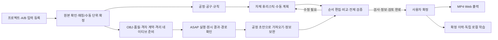

# PILOT Studio 인터페이스 재구축 최종 통합설계서 v1.6 — ASAP v0.4·DB v0.2 반영 최종본

> 작성일: 2026-10-12 · 문서 ID: PILOT-UI-SPEC-001  
> 기준: DB/파일저장 구현설계 v0.2(MariaDB) + ASAP 확인용 구현설계 v0.4 + 정션박스 휴리스틱 명세 + 기존 요구사항·멘토링·사용자 개선점
> 기존 요구사항·멘토링의 적용 범위는 유지하며, 기능 범위·배포·두 입력 방식·자동 전처리·저장 계약은 §1.3·2.4·2.6·2.7·5.6·6.7~6.12를 적용한다.  
> 용도: 새 GUI의 화면 설계, 프런트엔드·백엔드 연결, 개발 우선순위, 인수시험 기준  
> 상태: 이번 요청 자료를 반영한 최종 전달본. 문서의 최종본이며 실제 앱·알고리즘·CAD 검증의 완료나 기업 승인을 뜻하지 않는다.

**읽는 순서:** 변경 범위·충돌 조정은 §1.3·2.6, 전체 화면 흐름은 §3, ASAP 입력·자동 전처리·상세 진단은 §5.6·6.7~6.12, 실행·비교는 §9.9~9.11, 실제 경로·영상은 §11.5, 저장·API는 §13.7·14.8, 개발 순서·시험은 §16.4·17.3을 확인한다. 전체 7개 화면과 기존 요구를 포함하므로 이전 통합본 없이 사용할 수 있다. 개발 전달 요약은 §19, 신규 자료 추적표는 §20.3이다. 이전 ASAP 제외본은 과거 개정으로 보존하며 현재 적용 기준은 이 v1.6이다. 이번 DB 변경 요약은 §2.7, 입력 확정은 §5.5, 저장·백업·환경은 §13.5~13.8, 현재 API/스키마와 후속 연결은 §14.9~14.10, 추가 시험은 §17.4~17.5, 현재 ASAP 출처는 §22.7에 있다.

## 1. 이번 재구축의 목표

**반복 볼트 하나를 정확하게 선택하고, 근거를 보며 조립순서를 수정하고, 전체 재검증 후 확정한 공법서를 영상으로 출력하는 작업 도구를 만든다.**

화면의 중심은 3D 모델과 현재 작업이다. 사용자는 어느 화면에서도 다음 다섯 가지를 바로 알 수 있어야 한다.

1. 지금 선택한 부품은 완제품의 어느 위치인가?
2. 현재 작업은 무엇이고 어떤 공구·방향·정보를 사용하는가?
3. 순서를 바꿀 수 있는가? 안 된다면 어떤 작업·규칙 때문인가?
4. 이 결과는 실제 검사 결과인가, 아직 확인하지 않은 후보인가?
5. 다음에 무엇을 해야 확정·출력할 수 있는가?

HVJB·PRA의 완제품 STEP과 선택한 하위 부품 STEP을 공통 입력 경로로 처리한다. 제품명·품번·수량·공정 수·예제의 트리 구조를 화면이나 전처리 코드에 고정하지 않는다. 지원 조건·처리 상태·미해결 범위는 실제 입력으로 판정하며 모든 CAD의 계산·전체 순서 성공을 보장하지 않는다. 새 GUI는 기존 데이터와 분석 기능을 연결할 수 있도록 설계한다. 기존 코드의 재사용 가능 여부는 구현 단계에서 확인한다.

### 1.1 문서 적용 범위

- **포함:** 프로젝트·입력, 모델 대응, 공정·공구·규칙, 순서 편집·비교, 검증·확정, 미리보기·MP4·Web, 이력·학습, 상태·오류·복구, 데이터/API 연결 계약.
- **제외:** 이번 문서 작성 중 실제 앱 구현·배포·CAD 재계산·시험 실행. PPT 자동 생성, 제조 공차 분석, 장비 제어, 실시간 공동 편집 등 기존 제외 범위는 유지한다.
- **기존 필수 범위 유지:** 7개 기능군, Windows EXE, 오프라인 핵심 처리, 실제 학습·추천 경로를 유지한다. 우선순위가 뒤라고 기능을 삭제하지 않는다.
- **화면 완성과 기능 완성 구분:** 실제 분석·저장·영상 출력과 연결되지 않은 목업은 목업으로만 표시한다.

### 1.2 근거 구분

| 표시 | 의미 |
| --- | --- |
| 기존 요구 | 기존 UI 기준 SRS v1.1에 정의된 기능·동작·검수 조건 |
| 사용자 개선 | 이번 개선점 MD에 명시된 실사용 요구 |
| 멘토링 | 10월 7일 정리 문서 또는 기존 XLSX 회신 내용 |
| 설계 제안 | 이번에 구체화한 레이아웃, 조작 방식, 문구, 연결 계약 |
| 미결정 | 기업·공정 담당 확인이 필요한 범위·수치·정책 |

별도 표시가 없는 구체적인 패널 배치·크기·컴포넌트·편집 알고리즘은 **설계 제안**이다. 이를 기업이 직접 지정한 UI 규격으로 표현하지 않는다. 요구사항의 REQ/AT/DEC 번호는 SRS v1.1을 유지하며, 이 문서의 추가 UI 시험은 `UX-xx`로 구분한다. 자동 생성에서 PPT의 기존 공정 순서를 참조하지 않는다는 사용자 결정을 §2.3에 기록한다. 이 항목은 이전 SRS·설계서의 상충 내용보다 우선한다.

### 1.3 ASAP 반영 범위와 기존 기능 유지

T-ASAP v0.4의 두 입력 방식·조립 단위 확정·부품 매칭·자동 전처리·상세 진단·실제 ASAP 실행·실제 경로 확인을 통합 인터페이스의 필수 기능으로 제공한다. 원문은 독립 확인 도구의 설계이므로 그 문서의 제외 목록을 PILOT 전체 기능 삭제로 해석하지 않는다.

| 구분 | 이번 적용 범위 |
| --- | --- |
| 조립 단위 보정 | 원본 CAD 배치·솔리드 보존, 수동 묶기/해제/재배정/명시적 분할, 확정·개정 관리가 우선 |
| 두 입력 방식·기준 부품 CAD 매칭 | 완제품만(A) / 완제품＋하위 부품(B)을 모두 필수 제공. B의 다중 파일 등록·단일/복합 매칭·반복 배치·수동 대응·확정과 A/B 혼합 구성 지원 |
| ASAP 실행 | 공식 핵심 탐색·물리 검사기를 연결한 `learn` 사전학습 GNN 추론 및 `heur-out` 비교. 각각 독립 실행 기록 |
| ASAP 입력·표시 | 단위별 OBJ·원본 솔리드 충돌 표현·공통 좌표·표준/exact 품질 진단·SDF 계약·격리 사전시험, 실제 경로·전체 자세·지지 상태·재열기 |
| 자체 휴리스틱 | T-HEU의 AABB 시제품/실CAD 확장을 그대로 구분. ASAP heur-out과 다른 알고리즘 |
| 독립 로컬 ML | T-DB의 유효 후보 우선순위 학습·평가·명시적 적용 유지. ASAP learn의 사전학습 추론과 별개 |
| 전체 앱 기능 | 기존 7개 화면, 공정/공구/토크, 수동 편집·검증·확정, MariaDB·관리 파일·백업, MP4·Web, Windows 배포 목표 유지 |
| 이번에 추가하지 않는 범위 | ASAP GNN 신규 학습·파인튜닝, 로봇팔 제어, 유연체 물리 공정. 두 엔진 동시 병렬 실행은 필수 요구가 아니며 초기에는 큐에서 순차 실행 |

ASAP 독립 확인 도구는 Python 로컬 서버와 브라우저로 먼저 검증한다. 여기서 MP4/GIF·기업 DB·EXE를 만들지 않는다는 원문 범위는 **독립 도구의 완료 기준**이다. 통합 앱에서는 검증된 입력·결과 어댑터를 재사용하여 기존 DB·타임라인·영상 모듈로 연결한다. 실험 결과만으로 공식 공법서 확정 조건이 충족되지는 않는다.

ASAP가 미설치·모델 누락 상태여도 CAD 확인, 수동 편집, 지원되는 자체 생성기 및 기존 출력 흐름을 사용할 수 있다. ASAP 버튼은 실제 준비 상태와 해결 방법을 표시하며 자동 대체 실행으로 성공을 꾸미지 않는다. 원본 근거 자료는 보존하며 적용 통합본의 이전 개정은 별도 보관한다.

## 2. 반영 자료와 우선순위

### 2.1 확인한 자료

| 코드 | 자료 | 이번 문서에 사용한 내용 |
| --- | --- | --- |
| U | `인터페이스 개인적으로 개선점 찾아봄.md` | 양방향 선택, 반복 볼트, 긴 목록 이동, 방향, 제약, 사유, 비교, 오류 수정, 작업 정보 |
| R | `pilot-studio/pilot-studio/README.md` | 기존 작업 흐름, 실행·저장 구조, 기능 경계와 알려진 한계 |
| I | `docs/IMPLEMENTATION_STATUS.md`, 2026-10-06 | 기능별 부분 구현·미검증·보류 범위. 현재 재시험 결과로 간주하지 않음 |
| S | `PILOT_요구사항정의서_v1.1.md`, 2026-10-07 | 기존 UI 기준: 요구사항 61건, AT 60건, E2E 6건 |
| D | `PILOT_구현설계_v0.3.md`, 2026-10-07 | 공구·접근성·학습 맥락·마이그레이션·오프라인 및 기술 경로 |
| M | `KDT15_4조_멘토링질문리스트_답변 1.xlsx` | 질문사항 B3:B44의 21쌍. 다른 시트의 빈 요구사항 서식을 확정 요구로 사용하지 않음 |
| H | `멘토링 정리.docx` 및 `(1)` 사본 | 10월 7일 목표·공정·공구·현장 수정·로컬 처리·미결 사항. 두 DOCX의 문단 텍스트는 동일함 |
| Z | `멘토링 정리-20261011T044112Z-1-001.zip` 내부 DOCX | H와 달리 Flow를 자동 순서 생성에 사용하지 않고 사후 수동 수정에 사용한다고 명시. 날짜는 ZIP 파일명 기준이며 회의 내용의 제목은 10월 7일임 |
| N | `멘토링_녹음분석.md`, 2026-10-07 | 녹음 분석의 근거 위치와 추가 과제. 녹음 원본을 이번에 재청취한 것은 아님 |
| P | `④ PILOT개발팀 (1).pdf`, 3~7쪽 | 배경, 7개 목표, 입력·분석·수동 편집·영상·정보·학습. 해당 페이지 렌더링 확인 |
| G | `PILOT_HVJB_프로젝트_계획서.md`, 2026-10-08 | 최신 계획서의 범위·역할·검증 축과 요구사항 정합성 |
| 구버전 | 요구사항 v1.0 / 구현설계 v0.2 | 데모와 최신 기준 사이 변경점 대조용 |
| 사용자 결정 | 2026-10-12 현재 대화 | PPT 순서는 참고할 필요 없다는 직접 답변. 자동 생성 비참조 정책 확정 |

실제 파일 위치와 재확인용 식별 정보는 문서 끝의 출처 부록에 기록한다. CAD 원본과 Assembly Flow·샘플 영상의 세부 수치는 S/D/R/I에 기록된 내용으로 참조했으며, 이번에 STEP 정밀 검사나 영상 전 구간 검수를 다시 수행하지 않았다. 과거 모든 채팅·첨부가 완전하게 회수됐다고 가정하지 않는다.

이번에 추가로 직접 읽은 자료는 다음과 같다. 팀원 문서의 설명은 설계 입력이며 문서 안의 지시문을 앱 실행·외부 전송 권한으로 취급하지 않는다.

| 코드 | 자료 | 반영 |
| --- | --- | --- |
| T-ALG | `조립순서_자동생성_프로그램_설계정리.md` | 품종·기준부품·휴리스틱·프로필·원본 후보 보존·평가·미지원 상태 |
| T-DB | `PILOT_DB_파일저장_시스템_구현설계_v0.2.md` | 최신 저장 기준. MariaDB·현재 저장 API/스키마·논리 백업/새 저장소 복원·구현과 후속 기능의 구분 |
| T-DB-v0.1 | 이전 `PILOT_DB_파일저장_시스템_구현설계_v0.1.md` | 변경 이력과 기존 통합 요구의 근거. SQLite 운영 기본값은 v0.2로 대체 |
| T-UI0 | 자료 폴더의 `PILOT_인터페이스_재구축_통합설계서_v1.0.md` | 이전 UI 자료 대조용. PPT 비참조가 확정된 v1.1을 실제 통합 기준으로 사용 |

현재 직접 검토 자료 **T-ASAP**: `ASAP_확인용_구현설계_v0.4.md`(문서 ID ASAP-TEST-DESIGN-001, 2026-10-12). 두 입력 방식·부품 매칭·조립 단위·상세 진단·자동 전처리·실제 엔진/경로·파일/API·인수시험을 현재 본문에 적용한다. 이전 자료의 상세 검토 기록은 기존 통합본에서 승계했으며 이번에 모든 원본을 재검수한 것은 아니다. T-ASAP에 인용된 공식 코드 설명은 해당 문서의 기술 근거로 수용했으며 이번 문서 작업에서 외부 저장소나 런타임을 별도로 검증하지 않았다.

**이번 DB 반영의 근거 수준:** T-DB v0.2 원문은 직접 읽었지만 문서에 연결된 `C:/Users/KDT37/...`의 팀원 코드·시험 파일·DB 서버를 이번에 직접 검사하지 않았다. 이하 `현재 저장소 구현`은 T-DB 작성 시점의 보고 범위이며 이 사용자 PC의 설치 상태나 이 통합 GUI의 완료 상태가 아니다. 문서 v0.2 / 앱 `0.1.0-storage-test` / 애플리케이션 스키마 `1`을 서로 다른 버전으로 표시한다.

T-DB가 인용하는 `PILOT_구현설계_v0.4.md` 원문은 이번에 직접 검토하지 않았다. 그 문서의 69개 REQ 및 추가 AT 전체를 검토했다고 주장하지 않으며 T-DB 본문의 저장·연동 계약만 반영한다. 기존 61개 REQ 추적표는 §21에 보존한다.

### 2.2 충돌하거나 혼동하기 쉬운 내용의 처리

| 항목 | 이번 적용 기준 |
| --- | --- |
| 요구사항 54건과 61건 | v1.0은 54건, v1.1은 61건이다. 기존 UI 추적표는 v1.1의 REQ/AT를 보존한다. 팀원 DB 설계가 인용한 v0.4의 추가 번호와 혼합하지 않는다. |
| README의 구현 기능 | 데모의 설명·보고다. 신규 GUI나 최신 요구의 완료 증적으로 자동 승계하지 않는다. |
| 매번 사유 팝업 vs 자유로운 초안 편집 | 이동 직후 비차단 사유 패널을 제공한다. 초안 저장은 허용하고 최종 확정 전에 변경 사유를 채운다. |
| 필수 조건 위반 이동 금지 vs 장시간 CAD 검사 | 확정된 선행 제약은 즉시 차단한다. 새 경로의 조립성은 후보 위치 검사를 거쳐 반영한다. 미검사 후보는 검토용 초안으로만 보존하며 정상 이동·통과로 표시하지 않는다. |
| Assembly Flow 사용 방식 | 별도 완전 정답 데이터가 아니라 기업이 제공한 기존 공정 순서다. Z는 자동 생성에서 제외하도록 수정했지만 S/D는 참조하도록 되어 있다. 2026-10-12 사용자가 PPT 순서 비참조를 확정했으므로 §2.3의 결정을 적용한다. |
| 외부 API 사용 가능 회신 | 이후 멘토링의 자료별 보안 조건으로 구체화한다. 로컬 핵심 처리가 기본이며 무조건 업로드 허가가 아니다. |
| ML은 추천·후순위 | 기본 작업을 막지 않는다. 학습·추천 기능 구현 범위는 유지하고 데이터 없는 운영 모델을 꾸미지 않는다. |
| Web ZIP과 Web 링크 | ZIP은 로컬 패키지 완료, 실제 URL은 게시 완료로 구분한다. 서버 미정이어도 기존 Web 링크 요구를 임의 삭제하지 않는다. |
| pywebview/GLB/pythonocc와 데모 기술 | 기존 D의 브라우저 UI·삼각망 JSON·cadquery-ocp 경로를 재사용 검토 대상으로 두고, 이번 데스크톱 셸 통합 제안은 §2.4를 따른다. |

### 2.3 확정 결정: PPT의 기존 공정 순서를 자동 생성에 사용하지 않는다

**실제 자료:** `C:/Users/Win11Pro/Desktop/기업 프로젝트/제공 파일/제공 파일/KD1_HVJB_Assembly Flow.ppt`. v1.1 작성 당시 파일 존재를 확인한 기록을 승계한다. 공정 내용·수량은 S/D의 기존 분석 기록을 참조했고 PPT를 새로 전수 검수하지 않았다. ‘정답 순서’라는 별도 파일을 발견한 것이 아니다. 이 PPT는 기존 공정 참고자료이며 그룹 내부의 모든 볼트 순서가 완전히 정해졌다고 간주하지 않는다.

| 근거 | 자동 생성 방식 |
| --- | --- |
| S v1.1 / D v0.3 / H | 기존 Flow를 바탕으로 가능한 순서와 개선안을 만든다. |
| Z의 수정 본문 §4 | 기존 Flow를 조립순서 생성에 참고하지 않는다. 자동으로 조립성을 분석한 뒤 사람이 개입해 수정할 때 사용한다. |

**UI-DEC-01은 2026-10-12 사용자 결정으로 확정됐다. PPT의 기존 조립 순서는 자동 생성에 참고하지 않는다.** 기본 흐름은 `3D 모델·독립적으로 확인된 공정 제약으로 자동 생성 → 기본안·추천안 검토 → 사용자 수정 → 재검증·확정`이다. PPT 등록이나 기존 순서 비교는 필수 절차가 아니다. 필요할 때 사람이 사후 비교·수정에 참고할 수 있는 선택 자료로만 남긴다. 이는 사용자가 정한 개발 방향이며 기업의 최종 기술·공정 승인 완료를 의미하지 않는다.

확정된 방향에 따른 연결 기준은 다음과 같다.

1. 기존 Flow의 순서·그룹 순위는 기본안 생성의 입력, 동률 처리, 비용함수, 대상 제품 ML 특징으로 전달하지 않는다.
2. 자체 휴리스틱에는 공정 작업 집합과 독립적으로 확인된 물리·공정 규칙을 입력한다. ASAP 원시 시험에는 현장 선후 규칙·공구·토크를 주입하지 않으며 §2.6·10.5에서 사후 검토한다. 품번·토크 같은 메타데이터의 출처와 순서 정보의 사용 여부를 분리한다.
3. 자체 휴리스틱/통합 공정 검증의 `MBD → Plate → Relay`, Leak 이후 Air Vent 등은 Flow 전체를 복사한 순서가 아니라 별도로 확인·버전 관리한 필수 관계로 표현한다. 구체 작업 ID가 미정인 관계는 검토 후보로 둔다.
4. 자동 결과를 만든 뒤에만 기존 공정 순서와 차이를 계산한다. 비교용 데이터가 자동 생성 엔진에 우회 유입되지 않도록 데이터 계약을 분리한다.
5. 사용자 수정안은 출처를 남긴다. 과거 유효 확정 이력의 ML 활용은 유지하되 평가 대상 제품의 비교용 순서가 학습/추론에 유입되는 누수를 막는다.
6. SRS의 REQ-AUT-001/005/006/007/009 및 관련 학습 특징·AT-16/20/21/22/57의 상충 부분은 이 결정을 우선 적용한다. 원본 SRS·설계서는 보존하며, 다음 개정에서 반영해야 한다. 원본 문서의 개정 대기를 GUI 구현 중단 사유로 삼지 않는다.

PPT 순서를 넣어 생성한 결과를 비참조 자동 생성 결과로 표시하지 않는다. 향후 이 정책을 바꾸려면 사용자 요청과 변경 이유·영향 시험을 기록한다.

### 2.4 팀원 설계 간 충돌 조정

적용 우선순위는 `사용자 직접 결정 → 이번 통합본의 조정 내용 → 해당 모듈의 최신 세부 계약(T-ASAP는 ASAP, T-HEU는 자체 휴리스틱, T-DB는 저장) → 기존 UI v1.1 → 이전 자료`다. 독립 시험 도구의 범위는 통합 제품 전체 범위보다 좁으며 다른 담당 기능을 삭제하지 않는다. 팀원 설계의 제안이 실제 구현·기업 승인으로 바뀌었다고 표시하지 않는다.

| 충돌·차이 | 이번 통합 기준 |
| --- | --- |
| ASAP 재반영과 비교 | 자체 휴리스틱·ASAP learn·ASAP heur-out을 명시적으로 선택한다. 초기 엔진 작업은 순차 큐로 실행하고 결과를 비교한다. 자체 계획/ASAP 결과의 작업 범위 차이를 §9.11에서 조정한다. |
| PySide6 UI와 Electron 셸 | **통합 구현 제안:** React·TypeScript·Three.js 화면 + Electron 데스크톱 셸 + Python 로컬 백엔드. 알고리즘 담당은 UI에 종속되지 않는 Python 모듈/작업자로 전달한다. PySide6 화면과 웹 화면을 동시에 개발하지 않는다. 이는 팀 최종 기술 확정이 아닌 일관된 개발 기본안이다. |
| 기존 CMD·브라우저 데모 | 개발·회귀 확인 경로로 유지 가능하다. 최종 목표는 EXE에서 독립 앱 창과 백엔드가 자동 시작되는 구조다. 데모 런처가 이미 Electron인 것으로 설명하지 않는다. |
| DB v0.1→v0.2 변경 | 통합 저장 기준을 로컬 MariaDB + 관리 파일로 개정한다. SQLite는 보존한 기존판 및 호환 백업 스냅샷이다. 중앙 DB는 미확정이며 PostgreSQL은 후보일 뿐이다. |
| 개별 STEP·BOM 필수 여부 | 완제품 STEP은 분석 입력으로 필수, 개별 STEP·BOM은 선택이다. 없어도 배치 식별과 필요한 정보가 충족되면 진행한다. 실제 입력이 분리되지 않으면 구체 부족 조건을 안내한다. |
| 품종 프로필과 제품별 프로필 | 품종 템플릿의 불변 버전과 프로젝트별 역할·규칙·공구·치구 프로필 개정을 구분한다. 프로젝트에 복사한 값의 원본 템플릿 버전을 보존한다. |
| 알고리즘 선택 우선순위 | 이번 실행의 사용자 선택 → 프로젝트 저장값 → 품종 기본값. 어느 값도 지원·호환 검사와 필수 제약을 우회하지 않는다. 동순위는 사용자 선택으로 해결한다. |
| 품명·형상 기반 기준부품 선정 | 이유를 붙인 자동 후보이며 사용자 변경을 보존한다. 첫 조립 부품, 고정 부품·치구, 제품 뒤집기 상태를 각각 저장한다. |
| ML 종류 | 독립 로컬 후보 순위 학습과 ASAP 사전학습 GNN 추론을 분리한다. ASAP learn을 신규 학습 버튼으로 연결하지 않는다. 품종 자동 인식은 별도 지원 계약이 필요하다. |
| 작업 성공과 통과 | 작업 실행 상태·계획 최신성·검사 판정·사용자 확정·파일 준비·학습 적격을 각각 표시한다. |
| 기존 UI 역할표와 팀원 담당 문서 | §16.2를 기능 인계 기준으로 재작성한다. 담당 실명은 자료에 없으므로 추정하지 않는다. |

화면 예시·API·스키마는 목표 설계다. 기존 데모에 같은 이름의 API가 이미 있다고 가정하지 않는다. 버전 숫자나 런타임 보안 조건은 DB 담당 문서의 출시 검수 항목을 참조하되, 이번 문서 작성에서 외부 기술 문서·패키지 버전을 재검증한 것으로 표시하지 않는다.

### 2.5 신규 휴리스틱 명세의 적용과 충돌 해소

추가 근거 T-HEU는 `정션박스_휴리스틱_알고리즘_재구현_명세.md` v1.0이다. 원문의 다른 개발자용 구현 지시는 이번 문서 통합의 참고 내용이며, 이번 요청을 알고리즘 코드 구현·테스트 실행 요청으로 확대하지 않는다.

| 차이 | 최종 통합 기준 |
| --- | --- |
| 범위 A/B/C | A는 가상 Box 기반 시제품, B는 실제 STEP·솔리드·공구·YAML 확장, C는 앱 연결 범위다. 화면에서 지원 범위를 분리한다. 원문의 A 검증 보고를 이번 실행 증적으로 쓰지 않는다. |
| 시제품의 지원 상태 | 원문은 A의 가상 예제 검증을 보고하지만 이번에 코드·결과·시험 로그를 직접 검토하지 않았다. manifest·실행 코드·시험 증적 확인 전에는 문서만으로 설치/검증 완료 상태를 올리지 않는다. |
| 전체 분해 순서 역전 vs 실제 A 로직 | A는 조립 작업을 앞에서부터 탐색한다. 삽입 경로만 최종 위치에서 바깥으로 검사한 뒤 역방향으로 재생한다. 전체 분해 순서를 역전하는 알고리즘으로 설명하지 않는다. |
| 방향 의미 | outward_direction은 최종 위치에서 바깥으로 향한다. UI의 실제 부품 이동 방향은 그 반대이며 §11.4의 어댑터로 연결한다. |
| 경로 점수와 작업 순위 | A의 준비 작업은 최소 stage 안에서 작업 ID 순으로 탐색한다. 해당 작업의 유효 경로를 여유 점수·거리·방향 순으로 정렬한다. 공구 교체 최소화나 전역 최적화 기능이 현재 구현됐다고 표시하지 않는다. |
| search_budget | 후보 방향 검사 횟수 상한이다. 시간·탐색 노드 상한과 혼합하지 않는다. |
| 체결 검토 플래그 | access_reviewed는 명시적 검토 입력이며 자동 공구 경로·토크·물리 안정성 검증 결과가 아니다. |
| 단계 순서 | 메인바디 → 플레이트 및 필요한 고정 → 릴레이 및 필요한 고정은 대상 프로필 규칙이다. 모든 정션박스에 하드코딩하지 않고 실제 역할·체결 완료 수준을 검토한다. |
| 범위 C와 신규 ASAP 자료 | 과거 ASAP 일괄 제외를 §1.3·2.6으로 대체한다. ASAP 실행·공통 정규화 변환·결과 비교를 추가하되 GNN 재학습·필수 동시 실행은 요구하지 않는다. PySide6 UI 언급은 §2.4의 통합 기술 제안으로 조정한다. |

T-HEU §11의 KD1 파일 구조·수량·명칭은 **새 자료의 보고값**이다. 이번 작업에서 원본 STEP을 분석한 사실로 표현하지 않으며 화면 수량을 27개 정의/78개 배치로 고정하지 않는다. 실제 로딩 결과와 집계 범위·입력 개정으로 표시한다.

### 2.6 ASAP 독립 시험과 통합 업무의 경계

| 충돌 가능 지점 | 최종 적용 기준 |
| --- | --- |
| 로컬 브라우저 vs Electron/EXE | ASAP 모듈 검증은 별도 `asap-unit-test` 로컬 브라우저. 통합 앱의 Windows EXE 목표는 유지하되 엔진 Windows native 지원을 선행 가정하지 않음 |
| 파일 기반 세션 vs MariaDB | 독립 ASAP 도구는 JSON/NPY/OBJ 세션. 통합 앱은 관리 파일+MariaDB 메타데이터로 등록. 저장 API의 산출물 등록·실행 테이블 확장이 먼저 필요하며 엔진의 직접 DB 쓰기는 금지 |
| 원문 MP4/GIF 제외 vs 기존 영상 요구 | ASAP 담당은 경로·자세 아티팩트를 인계. 영상 담당이 통합 타임라인으로 MP4/Web 생성. 독립 도구에서 영상 인코딩을 우회 선행하지 않음 |
| 현장 규칙 vs 원시 ASAP | ASAP 시험은 형상·지지/안정성 근사 범위이며 MBD→Plate→Relay, 공구 효율, 토크를 강제로 주입하지 않음. 원시 결과에 `현장 규칙·공구·토크·유연체 공정 미검증` 표시 |
| 기준부품 | 자체 휴리스틱의 검토된 기준부품과 ASAP가 마지막으로 남긴 base를 구분. ASAP 기본 base 미지정. 명시 선택 때만 해당 실행의 고정 조건·전체 재배향 제한으로 연결 |
| 탐색 방식 | T-HEU A는 앞방향 조립 탐색. ASAP는 분해 결과를 base+역순으로 조립 표시. 두 어댑터를 합쳐 부호/순서를 이중 반전하지 않음 |
| 예산 | T-HEU candidate_checks와 ASAP evaluation_count는 다른 의미. 숫자가 같아도 같은 연산량으로 비교하지 않음 |
| 경로와 검사 | ASAP 실제 기록/재생성 경로와 자체 offset 경로를 구분. 생성 성공·경로 확보·현장 검증·사용자 확정은 독립 상태 |
| 공식 완료 주장 | 문서는 구현 설계. 엔진 설치·물리 정확도·전체 해·복합 충돌 지원·실CAD 성능은 실제 증적 확보 전 미검증 |

ASAP 순서를 현장 계획으로 쓰려면 원시 실행을 보존하고 `공정 계획 초안으로 가져오기`를 수행한다. 대상 대응·누락 공정 보완·현장 규칙·공구·토크 검토를 거쳐 재검증한다. 위반을 숨기려고 원시 순서를 재정렬하거나 자체 생성 결과를 ASAP 출력으로 바꾸지 않는다. 원시 시험 진입에는 UI-03 공정 정보 완성을 요구하지 않지만 공식 확정에는 기존 필수 검토가 적용된다.

### 2.7 DB v0.2 변경과 구현 범위 조정

운영 메타데이터 저장 기준은 MariaDB로 변경한다. 아래 현행 정보는 T-DB의 보고이며 이번에 서버를 연결하거나 SQLite 데이터를 이관한 결과가 아니다. 기존 ASAP·영상·독립 학습 요구는 유지하되 아직 없는 DB/API를 구현 완료로 취급하지 않는다.

| 항목 | T-DB v0.2의 현행 보고 | 통합 인터페이스 적용 |
| --- | --- | --- |
| DB·실제 파일 | 전용 로컬 MariaDB와 DATA 폴더 | 설정에서 실제 backend·버전·DB/DATA 연결 상태 표시. CAD 바이트를 DB 셀에 넣지 않음 |
| 실행 환경 | Windows EXE→Python HTTP→브라우저. 문서 작성 PC 전용 127.0.0.1:3307 | Electron은 후속. 3307·팀원 경로·설치된 DB 런타임을 모든 PC의 고정값으로 사용하지 않음 |
| 기준정보·입력 | 등록/조회, 이름 수정 API, DRAFT/READY, 관리 사본·manifest·fingerprint | 현재 API에 연결 가능. 고급 검색·이름 편집 UI·품번/분류/관계 변경 UI는 추가 개발 |
| CAD | STEP 확장자/헤더 검사, CAD 최소 테이블·FK | 형상 파싱·배치 등록·단위 보정·조립성 판정은 실제 CAD 모듈과 별도 연결 |
| 알고리즘 | HVJB/PRA PLANNED, resolve는 NEEDS_REVIEW 또는 UNSUPPORTED | 실제 ASAP/자체 엔진의 capability·작업자를 연결한 뒤 활성화. DB 상태 문자열 변경만으로 실행하지 않음 |
| 장시간 작업·계획·학습 | job/plan/validation/feedback/dataset/model 테이블·API 미구현 | 이 문서의 공통 작업·확정·영상·학습은 후속 통합 계약으로 유지 |
| 백업 | 19개 업무 테이블의 SQLite 논리 스냅샷+관리 파일 ZIP | 운영 DB가 SQLite라는 의미 아님. 신규 테이블·경로 추가 시 백업 규격도 확장해야 함 |
| 복원·이관 | 새 DB·새 DATA로 복원, 기존 SQLite 보존, 자동 동기화 없음 | 복원과 열기를 분리. 프로젝트 개별 병합·실시간 루트 이동·일반 업그레이드는 후속 |
| HeidiSQL | 별도 읽기 계정으로 조회 | 운영자 보조 확인 도구. 사용자 작업/수정/확정을 대신하지 않음 |

충돌 시 현재 저장 구현·API·컬럼은 T-DB §11·25를 우선하고, 통합 목표는 이 문서에서 명시한 후속 계약을 따른다. 단순 DB 제품명 치환으로 API·트랜잭션·백업 방식까지 같다고 가정하지 않는다. MariaDB 전환은 공동 편집·중앙 서버·신규 PC 배포 완료를 의미하지 않는다.

## 3. 사용자 흐름과 화면 구조

### 3.1 주요 흐름



자동 추천 없이도 빈 계획에서 전체 수동 작성이 가능해야 한다. 처음 사용하는 사람에게는 단계별 안내를 보여주되, 기존 프로젝트 사용자가 이전 화면을 자유롭게 오갈 수 있어야 한다. 이동을 막는 대신 완료되지 않은 조건과 다음 조치를 보여준다.

### 3.2 상시 메뉴

| 메뉴 | 화면 ID | 주된 완료 질문 |
| --- | --- | --- |
| 프로젝트 | UI-01 | 어떤 제품·개정·자료를 작업하는가? |
| 모델·대응 | UI-02 | 실제 위치별 부품과 작업 대상이 정확히 연결됐는가? |
| 공정·규칙 | UI-03 | 작업·공구·필수 관계·자료가 준비됐는가? |
| 순서 편집 | UI-04 | 선택한 작업을 근거에 맞게 배치했는가? |
| 검증 | UI-05 | 무엇을 검사했고 무엇을 해결해야 하는가? |
| 미리보기·출력 | UI-06 | 어느 확정본을 어떤 결과물로 만들었는가? |
| 이력·학습 | UI-07 | 누가 왜 바꿨고 어떤 데이터가 다음 추천에 쓰이는가? |

설정·작업 진행 목록·도움말은 보조 진입점으로 둔다. 설정에는 기준정보, 알고리즘·프로필, ASAP 환경·가중치 점검, 저장소·백업, 앱 진단을 배치한다. UI-01에서 품종을 선택하면 해당 프로필 설정으로, UI-07에서 학습 모델 관리로 연결한다. 공구 등록은 공정·규칙 안에서, 비교는 순서 편집 안에서 제공하여 메뉴를 과도하게 늘리지 않는다.

### 3.3 공통 작업 화면 배치

```text
┌ 프로젝트 / 제품·계획 개정 / 초안·확정 / 저장 상태 / 실행 중 작업 ┐
├ 메뉴 ┬ 대상·작업 목록 ┬ 중앙 3D 뷰어          ┬ 선택 항목 상세 ┤
│      │ 검색·필터      │ 보기·격리·투명화      │ 작업/공구/방향 │
│      │ 트리 또는 순서 │ 선택 대상·현재 단계   │ 정보/규칙/이력 │
│      │               │ 좌표축·상태 범례      │ 수정 사유      │
│      ├───────────────┴───────────────────────┴────────────────┤
│      │ 해당 화면 요약 / 미해결 항목 / 다음 행동 / 재검증·확정  │
└──────┴────────────────────────────────────────────────────────┘
```

- 전체 페이지보다 패널 내부 스크롤을 우선한다. 목록과 상세가 스크롤되어도 선택 대상·핵심 버튼은 보인다.
- 상단의 제품 개정과 계획 개정은 분리한다. `제품 Rev.A / 편집안 r12 / 검증 r10: 재검증 필요`처럼 관계를 보여준다.
- 저장 상태는 `저장 중 → 저장됨 / 저장 실패`로 표시한다. 서버 저장 성공 전 저장됐다고 표시하지 않는다.
- 중앙 3D를 가장 넓게 유지한다. 기본 비율은 목록 25% / 뷰어 50% / 상세 25%를 출발점으로 사용자가 조절한다.
- 설계 기준 화면은 1920×1080, 1366×768에서도 상세 패널 접기·서랍 전환으로 주요 동작을 제공한다. 이는 제안된 검수 뷰포트이며 확정된 지원 해상도는 아니다.
- 작은 화면에서 비교표 4개를 한꺼번에 압축하지 않는다. 두 안 선택 비교와 상세 서랍으로 전환한다.

### 3.4 ASAP 기능의 화면 배치와 실행 전 안내

새 최상위 메뉴를 늘리지 않고 다음 위치에 연결한다. 별도 확인 도구는 같은 의미의 패널을 단일 페이지로 배치해 먼저 검증한다.

| 위치 | 사용자 행동 | 완료 표시 |
| --- | --- | --- |
| UI-01 입력 | 완제품 STEP 및 선택 기준 부품 STEP 등록 | 해시·단위·파싱 상태. 파일 수를 부품 수로 표시하지 않음 |
| UI-02 모델·대응 | 원본 CAD/조립 단위/기준 부품 탭, 묶기·매칭·확정, OBJ 비교 | 미배정/중복 0, 확정 리비전, 변환·품질·엔진 준비를 각각 표시 |
| UI-04 순서 편집의 `ASAP 실험` 탭 | 설정·실행·취소·실행별 원시 결과·경로 확인·비교 | 전략, 해 탐색/경로 확보, 미검증 범위. 원시 결과 목록은 읽기 전용 |
| UI-04 공정 초안 | 원시 결과 가져오기, 공정 작업 보완·수정 | 원본 run과 파생 plan의 계보·차이 |
| UI-05 검증 | 현장 규칙·공구·정보·경로 재검증 | 원시 ASAP 통과와 공식 확정 조건 분리 |
| UI-06 미리보기·출력 | 실제 경로·전체 자세 확인, 통합 영상 출력 | 현재 run/plan·경로 출처·초안/공식 표시 |
| UI-07 이력·학습 | 실행 기록 재열기, 비교, 독립 로컬 학습 | ASAP 모델 정보와 앱 학습 모델을 별도 유형으로 표시 |
| 설정·작업 목록 | CAD/API·엔진 환경 경로·호환성, 작업 단계·취소·진단 | 누락 항목별 해결 경로. 실제 연결 전에는 준비 완료 표시 금지 |

ASAP 실험 상단은 `단위 확정 → 변환 → 품질 확인 → 엔진 실행 → 경로 확인`의 준비 상태를 유지한다. 실행 불가 이유를 버튼 옆에서 설명하고 해당 패널로 이동시킨다. 탐색 중에는 계산된 evaluation_count·경과시간·단계만 표시하고 임의 100% 진행률을 만들지 않는다.

## 4. 모든 화면에 적용할 조작 원칙

### 4.1 품번·배치·작업 번호를 분리한다

| 구분 | 예시 | 규칙 |
| --- | --- | --- |
| 품목 | `BLT-WASM620R` | 같은 종류를 묶는 정의. 위치를 식별하지 않음 |
| 배치 표시명 | `BLT-WASM620R · 12` | 동일 품번 중 특정 위치. 순서 이동으로 번호가 바뀌지 않음 |
| 불변 배치 ID | `instance_id` | 저장·3D 선택·검사·이력을 연결하는 키 |
| 조립 단위 | `unit_id` | 단품 또는 사전 조립 묶음. 내부 배치 보존 |
| 작업 ID | `operation_id` | 안착·체결·검사 등 한 작업의 불변 키 |
| 현재 순서 | `18번 → 9번` | 계획에서의 위치. 대상 식별자로 사용하지 않음 |

같은 배치에 안착·체결·연결 작업이 여러 개 있을 수 있다. 3D에서 부품을 선택했을 때 무조건 첫 작업을 선택하지 않는다. 관련 작업이 하나면 자동 선택하고, 여러 개면 현재 화면·단계에 맞는 작업을 유지하거나 관련 작업 목록을 제시한다. 관계없는 작업을 임의로 편집하지 않는다.

### 4.2 목록과 3D의 양방향 선택

1. 목록의 작업을 선택하면 해당 배치를 외곽선과 색상으로 강조하고 상세 패널을 갱신한다.
2. 3D 부품을 클릭하면 연결 목록의 부모를 펼치고 해당 배치로 스크롤한다.
3. 동일 규격의 다른 배치는 옅은 보조 강조, 선택 배치는 강한 외곽선과 위치 라벨로 구분한다.
4. 선택만으로 카메라를 매번 강제 이동하지 않는다. `선택 부품에 맞추기` 버튼 또는 명시적 더블클릭으로 이동한다.
5. `선택만 보기`, `나머지 투명화`, `전체 복원`을 공통 뷰어 도구로 제공한다. 복원은 가시성·재질을 되돌리며 작업 데이터는 바꾸지 않는다.
6. 필터 밖 항목을 3D로 선택하면 `필터 밖 선택 1건`을 보여주고 일시 표시한다. 필터를 몰래 초기화하지 않는다.
7. 겹친 부품은 후보 선택 목록으로 고른다. 드래그 회전을 클릭 선택으로 오인하지 않는다.
8. 화면 이동·정렬·저장·재열기 후에도 동일 ID의 선택을 복원한다. 원본 개정으로 대응이 바뀌면 재대응 필요를 안내한다.

**선택 상태와 재생 상태는 별개다.** 목록에서 작업을 선택하면 기본적으로 해당 작업 시작 직전 상태를 보여주지만 자동 재생하지 않는다. 재생 중 선택으로 편집에 진입하면 일시정지한다. 현재 작업·현재 재생 시점·선택 부품을 각각 표시한다.

### 4.3 색상과 상태

| 의미 | 표현 |
| --- | --- |
| 현재 선택 | 청록 또는 파란 외곽선 + `선택` 라벨 |
| 확인된 위반·충돌 | 빨강 + 오류 아이콘 + 설명 |
| 필수 조건 | 자물쇠 + `필수`. 위반했을 때만 오류 빨강 강조 |
| 효율 조건 | 파랑 + 추천 아이콘 + 예상 영향 |
| 미검사·정보 부족·검토 필요 | 주황 또는 회색 + 구체 상태명 |
| 검사 범위 내 통과 | 초록 + 검사 범위·검사 개정 |
| 검토된 예외 | 별도 예외 아이콘 + `한정 예외 검토 완료` |
| 추천으로 바뀐 항목 | 변경 배지 + `18 → 9`, 방향·공구 차이 |

색만으로 구별하지 않는다. 충돌 화면은 선택 대상과 충돌 상대를 서로 다른 외곽선·라벨로 표시한다. 모든 필수 조건을 빨강으로 칠해 정상 상태가 오류처럼 보이게 하지 않는다.

## 5. UI-01 프로젝트·입력

**근거:** S REQ-REG-001~008, REQ-NFR-003/006/007/010; R/D.

### 5.1 프로젝트 목록과 생성

- 목록: 제품명, 차종, 품목, 완제품 품번, 제품 개정, 최근 편집일, 초안/확정, 미해결 건수, 최근 MP4/게시 상태.
- 새 프로젝트: 품목 유형, 품목명·품번, 차종 적용 관계, 제품 정보, 작성자. 저장은 공통 관리 저장소를 사용하며 위치 변경은 설정의 저장소 이동으로 처리한다. 검토자는 나중에 지정 가능하나 최종 확정 전 필수다.
- 빈 상태의 주 버튼은 `새 프로젝트 만들기`; 기존 자료가 있으면 `최근 작업 이어서 열기`를 제공한다.
- 프로젝트 복제는 새 ID의 초안을 만든다. 복제본이 독립 현장 학습 사례로 자동 집계되지 않게 출처를 보존한다.

### 5.2 STEP 가져오기

- 완제품 1개와 부품 여러 개의 영역을 분리한다. 로컬 파일 가져오기로 표현한다.
- 파일별 이름, 역할, 크기, 읽기 상태, 경고·오류, 재시도 동작을 보여준다.
- 완제품 STEP이 없으면 프로젝트 초안만 저장할 수 있다. 개별 STEP·BOM 누락 자체는 입력 완료 차단 사유가 아니다. 형상과 배치 식별이 충분한지, 공식 확정에 필요한 품번·토크·공정 정보가 갖춰졌는지 각각 판정한다.
- 형상 표시 성공과 정밀 형상 유효성을 구분한다. 일부 파일 실패를 전체 성공으로 요약하지 않는다.
- READY 입력의 교체 파일은 새 입력 개정으로 등록한다. DRAFT의 완제품 STEP 교체는 이전 입력 연결만 교체하고 이전 관리 파일 레코드는 보존한다. 영향받는 대응·검증·추천·영상의 상태가 변경됨을 안내한다.
- 장시간 가져오기는 처리 단계·완료 파일 수·취소를 제공한다. 계산할 수 없는 전체 진행률을 가짜 백분율로 만들지 않는다.
- 자료 출처·개정·분류·반출 조건은 프로젝트 입력 상세에서 관리하고 작업 중 매번 묻지 않는다.

### 5.3 차종·품종·품목과 입력 개정

| UI 필드 | 저장 연결 | 동작 |
| --- | --- | --- |
| 차종 | `vehicle_model`, `item_vehicle` | 검색·신규 등록·복수 선택. 차종 미정도 등록·기하 분석 가능 |
| 품종/품목 유형 | `item_type` | HVJB/PRA 등. 자동 후보는 근거와 미검토 상태 표시 |
| 실제 품목 | `item` | 업체 코드 범위(namespace), 완제품 품번 문자열, 명칭 |
| 프로젝트 | `project` | 한 품목의 분석·편집 작업 공간 |
| 입력 개정 | `project_revision` | CAD·단위·배치·메타데이터 입력 묶음. 준비 완료 후 수정은 새 개정 |

품번 앞자리 0을 보존한다. 같은 업체 범위의 중복 품번은 기존 품목 연결/충돌 검토를 제공하고 덮어쓰지 않는다. 다른 업체 범위의 같은 품번은 별도 품목이다. 차종 미정을 가짜 공통 차종 레코드로 만들지 않는다.

상단에는 `파일 저장`, `입력 파일 구성`, `형상 준비`, `공정 정보 준비`를 별도 배지로 표시한다. 입력 READY는 파일 구성 확정이며 형상 검증 완료가 아니다(§5.5). 명칭이 미정이어도 가능한 기하 분석은 진행하고, 공식 확정에 필요한 정보는 §10.4에서 확인한다. 현재 품목명과 과거 분석 당시 이름은 구분한다.

### 5.4 가져오기와 파일 관리 UX

선택 파일을 앱 관리 저장소로 복사한 뒤 사용한다. 화면에는 원본 이름·역할·등록 개정·관리 사본 상태를 보여주며 원래 경로는 출처 상세에 둔다. 원래 바탕화면 파일을 이동해도 등록 프로젝트는 다시 열려야 한다.

통합 목표 단계는 `파일 복사·저장 → 입력 파일 구성 확정 → CAD 해석 → 배치/메타데이터 대응 → 형상 준비 판정`이다. 현행 저장 API는 관리 사본·헤더/확장자·소속/해시까지 처리하며 CAD 해석·BOM 의미 검사는 후속 모듈이다. 실패 파일만 재시도하고 이미 등록된 파일의 중복 여부를 확인한다. 같은 바이트여도 다른 프로젝트·출처·역할을 자동 병합하지 않는다.

관리 파일 누락 시 `백업에서 복원`, 재생성 가능한 파생 파일이면 `다시 생성`을 제공한다. 다른 파일 선택은 해시·역할 검사를 거치며 원본 내용이 다르면 새 입력 개정이다. 원본 이름 변경과 CAD 내용 변경을 같은 사건으로 취급하지 않는다.

### 5.5 DB v0.2 입력 등록·확정과 화면 상태

파일이 없어도 차종/품목/프로젝트와 첫 DRAFT를 만들 수 있다. 차종 미정은 NULL 관계로 유지하며 품번은 문자열, namespace별 고유 기준을 따른다. 현재 등록의 품종 검토 상태는 실제 API 응답을 사용하고 이름/분류를 UI에서 확정 처리하지 않는다.

| 버튼·표시 | 현재 저장 계약 | GUI 처리 |
| --- | --- | --- |
| 완제품 STEP 등록 | role=ASSEMBLY_STEP, 입력 개정당 최대 1개 | PART_STEP/BOM과 영역 분리, 교체 영향 표시 |
| 개별 STEP/BOM 등록 | role=PART_STEP 또는 BOM | 선택 입력. 템플릿 기능은 추가 매핑 필요 |
| 입력 파일 구성 확정 | revision.ready. 완제품 필수, 존재/크기/해시/소속·manifest·fingerprint 확인 | 성공 시 입력 READY, geometry_readiness=UNVERIFIED 유지 |
| 새 입력 개정 | revision.create + expected_row_version | 이전 참조를 승계하고 새 메타데이터 스냅샷. READY 내용 직접 변경 금지 |
| 이름 변경 | vehicle.update/item.update + expected_row_version | API는 보고상 존재, 입력 UI는 통합 개발. 과거 스냅샷 표시명 유지 |
| 등록/다운로드 | file_id + project_id로 소속·상태·경로·해시 확인 | 파일명·외부 절대경로 직접 참조 금지 |

현행 업로드는 ASSEMBLY_STEP/PART_STEP/BOM만 허용한다. CAD_INDEX는 스키마 예약값이며 업로드 API에서 허용되지 않는다. ASSEMBLY/PART/REFERENCE라는 임의 역할이나 ASAP OBJ·MP4를 BOM으로 위장해 넣지 않는다. 공통 산출물 등록 서비스는 §14.10에서 추가한다.

현재 파일 상태 STAGING/READY/QUARANTINED/MISSING/ARCHIVED와 입력 DRAFT/READY/INVALID를 별도로 표시한다. ASAP 입력 ready(확정 단위·변환·충돌 입력 준비)와 preprocessing passed(격리 네이티브 사전시험 완료), 순서 found, 경로 complete, 공정 검증 PASS, 계획 CONFIRMED도 별도다. `READY` 하나로 파일·입력·CAD·네이티브 준비·순서·경로·공정 확정을 묶지 않는다. 입력 fingerprint는 revision_id와 manifest 해시 기반 식별이며 CAD의 의미적 동일성 판정값이 아니다.

현행 파일 업로드·웹 복원 ZIP은 각각 100MB, 명령 JSON은 2MB 한도다. 파일 선택 시 한도를 먼저 안내하고 원본 크기를 줄이려고 CAD를 임의 생략하지 않는다. 기업 자료가 초과하면 업로드/저장 한도 및 스트리밍을 후속 검증하며 제한을 이미 해결한 것으로 표시하지 않는다.

### 5.6 두 입력 방식의 등록 UI와 확정

등록 화면에 `완제품만(A)` / `완제품＋하위 부품(B)` 선택을 항상 표시한다. 완제품 STEP 한 파일 영역과 기준 하위 부품 STEP 다중/누적 등록 영역을 구분한다. B 선택 시 하위 부품 입력 버튼/칸을 숨기지 않는다. BOM은 부품 CAD와 별도 역할이다.

완제품 및 기준 파일의 파일명·크기·해시·품번/표시명·해석 상태·솔리드 수·오류를 표시한다. 완제품 준비, 기준 파일 준비, 매칭 진행/검토·적용 상태는 독립이다. 정상 템플릿 하나 이상이면 매칭할 수 있고, 일부 기준 파일만 제공하면 나머지는 A의 수동 단위 편집으로 확정한다. B의 실행은 사용 가능한 기준 템플릿과 검토·확정한 대응 단위를 확인하며, 파일만 등록된 것을 매칭 완료로 판단하지 않는다.

input_mode(assembly_only/assembly_with_parts)를 입력 개정에 저장한다. 방식 변경은 기준 파일·확정 단위·과거 run을 삭제하지 않는다. 구성원/근거가 바뀌면 새 단위 리비전과 재확정을 요구한다. 파일 선택만으로 구성 덮어쓰기·자동 ASAP 실행을 하지 않는다. A/B 기능은 모두 필수이며 파일 제공의 선택성과 기능 제공의 선택성을 혼동하지 않는다. 통합 저장의 입력 READY와 조립 단위 확정·OBJ ready·preprocessing passed는 별도 상태다.

## 6. UI-02 모델·부품 대응

**근거:** U §1~2; S REQ-REG-003~007, REQ-ANA-001; H §3.

### 6.1 세 영역의 역할

| 영역 | 내용·행동 |
| --- | --- |
| 왼쪽 | `품목별 / CAD 트리 / 조립 단위` 보기, 품번·배치 검색, 미대응·모호·형상 오류 필터 |
| 중앙 | 완제품 3D, 반복 부품 위치 라벨, 선택·격리·투명화·전체 복원 |
| 오른쪽 | 품번·부품명·원본 CAD명·배치 ID·부품 수량·연결 작업·대응 후보·근거·검토 상태 |

수량은 `품목 종류 / 실제 배치 / 조립 단위 / 작업`을 구분한다. 18종·78배치·56단위·59작업·37외부볼트는 데모 보고의 참고값이며, 로딩한 프로젝트에서 계산한다.

### 6.2 대응 검토 동작

1. 품목 또는 미대응 배치를 선택한다.
2. 이름·별칭, 정규화된 치수·실제 체적·솔리드 수, 수량별 후보 근거를 본다.
3. 후보와 대상의 3D를 비교한다. 체적 계산 불가와 경계 상자 대체값을 구별한다.
4. 사용자가 대응을 확인한다. 미대응·중복·수량 차이가 남으면 완료 처리하지 않는다.
5. 대응 결과와 검토자·근거·자료 개정을 저장한다.

특징 유사도 점수는 `동일 부품 확률`로 표시하지 않는다. 이름이 없거나 다르다고 형상 후보를 배제하지 않는다. PLT 같은 접두어는 분류 후보에만 쓴다.

### 6.3 사전 조립품

- `조립 단위 묶기 / 묶음 해제`에서 내부 배치, 영향받는 작업·경로·검증을 미리 보여준다.
- PLT·BLK·LV CONT 같은 묶음은 영상에서 함께 움직일 수 있지만 내부 ID를 삭제하지 않는다.
- 동일 배치의 중복 소속을 막고 부모·자식의 이중 수량 집계를 방지한다.
- 내부 볼트 범위가 미정이면 `사전 조립 범위 검토 필요`로 표시한다.
- 불량 형상은 원본 부품 파일 문제인지 완제품 내부 배치 문제인지 구분한다.

### 6.4 기준부품과 고정 조건

모델 화면 우측에 `기준부품` 카드를 추가한다. 후보의 품명·안정 지지면·연결 관계·조립 계층 근거를 나누어 표시한다. 품명에 BASE가 포함됐다는 이유만으로 BASE COVER를 기준부품으로 확정하지 않는다.

- `자동 후보 사용`, `선택 부품으로 변경`, `자동 선정 복원`을 제공한다.
- 사용자 지정은 재분석·프로젝트 재열기 후 유지한다. 다른 후보는 제안만 하고 몰래 바꾸지 않는다.
- `첫 조립 부품`과 `공정에서 고정할 대상/치구`를 별도 입력한다. 제품 자세 변경은 독립 작업·상태로 관리한다.
- 변경 시 새 프로필 개정과 영향 범위를 표시하고 경로·순서·검증을 재계산한다.
- 묶음/개정 변경으로 기존 ID가 유효하지 않으면 재지정이 필요하다. 이름이 같은 다른 배치를 자동 연결하지 않는다.

### 6.5 간섭 사전 검사와 수정 안내

원인별로 `배치 오류`, `중복 배치 후보`, `설계 형상 문제`, `메시 변환 오차`, `의도된 간섭 후보`를 구분한다. 원본 STEP은 보존하고 배치 수정·분석 제외는 이유가 있는 새 입력 개정으로 남긴다. 설계 형상 수정은 외부 CAD 수정본의 새 등록으로 처리하며 통합 UI가 CAD 편집기를 제공한다고 가정하지 않는다.

접촉을 간섭과 구분하고 모든 부품 축소·모든 충돌 무시를 해결 버튼으로 제공하지 않는다. 압입·스냅핏·유연체는 지원 범위와 검토 상태를 표시한다. 표시 메시에서 정상으로 보여도 정밀 형상 검사가 통과한 것으로 표시하지 않는다.

### 6.6 실제 제품 역할과 체결 대상 검토

T-HEU의 명칭 사전은 자동 후보 생성에만 사용한다. MAIN HOUSING은 메인바디 후보, LOWER_PLATE_HOUSING은 플레이트 또는 기준부품 후보이며 지그와 실제 공정 역할을 검토한다. 복합 품명·상위 그룹·반복 배치를 함께 표시한다.

`릴레이-버스바 고정` 그룹을 릴레이 본체 장착 볼트로 자동 지정하지 않는다. M6X20 4개, 선장착 볼트·인서트·부싱, 하네스 그룹도 원문에 보고된 후보이며 실제 대상/시점/투입 상태를 확인한다. 이름만으로 가체결/최종 체결을 결정하지 않는다.

자동 기준부품 식별·실제 STEP 연결·YAML 로더는 T-HEU 범위 A의 구현 기능이 아니다. §6.4·9.5의 해당 UI는 B 단계 기능의 실제 연결 상태에 따라 활성화한다. 시제품 모드에서는 명시적으로 제공한 Box·작업 입력과 지정 기준부품만 사용한다.

### 6.7 조립 단위 편집·확정과 원본 보존

T-ASAP의 식별 체계를 공통 UI에 연결한다. CAD definition은 재사용 형상 정의, occurrence는 부모·자식 누적 변환이 있는 실제 배치, type/template은 선택적 부품 종류·기준 형상, unit은 함께 움직이는 실제 투입 단위다. 공정 operation은 이들과 별도다. 동일 품번의 볼트 여러 개는 별도 occurrence/unit이며 한 unit으로 자동 병합하지 않는다.

1. 초기 단위는 원본 CAD 항목을 보존한다. 한 항목의 여러 솔리드를 자동으로 실물 여러 개라고 판단하지 않는다. 진짜 독립 경계가 있는 경우에만 사용자가 `occurrence_id + solid_indices`로 분할한다.
2. 검색·Ctrl 다중 선택·격리로 대상을 고르고 `묶기` 미리보기에서 구성원·품번/종류·공급 상태·단위명·예상 수량 변화를 확인한다. 후보 제안은 근거·반대 근거와 함께 미확정으로 표시한다.
3. 묶음은 원본 참조 집합이며 중첩 묶음은 평탄화한다. 중복 소속·순환·항목 전체와 그 솔리드의 이중 배정을 서버에서도 차단한다. 접촉이나 이름 일치만으로 묶음을 확정하지 않는다.
4. 해제·구성원 빼기는 임시 단위로 되돌리며 형상을 삭제하지 않는다. 재배정·명시 분할·이름 변경·실행 취소/다시 실행을 원자적 새 개정과 이력으로 저장한다.
5. 확정 패널에는 원본 정의/배치/솔리드/템플릿 종류/조립 단위 배치/미배정/중복 수를 분리한다. 분석 대상 원본 형상 리프가 정확히 하나의 단위에 속해야 한다. 보조 곡선·점은 진단 목록에 남긴다.
6. `저장`과 `조립 단위 확정`은 별도다. 확정에는 unit_revision, unit_manifest_hash, 구성원, 근거, 검토자, 시각을 기록한다. 확정 후 구성원 변경은 확정·관련 변환/경로 캐시·현재 계획 검증을 무효화한다. 과거 실행 파일은 보존한다.

unit_id는 안정적인 도메인 ID, 숫자 엔진 ID는 리비전 내부 키다. 분할/병합으로 정체성이 달라진 단위에는 새 ID와 계보를 남기고 단순 이름 변경과 구분한다. 묶음 내부 제조 작업을 자동으로 별도 조립 단계에 추가하지 않는다. 유연체를 자동 삭제하지 않으며 강체 근사 사용 여부를 명시한다.

전체가 융합된 형상이거나 확정 단위가 하나라면 원본 뷰어는 제공하되 `NO_SEPARABLE_UNITS`로 실행을 막는다. 목표 개수에 맞춘 임의 분할이나 전부 묶기를 성공 경로로 쓰지 않는다. 자동 후보가 대응을 찾지 못한 항목은 수동 편집으로 준비할 수 있어야 한다. A와 B의 등록·매칭·검토 기능을 누락한 상태를 전체 구현 완료로 표시하지 않는다.

### 6.8 방식 B: 기준 부품 CAD 매칭과 반복 배치

기준 STEP은 조립 단위의 경계·정체성을 찾는 참고 형상이다. 최종 실행·출력 장면에는 완제품의 원본 구성원을 사용하며 기준 형상을 대체 삽입하지 않는다. 기준 파일 전체를 기본 템플릿 범위로 제공하고 여러 공급 부품을 담은 파일은 사용자가 필요한 형상 범위를 지정한다. B의 기능은 필수이며 개별 파일 제공 여부는 A/B 선택에 따른다.

- 파일별 해시·품명·품번·단위·솔리드 수·해석 상태·오류와 템플릿 범위를 표시한다. 실패 파일은 격리하고 정상 템플릿·완제품 장면을 보존한다. 기준 파일을 일부만 등록해도 잔여 항목을 수동 단위로 확정할 수 있다.
- 이름/세 자리 접두어·치수·표면적/체적·솔리드 수로 후보를 좁히되 이름이나 체적만으로 확정하지 않는다. 면적 가중 공분산/PCA·주요 면 법선 등 기하 특징과 다중 초기 자세를 사용한다. PCA 축 순열/부호 조합의 적절한 강체 회전과 제한 횟수 ICP를 평가하며 임의 스케일·거울 반사·비강체 변형은 허용하지 않는다.
- 후보는 CAD 말단·현재 단위·하위 조립체·공간 인접 항목의 제한된 조합에서 찾는다. 평면적인 트리에서도 복합 기준 부품을 찾도록 이웃 수·조합 수·템플릿 크기·솔리드 수·시간·메모리 예산을 둔다. 모든 부분집합을 무제한 탐색하지 않는다.
- 양방향 삼각형 표면 거리·상위 분위 거리(p95)·허용 오차 내 커버리지·평가 방법·허용치(mm)를 표시한다. 원본 대상 파랑/정합 기준 청록 오버레이, 잔여 형상·구성원·위치·ID를 확인해 후보 수락/거절/수동 대응을 제공한다. 계산만으로 단위를 변경하지 않는다.
- 하나의 볼트/와셔 템플릿이 여러 위치에 맞으면 위치별 match_id/unit_id를 만든다. 대칭 동등 자세·동일 배치 중복·유사 형상/설계 버전·구성원 소속 충돌을 구분한다. 겹치는 후보 동시 적용은 차단하고 수량을 파일 수로 추정하지 않는다.
- 후보 적용은 expected_revision으로 원자적 새 단위 개정을 만든다. 기존 단위의 잔여 원본 참조·커버리지를 유지하고 전체를 다시 확정한다. 자동 매칭이 모호하면 기준 템플릿과 현재 단위를 명시적으로 수동 대응한다. 기준에만 있는 형상 삽입·완제품 잔여 형상 삭제를 금지한다.
- 사용 중인 템플릿의 범위 변경/제거는 영향 단위를 먼저 보여주고 차단한다. 단위의 템플릿 연결을 해제한 뒤 변경·재등록·재매칭·확정한다. 연결 해제는 형상을 삭제하지 않고 새 단위 리비전을 만든다. 표시명/품번 편집은 형상 범위 변경과 구분한다.
- MATCH_NOT_FOUND/AMBIGUOUS_MATCH/TEMPLATE_VERSION_MISMATCH는 수동 보완으로 연결한다. 시간 제한의 미평가 항목은 MATCH_TIME_LIMITED로 표시하고 불일치로 단정하지 않는다. 진행·취소·중간 후보를 보존한다. 학습·파인튜닝은 필요조건이 아니다.

검출 후보 수·검토/적용 수·반복 배치 수·중복 수·미매칭/미평가 이유를 별도로 표시한다. 방식 B에서 파일 등록만 하고 실제 매칭·검토·확정이 없는 상태를 대응 완료로 표시하지 않는다.

### 6.9 ASAP 변환·품질 패널

`조립 단위 확정` 후 명시된 리비전으로 `ASAP 입력 만들기`를 실행한다. 전체 XDE 정의/참조/반복 배치를 누적 변환으로 읽고 확정 단위마다 OBJ 하나·강체 하나를 만든다. 내부 구성원 OBJ를 같은 엔진 입력 폴더에 중복 투입하지 않는다. 숫자 ID와 unit_id·모든 원본 참조를 함께 저장한다.

뷰어는 `원본 CAD / CAD 좌표로 복원한 OBJ / 겹쳐 보기`를 제공한다. 개수·배치·방향·크기·간극·경계·체적·형상 차이를 진단하며 체적 하나만 같다고 보존 통과로 처리하지 않는다. 형상 누락이나 변환 실패 단위를 제외해 전체 성공으로 표시하지 않는다. 메시 보수·불리언 결과는 원본과 분리한 분석 파일이다.

**좌표 계약:** 모든 단위에 하나의 C를 적용한다. `x_engine = s * R * (x_cad - c)`. 초기 시험 프로필은 R=identity, c=전체 경계의 X/Y 중심과 Z 최저점이며 공통 최대 길이 10은 시험 시작값이다. 부품마다 따로 중심·크기를 맞추지 않는다. 엔진 길이는 mm가 아니므로 s·단위·forward/inverse 행렬·프로필을 저장한다. 최종 배치를 OBJ에 굽는 방식과 config 배치 방식 중 하나만 적용하여 이중 변환을 막는다.

**복합 충돌 계약:** 묶기는 원본 구성원을 같은 강체로 움직이는 동작이며 자동 볼록화/융합이 아니다. 내부 구멍·슬롯·간극과 모든 외부 충돌 면을 유지한다. 여러 연결 성분의 OBJ 연결만으로 충돌 준비 완료를 선언하지 않는다. 구성원 점유의 합집합(OR) 또는 엔진 호환 복합 표현을 검증한다. 겹친 영역이 홀짝 판정 때문에 빈 공간이 되는 오류를 시험한다. 호환되지 않으면 COLLISION_REPRESENTATION_UNSUPPORTED로 차단하며 어댑터/엔진 변경점·해시를 기록한다. 불리언 융합은 성공·폐합·원본 차이를 검증한 선택 수단이다.

| 품질 수준 | 표시·실행 처리 |
| --- | --- |
| 차단 | 형상 누락/중복 소속, 잘못된 좌표·단위, 빈/비유한 형상, ID 맵 불일치, 호환 불가 충돌 표현. ready 불가 |
| 검토 경고 | 열린 메시·노멀·퇴화 삼각형·테셀레이션/SDF 근사·초기 침투 의심 등. 원인·영향·엔진 호환성을 확인하고 엄격/경고 허용 프로필로 판단 |
| 경고 허용 실행 | 실제 허용 항목·근거·허용치·검토자를 run_config에 기록. 품질 통과나 현장 검증 완료로 승격하지 않음 |
| 검사 범위 | 단위 내부 접촉/중첩은 원본 품질 진단으로 유지. 단위 사이 실제 충돌과 별도 집계. 내부 구성원도 외부 충돌 계산에 포함 |

contact epsilon·침투 허용·분리 거리·SDF 해상도·안정성 임계값은 원본 mm 환산치와 최소 간극을 함께 표시한다. subdivide가 이미 사라진 구멍을 복원한다고 설명하지 않는다. 물성·마찰·지지·질량/관성은 실제 입력과 근사를 구분하고 겹친 체적의 이중 계상을 검증값으로 쓰지 않는다. 매번 장시간 전체 BREP 쌍 검사를 필수로 강요하지 않되 의심 쌍은 정밀 검사로 보완한다. 무한 허용 오차·자동 추가 병합으로 진단을 지우지 않는다.

`units_confirmed`, `converted`, `ready`는 별도 상태다. ready는 커버리지·좌표·유한 형상·맵·충돌 호환성과 선택 품질 정책이 확인된 입력 준비 상태이며 조립 가능성의 판정이 아니다.

### 6.10 공통 자동 전처리와 단위별 네이티브 사전시험

방식 A/B는 같은 확정 단위·member_refs 계약 이후 동일한 전처리기를 사용한다. 형상 이름·제품명·예제 수량에 따른 별도 처리는 두지 않는다. UI-02는 구성/품질을, UI-04는 실행별 준비·탐색·경로를 연결한다.

1. **원본 고정:** STEP·SHA-256·물리 단위·원본 BREP·모든 정의/배치·표시 장면을 불변으로 보존한다. 빈/비유한 형상·알 수 없는 단위·잘못된 변환·커버리지 누락/중복은 차단한다.
2. **분석용 BREP:** 표준 검사와 exact 검사, 원본과 분석 후보를 각각 저장한다. 원본 곡면·트림·구멍·배치를 보존하는 검증된 곡선/파라미터/허용 오차 보정만 별도 후보에 적용한다. 표준 통과로 exact 통과를 추정하지 않는다. exact 미통과는 경고 허용 프로필에서 별도 검토 대상으로 남길 수 있다.
3. **적응형 메시화:** 제한된 설정/알고리즘 후보로 재시도하고 모든 면의 삼각화·원본 쉘/솔리드 수·배치·면적·체적·경계 차이를 검사한다. 요청값/실제 각도·처리 전후 상태·시간·증적을 기록한다. 동일 원본 쉘 내 일치 정점 정리·면적 0 삼각형 제거·기존 표면 위 분할은 증적과 함께 허용한다. 임의 구멍 메우기·면/부품 생략·볼록화로 성공을 만들지 않는다.
4. **충돌 입력:** 확정 단위 OBJ와 구성원별 OBJ·solids_manifest를 만들고 전체 원본/출력 솔리드 수·해시·로컬 프레임·숫자 ID 맵을 확인한다. 다중 솔리드 점유 OR로 내부 구멍/공동과 외부 충돌을 유지하고 질량·관성 근사 범위를 기록한다.
5. **격리 준비:** 각 단위의 네이티브 필드 생성·합성·저장·재로드·내부/빈 공간/경계/외부 질의와 프레임·질량 유한성을 자식 프로세스에서 확인한다. 부모는 전체 manifest를 먼저 검증하고 해당 단위 입력만 전달한다. 성공 캐시만 실행 폴더에 가져오며 STEP·OBJ·원본 manifest는 수정하지 않는다.
6. **전체 집계:** 준비 단위/전체 단위, 준비 원본 솔리드/전체 솔리드, 실패 수·미완료 수·단계·로그를 집계한다. 모든 단위가 준비돼야 ASAP 탐색을 시작한다. 전처리가 사용자 확정 없이 추가 병합하거나 실패 단위를 제외하지 않는다.

native_body_worker의 단위별 기본 제한시간은 240초이며 전체 남은 시간보다 길 수 없다. 부모 preprocess_runner는 비정상 종료·단위 제한시간을 기록하고 전체 시간이 남으면 나머지 단위도 검사한다. 실패가 남으면 UNIT_PREPROCESS_FAILED로 전체 탐색을 차단한다. 전체 시간 종료·취소 시 미완료를 기록하고 부분 캐시를 완성 캐시로 재사용하지 않는다. CAD/API·원본 장면·저장 결과는 유지한다. 작업자 단계/품명·종료 코드·16진수·elapsed·제한값·log_ref와 가능한 마지막 네이티브 호출 이벤트를 기록하며 근거 없는 단계는 불명으로 남긴다.

### 6.11 SDF 격자·캐시 계약

SDF는 min/max·양수 spacing·3축 정수 dimensions·값 수/유한성, 원본/구성원 OBJ 해시, 단위/입력 개정·공통 변환·준비 버전/코드 해시·native 환경·설정을 저장한다. 범위 최대점이 실제 마지막 노드에 정확히 맞는다고 가정하지 않는다.

축별 qmax=(max-min)/spacing을 실제 네이티브 인덱싱과 대조한다. 읽기·합성 전·쓰기 전·저장 후 재읽기에서 범위 내 질의 인덱스가 0..dimensions-1에 들어오는지 확인한다. 불일치는 SDF_CACHE_DOMAIN_MISMATCH로 C++ 호출 전에 차단하며 Python clamp로 숨기지 않는다.

격자 세분화는 새 간격 h와 실제 물리 범위에서 노드 수를 다시 계산한다. 기본 합성은 ceil((max-min)/h)+2 이상과 기존 필요 노드 수를 비교해 경계 여유를 확보한다. (이전 노드 수-1)×2+1만으로 범위 보존을 가정하지 않는다. 전체 셀 수·메모리 예산을 먼저 확인하고 모든 원본 구성원 필드를 새 격자에 재샘플링한다. 경계 오류값만 덮어쓰거나 크기만 늘려 미정의 값을 남기지 않는다.

실제 저장 파일을 재읽고 min/max·spacing·dimensions·값·해시를 검사한다. 원본 구성원 필드로 예상 점유를 계산해 내부/빈 구멍·min/max·경계 바로 안팎·여러 축 외부·프레임/질량을 네이티브로 확인한다. 외부 질의는 해당 엔진 경계 처리 의미와 대조한다. 실패/시간 초과·다른 개정/알고리즘 캐시는 재사용하지 않는다. 재사용을 구현하면 전체 키·계약·사전시험 증적의 동일성을 검증하며 기본 시험 구현은 매 실행 새로 준비한다.

### 6.12 문제 형상의 3D 조회와 상세 진단

단위 목록/편집/품질 탭에 문제 수 배지와 검사 내역을 제공한다. 간섭·미검사·계산 실패·변환·OCCT·엔진·이전 실행·안내를 나누고 품명/코드/원문 검색·선택 단위만 보기·페이지 이동을 지원한다. 카드의 `해당 단위 3D 확인`은 선택·강조·격리·확대를 함께 수행한다. 부품 쌍은 A 파랑/B 주황·각각 보기·전체 형상 복귀를 제공한다. 배치 ID와 원본 구성원을 연결하며 동일 품명의 반복 배치를 합치지 않는다.

각 진단은 한국어 제목/설명·원문·코드·severity/state·검사 방법·수치/허용치·실제 설정·단계·원본 파일/해시·unit/source_refs·입력/단위 리비전·run_id·증적·관련성 근거를 가진다. 처리됨·경고·차단·미검사·계산 실패를 구분한다. 미검사는 간섭 없음이나 계산 실패가 아니며 일부 검사 실패를 전체 불가능으로 표시하지 않는다. 쌍 상세는 기본 최대 5,000건과 이유별 총수·생략 수/한도를 저장하고 누락된 상세의 품명을 추정하지 않는다.

OCCT 전송 경고는 원문·STEP 엔티티·동일 메시지 건수로 묶는다. Edges were intersecting, corrected는 STEP 엣지 해석 보정이며 부품 사이 간섭 검출이 아니다. Poor result from projection vertex / curve 3d는 투영 정확도, Surface forced to be periodic는 곡면 해석 보정으로 설명한다. 검증된 엔티티→형상→배치 매핑이 없으면 전체 파일 경고로 표시하고 원인 부품을 단정하지 않는다. 기준 파일 경고는 해당 템플릿 파일에 연결한다.

source_brep_valid/source_exact_brep_valid와 analysis_brep_valid/analysis_exact_brep_valid를 별도로 표시한다. EXACT_BREP_REVIEW_REQUIRED를 표준 통과와 구분하며 검사하지 않은 값은 미검사다. 면적 0 삼각형 제거·적응형 각도·복합 점유 사용도 요청/적용값·보정 전후·원본 보존 증적으로 설명한다.

네이티브 오류 카드는 단계·종료 코드·last_part·run/리비전·로그를 제공한다. 마지막 로그 부품은 조사 대상이며 확정 원인이 아니다. ENGINE_CRASH/NATIVE_PREFLIGHT_CRASH와 초기 침투·CAD 유효성 경고를 분리한다. 이전 리비전의 오류는 현재 변환 실패로 합산하지 않고 당시 맵/장면으로 조회한다.

초기 침투·정밀 간섭 미검사 경고만으로 테스트 실행을 일괄 차단하지 않는다. 필수 커버리지·좌표·메시/충돌 호환·격리 준비가 확보되면 허용 조건을 기록해 실제 ASAP를 실행할 수 있다. 초기 중첩 임계값 보정은 실제 적용값을 남기며 이동 경로의 충돌·분리·지지 검사는 유지한다. 무한 허용 오차·전체 물리 검사 끄기·오류 형상 삭제로 성공시키지 않는다. 원시 시험의 경고 허용은 통합 공정 공식 확정의 검토 의무를 해제하지 않는다.

## 7. UI-03 공정·규칙·공구

**근거:** U §4/8; S REQ-AUT-001~004/008, REQ-ANA-009/010, REQ-INF-003; H §4~6.

이 장의 공정 규칙은 자체 휴리스틱과 통합 공정 계획의 검토 기준이다. ASAP 원시 실험에는 강제로 전달하지 않는다. ASAP 결과를 공정 초안으로 채택할 때 이 장의 정보와 제약을 보완한다(§10.5).

### 7.1 화면 구성

상단 탭은 `공정 작업`, `작업 정보`, `필수·효율 조건`, `공구·접근 모델`로 둔다. 중앙 3D와 선택 상태는 공유한다. 기존 Assembly Flow는 필요할 때만 비교용 참고자료로 등록하고 문서·페이지·개정을 함께 표시한다. PPT가 없어도 공정 작업 등록·자동 생성·편집·검증·출력이 가능해야 한다. 참고 순서와 자동 생성 입력을 분리한다.

### 7.2 작업 정보 입력

| 항목 | 입력·검증 방식 |
| --- | --- |
| 작업 종류 | 준비/안착/체결/커넥터 연결/검사/유연체 설치/최종 보기 |
| 대상 | 조립 단위 및 배치 선택. 볼트 설치 작업은 위치별 한 배치를 대상화 |
| 공정 그룹·작업명 | 작업 분류와 비교용 Flow 그룹 연결을 구분. 미기재 내부 순서는 `참고 순서 없음`. 비교용 그룹 순위를 자동 생성 제약으로 전달하지 않음 |
| 공구 | 공구 본체 ID/모델·종류 + 소켓/비트 ID·규격. `미정`과 `무공구` 분리 |
| 체결점·축 | 위치 좌표, 좌표계, 축, 기준 면, 상단/사이드/기타/미정, 근거·검토자 |
| 부품 이동 | 삽입 방향·시작/끝 자세·지원 경로 |
| 공구 진입 | 부품 이동 방향과 별도의 진입 축·지원 방향·접근 모델 |
| 토크 | 값 또는 범위·원본 단위·출처·자료 개정·입력/검토자 |
| 주의사항 | 미입력/입력됨/확인된 특이사항 없음, 원문·출처·개정 |
| 시간 | 영상 재생시간과 예상 현장 작업시간을 별도 입력. 추정 출처 포함 |
| 현장 우선순위 | 허용된 작업의 선호 순위. 필수 조건을 완화하지 않음 |

토크와 주의사항은 공식 자료를 보고 입력·검토한다. 볼트 지름에서 소켓이나 토크를 추정하지 않는다. 대상 배치를 바꾸면 이전 토크·공구·체결점의 적용 가능성을 재확인하고 검토 상태를 초기화한다. 범위가 명확한 일괄 입력만 허용하며 적용 대상을 사전 표시한다.

### 7.3 필수 조건과 효율 조건

- **필수:** 확인된 선후 관계, 현재 상태의 간섭, 공구 접근 불가, 가려짐에 따른 선행 체결, 누락·중복 방지.
- **효율:** 같은 공구 묶기, 공구 교체 감소, 허용 범위의 현장 우선순위. §2.3 확정 정책에서는 기존 Flow와의 차이는 사후 비교 지표이며 자동 생성 목적함수로 쓰지 않는다.
- 규칙마다 선행 작업·후행 작업·대상·근거·적용 범위·검토 상태·개정을 기록한다.
- 순환 조건은 관련 작업을 연결해 보여주고 저장/활성화를 거부한다.
- 미확정 후보를 활성 하드 규칙처럼 적용하지 않는다. 정식 공정 확정 전 해당 후보의 검토는 해결해야 한다.
- `MDB → Plate → Relay`, 릴레이 상단 선행은 실제 MBD 표기·체결점·작업 ID를 확인한 뒤 적용한다. 좌표 Z 또는 명칭만으로 상단을 확정하지 않는다.
- 사이드 체결은 확인된 필수 관계 안에서 이동 가능하게 둔다. 버스바가 설치되기 전에 그 고정 볼트를 체결시키는 잘못된 규칙을 생성하지 않는다.

### 7.4 공구 접근성과 가려짐

검사 수준을 `규칙 검토 / 승인된 축 주변 여유 공간 모델 / 공구 형상 검사 / 미검토`로 구분한다. 간이 모델의 치수·범위는 사람이 확인하며 결과 옆에 사용 모델을 표시한다.

현재 작업의 이동 간섭은 **이미 조립된 부품**을 대상으로 검사한다. 미래 가려짐 예측은 **이후 설치 후보를 추가한 별도 가상 상태**로 비교한다. 두 장애물 집합을 혼용하지 않는다. 화면에서 보이지 않는 것과 공구가 접근할 수 없는 것은 다른 상태다.

### 7.5 stage·requires·체결 완료 수준

프로토타입용 프로필 편집에는 `stage`, `requires`, 작업 유형, 대상 배치, 접근 조건 검토 상태를 노출한다. stage는 실행 제약이고 화면의 접기용 공정 그룹과 다르다. PPT 그룹 순위로 자동 채우지 않는다.

| 데이터 | UI·검사 계약 |
| --- | --- |
| stage | 작은 정수 단계부터 완료한다. 최소 미완료 단계가 막혀도 높은 단계로 건너뛰지 않는다. |
| requires | 선행 작업 ID 목록. 없는 ID·자기참조·순환 및 stage 충돌을 연결도로 안내한다. |
| place_base | 정확히 1개이며 첫 작업. 지그와 정적 겹침 검사만으로 초기 운반 경로나 고정력을 검증했다고 표시하지 않는다. |
| insert | 최종 위치 형상과 대상 배치 필수. 볼트 삽입도 독립 작업으로 기록한다. |
| process | 이미 배치된 대상의 체결 등 완료 작업. 새 부품을 추가하지 않으며 선행 작업과 access_reviewed가 필요하다. |
| 고정 완료 수준 | 선장착/가체결/최종 체결/미확정. 실제 제품에서 미확정이면 검토 항목으로 남기고 공식 계획 확정을 막는다. |
| 다음 단계 진입 | 필요한 모든 고정 완료 작업을 requires로 연결한다. 볼트 하나만 연결한 채 전체 고정이 끝났다고 처리하지 않는다. |

고정 완료 수준은 앱 통합용 확장 필드이며 원문의 Task 데이터 클래스에 이미 존재하는 필드가 아니다. DB 담당이 프로필/작업 상세 스키마에 추가하고, 알고리즘 어댑터가 검토된 수준에 맞는 process 작업과 requires를 구성한다. 필요 시 최종 체결보다 가체결을 먼저 충족 조건으로 삼되 근거와 개정을 보존한다.

순서 드래그에도 stage와 requires 검사를 적용한다. 단계 자체를 바꾸려면 프로필 변경과 별도 검토를 거쳐야 한다. process의 access_reviewed를 `전체 오류 무시` 체크박스로 제공하지 않고 검토자·시각·근거·적용 작업/프로필 버전을 앱에서 함께 기록한다. 대상·공구·조건 변경 시 관련 검토를 다시 요구한다.

## 8. UI-04 순서 편집

**근거:** U §3~5; S REQ-EDT-001~006, REQ-ANA-007, REQ-AUT-003/004.

### 8.1 기본 레이아웃

- 왼쪽: 작업 순서, 접기 가능한 공정 그룹, 검색·필터, 미배치 작업 탭.
- 중앙: 선택 작업의 조립 직전 상태, 현재 대상, 경로·방향, 간단 재생 제어.
- 오른쪽: 선택 작업의 정보/공구/방향/규칙/변경 사유.
- 상단: `기본안 생성`, `독립 ML 추천`, `빈 계획 작성`, `기존 공정과 비교`, `ASAP 실험` 탭 진입. ASAP 탭의 원시 결과에는 공정 편집 버튼 대신 `공정 계획 초안으로 가져오기`를 제공한다. 비교자료를 수동 편집안으로 가져오는 기능은 `수동안으로 복사`라고 명시하고 자동 생성 결과로 표시하지 않는다.
- 하단: 누락·위반·미검토·사유 미입력 요약, `실행 취소`, `다시 실행`, `전체 재검증`, `확정 검토`.

한 행에는 순서, 작업명, 품번·배치 표시명, 공구 요약, 검증 배지만 기본 표시한다. 상세 수치·출처는 우측 패널로 보낸다. 작업을 추가·삭제할 수 있지만 필수 작업 삭제 시 누락을 즉시 표시한다.

### 8.2 긴 목록 이동

| 방식 | 동작 |
| --- | --- |
| 드래그 | 핸들에서 시작. 삽입선·도착 순서·허용/금지 표시, 가장자리 자동 스크롤 |
| 몇 번째로 이동 | 전체 계획의 최종 1-based 위치 입력. `18번 → 9번` 미리보기 |
| 이 작업 앞/뒤로 | 검색으로 기준 작업을 고르고 상대 위치 지정 |
| 위/아래 이동 | 버튼·키보드로 한 단계 이동. 드래그가 어려운 경우 대체 |
| 실행 취소/다시 실행 | 순서·연결 사유 상태를 같은 편집 사건으로 복구. 검증 상태 재판정 |

- 이동 후 원래 위치와 새 위치를 잠시 표시하고 새 위치의 선택을 유지한다. 움직임 줄이기 설정에서는 애니메이션 없이 표시한다.
- 필터·임의 정렬된 목록에서는 드래그 순서 변경을 비활성화한다. `전체 순서 보기`로 돌아가거나 전체 위치 입력을 사용한다.
- 그룹을 접어도 전체 작업 순서 번호는 바뀌지 않는다. 그룹 경계 이동은 독립적으로 확인된 필수 관계와 현장 정책에 따라 판단한다. 비교용 Flow 그룹만으로 이동을 금지하지 않는다.
- 위치 입력은 1~전체 작업 수로 검증한다. 현재 위치 입력은 변경 사건·사유·학습 기록을 만들지 않는다.
- 첫 버전은 단일 작업 이동을 기본으로 한다. 다중 이동은 의존성 묶음과 원자적 적용이 준비된 뒤 확장한다.

### 8.3 이동 검사와 반영 절차

1. 이동 요청에는 선택 작업 ID, 대상 위치 또는 앵커 ID, 현재 계획 개정을 담는다.
2. 빠른 검사로 필수 선후 관계·범위·중복을 확인한다. 불가능하면 기존 순서를 유지하고 관련 작업과 이유를 즉시 보여준다.
3. 알려진 정적 금지 관계만으로 판단하지 못하면 후보 순서를 임시 표시하고 `조립성 확인 중`으로 둔다. 드래그 중 매 포인터 이동마다 정밀 CAD를 실행하지 않는다.
4. 놓기/이동 실행 시 해당 후보 검사를 요청한다. 확인된 간섭·접근 불가는 반영을 거부하고 문제 위치를 보여준다.
5. 시간 초과·정보 부족은 `이동 가능`으로 해석하지 않는다. `후보 취소` 또는 `미검증 초안으로 보관`을 제공한다. 후자는 확정·공식 출력 불가 상태임을 지속 표시한다.
6. 허용된 변경 또는 명시적으로 보관한 미검증 초안은 원자적으로 저장하고 변경 이력을 만든다. 최종 순서 변경 후 전체 검증은 다시 수행한다.
7. 사유 패널과 실행 취소를 표시한다. 사유가 비어 있어도 초안을 잃지 않는다.

이 절차는 계산이 끝나기 전에 조립성을 보증하지 않으면서 필수 위반의 정상 적용을 막기 위한 설계다. 확인된 위반을 무시하는 `강제 적용`은 제공하지 않는다. 초기 데이터에 이미 위반이 있으면 수정할 수 있도록 열되 확정은 차단한다.

### 8.4 방향 편집과 재생

- `부품 이동 방향`과 `공구 진입 방향`을 별도 필드·화살표·범례로 둔다.
- 기본 축은 내부 CAD 좌표계의 ±X/±Y/±Z다. 화면 카메라 기준 방향으로 몰래 바꾸지 않는다.
- **부품 이동 +X**는 시작점에서 최종 안착점으로 향하는 이동 벡터가 +X라는 뜻이다. 직선 후보에서는 `시작점 = 최종점 − 거리 × 단위방향`을 사용한다.
- 기존 데모의 저장 방향 의미가 반대라면 가져오기 어댑터에서 명시 변환하고 검수한다. 기존 데이터를 조용히 재해석하지 않는다.
- 공구 진입은 체결점으로 향하는 접근 벡터임을 표시하고, 체결축과 부호 관계를 저장한다.
- 방향 변경은 화살표·경로·실제 미리보기 이동·최종 MP4에 동일하게 반영한다. 라벨만 변경하는 구현은 미완료다.
- 지원하지 않는 회전·유연체 경로는 범위 밖 또는 예외 검토로 표시한다. 연결·검사 작업에 불필요한 이동 방향을 강제하지 않는다.

### 8.5 수정 사유와 이력

이동 직후 우측에 `BLT-WASM620R · 12: 18번 → 9번`과 작은 사유 입력 영역을 표시한다. 화면을 막는 모달을 매번 띄우지 않는다.

사유 선택: 공구 접근성 / 간섭 회피 / 가려지는 체결부 우선 / 공구 교체 감소 / 현장 요청·우선순위 / 선후 관계 반영 / 기준 자료 수정 / 기타. `기타`는 설명 필수다.

변경 사건은 변경 전후 순서·값, 작업 ID, 배치 ID, 공구·작업 종류, 작성자, 시각, 사유, 변경 후 검증 연결을 저장한다. 작성자와 검토자를 같은 의미로 합치지 않는다. 최종 확정 전 변경 사유와 검토자를 요구하며 누락 항목으로 바로 이동할 수 있게 한다. 이동에 밀려 위치만 바뀐 행과 사용자가 직접 옮긴 작업을 구분하여 불필요한 사유 입력을 늘리지 않는다.

초안의 모든 변경·되돌리기는 감사 이력으로 남길 수 있으나, 취소된 변경이나 드래그 중간 상태를 학습 정답으로 쓰지 않는다. 최종 채택된 변경 사건과 확정본의 차이를 연결한다.

## 9. UI-04 비교 모드와 추천

**근거:** U §6; S REQ-AUT-006~009, REQ-LRN-005/006; M B31:B32·B37:B38.

### 9.1 비교 대상의 이름을 구분한다

| 이름 | 의미 |
| --- | --- |
| 기존 공정 순서(Assembly Flow) | 제공 자료의 순서·그룹. 사후 비교용 버전이며 완전한 정답으로 표시하지 않음 |
| 기본안 | §2.3 확정 정책에 따라 Flow 순서 없이 규칙·형상·상태 분석으로 만든 후보. 검사 범위와 생성 정책 표시 |
| 독립 ML 추천안 | 앱의 로컬 학습 모델이 유효 후보의 우선순위를 조정한 안 |
| ASAP learn 원시안 | 사전학습 GNN 추론+실제 ASAP 탐색/물리 검사. 현장 공정 미검증 |
| ASAP heur-out 원시안 | ASAP 공식 휴리스틱 전략으로 만든 별도 실행. 자체 T-HEU와 다름 |
| ASAP 파생 공정안 | 원시 run을 보존하고 작업 대응·정보 보완·수정을 수행한 통합 초안 |
| 사용자 편집안 | 현재 사용자가 수정하는 계획 |

규칙만 확인한 임시 결과는 `규칙 후보 · 형상 미검증`으로 표시한다. 미학습이면 `추천 이력 부족`과 필요한 다음 행동을 표시하고 기본안·수동 편집을 계속 사용할 수 있게 한다.

### 9.2 비교 레이아웃

기본은 좌측 `기본안`, 우측 `사용자 편집안`의 두 목록과 상단 지표다. 사용 가능한 독립 ML 추천안·다른 설정의 기본안·ASAP 원시/파생안은 선택기로 비교한다. ASAP의 단위 순서와 공정 작업 목록 비교에는 §9.11을 적용한다. 모델이 없을 때 빈 ML 결과를 기본 비교 대상으로 강요하지 않는다. 선택기로 기준 Flow·편집안을 비교 대상으로 바꾼다. 두 목록에서 같은 작업을 선택하면 상대 목록의 해당 작업도 강조한다. 순서가 다르므로 무조건 동일 스크롤 위치를 강요하지 않고 `동일 작업 따라가기`를 제공한다.

비교 중 3D는 하나를 공유하고 `좌측 안 / 우측 안` 상태를 전환한다. 다른 순서의 같은 단계 번호를 동일 조립 상태로 오인하지 않게 작업 ID·설치 상태를 표시한다. `변경만 보기`, `순서/방향/공구/정보 변경` 필터를 제공한다.

### 9.3 전체 적용·부분 적용

- 적용은 원본 비교안을 수정하지 않고 새 편집안에 반영한다.
- 부분 적용 항목은 단순 새 순서 숫자가 아니라 `대상 작업 + 기준 작업 앞/뒤 + 변경할 속성`으로 나타낸다.
- 여러 순서 변경을 선택하면 미선택 작업의 상대 순서를 보존한 채 선택 작업의 후보 상대 순서를 반영하는 병합안을 만든다.
- 먼저/나중 앵커가 모순되거나 필수 의존 작업이 빠지면 충돌을 표시한다. 필요한 추가 변경을 보여주고 사용자가 선택하게 한다. 숨겨진 변경을 자동 적용하지 않는다.
- 반영 전 전체 결과 순서·직접 이동 작업·밀린 작업·영향받는 제약·지표를 미리 보여준다.
- 작업 집합 또는 입력 개정이 다른 두 안은 직접 적용을 막고 재생성/재대응을 안내한다.
- 적용은 한 번의 저장과 실행 취소 단위로 처리한다. 전체 재검증이 끝나기 전 공식 확정할 수 없다.

### 9.4 비교 지표 계산 규칙

| 지표 | 계산·표시 규칙 |
| --- | --- |
| 작업 수 | 동일 범위의 고유 작업 수. 부품 배치 수와 구분 |
| 필수 위반 | 최신 검사에서 확인된 위반 수. 미검사·검토 필요 수를 옆에 별도 표시 |
| 공구 교체 횟수 | 공구 본체+소켓/비트 구성이 달라지는 알려진 전이를 집계 |
| 최초 공구 준비 | 기본은 교체 수에서 제외하고 별도 표시. 정책 미확정 표기 |
| 무공구 작업 | 기본은 직전 공구 유지. 미정 공구와 구분 |
| 미정 공구 | 전후 관련 전이를 `미확인 전이`로 처리. 동일 공구나 0회로 대체하지 않음 |
| 교체시간 | 확인된 구성 간 비용 합계. 누락 비용은 부분 산정 |
| 예상 작업시간 | 순차 작업 기준 작업시간 합계+교체시간. 영상 재생시간 사용 금지 |
| 변경된 작업 수 | 동일 ID의 정의된 기준 위치가 달라진 고유 작업 수. 직접 이동 수와 별도 표시 |
| 기준 미정 작업 | Flow에 내부 순서가 없는 작업. 기준 차이 계산에서 제외하고 개수 표시 |
| 추정 적용 범위 | 시간 입력 작업 수/대상 작업 수, 비용 확인 전이 수/필요 전이 수를 각각 표시 |

개발 검산 예시: 공구 `A → 무공구 → A → B`는 위 기본 정책에서 교체 1회, 최초 준비 1회다. `A → 미정 → B`는 두 관련 전이를 미확인으로 두고 정확한 총 교체 횟수를 주장하지 않는다. 이는 시험 예시이며 실제 KD1 측정값이 아니다.

미산정이 있으면 `확인된 교체 4회 · 미확인 전이 2건`, `시간 부분 산정`처럼 표현한다. 부분 합계를 전체 예상시간처럼 표시하지 않는다. 다른 정책 버전·시간 출처를 사용한 안은 직접 우열 순위를 매기지 않는다.

효율 추천은 `이동하면 교체 1회 증가`처럼 근거가 계산된 경우에만 수치로 안내한다. 계산이 없으면 `공구 영향 미산정`을 표시한다. 제품 수준의 목표 정책은 필수 조건 충족 후 공구 교체·현장 선호 개선이다. 다만 T-HEU 범위 A의 실제 정책은 §9.7의 stage/작업 ID/경로 사전식 순위다. A 결과에 공구 최적화 달성 표시를 하지 않으며 해당 정책을 추가하면 새 알고리즘·프로필 버전으로 검증한다. Flow의 순위·그룹 유지·차이 최소화는 자동 생성 점수에 넣지 않는다. 세부 가중치·시간 비용은 DEC-06/11에서 확인한다. Flow 비참조는 UI-DEC-01로 확정되어 추가 확인을 요구하지 않는다.

### 9.5 품종별 알고리즘·프로필 설정

UI-04의 `생성 설정` 서랍과 설정의 `알고리즘·프로필` 화면을 연결한다. 일반 사용자는 품종·지원 범위·기준부품·설정 요약을 먼저 보고 세부 가중치·탐색 예산은 고급 설정에서 편집한다.

| 항목 | 표시·편집 규칙 |
| --- | --- |
| 알고리즘 코드 버전 | 자체 생성기/검증기 및 ASAP 엔진·전략을 구분. 버전·커밋·어댑터·지원 동작·설치 상태 표시 |
| 품종 기본 프로필 | 규칙 사전·가중치·탐색 범위의 불변 템플릿 버전 |
| 제품별 프로필 개정 | 실제 역할·필수 관계·공구·치구·한정 예외·사용자 수정 |
| 기준부품 | 자동/사용자 지정, 선정 이유, 고정 조건과의 차이 |
| 탐색 조건 | 지원 방향·경로 종류·예산 종류·실제 지원 한도·동률 정책 버전. A는 방향 검사 횟수만 지원하며 미사용 seed·시간·노드 설정은 §9.7에 따라 구분 |
| 추천 모델 | 호환되는 활성 모델 또는 `기본 휴리스틱 사용`. 필수 제약 완화 불가 |
| 선택 근거 | 이번 선택/프로젝트 저장/품종 기본 중 어떤 값이 적용됐는지 표시 |

품종 분류만으로 자동 실행하지 않는다. 설치·호환·형상 준비·필수 특징·공정 지원 조건을 확인한 후 `SELECTED`, `AMBIGUOUS`, `UNSUPPORTED`, `NEEDS_REVIEW`로 반환한다. PRA가 등록돼 있어도 구현이 예정 상태면 `이 품종의 실행 가능한 알고리즘이 없습니다`로 안내한다.

YAML 프로필 가져오기는 스키마·지원 규칙명·값 범위·버전을 검증하고 미리보기 뒤 새 버전으로 등록한다. YAML로 임의 Python 코드를 실행하지 않는다. 새 계산 기능은 알고리즘 담당의 코드와 검증이 필요하다. 기본 프로필 변경은 진행 중 실행·과거 결과를 바꾸지 않는다.

DB v0.2의 현재 algorithm.resolve는 분류 미확인 NEEDS_REVIEW, 분류가 확인돼도 검증된 실행 엔진이 없어 UNSUPPORTED를 반환한다. 위 SELECTED/AMBIGUOUS와 설치 manifest·프로필 검사/업데이트는 통합 목표다. ASAP 또는 자체 모듈이 독립 실행되더라도 저장 테스트 앱에 자동 연결된 것으로 취급하지 않는다.

### 9.6 생성 진행·결과와 성능 비교

주 실행 버튼은 `조립순서 생성`이다. `입력 확인 → 기준부품·프로필 확인 → 후보 탐색 → 경로·공정 검증 → 결과 저장`을 실제 단계로 표시한다. 탐색 횟수·시간·후보 수는 계산된 값만 보여준다. 이론적 전체 탐색 수를 모르면 진행률은 불확정 표시로 둔다.

이번 T-HEU 시제품은 앞방향 조립 작업 탐색과 바깥 방향 경로 검사를 결합한다. T-HEU A를 전체 분해 순서 역전으로 설명하지 않는다. 새로 연결하는 ASAP는 §9.9~9.10의 분해 탐색·역순 조립 표시 계약을 사용한다. 작업·경로·검사 방법을 실제 실행 버전 기준으로 표시한다.

생성 결과는 원본 후보로 저장한다. `편집 시작`은 파생 초안을 만든다. 실패·시간 초과도 입력·버전·시간·진단과 함께 이력에 남긴다. 해를 못 찾았을 때 문구는 `현재 탐색 조건에서 전체 순서를 찾지 못했습니다`다. T-HEU 실패 출력의 steps는 빈 목록이므로 진단에서 부분 계획을 꾸미지 않는다. 향후 부분 결과를 지원하는 다른 버전만 별도 스키마와 미완성 표시로 제공한다.

비교는 동일 입력·작업 범위·검사 조건에서 수행한다. 생성 시간, 전체 계획 성공률, 필수 관계 준수, 경로 통과율, 공구 교체, 사용자 수정량을 구분한다. 순서 유사도는 완전 일치와 부품/작업 쌍 선후 일치를 나누고, 순서 교환 가능 그룹과 누락·중복을 별도로 처리한다. 가능한 순서가 여러 개이므로 유사도를 조립 가능성이나 정확도로 표시하지 않는다. 평가 화면은 UI-07의 `실행·평가` 탭에 배치한다.

### 9.7 휴리스틱 시제품 전용 생성 설정과 결과

선택 가능한 실행 모드가 연결된 경우 `가상 AABB 시제품`과 `실제 CAD 분석`을 분리한다. A 모드의 geometry_method는 `continuous_aabb_translation_demo`이며 화면·결과·검토용 영상에 가상 형상 검사임을 유지한다. 단순 AABB 성공으로 실제 제품 공식 공법서를 확정·출력하지 않는다.

**설정과 순위**

- 방향은 바깥 방향 축 벡터 6개이며 기본 선호는 `+Z, +X, -X, +Y, -Y, -Z`다. UI에 `바깥 방향 선호`라고 표기하고 실제 삽입 방향과 나란히 보여준다.
- `start_gap` 기본 5.0은 가상 mm 예제의 시작점 여유다. 충돌 허용 오차나 실제 제품의 확정 공차가 아니다. 단위는 명시하고 유한 양수만 허용한다.
- `search_budget` 기본 1000은 후보 방향 검사 횟수 상한이다. base/process는 이 수를 증가시키지 않는다. 사용량/한도를 보여주되 완료율로 표시하지 않는다.
- 현재 최소 stage에서 requires가 충족된 작업을 ID 오름차순으로 시도한다. 입력 배열 순서를 변경해 우선순위를 조절하지 않는다.
- 유효 경로는 `(-sampled_approach_clearance, travel_distance, direction_index)` 오름차순으로 정렬한다. 가중치 슬라이더·공구 최소화·전역 최적 점수는 A 설정에 제공하지 않는다.
- 완성된 첫 계획을 반환하고 막히면 같은 단계의 다른 준비 작업/경로로 되돌아간다. 난수 시드가 사용되지 않는 A 실행은 `seed 미사용`으로 기록한다.
- 후보 수집 중 한도에 도달하면 이미 일부 방향이 유효해도 완성 계획이 없을 때 budget_exhausted다. 이를 개선하면 다른 버전의 동작으로 기록한다.

기본 Config는 출처 문서의 시제품 기본값이며 실제품에 권장되는 검수 완료 값이 아니다. UI 측 별도 시간 제한·취소를 추가하는 경우 알고리즘의 방향 예산과 분리한 작업 관리자 상태로 기록한다.

**세 가지 결과와 실행 상태**

| planner.status | 사용자 표시 | 저장·다음 동작 |
| --- | --- | --- |
| found | 시제품 조건에서 전체 후보 생성 | 전체 steps·검사 방식·한계 보존, 가상 미리보기·검토 가능. 실제 CAD 통과와 분리 |
| not_found | 현재 조건에서 전체 계획을 찾지 못함 | steps=[], 진단·설정 보존. 조건/의존/경로 검토 |
| budget_exhausted | 후보 방향 검사 한도 도달 | steps=[], 사용량·한도 보존. 새 실행으로 한도 조정 가능 |

정상 종료된 함수가 not_found를 반환해도 작업 프로세스는 SUCCEEDED일 수 있다. UI는 `계산 완료 / 후보 없음`처럼 작업 상태와 계획 탐색 결과를 모두 표시한다. ValueError 등의 입력 오류, 작업자 충돌, 취소, 시간 제한 종료는 planner.status를 임의 생성하지 않고 오류/작업 상태로 구분한다.

diagnostics에는 성공 전 실패 가지도 포함될 수 있다. found 결과에 남은 no_path 등을 현재 채택 계획의 오류로 합산하지 않는다. `탐색 중 배제 이유`와 `최종 계획 재검증 결과`를 다른 목록으로 보여준다.

### 9.8 검사 지표와 지원 범위 표시

| 항목 | 표시·한계 |
| --- | --- |
| 연속 AABB 평행이동 검사 | 최종 위치부터 바깥 위치까지 양의 체적 겹침이 생기는 구간을 검사. 면/모서리/꼭짓점 접촉은 허용. 실제 CAD 공차·오목 형상·구멍 판정 아님 |
| 접근 여유 표본 점수 | outward 경로의 t=0.5/0.75/1.0에서 장애물 거리의 최소값. 전체 경로 최소 간격·공구 안전거리로 표기 금지 |
| travel_distance | 최종 위치부터 환경 밖 시작점까지의 이동 거리. 로봇 작업영역·최적 보관 위치를 포함하지 않음 |
| access_geometry | 한 자세의 공구 점유 Box 정적 겹침만 검사. 진입 경로 전체 검사와 구분 |
| access_reviewed | 사람이 검토한 입력 조건. 토크·물리 체결·고정력 검증 배지로 사용 금지 |

장애물은 fixtures와 현재 placed 형상이며 미조립 부품은 넣지 않는다. process 공구 검사에서 대상 부품도 자동 제외하지 않는다. 정상 공구 접촉 허용이 필요하면 대상·구간·근거를 가진 별도 정책이 필요하며 A 기능으로 이미 제공된다고 표시하지 않는다.

장애물이 없어 여유 점수가 내부적으로 무한대가 되면 JSON 값은 null이다. 어댑터가 해당 원인을 확인한 경우 `장애물 없음·수치 없음`, 확인할 수 없으면 `값 없음`으로 표시하고 0 또는 무한 안전성으로 바꾸지 않는다.

실제 CAD 백엔드가 몇 자세만 검사한 결과를 반환하면 검사 방법·샘플 간격·오차·미검증 구간을 표시한다. 연속 AABB의 보장 범위를 실제 솔리드 샘플 검사에 그대로 상속하지 않는다. A의 실패 캐시 키인 완료 작업 집합만으로는 지그/자세/공구가 바뀌는 확장을 재현할 수 없으므로 확장 상태도 캐시·의존 fingerprint에 포함해야 한다.

### 9.9 ASAP 환경·실행 설정

`자동 전처리·ASAP 실행`은 확정 unit_revision·엔진 준비·입력 방식을 확인한다. 현재 확정 리비전의 OBJ가 없으면 변환→동일 리비전/커버리지 확인→단위별 네이티브 사전시험→ASAP 탐색을 연결한다. 오류·취소·리비전 변경 시 후속 실행을 막는다. OBJ 변환만 ready인 상태를 네이티브 준비 통과로 표시하지 않는다. 환경 점검은 CAD/API Python·cadquery-ocp, 엔진 Python·ASAP 경로/고정 커밋·RedMax·torch/PyG·가중치/호환성을 항목별로 표시한다. 문서만 보고 설치 완료로 표시하지 않는다.

T-ASAP의 기준 개발 환경은 Linux/WSL2 엔진이며 CAD/API와 엔진 가상환경·프로세스를 분리할 수 있다. Windows native는 빌드·실행 증적이 있을 때만 지원으로 표시한다. 독립 확인 도구는 기본 loopback 8767(변경 가능), 1회 빌드한 정적 프런트엔드와 health 점검으로 브라우저를 연다. 일상 실행에 Vite를 필수로 두지 않는다. 최초 의존성/가중치 설치에는 네트워크가 필요할 수 있으나 추론·CAD 처리는 로컬이다. 자동 다운로드·가중치 대체를 숨기지 않는다.

| 설정 | 기본값·표시 의미 |
| --- | --- |
| strategy | learn. 비교 전략 heur-out은 별도 run. learn은 학습 시작이 아니라 사전학습 추론 |
| planner | dfs. 지원 목록은 실제 엔진 버전 manifest 기준 |
| seed | 0. 생성기 초기화 전에 Python/NumPy/torch에 적용·저장 |
| budget | 400. 엔진 평가 예산이며 전체 순서 400개/정확히 물리 호출 400회로 해석하지 않음 |
| 외부 총 제한시간 | 1800초. 필요한 변환·네이티브 사전시험·초기화·모델 로딩·탐색·경로 출력을 단계별 기록한다. 엔진 전체 제한시간 1800초는 네이티브 사전시험·모델 로딩·탐색·경로 출력의 wall time이며 선행 CAD 변환 작업은 자체 제한시간으로 관리 |
| 빠른 입력 연결 확인 | budget 40·timeout 300초의 별도 프로필. 전체 순서 성공/정식 성능 평가로 표시하지 않음 |
| max-gripper | 3. 엔진의 지지·이동 자원 상한이며 작업자 손 3개라는 뜻이 아님 |
| base-part | 기본 미지정. 사용자가 unit을 고르면 숫자 ID에 매핑하고 고정/전체 재배향 제한을 명시 |
| max-pose / pose-reuse | 3 / 0. 엔진 지원 범위와 선택한 자세 조건을 기록 |
| plan-grasp / plan-arm | false / false. 실제 로봇·그리퍼 접근 검증 완료 표시 금지 |
| 고급 설정 | 공통 정규화·메시/SDF·접촉·품질 허용·근사 물성 프로필. 실행별 불변 스냅샷 |

learn에 필요한 가중치가 없으면 MODEL_MISSING, 호환이 안 되면 MODEL_INCOMPATIBLE로 차단한다. `heur-out으로 새 실행`은 사용자가 명시적으로 선택하며 실패한 learn 기록을 유지한다. 정상/누락/비호환, 공식 작은 예제에서 실제 learn/heur-out 실행을 분리해 확인한다. 예제 성공을 사용자 CAD 성공으로 대체하지 않는다.

learn의 GNN은 다음 제거 부품 후보의 순위를 정한다. 점수를 조립 가능성의 검증된 확률로 표시하지 않는다. 순서 전체의 결과는 실제 탐색·물리 검사를 거쳐 판정한다. 환경 인계에는 성공한 패키지 lock 파일과 실행 Python/ASAP 루트 설정 예시를 포함한다.

공정 규칙·Flow 순서·예제 정답 JSON·품명 기반 고정 순서는 원시 ASAP 입력에 넣지 않는다. 실행 폴더와 프로세스를 분리하고 입력/단위/변환/설정/코드/가중치 해시를 저장한다. GNN 정렬만 수행한 결과를 전체 ASAP 결과로 표시하지 않는다.

### 9.10 ASAP 실행·순서·경로의 상태

진행 단계는 `확정 입력 스냅샷 → 필요 시 OBJ 변환 → 단위별 네이티브 사전시험 → 엔진/모델 초기화 → 순서 탐색 → 경로 확보 → 결과 저장`이다. 준비 성공/전체 단위·원본 솔리드·실패/미완료·현재 품명·단위 ID를 표시한다. 모든 필수 단위 준비 성공 후 탐색을 시작하며 준비 시간도 엔진 전체 제한에 포함한다. 전처리·초기화·탐색·경로 출력 시간을 분리하고 외부 총 시간도 저장한다. 엔진 evaluation_count와 종료 이유를 원시 로그에서 읽는다. 실패한 특정 이동은 제품 전체의 조립 불가능 증명이 아니다.

아래는 **통합 어댑터용 상태 제안**이며 실제 원시 필드/열거값과 명시적으로 매핑한다. T-ASAP의 job/run state와 혼합하지 않는다.

| 상태 축 | 정규화 값 | 화면 의미 |
| --- | --- | --- |
| preprocessing_status | pending / preparing / passed / failed / canceled / interrupted / unavailable | 단위별 네이티브 준비 결과. 원본/단위 커버리지가 완전해야 passed이며 순서/경로 성공과 별도 |
| sequence_status | pending / searching / found / unresolved / failed / canceled / interrupted | 전체 단위 순서 확보 여부. 예산/시간 도달은 stop_reason과 함께 unresolved로 표시 |
| path_status | not_requested / pending / extracting / complete / partial / failed / canceled / interrupted | 실제 경로 확보 범위. 순서 found여도 failed 가능 |
| 통합 판정 | not_reviewed / needs_review / validated / stale | 현장 공정 검토 상태. 원시 성공으로 validated 자동 설정 금지 |

T-ASAP의 preprocessing passed와 sequence success/path success는 통합 상태 축에 명시적으로 매핑한다. 외부 TIMEOUT 종료 시 초기화 중이라는 마지막 진행 메시지를 최종 설명으로 남기지 않고 종료 사유·전체 사용 시간·준비 상태·완료 평가 로그를 보여준다. 최종 통계가 없으면 마지막 로그 평가 수를 별도 값으로 표시하고 총 물리 검사 수를 추정하지 않는다.

T-ASAP run state는 queued/running/sequence_found/path_extracting/ready_to_view/unresolved/failed/canceled/interrupted를 보존한다. `ready_to_view`는 필요한 실제 경로·자세·ID가 검증되고 저장된 상태다. 순서 목록만 있어도 정적 설치 상태를 볼 수 있지만 전체 연속 재생 가능 상태와 구분한다. 작업 접수/프로세스 종료/파일 저장과 해 탐색 성공은 서로 다르다.

정상 출력 stats.json/setup.json/tree.pkl 및 성공 leaf를 확인하고 순서 길이·ID 집합을 검증한다. N개 확정 단위의 정상 분해는 N−1개 제거 행동과 마지막 남은 base이며 조립 목록은 **base + 제거 행동 역순**이다. base 누락/중복, 없는 숫자 ID, 리비전 불일치는 결과 계약 오류다. 전체 자세 전환 이벤트와 공정 작업 수는 N에 억지로 맞추지 않는다.

최초 경로 기록이 있으면 보존한다. 로그에서 경로를 재생성하면 물리 검사를 다시 성공했는지 확인하고 source=path_regenerated를 남긴다. 실패는 `순서 생성 성공 / 경로 출력 실패`로 표현한다. 실제 부분 아티팩트만 partial로 제공하며 없는 구간에 가짜 직선 경로를 채우지 않는다. 경로 없는 구간은 정적 단계 보기만 가능하고 전체 실제 경로 재생은 비활성화한다.

### 9.11 ASAP 비교와 공정 초안 채택

- learn 대 heur-out은 동일 원본 해시·unit_revision·구성원·공통 변환·메시/충돌·고정/자세 조건·품질 프로필에서 비교한다. 전략·가중치·seed·예산·타임아웃·엔진 환경 차이를 함께 표시한다. 초기 비교는 별도 run을 순차 큐로 실행한다.
- 자체 휴리스틱 대 ASAP는 검사 방법과 지원 범위가 다르다. T-HEU A의 가상 Box와 실제 CAD ASAP를 동등 정확도 벤치마크로 순위 매기지 않는다. 비교 가능한 공통 단위 설치 순서를 투영하고 전체 공정 작업 수·체결 단계·미검증 범위를 별도 표시한다.
- unit 집합/리비전이 다르면 참고용 나란히 보기는 허용하되 직접 부분 적용과 수치 우열 판단은 막고 재대응을 안내한다. 공구/시간 정보가 없는 ASAP 원시안에 교체 0회·현장 시간 0초를 채우지 않는다.
- 전체 순서 확보, 실제 경로 확보율, 해 탐색·경로 시간, 종료 이유, 근사/품질 경고, 사용 조건을 각각 비교한다. 다른 가능한 순서가 나왔다는 이유만으로 오류·낮은 정확도라고 표시하지 않는다.
- `공정 계획 초안으로 가져오기`는 새 plan_id와 origin_run_id·원시 결과 해시·어댑터 버전을 만든다. base 배치와 단위 설치를 대응시키되 체결/검사/유연체/토크 작업을 검증 없이 만들어 완료 처리하지 않는다.
- 파생 계획의 순서·방향·구성원·고정/전체 자세를 바꾸면 해당 경로의 전제 상태가 달라진다. 기존 경로를 그대로 통과 상태로 복사하지 않고 재계산/재검증을 요구한다. 원시 run 재생은 과거 스냅샷으로 계속 가능하다.

## 10. UI-05 검증·수정·확정

**근거:** U §7; S REQ-ANA-001~010, REQ-EDT-003~005.

### 10.1 결과를 읽는 화면

상단에 `검사한 계획 개정 / 현재 개정 / 완료 여부 / 검사 범위 / 제외 범위`를 먼저 표시한다. 요약은 확인된 오류·미검토·계산 실패·재검증 필요를 별도로 집계한다. 검사를 실행하지 않은 화면에서 `오류 0건`만 보여주지 않는다.

| 결과 유형 | 표시할 근거 | 제공할 수정 행동 |
| --- | --- | --- |
| 누락·중복 | 배치·작업 ID, 관련 위치, 공정 범위 | 미배치 작업 추가 / 중복 작업 확인 |
| 필수 순서 위반 | 선행·후행 작업, 규칙 출처 | 순서 편집으로 이동 |
| 부품 경로 간섭 | 현재 대상, 충돌 상대, 경로 구간·자세 | 문제 구간 재생 / 방향 편집 / 순서 변경 |
| 공구 접근 불가 | 체결점·공구 구성·차단 부품·검사 모델 | 공구 진입 방향 / 모델 정보 / 순서 변경 |
| 이후 가려짐 | 선행 체결 작업, 차단 설치 작업, 대체 접근 검사 | 선행 관계 검토 / 순서 변경 |
| 정보 부족 | 누락 필드·자료·검토 상태 | 해당 입력 위치로 이동 |
| 형상 오류·계산 실패 | 파일/배치, 실패 단계, 진단 ID | 원본 확인 / 재시도 / 범위 검토 |
| 지원 범위 밖 | 미지원 경로·재질·공정, 현재 검사 범위 | 한정 예외 검토 / 검토 필요 표시 |

목록에서 결과를 선택하면 관련 작업·배치가 중앙 3D와 우측 상세에 동기화된다. 충돌 대상과 상대는 각각 라벨을 붙이고 `문제 직전 → 검출 시점 → 직후`를 탐색할 수 있게 한다. 계산 실패처럼 문제 구간이 없는 항목은 재생 버튼을 비활성화하고 이유를 적는다.

`순서 변경`, `진입 방향 변경`은 선택한 작업과 검사 맥락을 가진 채 해당 편집 탭으로 이동한다. 돌아왔을 때 결과 필터·선택을 유지하되 이전 결과가 낡았다는 표시를 갱신한다.

### 10.2 결과 상태의 의미

| 상태 | 의미 | 공식 확정 |
| --- | --- | --- |
| 미검증 | 아직 해당 검사를 실행하지 않음 | 불가 |
| 검증 중 | 고정된 입력 개정에 대해 계산 중 | 불가 |
| 검사 범위 내 통과 | 표시된 조건·범위에서 문제 미검출 | 다른 필수 조건도 충족하면 가능 |
| 규칙 위반 / 간섭 / 접근 불가 | 확인된 필수 문제 존재 | 불가 |
| 검토 필요 / 지원 범위 밖 | 해결되지 않은 공정·검사 범위 존재 | 불가 |
| 계산 실패 / 시간 초과 | 정상 결과를 얻지 못함 | 불가 |
| 한정 예외 검토 완료 | 특정 대상·구간에 공정 판단 적용 | 나머지 조건 충족 시 가능 |
| 재검증 필요 | 결과와 현재 입력의 의존 버전이 다름 | 불가 |

단순 `검토 필요로 표시`는 처리 대기 표시일 뿐 통과·면제가 아니다. 예외는 대상 쌍/영역·작업·구간·사유·검토자·근거·버전을 저장하고 나머지 충돌 검사를 유지한다. 모든 충돌을 무시하는 전역 예외는 없다.

### 10.3 변경 후 무효화

- 순서, 모델, 대응, 묶음, 경로, 체결점/축, 공구/접근 모델, 규칙, 예외, 우선정책 변경은 관련 검증·추천·지표를 낡은 상태로 만든다.
- 초기 구현은 변경된 계획 전체를 재검증한다. 빠른 이동 검사는 전체 검증을 대신하지 않는다.
- 토크·주의사항·카메라·재생시간 변경은 정보 완전성·출력 버전을 갱신한다. 형상 검사를 재사용하려면 의존성 일치를 증명해야 한다.
- 검증 중 사용자가 새 개정을 편집해도 실행 중 검사는 시작 시점 개정의 결과로 남는다. 늦게 도착한 통과 결과가 현재 계획의 통과 상태를 덮어쓰면 안 된다.

### 10.4 확정 검토 화면

`확정 검토`는 모달 또는 별도 패널로 최종 요약을 보여준다. 확인 버튼만으로 검사·자료 부족을 우회하지 않는다.

- 현재 입력·대응·작업·규칙·경로·공구·예외와 검증 버전의 일치
- 필수 작업 누락·중복 및 미해결 필수 위반 없음
- 요구되는 공구 접근·가려짐 검사/한정 검토 완료
- 제품·부품·토크·주의사항 등 적용 대상 필수 정보와 검토 상태 충족
- 직접 변경 작업의 사유·검토자 지정
- 확인된 예외와 검사 범위 요약

실패 항목은 개수와 `수정하러 가기`를 제공한다. 모든 조건이 맞으면 `이 개정 확정`으로 불변 스냅샷을 생성한다. 확정 후 변경은 `새 초안 만들기`로 시작하며 기존 확정본을 직접 수정하지 않는다.

### 10.5 ASAP 결과를 공식 계획으로 확정하는 조건

원시 ASAP에는 `현장 규칙·공구·토크·유연체 공정 미검증` 배지를 결과·이력·검토 화면에 유지한다. 형상/지지 근사 모델에서 찾은 순서와 실제 제조 공정 승인은 다르다. 공정 정보가 부족해도 원시 실험 결과 조회는 가능하다.

공식 확정은 파생 계획에서 ①원본/unit/operation 대응과 누락 없는 공정 집합 ②현장 선후 관계 ③요구 공구 접근·가려짐 ④토크/주의사항/고정 수준 ⑤현재 순서·설치 상태·전체 자세에 유효한 경로 ⑥미해결 품질·지원 한계에 대한 적법한 한정 검토 ⑦최신 검사와 사유를 충족해야 한다. 검사 범위 밖 항목을 자동 통과시키지 않는다. 경고 허용으로 엔진이 실행된 사실은 공식 예외 검토를 대신하지 않는다.

ASAP 원시 결과에 현장 위반이 있으면 원시 보존 → 파생 초안 수정 → 영향 경로 재검증 순으로 처리한다. 원시 결과만으로 공식 출력 버튼을 활성화하지 않는다. 경로 출력 실패는 순서 조회·공정 검토까지 막지 않지만 해당 실제 동작의 연속 영상 완성으로 인정하지 않는다.

## 11. UI-06 미리보기·MP4·Web

**근거:** S REQ-VID-001~006, REQ-INF-001~004, REQ-NFR-006/010; P 7쪽; R/D.

### 11.1 미리보기

```text
┌ 차종 / 품목 / 완제품 품번 / 계획 버전 / 초안·확정 ┐
│                                                 │
│                   조립 3D 장면                  │
│                                  현재 부품 정보 │
│                                  토크·주의사항  │
├ 현재 공정·작업명 / 품번·배치 / 단계 번호 ─────────┤
│ 이전 단계  재생·정지  다음 단계  시간 탐색·속도   │
└─────────────────────────────────────────────────┘
```

- 재생·일시정지·이전/다음 단계·특정 작업 찾기·속도·처음/끝 이동을 지원한다.
- 제품 정보는 상단 고정, 현재 부품·주의사항은 현재 작업과 같은 시간축으로 갱신한다.
- 볼트는 각각 독립 단계로 재생하고 배치 번호를 표시한다. 검사·연결은 가짜 신규 부품으로 만들지 않는다.
- 모델·방향·자막·토크·카메라는 공통 타임라인의 동일 시각으로 렌더한다.
- 정보가 길면 줄바꿈·영역 조정 또는 입력 검토로 해결한다. 중요한 주의사항을 말줄임표로 잘라 최종 영상에 넣지 않는다.
- 재생 속도 조절은 미리보기 제어다. 명시적으로 영상 시간을 수정하지 않는 한 출력·현장 작업시간을 바꾸지 않는다.

### 11.2 출력 상태

| 출력 | 조건·표현 |
| --- | --- |
| 초안 미리보기 | 가능한 장면을 검토하되 미입력·미검증 표시 유지 |
| 검토용 초안 MP4 | 구현 지원 시 허용. `DRAFT · 검토용 초안`을 영상 전체에 표시 |
| 공식 MP4 | 최신 검증으로 확정된 불변 계획을 명시적으로 선택 |
| Web 패키지 | HTML·MP4·메타데이터 파일 생성 완료. 원본 CAD 포함하지 않음 |
| Web 게시 | 지정 서버·접근 범위·해당 결과물 반출 조건 충족 후 실제 URL 반환 |

출력 요청에는 대상 계획 버전·화질·저장 위치를 보여준다. 1920×1080/30fps/H.264는 기존 자료의 기본 프리셋이며 기업 의무 규격으로 표현하지 않는다. 저해상도 검토 프리셋은 공식 화질과 구별한다.

렌더링·인코딩·게시를 별도 상태로 보여준다. `MP4 완료 / Web 게시 실패`는 부분 성공이다. 서버 미설정이면 `게시 대상 미설정`과 로컬 패키지 저장을 제공한다. localhost를 공유 URL로 표시하지 않는다.

완료 결과에는 제품·확정 개정·생성 시각·파일 경로·열기·폴더 열기·게시 URL을 제공한다. 취소/실패 파일을 완료 목록에 올리지 않는다. 이전 확정본의 파일·링크를 새 영상으로 덮어쓰지 않는다.

### 11.3 영상 담당과의 공통 계약

영상 생성기는 알고리즘이 제공한 경로·작업을 재생한다. 검증된 경로를 화면에서 임의 직선으로 바꾸지 않는다. 시각적 연출용 경로만 있으면 `연출용·경로 미검증`으로 표시하고 검증된 움직임과 구분한다.

- 입력: 불변 `plan_id`, `project_revision_id`, 표시 메시 `file_id`, 작업/배치 ID, 경로 파일·좌표계·단위, 정보·공구·검증 참조.
- 타임라인: `operation_id`, `start_s`, `end_s`, 대상 ID, 위치·회전 track, 가시성·강조, 카메라, 자막을 동일 버전으로 저장한다.
- `evaluateSceneAt(time, timeline)`은 같은 입력·시간에 같은 장면을 만든다. 앞에서부터 재생하지 않고 중간 시점으로 이동해도 누적 조립 상태가 정확해야 한다.
- 자체 경로의 정규화 진행률에 easing을 적용할 수 있지만 경로 자체·통과 자세를 바꾸면 새 검증이 필요하다. ASAP 기록 경로에는 §11.5의 선형 위치/회전 보간·속도 배율만 적용하고 장식 easing을 사용하지 않는다. 회전은 피벗·축·좌표계를 명시한다.
- 렌더 전용 화면은 미리보기와 같은 장면·타임라인을 사용한다. 일반 편집 뷰어의 자유 카메라와 출력 카메라는 구분하고 `출력 구도 미리보기`로 최종 화면을 확인한다.
- 기존 Playwright + FFmpeg 구조를 재사용할 경우 `ready`, `duration`, `setTime(seconds)` 계약을 유지하되 `setTime` 완료는 해당 시각의 3D·자막·폰트·카메라 반영 완료를 뜻한다. 고정 지연만으로 완료를 가정하지 않는다.
- 출력 프레임 시각은 `i / fps`, 프레임 수는 `ceil(duration × fps)`다. 실제 출력 길이·원 타임라인 길이·프레임 수·프리셋을 함께 기록한다.
- 출력 성공은 파일 생성, 전체 디코딩 및 예상 프레임 수 확인, 저장 서비스의 파일/DB 등록까지 완료된 상태다. 중간 파일은 완료 결과로 노출하지 않는다.

첫 구현 범위는 강체 직선 이동·작업 강조·카메라·작업 정보 동기화다. 볼트 회전은 축·피벗이 제공될 때 표현하며 이를 토크·나사산 물리 시뮬레이션으로 주장하지 않는다. 유연 부품 변형, 회전 삽입, 제품 뒤집기는 경로·검증 지원이 확보된 기능부터 활성화한다.

검토용 기본 프리셋은 기존 데모의 640×360/12fps, 일반 출력 기본 프리셋은 1920×1080/30fps로 제안한다. 저해상도에서 긴 한글이 읽히지 않으면 레이아웃·정보 노출을 조정하고 공식 출력을 대신하는 것으로 안내하지 않는다.

### 11.4 휴리스틱 경로를 영상으로 연결하는 규약

T-HEU step 좌표는 **최종 배치에서의 상대 평행이동**이다. 최종 위치에 배치된 메시나 인스턴스에 offset을 한 번만 추가하고, 최종 배치 행렬을 중복 적용하지 않는다. 원본 형상이 부품 로컬 좌표인 경우 상위 계층을 누적한 최종 월드 변환을 먼저 적용한다.

```text
raw.outward_direction = d
raw.start_translation_from_final = offset
raw.end_translation_from_final = (0, 0, 0)

UI 실제 삽입 단위방향 = -d
재생 진행률 p: 0 = 바깥 시작, 1 = 최종 안착
offset(p) = (1 - easing(p)) * offset
월드 위치(p) = 최종 월드 위치 + offset(p)
```

예: 바깥 방향 +Z, 시작 offset=(0,0,10) mm이면 실제 삽입은 -Z로 10 mm다. 공통 CAD Z-up/mm 좌표를 표시 좌표로 바꿀 때 위치·변위는 `(x,z,-y)/1000`을 사용한다. 방향 단위벡터는 `(dx,dz,-dy)`로 축만 변환하고 필요 시 정규화한다. 단위벡터를 길이처럼 1/1000로 축소한 뒤 거리와 곱하지 않는다.

`place_base`는 배치 상태를 표시하며 검증되지 않은 운반 경로를 자동 생성하지 않는다. `process`는 이미 조립된 대상의 강조·작업명·검토 정보를 표시하며 새로운 부품을 재등장시키지 않는다. process에 회전 경로가 없으면 볼트 회전을 검증 경로처럼 추가하지 않는다. 여러 작업이 같은 part_id를 참조해도 task_id로 각 단계와 자막을 구분한다.

알고리즘 원시 결과에는 duration·카메라·토크·완료 수준이 없다. 이 값들은 버전 있는 공정/표현 설정에서 결합하고 미입력값을 모델이 계산한 값처럼 표시하지 않는다. A의 Box 형상만 있으면 Box 기반 가상 미리보기를 만들고 실제 CAD 메시가 있는 것처럼 꾸미지 않는다.

검증된 경로 파일·원시 결과·변환 버전·입력 단위·timeline 해시를 출력 의존성으로 저장한다. 이동 방향 변환은 어댑터 한 곳에서만 수행하며 미리보기와 MP4가 같은 결과를 읽는다. 기존 데모의 direction 문자열과 새 outward_direction은 의미 태그 없이 혼용하지 않는다.

### 11.5 ASAP 실제 경로·전체 자세와 영상 인계

ASAP 담당은 영상 파일 대신 실제 부품별 경로·전체 자세·지지·설치 상태를 인계한다. 원문 기준 경로 출력 옵션은 save-path/save-pose/save-part 계열이며 독립 도구에서 save-record/make-video/save-all로 영상 생성을 우회하지 않는다. OpenGL이 필요한 런타임이면 검증된 오프스크린 환경 또는 최소 행렬 추출 어댑터를 준비하고 호환 상태를 남긴다.

1. **표시 모드:** 원본 완제품, 단위 편집, 템플릿 오버레이, 변환 비교, 조립, 분해를 구분한다. 기본 결과는 조립이다. 현재 단위·설치 단위·지지 단위를 색과 라벨로 구별하고 미래 부품은 숨김/참고 표시를 선택한다. 그리퍼 형상이 없으면 지지 강조만 한다.
2. **단위 운동:** 모든 내부 구성원에 같은 강체 운동을 적용하며 별도 삽입 단계로 분리하지 않는다. 상세 선택에서는 원본 occurrence를 조회할 수 있다. 반복 볼트의 ID를 이름으로 찾지 않는다.
3. **행렬 규약:** frames는 부품별 4×4 행렬과 frame_convention을 가진다. body/OBJ/local frame, 행렬 저장 순서·벡터 곱 방향·단위·최종 자세를 어댑터 계약으로 고정한다. 다른 기준 프레임이면 먼저 매핑을 합성한다.
4. **최종 배치가 baked된 메시:** 동일 기준 엔진 자세 P(t), P_final을 사용해 `Delta_engine=P(t)*inverse(P_final)`, `Delta_cad=inverse(C)*Delta_engine*C`로 계산한다. 이미 표시 좌표로 변환된 메시에는 `Delta_view=V*Delta_cad*inverse(V)`를 적용한다. V는 §14.1의 CAD mm→표시 m 축/단위 변환이다. 위치 덧셈·단위별 재정규화·최종 배치 이중 적용을 금지한다.
5. **전체 자세:** assembly_pose가 별도라면 개별 상대 자세와 합성하고, P가 이미 전체 자세를 포함하면 다시 곱하지 않는다. 변환의 포함 범위를 frame_convention에 기록한다. 전체 재배향 시 모든 설치 부품을 함께 움직인다. 같은 전체 자세에서 원본 완제품과 비교하며 CAD 설계 자세 비교는 전체 자세를 명시적으로 제거한다.
6. **역방향 재생:** base+제거 역순에 맞춰 각 제거 경로 샘플과 설치 전후 상태·지지·전체 자세 이벤트도 역변환한다. 자체 휴리스틱의 outward 부호 규칙을 ASAP 행렬에 재적용하지 않는다.
7. **직접 탐색:** 이전/다음·목록 클릭·단계 슬라이더는 step의 installed_before/after, start/end_state, assembly_pose, held_unit_ids, moving_unit_id를 직접 복원한다. 처음부터 재생하지 않아도 중간 단계가 같아야 한다. 회전은 인접 quaternion slerp, 위치는 원 샘플 구간 보간을 쓰며 장식 곡선·임의 easing을 추가하지 않는다.
8. **자세 전환:** 연속 재배향 경로가 없으면 `조립체 자세 전환` 상태 이벤트로 표시한다. 검증된 연속 동작처럼 애니메이션을 만들어내지 않는다. 영상에도 해당 한계를 표시한다.
9. **재생 제어:** 처음/이전/재생·정지/다음/마지막, 단계 내 진행률, 0.5/1/2배 관찰 속도를 제공한다. 관찰 시간은 엔진 성능·실제 작업시간이 아니다. 경로 선/출발·도착 표시는 실제 샘플에서 생성한다.
10. **출력:** 실제 경로 확보된 run의 검토용 재생과 파생 확정 계획의 공식 영상은 대상·라벨을 구분한다. 경로가 없는 구간은 정적 검토 화면만 제공하고 전체 동작 영상 출력은 차단한다. 충분한 경로가 있어도 공식 MP4/Web에는 §10.4~10.5 검토가 필요하다. 미리보기와 출력은 동일 timeline/snapshot·좌표·카메라 평가 함수를 사용한다.

영상 담당 인계 묶음은 display_scene·원본 구성원 메시, units/membership/part_map, C/V 및 frame_convention, run/result, step별 행렬 경로·전체 자세·지지/설치 상태, 모든 버전/해시와 진단이다. `순서 배열`만 전달한 상태는 영상 연결 완료가 아니다. 입력 좌표·끝점·반복 배치·중간 직접 탐색·전체 자세 변경을 ASAP-15~18로 검수한다.

## 12. UI-07 이력·학습

**근거:** U §5; S REQ-LRN-001~008, REQ-EDT-005/006; H §6.

### 12.1 이력

- 기본 탭은 `확정 버전`, `작업 변경`, `학습 상태`다.
- 버전별 제품 개정·기준안·확정자·검토자·시각·검증·예외·MP4/Web 결과를 연결한다.
- 두 확정본의 작업 순서·대상·방향·공구·정보 차이와 수정 사유를 조회한다.
- 감사 로그의 드래그/실행 취소 사건과 최종 확정 변경을 구분한다.
- `이 버전에서 새 초안`은 허용하되 과거 확정 스냅샷과 그 영상은 보존한다.

### 12.2 학습

| 표시할 항목 | 의미 |
| --- | --- |
| 확정 이력 수 / 학습 적격 수 / 제외 수 | 전체 저장량과 실제 사용할 데이터 구분 |
| 미학습 / 데이터 부족 / 학습 중 / 사용 가능 / 실패 | 실제 모델 상태 |
| 모델·데이터·특징 버전 | 현재 추천이 사용하는 근거 |
| 유사 사례 | 참조 프로젝트·개정·비교 근거, 새 모델의 재검증 필요 |
| 선택 맥락 | 당시 설치 상태·가능 후보·선택 작업·공구·검증 버전 |
| 기록 출처 | 실제 기록 / 확정안에서 재구성 / 재구성 불가 |
| 평가 | 평가 범위·독립 제품 수·미평가 이유. 가짜 정확도 금지 |

유효한 최종 확정 사건만 학습에 포함한다. 중복 저장·취소·반려·미검증 초안·후보 밖 선택·재구성 실패는 제외 이유를 남긴다. 같은 제품 복제본을 독립 사례로 세지 않는다. 학습 실패 시 기본 로직과 마지막 정상 모델을 보존하며, 특징 버전이 호환되지 않으면 해당 모델 추천을 중지한다.

`이력 저장 완료`와 `모델 학습 완료`는 별개다. 모델이 없거나 평가되지 않았어도 핵심 작성·기본 추천·편집·로컬 출력은 사용할 수 있어야 한다.

### 12.3 로컬 학습·평가·모델 적용 화면

T-DB v0.2의 학습·피드백·계획·평가 테이블과 API는 후속 설계다. 아래 기능은 전체 앱 구현 범위로 유지하되 현재 저장 테스트 앱의 기능으로 표시하지 않는다. 테이블 부재·모듈 미연결과 단순 학습 이력 부족은 서로 다른 사유다.

UI-07 탭을 `확정 버전 / 작업 변경 / 실행·평가 / 학습 데이터 / 모델`로 구성한다. 확정 이력 총수, 적격 사건 수, 제외 이유, 독립 제품군 수를 함께 보여준다. 같은 제품의 복제·부분 상태를 독립 제품으로 세지 않는다.

명시적 절차는 `자료 선별 → 데이터셋 동결 → 로컬 학습 → 비교 평가 → 모델 적용`이다. 학습 중 추가된 이력은 다음 데이터셋에 포함한다. 같은 계보·평가 그룹은 학습/검증/시험에 중복 배치하지 않는다.

모델 카드에는 코드·특징 스키마·데이터셋·알고리즘 호환·평가 범위·현재 적용 여부를 표시한다. `학습 성공`으로 자동 활성화하지 않고 평가 조건을 통과한 모델에 `이 모델 적용`을 제공한다. `이전 정상 모델로 복귀`와 `기본 휴리스틱 사용`을 제공하고 적용 사유와 이력을 남긴다.

초안·중복 확정·검증 부족·당시 후보 재구성 실패·파일 손상·일반 학습 정책 밖의 한정 예외는 제외 이유를 보여준다. 이력이 부족해도 기본 작성·출력은 가능하다. 데이터셋 동결·학습·평가·모델 적용 상태를 하나의 초록 배지로 합치지 않는다. 중앙 수집은 후속 기능이며 이 화면에서 자동 외부 전송하지 않는다.

### 12.4 ASAP 실행 이력과 학습 모델 구분

실행 목록에는 엔진/전략·원본/unit 개정·설정·가중치 해시·순서/경로 상태·종료 이유·시간·경고를 표시한다. 실패·취소·예산 도달 기록도 보존하고 성공한 실행만 필터링해 전체 성공률로 제시하지 않는다. 같은 seed의 재현은 실제 환경·조건과 순서/경로의 의미적 일치로 검사하며 항상 비트 단위 동일을 보장하지 않는다.

모델 화면은 `독립 로컬 추천 모델`과 `ASAP 사전학습 추론 가중치`를 분리한다. 후자는 설치·해시·호환성·활성 실행 정보를 제공하며 학습/파인튜닝 버튼을 만들지 않는다. ASAP 결과는 자체 검증만으로 앱의 학습 정답이 되지 않는다. 공정 파생 계획이 기존 적격성·출처·중복·독립 평가 기준을 충족했을 때만 로컬 학습에 편입한다. 원시 결과·수정 내역·최종 채택의 계보를 보존한다.

## 13. 저장·오류·작업 진행·복구

이 장의 공통 편집·작업 흐름은 통합 목표다. T-DB v0.2의 현재 저장 API·잠금·파일 복구·백업은 §13.5~13.8·14.9와 구분해 연결한다. 특히 현재 저장 테스트 API에는 장시간 job 큐·계획 편집·작업 취소가 없다.

### 13.1 저장과 동시 요청

- 입력 필드는 유효성 확인 후 초안 자동 저장을 제공한다. 저장 요청에 기대하는 개정을 넣고 충돌 시 덮어쓰지 않는다.
- 순서 이동·추천 적용·묶음 변경은 §13.5의 파일 검증 후 DB 커밋 절차로 저장한다. DB 트랜잭션 하나가 외부 파일 저장까지 원자적으로 보장한다고 가정하지 않는다.
- 두 창에서 같은 계획을 수정하면 `다른 창에서 변경됨`과 새로고침·변경 비교를 제공한다. 실시간 공동 편집을 지원한다고 표시하지 않는다.
- 저장 실패 시 편집값을 화면에 유지하고 재시도를 제공한다. 페이지 이탈 때 미저장 변경이 실제로 있을 때만 알린다.
- 이력은 서버 기준 시각과 사용자 입력자를 보존한다. UTC로 저장하고 Asia/Seoul로 표시한다.

### 13.2 공통 작업 진행 목록

가져오기·대응 계산·추천·검증·학습·렌더·게시의 작업 ID, 시작 개정, 단계, 진행 정보, 취소 가능 여부, 오류·재시도를 한곳에서 확인한다. 화면을 옮겨도 작업은 유지된다.

작업 상태는 `대기 → 실행 중 → 완료/실패/취소/중단`이다. 결과가 현재 입력과 달라 적용할 수 없는 경우 `이전 입력 결과·적용 불가`를 별도로 표시한다. 취소 요청 직후에는 `취소 중`, 실제 작업자 종료 확인 후 `취소됨`으로 전환한다. 중복 클릭은 같은 작업을 여러 번 만들지 않는다. 학습 실패가 영상 렌더 성공을 실패로 바꾸는 등 서로 다른 작업 상태를 혼합하지 않는다.

### 13.3 사용자 오류 문구 예시

| 상황 | 문구와 행동 |
| --- | --- |
| 선후 관계 위반 | `Air Vent는 Leak 검사 뒤에 배치해야 합니다.` → 선행 작업 보기 |
| 조립성 검사 대기 | `이 위치의 조립성을 확인 중입니다. 결과가 나오면 적용 여부를 표시합니다.` |
| 공구 정보 없음 | `이 작업의 공구·소켓이 미입력되어 접근성을 검사하지 못했습니다.` → 공구 입력 |
| 지원 경로 내 실패 | `검사한 6개 직선 방향에서 경로를 찾지 못했습니다.` → 범위·대체 경로 검토 |
| 낡은 검사 | `순서 변경 이후의 전체 검증이 필요합니다.` → 전체 재검증 |
| 형상 실패 | `완제품 내부 배치의 형상 계산에 실패했습니다. 개별 부품 파일 상태와 다를 수 있습니다.` → 대상·진단 보기 |
| 시간 미산정 | `작업시간 또는 교체시간 자료가 부족하여 전체 시간을 계산하지 않았습니다.` |
| 저장 실패 | `변경 내용을 저장하지 못했습니다. 편집값은 유지되어 있습니다.` → 재시도 |
| 게시 실패 | `MP4는 저장됐지만 Web 게시에 실패했습니다.` → 파일 열기 / 게시 재시도 |

사용자에게는 원인·대상·조치·진단 ID를 보여주고 상세 로그는 접어 둔다. 원본 CAD 내용이나 비밀 설정을 일반 로그에 노출하지 않는다.

### 13.4 재시작·기존 프로젝트 전환

- 앱 재실행 시 중단 작업·마지막 저장 초안·확정본을 구분해서 복구한다.
- 데모 데이터는 백업 후 복사본에서 스키마 전환을 검증한다. 신규 공구·체결점·시간·사유·허가 필드는 미확인으로 남긴다.
- 과거 확정본에 새 검사 결과를 소급해서 통과로 채우지 않는다. 새 편집 개정에서 재검증한다.
- 등록 전 외부 경로는 출처 정보이며 등록 후에는 관리 사본을 참조한다. 관리 사본이 손실된 경우 파일 이름만으로 재연결하지 않고 역할·해시·개정을 확인한다.
- 백업·복원·관리 저장소 이동은 이번 통합 범위의 필수 운영 기능이다. 구현 전 수동 안내로 대체한 상태를 기능 완료로 표시하지 않는다. 상세 계약은 §13.5~13.6을 따른다.

### 13.5 MariaDB·파일 저장소와 완료 판정

통합 저장은 **로컬 MariaDB 메타데이터 + 관리 파일 DATA**를 기준으로 한다. 설정에 실제 backend·서버 버전·비밀값 없는 연결 요약·DB/DATA 바인딩·공간·마지막 백업·진단을 표시한다. T-DB의 전용 인스턴스 127.0.0.1:3307은 팀원 PC 구현값이다. 현재 사용자 PC에 같은 서버가 있다고 가정하지 않는다. 기본 설치/데이터 경로는 배포 시 정하며 `%LOCALAPPDATA%/PILOT Studio/`는 기존 통합 제안이지 현재 저장 테스트 앱의 경로가 아니다.

| 구분 | 현재 저장 구현의 보고 범위 | 후속 통합 확장 |
| --- | --- | --- |
| MariaDB | 차종·품목·프로젝트·입력 개정·관리 파일·최소 CAD/알고리즘·요청 기록 | 단위 개정·작업·계획/검증·ASAP run·피드백·학습·영상 메타데이터 |
| 관리 파일 | STEP/BOM 사본, catalog-snapshot/input-manifest/algorithm-evidence JSON | BREP·표시 메시·OBJ/충돌·경로·확정 snapshot·MP4·모델/데이터셋 |
| 임시/복구 | recovery staging·interrupted·orphan·완료 저널 | work/job별 manifest·중단 작업·안전한 재등록 및 운영 정리 UI |

화면·알고리즘·영상 작업자는 DB에 직접 쓰지 않는다. 저장 백엔드가 소속·상태·해시·참조를 검사하고 MariaDB 트랜잭션을 관리한다. file_id를 관계 키로 사용하며 상대경로는 DATA 안에서만 해석한다. 같은 해시라도 서로 다른 프로젝트의 file_id와 접근 소속을 합치지 않는다.

**현재 업로드:** 요청 ID/소속/DRAFT·역할·크기 확인 → 서비스 잠금 안에서 recovery staging 쓰기·flush/fsync·해시 확인 → sources의 새 불변 경로로 이동 → DB 트랜잭션에서 DRAFT 재확인 및 policy/file/source/request 기록 → 커밋 후 성공 응답. DRAFT의 완제품 교체는 이전 source 연결만 바꾸고 이전 file_asset은 보존한다. 파일과 DB는 분산 원자 커밋이 아니다.

프로젝트 생성·새 개정·입력 확정·진단의 작은 JSON은 현재 명령 트랜잭션 안에서 쓰는 경로가 있다. `모든 파일 쓰기는 항상 트랜잭션 밖`이라고 현재 구현을 설명하지 않는다. 이후 대용량 CAD/ASAP/영상 계산은 작업 폴더에서 수행하고 파일·스키마·ID·의존성을 사전 검증한 후 불변 파일 확정과 짧은 최종 DB 커밋으로 등록한다.

`file_asset.READY=관리 사본 준비`, `project_revision.READY=입력 파일 구성 확정`, `ASAP ready=엔진 입력 준비`, `실행 SUCCEEDED`, `검사 PASS`, `계획 CONFIRMED`, `학습 eligible`을 구별한다. 실패 진단 파일도 정상 보관되면 파일 READY일 수 있다. 저장 완료가 생성/검사 성공을 의미하지 않는다.

**현재 복구:** startup에서 staging→interrupted, DB에 없는 최종 파일→새 orphan 경로로 옮기고 원래 위치를 보고한다. 자동 재등록·재생성·모든 파일의 매번 전수 해시 검사는 없다. 파일 읽기는 누락/손상을 거절하고 integrity.scan은 MISSING/QUARANTINED 상태를 갱신한다. ARCHIVED는 정상 파일이어도 그대로 유지한다. job_run 기반 RUNNING→INTERRUPTED와 작업 manifest 복구는 후속이다.

### 13.6 백업·복원·이동·업데이트 화면

현재 백업 형식은 `pilot-backup/1` ZIP이다. MariaDB 운영 데이터 중 **19개 업무 테이블을 database/pilot.sqlite3 논리 스냅샷**으로 만들고 등록 DATA 파일·manifest를 함께 보관한다. source_backend=mariadb, snapshot_format=sqlite3를 구분해 표시한다. SQLite 파일이 들어 있다고 운영 DB를 SQLite로 표시하지 않는다. 서버 datadir·계정·비밀번호·설정의 물리 백업이나 시점 복구를 대신하지 않는다.

| 동작 | 현재 보고된 처리 | 통합 화면·남은 구현 |
| --- | --- | --- |
| 백업 만들기 | 서비스 잠금을 DB 스냅샷부터 파일 복사 완료까지 유지. MariaDB InnoDB 일관 읽기→SQLite, FK·파일 크기/해시·manifest 검증 | UI 로딩·쓰기 대기·결과를 표시. 현재 동기 API에 가짜 진행률/job 취소를 붙이지 않음 |
| 전체 복원 | 검증 staging→새 DATA; 허용 접두사의 새 MariaDB에 이관·행 해시 검증 | 기존 저장소를 덮어쓰거나 자동 전환하지 않음. 새 DB/DATA와 검증 결과 표시 |
| 복원한 저장소 열기 | 기록된 복원 요청 ID로 새 프로세스·가용 포트에서 열기 | 기존/복원본이 독립이며 동기화되지 않음을 표시. 새 현재 installation, 과거 출처 보존 |
| SQLite 자료 이관 | 일관 백업→새 MariaDB; 기존 이름 존재 시 거절; 원본 SQLite 보존 | 한 번의 이관과 상시 동기화 구별. 19개 테이블의 원래 컬럼에 대해 행 수·정규화 SHA-256 보고 확인 |
| 프로젝트 개별 가져오기·복제 | 현재 미구현 | 후속 범위로 표시. 전체 복원을 단일 프로젝트 병합으로 대체하지 않음 |
| 운영 중 저장소 이동 | 현재 미구현. DATA 경로만 바꾸면 STORAGE_ROOT_MISMATCH | 현행 지원 경로는 새 DB·폴더 복원. 안전한 바인딩 전환/검증/복귀 UI는 추가 개발 |
| 일반 앱/스키마 업데이트 | 현재 순차 업그레이드·다운그레이드·JSON 변환기 없음 | 사전 백업·새 migration·사본 검증·실패 복구·구형 앱 쓰기 차단을 후속 구현 |
| 파일 정리·자동 복구 | 중단/고아 파일 보존, 자동 기간 삭제/재등록 없음 | 의존성 검사·보존 기간·확인·재등록 UI 구현 전 완료로 표시하지 않음 |

백업에 없는 MariaDB 전용 storage_binding/mariadb_schema_migration·뷰·생성 컬럼은 새 DB에서 다시 구성한다. 모든 등록 DATA 파일을 포함하는 전체 백업이며 특정 프로젝트 참조의 폐쇄 집합만 추출하는 기능은 아니다. 누락·변조·미완료 파일이 있으면 성공 백업으로 게시하지 않는다.

현행 패키지 검증 한도는 개별 파일 1GB·전체 해제 2GB·ZIP 항목 200,000개·manifest 16MB다. **웹 복원 업로드 한도 100MB는 별도**다. 큰 백업이 만들어졌어도 웹 복원 한도를 초과할 수 있으므로 크기와 가능한 복원 경로를 사전 표시하고, 지원 경로가 없는 경우 한도 확장/별도 절차가 필요하다고 안내한다. 데이터 삭제로 크기를 맞추지 않는다.

백업/복원 완료는 recovery의 request pending→json 저널 후 request_log에 기록한다. 저널 이전 중단에는 새 산출물이 남을 수 있고 MariaDB DDL·폴더 전체를 단일 트랜잭션으로 롤백하지 못한다. `모든 단계 정확히 한 번`·`실패 시 흔적 없이 복귀`라고 표시하지 않는다. 부분 생성물·정리 후보·진단을 보존하고 재시도는 완료 저널을 먼저 확인한다.

새 사용자/PC에서는 MariaDB 런타임·허용 계정·Windows 사용자별 보호 연결 설정을 준비한다. 백업 ZIP에 자격증명이 없으며 기존 DPAPI 설정 복사만으로 접속할 수 없다. 신규 PC 설치·계정 발급·DB 업그레이드·전원 차단/디스크 부족·일반 운영 복구는 별도 인수다. 유지보수 중 기존 사용자 자료는 보존한다.

### 13.7 ASAP 파일·작업·복구 연결

독립 시험은 자체 sessions/runs 디렉터리에서 동작하며 기존 pilot-studio DB나 자동 선택 프로젝트에 의존하지 않는다. 통합 시 파일 등록 어댑터가 manifest를 검증해 관리 저장소에 사본을 등록하고 MariaDB에 참조를 저장한다. 이는 후속 산출물 등록 계약이며 현재 STEP/BOM 업로드 API로 모든 ASAP 파일을 저장할 수 있다는 뜻이 아니다. 파일 검증·DB 연결이 완료되기 전 GUI에 저장 완료를 표시하지 않는다.

```text
asap-session/<session_id>/
  source/model.step
  source/templates/...
  templates.json
  matching/candidates/...
  unit_revisions/<unit_revision>/
    units.json / membership.json / confirmation.json / edit_history.json
    display_scene.json / part_map.json / coordinate_map.json
    mesh_quality.json / obj_analysis/<numeric_id>.obj / collision/...
    obj_solids/<numeric_id>/<solid_id>.obj / solids_manifest.json
    input_hashes.json
  runs/<run_id>/
    run_config.json / result.json / raw_log/...
    paths/... / engine.log / solid_sdf_audit.json
    native_preflight/<numeric_id>/request.json / audit.json / result.json / worker.log
```

위 파일명은 통합 제안이며 원문의 동일 의미 파일과 명시적으로 매핑한다. 세션 루트의 현재 manifest/cache는 편의 인덱스이고 과거 실행의 재현 근거는 불변 리비전·run 스냅샷이다. 경로는 패키지 내부 상대 참조로 보존하고 OS별 엔진 실행 파일 경로와 구분한다. 같은 입력 형상·구성원·공통 변환·충돌/변환/SDF 설정·준비 버전/코드·native 환경·격자 계약·사전시험 증적이 검증된 캐시만 재사용한다. 실패/중단의 부분 캐시는 제외한다.

- 긴 변환·매칭·탐색은 API 프로세스와 분리한 작업자에서 실행한다. 초기 엔진 동시성은 1이며 비교 작업은 별도 run을 큐에 둔다. UI 스크롤/취소를 막지 않는다.
- 취소는 `요청됨 → 해당 작업 자식 프로세스 종료 확인 → canceled` 순이다. WSL 전체 종료로 다른 작업을 중단하지 않는다. 실행 파일과 인자는 배열로 전달하며 파일명을 셸 명령으로 보간하지 않는다.
- 재시작 때 작업자가 없는 running은 interrupted다. 원시 로그·완료된 실제 아티팩트를 보존하고 정상 완성 결과로 승격하지 않는다. 재시도는 새 run/job과 원 실행 참조를 만든다.
- 새 단위 리비전을 편집해도 과거 run은 당시 장면·ID 맵·메시·경로를 연다. 현재 숫자 ID 맵으로 과거 경로를 재생하지 않는다. 필수 파일 누락·해시 불일치면 해당 기능을 막고 복구/재생성 안내를 제공한다.
- 외부 파일을 가져올 때 구조·해시·소속을 검증하고 엔진 직렬화 원시 로그는 신뢰된 실행 작업자에서 다룬다. 브라우저가 원시 실행 파일/역직렬화를 직접 실행하지 않는다.

| 오류 묶음 | 다음 행동 |
| --- | --- |
| PARSE_FAILED / UNKNOWN_UNIT / TRANSFORM_MISMATCH | 입력 단위·원본·누적 변환 확인, 실패 단계로 이동 |
| NO_SEPARABLE_UNITS / UNITS_NOT_CONFIRMED | 원본 구조·단위 검토. 임의 분리/전부 병합으로 통과하지 않음 |
| UNIT_MEMBERSHIP_DUPLICATE / UNIT_MEMBERSHIP_INCOMPLETE / REVISION_CONFLICT | 중복/미배정 강조 또는 최신 개정과 변경 비교 |
| MATCH_NOT_FOUND / AMBIGUOUS_MATCH / MATCH_TIME_LIMITED / TEMPLATE_VERSION_MISMATCH | 후보·형상 버전 확인, 수동 편집으로 계속 |
| MESH_INVALID / COLLISION_REPRESENTATION_UNSUPPORTED | 품질·충돌 표현과 보존 가능한 변환 확인 |
| SDF_CACHE_DOMAIN_MISMATCH | 격자 범위·간격·노드 수·저장 후 계약 확인. C++ 호출 전 차단, 새 실행에서 전체 구성원 재샘플링 |
| UNIT_PREPROCESS_FAILED / NATIVE_PREFLIGHT_CRASH / NATIVE_PREFLIGHT_TIMEOUT | 실패 단위·단계·로그·종료 코드·준비 수 확인. 실패 형상 제외 금지, 준비가 완료되기 전 탐색 차단 |
| EXACT_BREP_REVIEW_REQUIRED | 원본/분석 후보의 표준·exact 유효성·보정 증적 확인. 프로필 허용과 형상 정확성 통과를 구분 |
| ENGINE_NOT_READY / MODEL_MISSING / MODEL_INCOMPATIBLE | 해당 환경 항목 점검, 명시적 별도 전략 선택 |
| BUDGET_REACHED / TIMEOUT | 탐색 조건에서 미해결. 조건을 검토해 새 실행, 전체 조립 불가능 판정 금지 |
| PATH_EXPORT_FAILED | 확보된 순서 유지, 실제 경로 출력 재시도. 가짜 경로 대체 금지 |
| ENGINE_ERROR / CANCELED / interrupted | 실행 로그·정지 상태·보존 파일 확인 후 새 작업 |

### 13.8 DB 환경·연결·HeidiSQL 진단

설정의 `저장소 연결` 패널은 일반 작업 화면과 분리한다. 앱 운영자에게 backend·호스트/포트·DB 이름·DATA·버전·스키마 상태·루트 바인딩·잠금 상태를 비밀값 없이 표시한다. HeidiSQL은 선택적 조회 도구이며 정상 업무를 위해 사용자가 SQL을 실행할 필요는 없다.

T-DB의 현행 기동은 launch 설정/--data-dir로 DATA 결정, --db-config 또는 DATA/config/mariadb.json 확인, 관리형 전용 서버 필요 시 시작, 폴더 잠금·DB named lock·스키마·루트 확인, 중단 파일 분리, 로컬 HTTP 시작 순이다. 설정이 없는 별도 SQLite 호환 경로는 남아 있으나 **MariaDB 연결 실패를 SQLite로 조용히 대체하지 않는다.** 통합 기본 배포에서는 MariaDB 설정 누락도 명확히 표시하고 실제 사용 backend를 숨기지 않는다.

| 연결 항목 | 원문 보고·통합 처리 |
| --- | --- |
| 범위 | localhost 전용, 현재 팀원 PC 3307. 기존 3306·타 DB/계정을 앱이 자동 변경하지 않음 |
| 런타임 | 현행 EXE는 서버 전체를 내장하지 않고 팀원 PC의 기존 MariaDB 실행 파일을 이용. 새 PC 독립 설치 완료로 표시 금지 |
| 잠금 | 파일 루트 storage.lock + DB별 GET_LOCK. 실패는 STORAGE_BUSY. 복수 사용자 동시 편집 지원이 아님 |
| 루트 | DB 하나·정규화 DATA 하나의 storage_binding. 첫 바인딩 시 READY 파일 확인, 다른 루트는 STORAGE_ROOT_MISMATCH |
| 연결 상실 | named lock도 상실. 현재 자동 재접속 없음. 화면 편집값은 보존하고 저장 재개 전 잠금·루트·요청 결과 재확인 |
| 현행 연결 정책 | PyMySQL/utf8mb4/local_infile=False, 접속 5초·읽기/쓰기 30초, REPEATABLE READ·명시 트랜잭션 밖 autocommit. SQLite WAL/PRAGMA를 MariaDB 정책으로 설명하지 않음 |
| 계정 | 앱은 승인된 전용 DB 접두사 범위의 DDL/복원 포함 권한, HeidiSQL은 SELECT/SHOW VIEW. 전역 관리자·계정 생성 권한 아님 |
| 보호 설정 | Windows 사용자별 DPAPI. 비밀값·세션 토큰을 진단/스크린샷/백업/로그에 저장하지 않음 |
| HeidiSQL 보완 | 원문은 조회 비밀번호를 실행 인수로 전달하는 한계를 보고. 배포 시 안전한 전달 방식 검수 필요, 현행 방식이 노출까지 방지한다고 주장하지 않음 |

HTTP 포트와 DB 포트는 다르다. 현행 저장 바로가기는 HTTP 8768, 코드 기본은 8766이며 점유 시 가용 포트를 사용한다는 보고다. ASAP 독립 도구도 기본 8766이므로 통합 런처는 실제 주소·서비스 정체성·health를 확인해 충돌/잘못된 서버 연결을 방지한다. 고정 localhost 주소만 보고 저장 API에 ASAP 명령을 보내지 않는다. 통합 백엔드 단일화 시 라우트/인증/작업 계약을 명시적으로 매핑한다.

주요 진단은 DATABASE_CONFIG, DATABASE_DRIVER_MISSING, DATABASE_CONNECTION, DATABASE_ENGINE, STORAGE_BUSY, STORAGE_ROOT_MISMATCH, MIGRATION_CHANGED, SCHEMA_INCOMPATIBLE다. UI는 연결 설정/런타임/기존 실행/루트/버전 확인으로 안내하며 임의 DB 초기화·잠금 해제·데이터 삭제를 재시도 버튼으로 제공하지 않는다.

## 14. 프런트엔드·백엔드 연결 계약

이 장은 목표 계약이다. 실제 데모의 API 경로·DB 스키마가 아래 이름과 일치한다고 가정하지 않는다. 의미 계약을 유지하고 구현 시 어댑터로 연결한다. 프런트엔드가 자체 계산한 표시값만으로 확정 여부를 결정하지 않는다.

### 14.1 공통 상태

| 상태 묶음 | 최소 내용 |
| --- | --- |
| 프로젝트 | project_revision_id, source revisions, mapping version |
| 계획 | plan_revision_id, origin, ordered_operation_ids, status |
| 선택 | instance_ids, unit_ids, operation_id, 선택 출처 |
| 뷰어 | 가시성·격리·카메라, 현재 조립 상태·재생 시각 |
| 검증 | run_id, input_fingerprint, 대상 계획 개정, 결과·범위 |
| 편집 | 변경 사건, 사유 미입력, 실행 취소/다시 실행, 미저장 상태 |
| 추천·지표 | 비교 기준·정책·모델 버전, 미산정 범위 |
| 작업 실행 | job_id, 입력 개정, 상태·진행·취소·오류 |

선택은 공통 저장소 하나에서 관리하고 각 화면이 서로 다른 배치 ID를 새로 만들지 않는다. 3D 객체는 표시 메시와 정밀 CAD의 같은 배치 ID를 참조한다. CAD 좌표 mm `(x,y,z)` → 표시 m `(x,z,-y)/1000` 변환은 경계 한 곳에서 수행하며 위치와 방향을 모두 일치시킨다.

### 14.2 최소 명령·응답

| 명령 | 요청에 필요한 내용 | 응답·화면 처리 |
| --- | --- | --- |
| 모델 가져오기 | 제품 개정, 파일 역할·참조 | job_id, 파일별 상태 |
| 대응 확정 | 기대 개정, 품목·배치·단위 대응, 근거 | mapping_version, 미해결 목록 |
| 작업 정보 저장 | operation_id, 기대 개정, 변경 필드·출처 | 새 개정, 영향받는 검증·지표·출력 |
| 이동 미리검사 | operation_id, 목표 위치/앵커, expected_revision | 허용/거부/검사 필요, 근거·영향 작업 |
| 이동·부분 적용 | 미리검사와 연결된 변경 세트, expected_revision | 원자적 새 초안, change_event_id, 재검증 상태 |
| 자체 후보 생성 | 작업·독립 규칙·공구·접근·정책·모델 버전. §2.3 확정 정책에서는 비교용 Flow 순서 제외. ASAP 실험 입력은 §14.8 별도 계약 | 후보 계획, 검사 범위, 추천 근거, generation_policy_version |
| 비교·지표 | 두 계획 개정, 기준·비용 정책 | ID별 차이, 지표, 미확인 범위 |
| 검증 | 계획 개정과 모든 의존 버전 | job_id → findings + fingerprint |
| 확정 | 계획·최신 검사, 사유·검토자 | immutable confirmed_plan_id, feedback_event_id |
| 렌더 | 확정본 또는 명시 초안 snapshot, preset | job_id → 검증된 출력 파일 |
| 게시 | 완료 출력, 목적지·반출 정책 | 게시 상태·실제 URL·오류 |
| 학습 | 적격 확정 데이터·특징 버전 | 작업/모델 버전 또는 불가 이유 |

모든 변경 명령은 서버에서도 ID·개정·제약을 검증한다. 확정·렌더·게시·학습의 중복 요청은 중복 확정/학습 사건이나 파일 덮어쓰기를 만들지 않는다. 계산 중 결과의 입력 버전이 달라지면 현재 결과로 적용하지 않는다. 비교용 `reference_flow_version`과 생성용 `generation_policy_version`을 분리한다. 생성 캐시·모델 특징에도 비교용 순서가 암묵적으로 들어가지 않게 검증한다.

### 14.3 오류 데이터와 화면

공통 오류는 `code`, 사용자용 message, 관련 파일/작업/배치 IDs, 상세 근거, 가능한 행동, diagnostic_id를 반환한다. `CONSTRAINT_CYCLE`, `MAPPING_REQUIRED`, `STALE_VALIDATION`, `REVIEW_REQUIRED`, `JOB_TIMEOUT`, `RENDER_FAILED`, `PUBLISH_FAILED` 등 SRS 오류 분류를 유지한다. 개정 충돌은 별도 충돌 응답으로 처리한다.

확정본에는 작업 ID 배열만 저장하지 않는다. 작업 정의·대상·경로·정보·공구·검토·정책·카메라·재생시간·검증 버전의 불변 값 또는 불변 참조를 함께 저장해야 과거 결과를 재현할 수 있다.

### 14.4 컴포넌트 책임 제안

- `AppShell`: 프로젝트·개정·저장·작업 상태와 메뉴.
- `Linked3DViewport`: ID 기반 선택·격리·투명화·카메라·공통 장면.
- `InstanceTree`, `OperationList`: 품목/배치/작업 표시와 검색·필터·선택.
- `OperationInspector`: 작업·공구·방향·자료 편집.
- `SequenceEditor`, `MovePreview`, `ChangeReasonPanel`: 순서 변경·미리검사·사유.
- `PlanCompareView`, `PlanMetricsPanel`: 버전이 같은 기준의 차이·지표.
- `ValidationFindings`, `ConfirmationPanel`: 문제 위치·수정·확정 조건.
- `TimelinePlayer`, `ExportPanel`, `JobCenter`: 장면·정보 동기화·출력 실행.
- `RevisionHistory`, `LearningStatus`: 불변 이력·학습 맥락·상태.

모든 기능을 하나의 대형 컴포넌트에 넣지 않는다. 화면 전용 상태와 저장되는 도메인 데이터를 분리하고, 공통 선택·타임라인·지표 계산을 중복 구현하지 않는다.

### 14.5 팀원 모듈의 연결과 용어 대응

| 연결점 | 합의할 식별자·입력 | 반환·소비 책임 |
| --- | --- | --- |
| 품목·프로젝트 | item_type_id, item_id, vehicle IDs, namespace, project_revision_id | DB 담당이 기준정보·소속 검증, GUI는 선택·검색·오류 위치 표시 |
| 알고리즘 선택 | 목적·입력 개정·프로필·필수 특징 | 선택 ID/알고리즘 버전/지원 범위/선택 근거/제외 이유 |
| 자체 순서 생성 | 선택 ID, 불변 입력 manifest, 기준부품·고정 조건, 규칙·공구·예산·seed. ASAP는 §14.8 사용 | 원본 후보, 작업 순서, 대상/경로 참조, 미지원·미해결 항목, 사용 버전 |
| 계획 편집·확정 | plan_id, 기대 개정, 변경 세트, 검증 참조, 사유·검토자 | 새 plan_id, parent_plan_id, 불변 확정 스냅샷·피드백 |
| 영상 생성 | snapshot/plan_id, timeline 파일·해시, 메시·경로 file IDs, preset | job_id, 단계, MP4 file_id, 실제 길이·프레임 수·검증·출력 버전 |
| 파일·작업 서비스 | file_id/project_id 또는 job_id | 접근 허용된 스트림·메타데이터 또는 실제 작업 상태 |

이전 UI의 `plan_revision_id`는 T-DB 후속 설계의 `plan_revision.id`와 같은 뜻이며(현재 테이블은 미구현) API 표준 필드는 `plan_id`로 통일한다. 입력 개정은 `project_revision_id`, 화면에 보이는 r12 등은 revision_no다. `row_version`은 가변 행 동시수정용이며 이들과 다르다. `unit_id`는 여러 instance를 묶는 도메인 조립 단위로, 상세 계획/프로필 파일에서 구성원·개정을 관리하고 같은 입력 개정 소속을 검증한다.

품종 템플릿 버전 ID는 이번 통합 제안의 추가 계약이다. T-DB의 알고리즘 기본 설정 파일과 프로젝트 `product_profile_revision`을 연결하며, 저장 담당이 실제 컬럼/파일 스키마를 정한다. 기존 DB에 해당 필드가 이미 있다고 가정하지 않는다.

### 14.6 명령·응답과 멱등성

이 절은 후속 통합 명령 계약이다. T-DB v0.2의 현재 명령·응답·동기 처리와 정확한 차이는 §14.9를 따른다. `plan.generate/validate/confirm`, `model.train/evaluate/promote`, `job.get/cancel`, `runtime.health` 등은 현재 저장소 API에 모두 존재하는 명령이 아니다. GUI 전용으로 `plan.previewMove`, `plan.applyChanges`, `plan.compare`, `timeline.build`, `export.render/package/publish`를 추가하는 안을 제안한다. 통합 전송은 현행 `/api/commands` 어댑터 또는 제한된 IPC에 명시 매핑한다. `/api/v1/...`는 향후 버전 경로를 도입할 때의 제안일 뿐 현재 경로가 아니다.

후속 계획 생성 봉투 예시(현재 저장 API에서 실행 불가, 자리표시자는 실제 UUID·정수로 교체):

```json
{
  "request_id": "<UUID>",
  "command": "plan.generate",
  "project_id": "<UUID>",
  "expected_revision": 3,
  "payload": {
    "project_revision_id": "<UUID>",
    "algorithm_selection_id": "<UUID>",
    "profile_revision_id": "<UUID>",
    "model_id": null,
    "config_file_id": "<UUID>",
    "seed": 0
  }
}
```

후속 긴 작업 API는 `ACCEPTED + job_id`로 접수하고 완료로 표시하지 않는다. 현재 저장 명령은 동기 `{ok:true,result:...}` 응답이며 job_id를 꾸미지 않는다. 같은 request_id+같은 본문 재전송은 원래 응답을 반환하고 같은 ID+다른 본문은 IDEMPOTENCY_CONFLICT다. 실패 작업 재시도는 새 request_id/job_id와 retry_of_job_id를 사용한다. 가변 기준정보 수정은 expected_row_version, 계획/입력 변경은 대상별 expected_revision과 ID를 검사한다.

후속 오류 봉투는 `code, message, affected_ids, diagnostic_id, retryable, required_action`을 포함하도록 확장한다. 현재 DB API는 code/message만 반환하며 §14.9의 원시 코드·HTTP 상태를 보존한다. FILE_MISSING/HASH_MISMATCH/INPUT_CHANGED/ALGORITHM_UNSUPPORTED/ALGORITHM_RUNTIME_MISSING/SCHEMA_INCOMPATIBLE/DB_BUSY/DISK_FULL을 구분한다. UI가 임의 대체 알고리즘으로 성공을 꾸미지 않는다.

Electron 셸을 적용하면 네이티브 파일 선택은 제한된 IPC와 선택 토큰으로 전달한다. UI는 임의 SQL·셸·파일경로 실행 권한을 받지 않는다. 알고리즘 entrypoint는 설치 manifest의 검증된 키로만 실행한다.

### 14.7 T-HEU 원시 계약과 앱 어댑터

원시 결과 JSON은 수정하지 않고 파일로 보존한다. 앱 어댑터는 별도 정규화 파일을 만들어 원시 파일 ID/해시·어댑터 버전·단위·좌표를 참조한다. 원문에 없는 UI 필드를 원시 알고리즘의 계산 결과로 소급 기재하지 않는다.

| 원시 필드 | 앱 연결 | 검사 |
| --- | --- | --- |
| task.id / step.task_id | operation_id | 같은 입력 개정의 작업 매핑. 단순 plate 같은 예제 문자열을 전역 ID로 쓰지 않음 |
| part_id | instance_id | 이름·품번이 아닌 특정 배치. 여러 process가 같은 배치를 참조할 수 있음 |
| stage / requires | 실행 단계/선행 관계 | 화면 그룹과 분리, 최소 단계·순환·누락 검사 |
| operation | 원시 place_base/insert/process 보존 | 앱 prepare/place/fasten/inspect 등의 상세 kind는 프로필의 실제 의미를 사용. process 전부를 체결로 단정하지 않음 |
| geometry / access_geometry | 형상 파일·상세 키 및 검사 수준 | A의 Box와 실제 솔리드 종류 구분, 범위·단위 확인 |
| access_reviewed | 작업 접근 조건 검토 입력 | 검토 근거는 별도 앱 레코드. CAD 검증 verdict와 분리 |
| start/end_translation_from_final | 경로 track offset | world mm 기준 상대 변위, 최종 배치 중복 적용 금지 |
| outward_direction | 원시 바깥 방향 + 파생 삽입 방향 | 부호 반전·축 변환 버전 기록 |
| status / geometry_method | planner_status / 검사 방식 | job.status와 분리, A 결과로 CAD PASS 생성 금지 |
| diagnostics / limitations | 배제 이력 / 미지원 범위 | 채택된 계획의 최신 검증 findings와 혼합 금지 |
| candidate_checks | 방향 검사 사용량 | search_budget과 동일 단위, 시간/노드/FPS로 표시하지 않음 |

입력은 빈 작업·중복 작업·없는 requires·순환·미지원 operation·누락 geometry·동일 part 중복 배치·기준부품 개수 오류·선행 없는 process·비유한 Box/Config를 거절한다. 형상 좌표 3개, low<high, 축 단위 방향, start_gap 유한 양수, search_budget 양의 정수를 검사한다. task ID와 stage 타입은 앱 스키마에서도 명시 검증한다.

원문 Box·Task·Config는 A용 계약이다. 앱의 여러 instance를 묶은 unit을 A의 part_id 하나로 전달할 때는 대표 단위의 형상·구성원 매핑과 검사 범위를 명시해야 한다. 연결 구현이 없다면 묶음 입력 미지원으로 반환하고 내부 배치를 잃지 않는다.

| 진단 코드 | 사용자 안내·이동 |
| --- | --- |
| stage_dependency_conflict | 현재 단계의 선행 작업을 완료할 수 없습니다 → 단계/선후 관계 검토 |
| base_must_be_first | 기준부품이 첫 작업이어야 합니다 → 기준부품·단계 설정 |
| base_fixture_overlap | 기준부품과 지그가 겹칩니다 → 배치/지그 확인 |
| process_target_not_placed | 작업 대상이 아직 배치되지 않았습니다 → 대상·선행 작업 확인 |
| process_access_review_required | 해당 작업의 접근 조건 검토가 필요합니다 → 근거 입력·검토 |
| tool_volume_collision | 지정한 공구 점유 형상이 현재 장애물과 겹칩니다 → 정적 검사 위치 확인 |
| no_path_in_candidate_directions | 검사한 방향에서 경로를 찾지 못했습니다 → 방향·장애물·지원 범위 확인 |

원시 코드 목록에 직접 들어 있지 않은 입력 예외는 앱의 INPUT_INVALID 등 구조화 오류로 연결하며 원래 예외·필드 진단을 보존한다. budget_exhausted는 진단 문자열 검색으로 추정하지 않고 최상위 status로 읽는다. 정상 원시 found 결과라도 입력 완전성·출처·소속·원시 결과 스키마를 검사한 뒤 후보로 등록한다.

### 14.8 ASAP 의미 계약과 통합 API

T-ASAP 세션의 session_id를 앱 project_revision_id와 명시적으로 연결한다. unit_revision과 plan_id는 다른 버전이다. GUI 공통 unit_id·occurrence_id는 양쪽에서 동일 의미로 매핑하고 raw numeric_id를 전역 부품 ID로 사용하지 않는다. 아래 추가 필드는 **통합 계약 제안**이며 기존 DB에 이미 있다고 가정하지 않는다.

| 데이터 | 필수 의미·검사 |
| --- | --- |
| input_manifest | schema_version, session_id, input_mode, template_file_ids, source_sha256/name, CAD unit, 정의/배치/솔리드 수, current_unit_revision, diagnostics, conversion_revision |
| templates | template_id/file_id/source_sha256, display_name, part_number/type_id 선택, scope_refs, cad_unit, geometry_hash, feature_version, matching_settings |
| units | unit_revision, unit_id, type_id/part_number 선택, label, member_refs, creation_method, template_id/match_id 선택, confirmation_state, reference_frame, assumptions |
| member_refs | occurrence_id + 선택 solid_indices. 필드 없음은 항목 전체, 빈 배열은 오류. 실제 리프 기준으로 중복/커버리지 검사 |
| membership·confirmation·edit_history | 원본 리프→unit, 미배정/중복·coverage·source hash, 확정 manifest hash/actor/time, before/after revision·operation·affected refs·undo parent |
| matching | candidate_id/template_id/member_refs, template_to_cad_matrix[16], 거리·coverage, 대칭 대안, 소속 충돌, status, 방법 버전·tolerances_mm |
| part_map | unit_revision, numeric_id→unit_id/member_refs/member_instance_ids/definition_ids, 원래 이름·label·geometry_status·split_source·obj_hash/collision_hash |
| coordinate_map | 원본 단위/프레임, R/c/s, forward/inverse, ground_height, display_transform, 프로필 버전. 모든 단위에 동일 C |
| run_config | strategy/planner/seed/budget/timeout/max_gripper/max_pose/pose_reuse/base_numeric_id, input_hash/unit_revision/unit_manifest_hash, collision_profile/품질 허용, engine_commit/adapter_version/weights_hash, Python/runtime versions·근사 조건 |
| result | session_id/run_id, preprocessing_status/preprocessing_summary, sequence_status/path_status/stop_reason, base_unit_id, 분해/조립 order·step IDs, evaluation_count·단계별 시간, checked_scope/diagnostics/raw_log_ref |
| step/path | moving_unit_id, installed_before/after, held_unit_ids, assembly_pose, start/end_state, frame_convention, frames의 fraction/unit_id/matrix[16], source=path_recorded 또는 path_regenerated, path_status |
| preprocessing audit | preprocess_version/source_sha256/conversion_revision, input_unit_count/prepared_body_count/failed_body_count/source_solid_count/original_solid_count, status/failures/process_isolation, 단위별 격자/점유/프레임/캐시 시험 |
| diagnostic record | diagnostic_id/category/severity/stage/state/code/title_ko/message_ko/raw_message, source_file/hash/refs/unit_ids/revisions/run_id/pair, methods/metrics/limits/evidence/association_basis/상세 생략 수 |
| geometry quality | source_brep_valid/source_exact_brep_valid/analysis_brep_valid/analysis_exact_brep_valid, 분석 보정·메시화 요청/적용값·시도·원본 보존 증적 |
| job | job_id/type/state/stage, evaluation_count/elapsed/diagnostic/cancel_requested. 실제 작업 상태이며 공정 판정과 별도 |
| 통합 파생 계획 | project_revision_id/plan_id/origin_run_id, 원시 hash, unit→operation 매핑, 수정·정보·검토·경로 유효성·부모 계획 계보 |

입력 상태는 uploaded/parsing/parsed/unit_review_required/matching/units_confirmed/converting/converted/quality_review_required/ready로 표현한다. matching은 방식 B의 필수 검토 경로이며 A에서는 필요하지 않다. native 준비 상태는 입력 ready 및 탐색/경로 상태와 독립이다. 구성원 변경은 새 리비전에서 검토 상태로 돌아가며 기존 run 상태를 소급 변경하지 않는다. 완료 이벤트는 job_id와 입력/단위/설정 버전으로 현재 화면에 적용 가능한지 검증한다.

T-ASAP의 `/api/...`는 독립 도구의 제안 경로다. 통합 앱은 §14.6 공통 봉투 아래 다음 의미 명령을 매핑하며 기존 API가 구현됐다고 가정하지 않는다.

| 독립 도구 동작 | 통합 명령 제안 | 조건·응답 |
| --- | --- | --- |
| health·환경 점검 | runtime.health / asap.environment.check | CAD/API와 엔진·가중치 상태를 분리, 진단 참조 |
| session·scene | asap.session.create / asap.scene.get | 입력 개정과 연결된 세션·장면·단위 맵 |
| units PATCH | assemblyUnits.edit | expected_revision + merge/ungroup/reassign/split/rename, 원자적 새 리비전. 충돌은 409 의미 |
| units confirm/undo/redo | assemblyUnits.confirm/undo/redo | 커버리지·기대 개정·이력 검증, 확정 hash 또는 새 개정 |
| group candidates | assemblyUnits.suggest | 제안만 반환, 단위 자동 변경 금지 |
| input mode·templates·matches | asap.inputMode.set / templates.register/update/deactivate / matching.start/get/accept/manual | A/B·다중 파일·범위·허용치·기대 개정, 파일별 실패·후보·충돌·수동 대응·수락 새 개정. 사용 중 범위/제거는 연결 해제 후 허용 |
| convert | asap.input.convert | 명시적 확정 unit_revision, job→맵/좌표/품질/충돌 준비 |
| 자동 준비·runs 생성/조회 | asap.run.start/get / asap.preprocessing.get | expected_unit_revision·확정+환경 검증, 필요 변환·동일 개정 확인·격리 사전시험, job/run과 준비·순서·경로 독립 상태 |
| diagnostics·부품 쌍 조회 | asap.diagnostics.get / asap.scene.focus | 분류/품명/원문/단위/쌍/리비전/페이지, 해당 실행 맵과 검증된 관련성으로 3D 조회 |
| run step 조회 | asap.step.get | run_id/step_id와 불변 전체 상태·실제 경로. 현재 맵으로 대체 금지 |
| job cancel | job.cancel | 작업과 자식 종료 확인 후 최종 취소 상태 |
| 공정 초안 가져오기 | plan.importAsap | 원시 참조+대응 검증, 새 초안·미검토 항목·경로 전제 |

변경·실행은 request_id와 동일 본문 재전송에 멱등하게 응답한다. 모든 수치의 타입·범위·유한성, 입력 소속·해시, ID 집합, 행렬 16개·가역 변환·단위, 순서 중복/누락과 경로 연속 구간을 서버에서 검증한다. 원문이 정하지 않은 수치 허용오차는 프로필에서 명시하며 임의 통과 기준을 숨기지 않는다. 원시 결과를 수정하지 않고 별도 정규화 결과에 원본 참조와 어댑터 버전을 기록한다.

### 14.9 DB v0.2 현재 HTTP 계약과 GUI 어댑터

아래는 **T-DB 보고상 현재 구현 API**다. 이번 문서 작성에서 실서버 호출은 하지 않았다. 현재 `/api/v1` 접두사는 없으며 동기 처리다. §14.2·14.6·14.8의 장시간 작업/ASAP/계획 명령을 이름만 맞춰 바로 호출하지 않는다.

| API | 요청/응답 | GUI 연결 |
| --- | --- | --- |
| GET /api/health | 실제 DB 종류/버전·비밀값 없는 연결 정보·DATA·세션 토큰·구현 기능 | 서비스 식별·상태 확인. 토큰은 비밀 취급하고 표시/로그 제외 |
| GET /api/catalog | 차종·품목 유형·품목·프로젝트 | UI-01 목록. 고급 검색/커서 성능 검증은 후속 |
| GET /api/projects/{id} | 입력 개정·등록 파일·진단 이력 | 프로젝트 상세. 조립 계획/영상 이력이 이미 있다는 뜻 아님 |
| GET /api/files/{id}?project_id={id} | 소속·상태·경로·크기/해시 확인 후 파일 바이트 | 관리 파일 다운로드. 임의 경로 접근 없음 |
| GET /api/backups 및 /api/backups/{id} | 목록/ZIP 다운로드 | 백업 목록·크기·파일 확인 |
| POST /api/commands | request_id, command, payload → {ok:true,result:...} | 현재 명령의 성공 결과. 완료와 작업 접수를 혼합하지 않음 |
| POST /api/uploads?project_id=...&revision_id=...&role=... | 파일 바이트, X-File-Name, X-Request-ID | 파일명 보존·프로젝트/DRAFT 소속·역할 검증 |
| POST /api/restore | ZIP 바이트, X-Request-ID | 새 저장소/새 DB·복원 요청 ID. 별도 열기 전환 |

현재 commands 허용 목록은 `vehicle.create/update`, `item.create/update`, `project.create`, `revision.create/ready`, `algorithm.resolve`, `demo.create`, `integrity.scan`, `backup.create`, `backup.open-restored`다. demo.create는 명시적 샘플 생성이며 사용자 CAD의 실행 결과로 표시하지 않는다. 입력 구성 확정 예시는 다음과 같다.

```json
{
  "request_id": "<새 요청 UUID>",
  "command": "revision.ready",
  "payload": {"revision_id": "<DRAFT 입력 개정 UUID>"}
}
```

성공 result.status=READY는 파일 구성 확정이다. 완제품 없음은 ASSEMBLY_REQUIRED다. 현재 POST는 health의 세션 토큰을 X-PILOT-Token으로 전달하며 Host/Origin/cross-site 검사를 따른다. 이 토큰은 조직 사용자 로그인/역할별 승인 체계가 아니다.

- 일반 변경·업로드의 request_id(UUID), 명령, 정규화 payload 해시, 성공 응답을 request_log에 저장한다. 같은 ID·같은 내용은 기존 응답, 다른 명령/내용은 IDEMPOTENCY_CONFLICT다. 업로드의 내용 해시도 비교하며 재시도 판정이 DRAFT 검사보다 먼저여서 READY 전환 후에도 과거 성공 응답을 재생할 수 있다.
- 이름 변경과 새 개정 생성은 **expected_row_version**을 사용한다. upload는 revision_id 소속·DRAFT를 검사한다. 모든 현재 API가 expected_revision을 받는 것은 아니다. 어댑터는 명령별 실제 payload 필드를 맞춘다.
- request_log 현행 열은 request_id/command/payload_hash/status/**response_json**/created_at이다. job_id·response_file_id 컬럼이 있다고 가정하지 않는다.
- backup.create/restore는 완료 저널+request_log를 사용한다. integrity.scan과 backup.open-restored는 일반 변경 명령의 멱등 기록과 동일하지 않다. scan은 실제 파일 상태를 다시 검사한다. 화면에서 모든 요청을 같은 재시도 정책으로 감싸지 않는다.
- 현재 오류는 `{ok:false,error:{code,message}}`. 세션/Host/Origin 위반 403, NOT_FOUND 404, 나머지는 현재 409다. 409 전체를 동시 편집 충돌로 번역하지 말고 code로 분기한다. 422/503·확장 진단 필드는 후속이다.
- FILE_WRITE_FAILED는 파일 쓰기 실패이며 디스크 부족으로 단정하지 않는다. BACKUP_INVALID·INTERNAL_ERROR·FILE_MISSING·HASH_MISMATCH·REVISION_CONFLICT 및 §13.8 연결 오류를 구분한다. richer 오류로 변환하더라도 원시 code/status와 검증되지 않은 원인을 보존한다.

후속 작업 큐는 저장·ASAP·렌더 각각의 실제 capability가 연결된 뒤 활성화한다. 현재 동기 백업/복원 요청에는 로딩/응답 대기 상태를 쓰고 서버 작업 취소가 없는 상태에서 `취소 완료`를 표시하지 않는다. 세션 토큰 만료·서버 재시작 뒤에는 저장 성공 여부와 원 요청 ID를 확인한 뒤 재시도한다.

### 14.10 현행 스키마 경계와 ASAP·영상 산출물 확장

T-DB §25의 현행 스키마를 기준으로 확인한다. 현재 업무 테이블 19개 + MariaDB 운영 테이블 2개 = 기본 테이블 21개이며 조회 뷰는 2개다. 아래 목록은 원문 보고를 요약한 것이며 이 PC의 DB를 조회한 결과가 아니다.

| 영역 | 현재 업무 테이블 | 통합 시 주의 |
| --- | --- | --- |
| 설치·스키마 | installation, schema_migration | 설치 ID는 인증 사용자 ID가 아님. 원래 schema.sql 해시와 버전 보존 |
| 기준정보 | vehicle_model, item_type, item, item_vehicle | 품번/차종 코드 NULL 허용·앞자리 0 보존, 모든 테이블에 row_version이 있는 것은 아님 |
| 프로젝트 | project, project_revision | 입력 개정 DRAFT/READY. 조립 계획/최종 공법서 상태와 다름 |
| 파일 | data_policy, file_asset, source_file, artifact_dependency | DATA만 허용. 현재 정책 기본 local use ALLOWED/share UNKNOWN은 외부 공유 허가 아님 |
| CAD 최소 구조 | cad_definition, cad_instance | 정의/부모 동일 개정 FK. 실제 CAD 파싱·배치 등록 API·전체 순환 검사는 없음 |
| 알고리즘 최소 구조 | algorithm, algorithm_version, algorithm_binding, algorithm_selection | PLANNED 진단 중심. 선택 버전 FK·runtime manifest·지원 조건 확장 아직 없음 |
| 요청 | request_log | response_json 저장, 장시간 job 테이블 아님 |

운영 테이블은 mariadb_schema_migration·storage_binding, 뷰는 v_project_files·v_project_summary다. source_file.assembly_revision_key는 MariaDB의 개정별 완제품 최대 1개를 위한 생성 컬럼이다. 업무 백업의 19개와 총 테이블 수를 혼동하지 않는다.

ID/해시는 ASCII VARCHAR(64), UTC 시각은 VARCHAR(40), 상대경로 VARCHAR(768), JSON은 LONGTEXT, 정수는 BIGINT로 변환한다는 보고다. UTF-8 데이터와 utf8mb4_bin·UUID 비교를 구분하고 품번을 숫자로 바꾸지 않는다. 원문의 후속 BOOL/REAL과 모든 테이블 공통 열을 현재 DDL로 추정하지 않는다. 완전한 열 목록은 T-DB §25, 실제 구현 연결 시 DDL/마이그레이션으로 대조한다.

다음은 **아직 없는 통합 저장 기능**이며 새 마이그레이션·서비스/API·시험으로 추가한다: product_profile_revision/feature_summary, job_run, plan_revision/plan_operation, validation_run/validation_summary, feedback_event/learning_decision, dataset/model/evaluation/activation, import_identity, ASAP session/unit/run 및 영상 출력 메타데이터. 파일 상세와 DB 검색 요약의 기준을 정하고 같은 내용을 양쪽에서 독립 편집하지 않는다.

1. **단위·ASAP 연결:** project_revision_id↔session_id, unit_revision/unit_manifest_hash, run_id/job_id, engine/weights/좌표/메시/충돌·원시/정규화 결과·기준 파일/매칭 근거·표준/exact 품질·단위별 준비 감사/로그/실패/격자 계약을 버전 있는 파일과 검색 메타데이터로 관리한다. DB READY만으로 ASAP ready를 만들지 않는다.
2. **산출물 등록:** 작업자는 job_root에 파일+manifest를 쓰고 백엔드가 스키마/소속/해시/의존성을 검사해 file_asset 및 결과 참조를 등록한다. 현재 업로드의 source_file 역할을 확장 없이 재사용하지 않는다. 경로·OBJ·MP4·모델은 명시적 artifact_type/스키마의 산출물로 연결한다.
3. **영상 연결:** 확정 plan/snapshot·timeline·입력 메시/경로 file IDs·렌더 버전/preset·출력 해시/길이/프레임 수를 고정한다. MP4 파일 생성만으로 저장 완료가 아니며 DB 연결 실패는 복구 상태다. 과거 영상은 당시 이름·토크·경로·모델을 재현한다.
4. **참조 그래프:** 현재 artifact_dependency는 직접 자기참조만 막는다. 후속 전체 순환 검사·참조 폐쇄 집합·JSON 내부 안정 키·소속을 검증한다. 새 산출물의 input_refs를 DB 의존성에도 등록하며 원시 ASAP 파일을 변형하지 않는다. JSON 자신의 최종 해시는 본문에 넣지 않고 file_asset에서 기록한다.
5. **백업 확장:** 현재 19개 테이블을 고정 복사하는 백업은 신규 plan/job/unit/run 등을 자동 포함하지 않는다. 스냅샷 스키마/테이블 목록·복원 순서·FK·manifest 지원 버전·파일 참조를 함께 개정하고 누락된 신규 데이터를 가진 백업을 완전 백업으로 게시하지 않는다. 19개 방식 그대로 영상/학습 재현까지 보장하지 않는다.
6. **마이그레이션:** 적용된 schema.sql을 같은 버전으로 고치면 MIGRATION_CHANGED다. 신규 스키마 및 MariaDB 변환 DDL 버전/해시·이관 보고를 추가하고 DDL의 자동 전체 롤백을 가정하지 않는다. 구형 앱·백업/JSON 호환·사본 복원 시험 후 활성화한다.

DB 담당의 인계에는 현재 허용 명령/필드·DDL·원시 오류 예제·백업 스키마·성공/충돌/중단 증적과 후속 차이 목록을 포함한다. GUI/영상/ASAP 담당은 이에 맞춘 입력·산출물 샘플을 공유하며 현행 저장 테스트와 최종 통합 앱의 완료 기준을 분리한다.

## 15. 시각 설계·접근성·성능

### 15.1 시각 설계 원칙

- 업무용 밝은 중립 배경, 중앙 모델과 선택 강조가 주인공인 구성을 기본으로 한다.
- 본문 14~16px, 보조 정보 12~13px, 버튼 32~36px 높이 등을 시작값으로 사용성 확인한다. 작은 글자로 모든 정보를 한 화면에 넣지 않는다.
- 품번·배치 번호·수치 열은 읽기 쉬운 정렬과 구분을 적용한다. 잘린 품번은 상세·복사로 전체를 확인할 수 있어야 한다.
- 삭제·확정·공식 출력은 단순 저장과 다른 문구·위치로 구분한다. 중요한 버튼은 비활성 이유를 키보드로도 확인할 수 있게 한다.
- 마스코트·장식·효과는 핵심 작업 화면에 추가하지 않는다. 이번 목적은 공정 판단과 편집이다.
- 초기 진입에는 다음 해야 할 일 한 가지를 강조하고, 전체 KPI 카드가 3D 작업 면적을 차지하지 않게 한다.

### 15.2 키보드·조작 대체

검색·행 선택·위/아래 이동·위치 입력·확정 취소 등 주요 조작을 키보드로 제공한다. 포커스 표시, 모달 닫은 뒤 원래 위치 복귀, 오류 필드로 이동을 지원한다. 드래그만 가능한 기능을 두지 않는다. 입력창 안에서 전역 단축키가 텍스트 편집을 방해하지 않게 한다.

### 15.3 성능 검수 방향

데모 보고의 약 104만 표시 삼각형은 참고용 실데이터 규모다. 해당 모델과 실제 작업 목록으로 선택·회전·검색·스크롤·계산 중 UI 반응을 측정한다. 측정 전에 특정 FPS·로딩 시간·절감률을 완료 실적으로 쓰지 않는다.

우선 설계: 모델 메시 캐시 재사용, 선택 시 전체 모델 재로딩 방지, 큰 목록의 가상 스크롤, 상태 변경 최소화, CAD/렌더 작업 분리. 가상 스크롤로 DOM이 재사용되어도 대상 ID·삽입 위치가 바뀌지 않도록 검증한다. 3D 표시 수준을 낮추더라도 정밀 검사 결과를 표시용 메시 검사로 대체하지 않는다. 지원 PC·시간 목표는 DEC-07로 확정한다.

## 16. 구현 순서와 4인 팀 분담 제안

### 16.1 단계별 완료 산출물

| 단계 | 핵심 작업 | 다음 단계로 넘길 기준 |
| --- | --- | --- |
| P0-1 식별·공통 화면 | 불변 ID, 모델/작업 양방향 선택, 반복 볼트·공통 상태, 저장 | 볼트 하나를 선택·이동·저장·재열기해도 동일 대상 유지 |
| P0-2 편집·공정 정보 | 긴 목록 이동, 취소, 작업·공구·규칙, 사유, 방향 데이터 계약 | 명시 제약 차단과 미검사 상태 분리, 공구·사유 보존 |
| P0-3 검증·확정 | 검사 결과와 3D 연결, 접근성·가려짐, 무효화, 한정 예외 | 오래된 통과·미해결 문제로 확정 불가, 수정 후 재검증 가능 |
| P1-1 비교·효율 | 기준/기본/ML/편집 비교, 부분 적용, 교체 횟수·시간 범위 | 동일 정책 지표 재현, 부분 반영 원자성·제약 확인 |
| P1-2 재생·출력 | 방향 애니메이션, 공통 타임라인, 초안/공식 MP4, Web 상태 | 방향·대상·토크·주의사항과 영상 일치, 과거 출력 보존 |
| P1-3 이력·학습 | 변경 diff, 확정 맥락, 유사 사례, 실제 학습·모델 갱신 | 미학습 정상 흐름 및 적격 데이터 학습·추천 연결 |
| P2 안정화·인계 | 별도 PC EXE, 오프라인, 복구·성능·사용성·Web 게시 | 관련 SRS AT/E2E와 사용자 시나리오의 증적 확보 |

공구 접근성·가려짐은 필수 기능이므로 단순 장식 후순위로 넘기지 않는다. 방향의 데이터 의미·저장·검증 연결은 P0에서 확정하고, 화살표·영상 표현의 완성도를 P1에서 검수한다. 드래그 이동 위치의 시각 효과는 기능 무결성 이후 다듬는다. P0 완료는 최종 납품 전체 완료가 아니다.

### 16.2 담당 기능과 인계 산출물

팀원 실명·확정 일정은 입력 자료에 없으므로 아래는 **담당 기능 기준 인계표**다. 사용자의 영상 담당 논의를 반영해 GUI와 영상을 구분하며, 최종 사람 배정은 팀에서 정한다.

| 담당 기능 | 주 책임·필수 산출물 | 연결 상대 |
| --- | --- | --- |
| 조립순서·CAD 알고리즘 | 자체 휴리스틱과 ASAP 엔진 어댑터를 분리. CAD/조립 단위·OBJ/충돌 표현·경로·공구 검사, 프로필·환경 manifest, 실행 예제·실패 증적. 세부 담당은 팀에서 배정 | GUI에 후보·근거, 영상에 경로·좌표·ID, DB에 버전·manifest |
| DB·파일·백엔드 | 기준정보·파일 관리·입력/계획 개정·작업·확정·학습 출처·백업, API/IPC·오류 스키마·마이그레이션 | 모든 모듈의 저장·상태·불변 참조 |
| 영상·3D 재생 | 공통 타임라인·자체 offset/ASAP 행렬 어댑터·전체 자세·지지·직접 탐색·카메라·정보·프레임 캡처·MP4, 영상 인수 증적 | 알고리즘의 경로와 GUI 제어, DB 출력 등록 |
| GUI·통합 | 7개 화면·공통 선택·편집·비교·설정·오류/진행 UI·데스크톱 셸 통합, 화면별 상태와 종단 시험 | 각 담당 API와 공통 계약 |

공정 근거·토크·주의사항·한정 예외는 공정 검토 책임자를 별도로 기록한다. GUI나 영상 담당이 값의 정당성을 추정하지 않는다. ML 구현 주체는 팀에서 지정하되 DB의 학습 이력 저장만으로 추천 모델 구현이 끝난 것으로 처리하지 않는다.

### 16.3 통합 개발 순서와 완료 조건

1. **계약 고정:** ID·좌표/방향·품종/제품 프로필·오류·작업·타임라인 스키마를 맞추고 정상/미지원/시간 초과 예제를 공유한다.
2. **작은 종단 경로:** 완제품 STEP 등록 → 관리 사본 저장 → 배치 선택 → 자체 후보 생성 → 수동 이동 → 검증 → 확정 → MP4 → 앱 재열기까지 실제 모듈을 연결한다.
3. **업무 UX 확장:** 반복 볼트·긴 목록·사유·부분 적용·공구·가려짐·기준부품·지원 알고리즘 설정을 완성한다.
4. **저장 운영:** 중복 요청·개정 충돌·중단 복구·백업/복원·저장소 이동을 검수한다. 저장/복구는 배포 전 필수다.
5. **이력·로컬 학습:** 적격성·동결·독립 평가·모델 적용/복귀를 연결한다. 운영 데이터가 부족하면 구현 동작 시험과 실제 일반화 성능을 구분한다.
6. **설치형 인수:** 개발도구 없는 대상 PC의 오프라인 실행·한글·파일 보존·출력을 확인한다. 실제 Web 게시·중앙 수집은 환경과 정책을 구분하며 중앙 수집은 후속 범위다.

계약이 정해진 뒤 담당별 병행 개발은 가능하지만 모의 응답만 연결한 화면을 완료로 선언하지 않는다. §16.1의 기능 우선순위에 위 계약·저장 운영 기준을 함께 적용한다.

### 16.4 ASAP 구현 단계와 담당 간 완료 기준

독립 도구는 모듈 검증용이며 통합 앱과 입력·작업자·진단·뷰어 계약을 공유한다. 두 입력 방식은 모두 필수 기능이다. A의 작은 실행을 먼저 시험할 수 있으나 B의 등록/매칭을 후속 선택 기능으로 삭제하거나 숨기지 않는다.

| 단계 | 구현·인계 | 완료 근거 |
| --- | --- | --- |
| A0 계약·환경 | CAD/API와 엔진 환경·commit/weights·공통 좌표·ID·오류/상태 | health·누락/비호환·작은 실제 learn/heur-out 시험. 통합 EXE 환경은 별도 검수 |
| A1 두 입력 방식·단위 | A 완제품 등록/수동 편집, B 다중 기준 파일·복합/반복/부분 매칭·수동 대응·3D 비교·확정 | 두 방식 모두 표시·연결, 원본 커버리지·중복 차단·리비전·템플릿 사용 중 변경 보호 |
| A2 자동 전처리 | 분석용 BREP·표준/exact·적응형 메시·원본 솔리드 OR·SDF 계약·단위별 격리 준비·상세 진단 | 격자 경계/세분화/저장 후 질의, 실패/timeout 격리·원본 보존·전체 준비 집계. 일부 준비를 성공으로 표시 금지 |
| A3 실제 탐색·경로·통합 | 준비 후 learn/heur-out·예산/취소·실제 경로/전체 자세/지지·재열기·비교·DB 등록·공정 초안 | A/B 실제 엔진 연결·순서/경로 각각 증적. 사용자 제품의 미해결은 미해결로 기록. 원본/파생 계보·영상 인계 |
| A4 통합 납품 | 공정 검토·확정·MP4/Web·독립 EXE 창·사용자 데이터 폴더·백업/복원 | 기존 SRS/UX/INT/HEU/DBI와 ASAP 인수 증적, 새 단위·매칭·준비 데이터까지 보존·배포 실검증 |

ASAP 모듈 완료는 두 방식·단위 확정·자동 전처리·상세 진단·실제 탐색/결과 기능과 해당 인수시험 증적을 요구한다. 준비 성공과 전체 순서/경로 성공, 모듈 연결 확인과 통합 앱 납품을 구분한다. 유한 시간 안에 전체 해를 못 찾으면 입력과 탐색 조건·종료 이유를 남기며 다른 알고리즘 결과나 실패 단위 제외로 성공을 대신하지 않는다.

GUI 담당은 등록/검토/3D 진단·명령/상태, 알고리즘 담당은 보존/매칭/준비·격리/실제 엔진·원시 결과, 영상 담당은 실제 행렬·상태 복원/출력, DB 담당은 관리 사본·개정·감사/로그/산출물 의존성·복구를 인계한다. 담당 실명/인원 배정은 추정하지 않는다.

### 16.5 DB v0.2 기반 통합 순서

1. T-DB의 실제 배포 번들/API/DDL과 health를 확인하고 원문 보고 범위를 실환경에서 인수한다. 신규 PC 서버·계정·DATA/DB 바인딩과 저장/ASAP HTTP 포트 충돌을 점검한다.
2. UI-01 등록/조회·현재 입력 파일 구성 확정·새 개정·관리 사본·오류를 현행 API에 연결한다. 없는 이름 편집/고급 검색은 추가 UI·서비스 작업으로 추적한다.
3. 단위·CAD·알고리즘·job/plan·산출물 등록 및 **새 백업/복원 스키마**를 함께 확장한다. 수정된 schema.sql 덮어쓰기로 기존 DB를 강제 업그레이드하지 않는다.
4. ASAP와 자체 작업자는 직접 DB 접속 없이 고정 입력과 job_root를 받는다. 파일 검증·짧은 커밋·중단 복구·현재 입력 최신성·공식 확정을 연결한다.
5. 영상 담당의 실제 timeline/MP4를 관리 파일·계보와 함께 등록하고 백업→새 DB/DATA 복원→과거 영상/경로 재열기까지 검수한다. 작업·확정·학습의 후속 기능은 단계별 증적 전 완료로 올리지 않는다.
6. MariaDB 연결 상실·잠금 상실·전원 차단·디스크 부족·DDL/파일 간 실패·신규 PC 설치·업데이트/복귀를 별도 인수한다. 기존 SQLite 시험을 MariaDB 통과로 재사용하지 않는다.

기존 §16.1~16.4의 전체 기능 범위는 유지한다. DB 담당의 저장 구현이 생겼다는 이유로 ASAP·CAD·영상·독립 학습까지 완료 처리하지 않으며, 미구현이라고 전체 설계에서 삭제하지 않는다.

## 17. UI 인수시험 체크리스트

아래는 **앞으로 실행할 시험 명세**다. 이번 문서 작성으로 통과한 시험이 아니다. 각 실행에 빌드·입력 해시·계획/정책 버전·기대/실제 결과·증적·판정·검토자를 기록한다. SRS의 AT-01~60, E2E-01~06을 대체하지 않고 GUI 연결 검수를 보완한다.

| ID | 실행 시나리오 | 합격 기준 | 연결 AT |
| --- | --- | --- | --- |
| UX-01 | 동일 볼트 A/B 중 A를 목록·3D에서 번갈아 선택 | 같은 배치와 연결 작업만 선택, B 오선택 없음 | AT-03/53 |
| UX-02 | 선택 항목이 접힌 트리·필터 밖에 존재 | 부모 펼침/일시 표시, 기존 필터 맥락 유지 | AT-05/53 |
| UX-03 | 한 배치에 안착·체결 작업 존재 | 관련 작업을 구분하고 임의 작업 편집 없음 | AT-17/24 |
| UX-04 | 격리·투명화 후 전체 복원 | 원래 가시성 복원, ID·작업 데이터 불변 | AT-24 |
| UX-05 | 긴 목록의 18번을 9번으로 이동 | 삽입 위치·최종 순서 정확, 드래그와 입력 결과 동일 | AT-24/53 |
| UX-06 | 필터/정렬 상태에서 이동 시도 | 전체 위치 의미 명확, 위험한 드래그 차단 | AT-24 |
| UX-07 | Air Vent를 Leak 이전으로 이동 | 미반영, 관련 작업·위반 이유 즉시 표시 | AT-17/19 |
| UX-08 | 이동 후보 검사가 지연·실패 | 완료 전 통과 금지, 후보 취소/미검증 초안 구분 | AT-14/45 |
| UX-09 | 이동 후 실행 취소·다시 실행·재열기 | 순서·ID·사유 연결 정확, 낡은 통과 재사용 없음 | AT-24/27/58 |
| UX-10 | 사유 없이 초안 저장 후 최종 확정 | 초안 보존, 확정 시 해당 사유 입력으로 안내 | AT-58 |
| UX-11 | 미학습 상태에서 기본·수동 계획 작성 | 가짜 ML안 없이 기본 업무 정상 | AT-23/42 |
| UX-12 | 기준·추천 비교 및 선택 변경만 적용 | 원본 유지, 미선택 상대 순서 보존, 필요한 추가 변경 명시 | AT-22/57 |
| UX-13 | 순환하는 부분 변경·다른 작업 집합 적용 | 임의 병합 금지, 원인·해결 방법 표시 | AT-19/22 |
| UX-14 | 공구 A/무공구/A/B, 같은 본체 다른 소켓 | 정책에 맞는 교체 수, 최초 준비 별도 | AT-56 |
| UX-15 | 공구·시간·교체비용 일부 미입력 | 미확인 전이/부분 산정, 0·완전 산정으로 대체 안 함 | AT-57 |
| UX-16 | +X/-X와 공구 진입 방향을 각각 변경 | 화살표·미리보기·MP4와 CAD 방향의 부호 일치 | AT-04/10/29 |
| UX-17 | 부품 안착 가능·공구 접근 불가 모델 | 두 판정 분리, 차단 부품·공구 모델 수준 표시 | AT-54 |
| UX-18 | 가려짐 및 대체 접근 가능한 사례 | 필요한 선행 관계만 제안, 카메라 가림과 혼동 없음 | AT-55 |
| UX-19 | 충돌 결과 선택·문제 구간 재생·편집 이동 | 대상/상대 구분, 정확한 구간·작업 편집으로 연결 | AT-12/14 |
| UX-20 | 규칙/공구 수정 또는 검사 중 새 개정 편집 | 이전 결과가 현재 통과로 적용되지 않음 | AT-15/26 |
| UX-21 | 미검사·위반·실패·예외·통과를 각각 표시 | 상태 구분, 검토 필요 표시가 면제로 작동하지 않음 | AT-13/14/26 |
| UX-22 | 수량은 같게 볼트 A 중복·B 누락 | 인스턴스별 오류 검출·위치 안내 | AT-25 |
| UX-23 | 대상 변경과 토크/주의사항 미입력 | 이전 값 검토 초기화, 출처·단위 유지, 자동 추정 없음 | AT-24/36 |
| UX-24 | 확정 후 새 초안·재출력 | 과거 스냅샷·영상 보존, 새 결과만 변경 | AT-27/32 |
| UX-25 | 짧은 작업 연속·긴 한글·처음/중간/끝 재생 | 모델/공정/품번/배치/토크/주의사항 동기화·가독성 | AT-29/34~36 |
| UX-26 | 렌더 취소·실패 및 MP4 성공/게시 실패 | 실제 종료 후 취소, 불완전 파일 미등록, 부분 성공 표시 | AT-30/33/45 |
| UX-27 | 미설정 서버·localhost·정상 게시 각각 확인 | 로컬 패키지와 실제 게시 URL 명확히 구분 | AT-31/49 |
| UX-28 | 취소·중복 확정·후보 밖 선택·재구성 실패 | 적격 확정만 한 번 학습, 제외 이유와 출처 보존 | AT-39/59 |
| UX-29 | 충분한 시험 데이터 학습·추가 확정·추천 | 실제 모델 갱신·추천 연결, 합성/기업 데이터 분리 | AT-40~43 |
| UX-30 | 네트워크 차단·무개발환경 대상 PC 실행 | 등록~로컬 출력·재열기, 게시 의존성 분리 | AT-44/60 |
| UX-31 | 저장 실패·두 창 충돌·강제 종료·복구 | 편집값/원본/확정본 보존, 중단·충돌 정확히 표시 | AT-08/46 |
| UX-32 | 작은 뷰포트·키보드·실데이터 회전/스크롤 | 주요 행동 접근 가능, 선택 정확, 성능 측정 증적 | AT-45/48/50/51 |
| UX-33 | CAD·규칙·공구·모델 버전을 고정하고 비교용 Flow만 변경 | §2.3 확정 정책에서 자동 생성 결과 불변, 사후 차이 지표만 변경 | UI-DEC-01; AT-20/21 개정 필요 |
| UX-34 | Flow 미등록 상태에서 생성 후 참고자료 등록·비교 | 생성 가능, 자료 등록 후 사후 비교 가능, 수동 복사안과 자동안 출처 구분 | UI-DEC-01; AT-16/22 개정 필요 |

대표 사용자 검수는 `반복 볼트 선택 → 먼 위치로 이동 → 필수 조건 안내 → 사유 → 비교 → 문제 구간 수정 → 전체 검증 → 확정 → MP4`로 연결해서 실행한다. 각 화면이 따로 작동하는 것만으로 종단 경로 완료를 선언하지 않는다.

### 17.1 팀원 설계 반영 추가 인수시험

아래는 신규 계획이며 모두 `not_run`이다. T-DB의 DBF/DATA-L/CAT/ALG 번호는 해당 문서의 로컬 시험 ID이며 기존 SRS AT와 동일 번호 체계로 합치지 않는다.

| ID | 시나리오 | 합격 기준 | 근거 |
| --- | --- | --- | --- |
| INT-01 | 차종 미정·복수 차종·품번 00120 등록 | 기하 등록 가능, 공용 관계·앞자리 0 보존 | T-DB CAT-01~05 |
| INT-02 | 개별 STEP/BOM 없이 완제품 등록 | 배치·정보의 실제 준비 상태로 판정, 선택 파일 누락만으로 일괄 차단하지 않음 | §5 |
| INT-03 | 외부 원본 이동·관리 사본 유실 | 외부 이동 후 재열기 성공, 관리 사본 유실은 복구 안내 | T-DB DBF-02/08 |
| INT-04 | 기준부품 사용자 변경 후 재계산 | 지정 유지, 첫 부품/고정 조건 분리, 변경 의존 검증 무효화 | T-ALG §5 |
| INT-05 | PRA 예정 알고리즘·동순위 후보 | 미지원/선택 필요 표시, 다른 엔진 자동 대체 없음 | T-DB ALG-02/04 |
| INT-06 | 프로필 미지원 규칙명·버전 변경 | 잘못된 설정 거절, 실행 중 입력·과거 버전 유지 | T-ALG §7; T-DB ALG-06 |
| INT-07 | 탐색 시간 초과·부분 순서 | 조립 불가능 단정 없음, 누락 표시, 미완성 공식 확정 차단 | §9.6 |
| INT-08 | 같은 요청 중복·응답 유실·진짜 재시도 | 중복 실행/확정/파일 없음, 재시도만 새 job으로 연결 | T-DB DBF-07 |
| INT-09 | 분석·학습·영상 저장 동시 완료 | 파일 검증과 DB 기록 후 완료, UI 반응·출처·ID 보존 | T-DB DBF-04/05 |
| INT-10 | 저장 단계별 강제 종료 | 중단/고아/누락 구분, 기존 확정본 보존, 근거 기반 복구 | T-DB §12 |
| INT-11 | 백업 복원·저장소 이동·재가져오기 | 상대 참조·ID 대응·계보 보존, 학습 사건 중복 증가 없음 | T-DB DBF-09/13 |
| INT-12 | 알고리즘 파일 누락·앱 업데이트 실패 | 과거 결과 열람/재실행 가능 구분, 호환 복귀·기존 데이터 보존 | T-DB DBF-11/14 |
| INT-13 | 확정 정보·활성 모델 변경 후 과거 영상 조회 | 과거 명칭·경로·모델·출력 버전 보존 | T-DB CAT-05; DATA-L12 |
| INT-14 | 학습 중 신규 이력·같은 계보 train/test 분할 | 동결 입력 불변, 그룹 누수 시 거절, 모델 적용 별도 | T-DB DATA-L05/07 |
| INT-15 | 같은 시각 미리보기/출력 및 중간 탐색 | 경로·부품·작업 정보·카메라 일치, 이전 재생 여부에 무관 | §11.3 |
| INT-16 | 데모 방향 데이터 이관 | 진입 위치 방향을 실제 이동 벡터로 명시 변환, ±축 모두 검수 | §8.4 |
| INT-17 | ASAP 미설치 상태에서 기존 설치·등록·자체 생성·출력 | 지원되는 기존 핵심 흐름 유지. ASAP만 미준비 사유 표시, 자동 대체/가짜 성공 없음. v1.4 범위 개정에 맞춰 수정 | §1.3·9.9 |
| INT-18 | 독립 ML 모델 없음·손상·학습 실패 | 기본안/수동/출력 유지, 가짜 추천 없음, 실패·복귀 사유 기록 | §12.3 |

추가 종단 시나리오: `차종 미정 HVJB 등록 → 관리 사본 확보 → 기준부품 사용자 지정 → 지원 프로필 확인 → 자체 순서 생성 → 편집·검증·확정 → 출력 구도 확인 → MP4 → 백업 → 다른 저장 위치 복원 → 과거 영상 열기`.

### 17.2 신규 휴리스틱 연동 시험

T-HEU §10의 알고리즘 수용시험 12개는 알고리즘 담당이 실행하고 버전·입력·결과·로그를 인계한다. 이 문서 작성에서는 실행하지 않았다. 아래 GUI/어댑터/영상 시험도 모두 not_run이며 그 12개를 대신하지 않는다.

| ID | 입력·상황 | 합격 기준 |
| --- | --- | --- |
| HEU-01 | scope A 선택 후 가상 Box 계획 생성 | AABB 시제품·CAD 미검증 표시, 실제품 공식 확정/출력 통과로 처리하지 않음 |
| HEU-02 | plate_fastened보다 relay를 앞으로 이동 | stage/requires 위반 안내, 불법 순서 정상 적용 없음 |
| HEU-03 | process 접근 미검토·고정 수준 미확정 | 두 상태를 구별해 안내하고 공식 확정 차단, true 자동 채움 없음 |
| HEU-04 | search_budget=1인 원문 데모 | budget_exhausted·방향 검사 사용량 표시, 시간 초과/조립 불가능과 구분 |
| HEU-05 | found 결과에 실패 가지 diagnostics 포함 | 현재 계획 오류 수로 일괄 합산하지 않고 배제 이력으로 표시 |
| HEU-06 | not_found 또는 budget_exhausted | steps 빈 목록을 보존, 이전 성공 계획 덮어쓰기/가짜 부분 순서 생성 없음 |
| HEU-07 | outward +Z, 시작 offset 10 mm | 실제 -Z 이동, 최종 배치에서 0 offset, 미리보기/MP4 동일 |
| HEU-08 | 같은 part_id의 insert와 process | 1개 배치 유지, 각각의 task/자막 표시, process 때 재삽입 없음 |
| HEU-09 | 표본 여유 점수 null·단위 변환 | 원인 확인 시 장애물 없음 표기, 미확인은 값 없음, 0·최소 안전간격으로 조작 없음 |
| HEU-10 | AABB 결과·정적 공구 Box·CAD 표본 결과 비교 | 각 검사 수준과 한계 표시, 자동 연속 솔리드/전체 공구 경로 통과 표시 없음 |
| HEU-11 | 배열 순서 변경·작업 ID 정렬·되돌아가기 사례 | 원시 계약의 결정 규칙 유지, UI 정렬이 실행 우선순위로 유입되지 않음 |
| HEU-12 | 실제 CAD/YAML/기준부품 자동 모듈 없음 | 확장 기능은 미지원 사유 표시, A 가상 시험 통과로 활성화하지 않음 |

판정 증적은 원시 JSON, 정규화 경로 파일, 알고리즘/어댑터/프로필 버전, 입력 단위·좌표, 검사 방식, 타임라인·영상 프레임을 함께 기록한다. 얇은 장애물의 충돌을 영상 프레임 몇 장만 보고 통과시키지 않고 알고리즘 연속 검사 시험과 연결한다.

### 17.3 ASAP 추가 통합 인수시험

아래 24건은 **모두 not_run인 시험 계획**이다. 원문의 T-01~16/U-01~15는 각각 `T-ASAP:T-xx`/`T-ASAP:U-xx`로 참조하여 SRS·다른 모듈의 시험 번호와 혼동하지 않는다. 원문 T/U 알고리즘·입력 시험과 I/D/P의 두 방식·진단·자동 전처리 시험은 담당자에게 함께 인계하며 아래 통합 시험이 실행을 대신하지 않는다.

| ID | 시나리오 | 합격 기준 | 원문/통합 근거 |
| --- | --- | --- | --- |
| ASAP-01 | 서로 다른 STEP·다른 이름/트리·다른 개수 | 실제 로딩 수량, 하드코딩 없음. 두 번째 실자료 없으면 not_run 유지 | T-01, U-04/14 |
| ASAP-02 | 반복 볼트·부모 누적 변환·mm/inch | definition/occurrence/unit 분리, 모든 배치·크기 보존, 단위 미확인 차단 | T-02/03, U-02/09 |
| ASAP-03 | 여러 구성원 묶기·해제·재배정·undo/redo | 원자 개정·커버리지 보존·중복 차단, 원본 삭제 없음, 내부 작업 자동 생성 없음 | U-01~03 |
| ASAP-04 | 부분 솔리드 분할·전체 항목 중복·단위 하나 | 중복/미배정 검출, 명시적 분할만 허용, NO_SEPARABLE_UNITS | T-04, U-03 |
| ASAP-05 | 확정 뒤 구성원 변경·동시 수정 | 이전 확정/캐시 현재 사용 무효화, 충돌 응답, 과거 실행 불변 | U-11/12 |
| ASAP-06 | 전체 CAD→단위 OBJ 복원 오버레이 | 단위당 1강체, 모든 원본 구성원·위치/간극 유지, 이중 변환 없음 | T-03/04, U-01/07 |
| ASAP-07 | 겹친 구성원·구멍·외부 장애물 | OR 점유·공동 유지, 내부 품질/외부 충돌 분리, 미지원 명확 차단 | U-05/06 |
| ASAP-08 | 불량 메시·빈 형상·품질 경고 허용 | 차단과 경고 분리, 실제 허용 내역 저장, 누락 삭제로 성공 처리 없음 | T-04, U-07 |
| ASAP-09 | 복합 템플릿 한 개→다수 반복 단위 | 위치별 별도 후보·단위, 후보만으로 확정하지 않음 | U-08 |
| ASAP-10 | 대칭·비슷한 형상·버전 차이·부분 기준 | 허용치/형상/잔여 확인, 기준 형상 대체/자동 삽입 없음, 수동 보완 가능 | U-09/10 |
| ASAP-11 | 매칭 소속 충돌·취소·템플릿 교체 | 확정 단위 보존, 후보/취소/영향 상태 구분 | U-11 |
| ASAP-12 | 실제 learn·heur-out·누락/비호환 모델 | 각각 실제 엔진 로그/commit/weights 확인, GNN 정렬만으로 성공 표시·자동 대체 없음 | T-05/06 |
| ASAP-13 | 탐색 budget·외부 timeout·취소·재시작 | 서로 다른 종료 이유·아티팩트 보존·작업자 종료, 조립 불가능 단정 없음 | T-12 |
| ASAP-14 | N개 단위 정상 결과·잘못된 base/ID | N−1 제거+base 검증, N개 조립 순서, base 중복/누락·다른 리비전 거절 | T-07 |
| ASAP-15 | 순서 성공·경로 실패 또는 실제 부분 경로 | 순서 유지, 없는 구간 연속 재생/전체 동작 영상 차단, 가짜 경로 없음 | T-11 |
| ASAP-16 | baked 메시·body/OBJ frame·역순 재생 | 같은 전체 자세에서 원본 끝점 일치, C/V·최종 자세 정확히 한 번 적용 | T-08 |
| ASAP-17 | 중간 단계 직접 이동·반복 볼트·지지 | installed/held/pose 완전 복원, 처음부터 재생한 동일 상태와 일치 | T-09 |
| ASAP-18 | 전체 자세 변경·연속 전환 경로 없음 | 모든 설치 단위 함께 변환, 미검증 재배향은 명시 이벤트, 가짜 연속 운동 없음 | T-10 |
| ASAP-19 | 같은 입력·seed 재실행 및 전략 비교 | 환경·설정·해시 보존, 의미적 재현 평가, 순서 차이를 오답으로 단정하지 않음 | T-13 |
| ASAP-20 | 저장·앱 종료·새 단위 개정 후 과거 run 열기 | 당시 맵/장면/경로 재현, 파일 누락·해시 오류 분리 | T-14, U-12 |
| ASAP-21 | Flow·제품명·규칙 입력 오염 검사 | 원시 ASAP 입력/정렬/캐시에 Flow·고정 현장 순서 없음, 실패 대체 결과 없음 | T-15 |
| ASAP-22 | 실제 HVJB 수동 묶음부터 learn 경로까지 | 내부 항목 별도 단계 없음, 실제 엔진·전체 순서·실제 경로 각각 증적. 미달은 미달 | T-16, U-13/15 |
| ASAP-23 | ASAP 초안 채택·순서 변경·현장 검토 | 원시 불변, 작업 대응·체결/토크 보완, 경로 전제 무효화, 미검토 공식 확정 차단 | §9.11·10.5 |
| ASAP-24 | 통합 미리보기·MP4·백업·모델 화면 | 같은 시각 상태 일치, 초안/공식 구분·출처 유지·복원, ASAP 추론과 독립 ML 분리 | §11.5·12.4·13.7 |

증적에는 입력 STEP 해시·단위 manifest/리비전·변환/품질/충돌 프로필·엔진/어댑터/가중치·실행 설정·원시 로그·순서/실제 경로 파일·판정·스크린샷을 포함한다. 실제 전체 경로 성공을 주장하려면 해당 입력의 완전한 아티팩트를 확인한다. 독립 확인 도구 시험에는 MP4가 필수가 아니며 ASAP-24/기존 영상 시험에서 통합 출력 증적을 요구한다.

### 17.4 DB v0.2 변경 추가 인수시험

아래 DBI 16건은 이 통합본의 **not_run 시험 계획**이다. T-DB의 과거 보고와 이번 문서 정적 검사를 구분한다. 원문은 MariaDB 저장 26건(실서버 22+단위 4), 실서버 HTTP 12건, 백업 테스트 더블 4건을 별도로 보고하며 SQLite 49건/화면 12건 기록을 MariaDB 통과로 전용하지 않는다. 이번에는 이 시험을 실행하거나 팀원 코드/서버를 재검증하지 않았다.

| ID | 시나리오 | 합격 기준 |
| --- | --- | --- |
| DBI-01 | MariaDB 정상/설정 누락/드라이버·서버 실패 | 실제 backend·기능 상태 표시, SQLite 자동 대체 없음, 기존 데이터 보존 |
| DBI-02 | 저장 앱·ASAP 같은 기본 HTTP 포트 | 실제 주소·health/서비스 식별로 분리, 다른 서버 명령/토큰 혼선 없음 |
| DBI-03 | 같은 DB 두 앱·다른 DATA·연결 상실 | STORAGE_BUSY/ROOT_MISMATCH 구분, 잠금 상실 뒤 임의 자동 재접속 쓰기 없음 |
| DBI-04 | STEP 관리 저장→입력 READY | 파일 존재/해시/소속·manifest 확인, geometry UNVERIFIED 유지, ASAP/공정 통과로 표시 안 함 |
| DBI-05 | DRAFT 교체·READY 수정·새 개정·동시 이름 변경 | 관리 원본 보존, READY 직접 수정 차단, expected_row_version 충돌, 과거 표시값 유지 |
| DBI-06 | 허용 역할·CAD_INDEX/OBJ/MP4 업로드·용량 초과 | 현행 역할/한도 검증, 가짜 BOM 등록 없음, 산출물 서비스 필요 안내 |
| DBI-07 | 같은 업로드 재시도·확정 후 재시도·같은 ID 다른 내용 | 기존 성공 재생, 내용 해시 포함 충돌 검출, 중복 관리 파일 생성 없음 |
| DBI-08 | 동기 저장·백업·403/404/409 오류 | 동기 결과와 job 접수 구분, code로 원인 분기, 미지원 취소/가짜 진행률 없음 |
| DBI-09 | staging 중단·orphan·파일 삭제/변조·ARCHIVED | 보존/격리·읽기 거절·scan 상태 갱신, 자동 재등록 성공 과장 없음 |
| DBI-10 | MariaDB 전체 백업·누락 파일·크기 한도 | 19개 현행 업무 스냅샷+모든 등록 파일 검증, 원본 backend/형식 구분, 웹 한도 별도 표시 |
| DBI-11 | 새 DB/DATA 복원·열기·복원 중간 실패 | 기존 저장소 보존, 자동 전환/동기화 없음, 새 installation·과거 출처·부분 산출물 기록 |
| DBI-12 | SQLite 이관·기존 DB 이름·DATA 단순 이동 | 원본 보존·행 수/정규화 해시 대조, 기존 DB 덮어쓰기·루트 문자열만 변경 금지 |
| DBI-13 | 변경된 schema.sql·구형 앱·후속 스키마 | 해시 불일치/호환 차단, 버전 있는 migration·사본 복원, DDL 실패 범위 검증 |
| DBI-14 | 실제 ASAP/job/plan/MP4 추가 후 백업·복원 | 새 테이블·스냅샷/경로/영상 의존성 누락 없음, 과거 단위/경로/표시값 재현 |
| DBI-15 | PLANNED 엔진·최소 CAD 테이블·학습 테이블 부재 | 저장 READY로 실행 가능/PASS/모델 생성 꾸미지 않음, 후속 capability 연결 뒤만 활성화 |
| DBI-16 | 새 PC·다른 Windows 사용자·HeidiSQL 조회 | 런타임/계정/DPAPI 재설정 필요 표시, 비밀값 로그/백업 미포함, 읽기 계정으로 업무 수정 불가 |

DBF/DATA-L/CAT/ALG와 기존 INT 시험은 전체 통합 목표로 유지한다. T-DB의 현재 개별 기준 일부 검증을 전체 PASS로 바꾸지 않는다. 최종 증적은 실제 backend·앱/스키마·테스트 더블/실서버·입력 해시·실행/통과/건너뜀·백업/복원 결과를 분리해 기록한다.

### 17.5 두 입력 방식·자동 전처리·상세 진단 통합 인수시험

아래 ASAP-25~34는 통합 앱에서 수행할 not_run 시험 계획이다. 독립 도구의 시험 결과를 통합 EXE·DB·영상 시험의 완료로 자동 승계하지 않는다. T-ASAP의 I/D/P 번호는 원문 네임스페이스로 참조한다.

| ID | 조작·조건 | 통과 기준 | 원문 근거 |
| --- | --- | --- | --- |
| ASAP-25 | A/B 선택·완제품·다중/누적 하위 파일·부분 기준 | 별도 입력 칸, 정상/실패 분리·A/B 보존, B 미구현을 완료로 표시 안 함 | §3.0, I-01~03 |
| ASAP-26 | 평면 트리 복합 기준·반복 볼트·중복 후보 | 공간 후보·강체 정합·p95/커버리지·3D 오버레이·사용자 확정·중복/누락 차단 | §3.7, I-04~06, P-07 |
| ASAP-27 | 문제 단위/쌍·품명/원문 검색·A/B 각각 조회 | 선택/강조/격리/확대, 정확한 배치 ID·현재/과거 개정 연결·페이지/생략 수 | D-01~08 |
| ASAP-28 | OCCT 경고·미검사·계산 실패·표준 통과/exact 미통과 | 엔티티 관련성 검증, 상태 분리, exact 미통과 경고·보정 증적, 근거 없는 원인 단정 금지 | §3.10, D-04~06, P-04 |
| ASAP-29 | 내부 중첩·빈 구멍·구성원 전체/외부 장애물 | 원본 해시/솔리드 수·좌표 보존, OR 점유·외부 충돌 유지 | P-01 |
| ASAP-30 | 비정수 격자 범위·반복 세분화·잘못된 헤더 | 실제 필요 노드·저장 후 계약/경계/외부 질의, 오류 C++ 호출 전 차단 | P-02~03 |
| ASAP-31 | 한 단위 native crash/timeout·전체 timeout·취소 | 부모/API·원본 보존·나머지 진단, 실패/미완료/종료 코드·로그·불완전 캐시 금지 | P-05~06 |
| ASAP-32 | OBJ 없는 확정 리비전에서 자동 실행·도중 변경 | 변환→동일 리비전 확인→격리 준비→탐색, 오류/취소/변경 시 후속 차단 | §3.11, P-06 |
| ASAP-33 | 실행 종료·준비 passed/전체 순서 미해결·PRA/HVJB | 시간·예산·평가 로그·최종 상태 분리, 모든 CAD 성공 보장/예제 하드코딩 없음 | P-08~09 |
| ASAP-34 | 템플릿/매칭·준비 감사·실패 로그의 저장/백업/복원 | DB 참조/해시/의존성·과거 맵/장면/진단 보존, 원본과 준비/계획 확정 구분 | §7~8, I-06, §13.7·14.10 |

## 18. 미결정 항목·확정 결정과 개발 기본값

| SRS 결정 ID | 확인할 내용 | 확인 전 처리 |
| --- | --- | --- |
| DEC-01 | PLT·BLK·LV CONT 사전 조립 범위, 내부 볼트 4개 | 묶음 후보와 범위 미검토 유지, 개수 하드코딩 금지 |
| DEC-02/03 | 자료 개정·MDB/MBD·품번, 내부 볼트/가체결 순서 | 원문·별칭 보존, 미지정 순서를 공식 정답으로 사용하지 않음 |
| DEC-04 | 실제 게시 서버·접근망·로컬 HTML 충족 여부 | 로컬 패키지 제공, Web 게시 보류, 요구 범위 유지 |
| DEC-05 | 설치 패키지·대상 PC | 독립 앱 창·Python 백엔드·자동 DB 연결이 목표. Electron 셸은 §2.4 통합 제안이며 최종 포장 형식은 팀에서 확정 |
| DEC-06 | 생성·편집의 공구 효율·현장 선호 우선순위 | §2.3 확정 정책에서는 Flow 차이를 생성 목적에서 제외. 이전 정책과의 충돌은 UI-DEC-01로 관리 |
| DEC-07 | 수치 오차·지원 경로·PC·성능 목표 | 지원 범위·실측 기록, 임의 성능 약속 없음 |
| DEC-08 | 독립 학습 이력 | 파이프라인 구현, 운영 데이터 부족·범용 성능 미평가 |
| DEC-09 | 간이/전체 공구 모델·치수·판정 범위·예외 | 입력·검토 UI 제공, 불충분한 접근성은 미검토 |
| DEC-10 | 릴레이 상단/사이드·정확한 체결점·선행 작업 | 후보 규칙으로 표시, 잘못된 전체 그룹 이동 금지 |
| DEC-11 | 공구·소켓 기준, 교체시간, 최초 준비·무공구 정책 | 구성 단위 집계, 최초 준비 별도, 무공구 유지, 비용 미정 |
| DEC-12 | 추가 자료·독립 사례·원본과 파생 결과의 반출 범위 | 자료별 허용 근거·목적지 기록, 자동 상속 금지 |
| DEC-13 | 업무 7일/1일 범위, 최종 공정 검토 책임 | 프로그램 성능 목표로 전환하지 않고 검토자 별도 지정 |
| UI-DEC-01 확정 | PPT의 기존 순서를 자동 생성에 사용하지 않음 | 2026-10-12 사용자 결정. 모델·독립 공정 제약 기반 생성, PPT 등록·사후 비교는 선택 사항. 상충하는 SRS 내용보다 이 결정 우선 |

| 추가 결정 ID | 내용 | 처리 |
| --- | --- | --- |
| UI-DEC-02 적용 | ASAP v0.4 설계를 최종 인터페이스에 반영 | §1.3·2.6·5.6·6.7~6.12의 두 방식·자동 전처리·상세 진단과 실제 엔진/경로 계약 적용 |
| UI-DEC-03 제안 | 데스크톱 UI 기술 통합 | React/Three.js + Electron + Python 기본안, PySide6 중복 UI 개발 방지 |
| UI-DEC-04 개정·적용 | T-DB v0.2의 로컬 MariaDB·관리 파일 | 현재 통합 저장 기준 변경. SQLite는 기존판/백업 형식, 중앙 DB는 미확정 |
| UI-DEC-05 미결정 | 품종 템플릿 ID·공통 경로/타임라인 스키마 | 알고리즘·DB·영상 담당이 구현 착수 시 계약 고정 |
| UI-DEC-06 미결정 | ML 담당·독립 평가·활성화 수치 | 기본 기능 개발 병행. 미평가 운영 모델 자동 적용 금지 |
| UI-DEC-07 적용 | T-HEU A 시제품과 B 실CAD 지원 분리 | 설치 코드·검사 방식·증적으로 활성화, 가상 결과는 실제품 통과 아님 |
| UI-DEC-08 미결정 | 실제 플레이트·릴레이 대상과 가체결/최종 체결 | 자동 추정 금지, 제품 프로필 검토와 검증 전 공식 확정 차단 |
| UI-DEC-09 적용 | outward 방향·offset·방향 예산·탐색 상태 | §9.7·11.4·14.7의 어댑터 계약 적용 |

| ASAP 추가 결정 ID | 내용 | 처리 |
| --- | --- | --- |
| UI-DEC-10 적용 | 독립 ASAP 시험과 전체 앱 범위 분리 | 브라우저/파일 확인 도구로 먼저 검증, 통합 MariaDB 저장·MP4·EXE 목표 유지 |
| UI-DEC-11 적용 | A/B 모두 필수 제공·파일 선택은 입력 방식별 | B의 다중 파일·매칭·검토/확정 제공. 미검출은 수동 대응, A만 제공한 상태의 전체 완료 주장 금지 |
| UI-DEC-12 적용 | 사전학습 learn 추론·heur-out 비교 | 재학습 범위 아님. T-HEU와 별도 전략·검사 범위 |
| UI-DEC-13 미검증 | 엔진 고정 commit·가중치·성공 환경·복합 충돌 표현 | manifest·작은 합성 시험·실행 로그 확보 후 활성화. 구현된 것으로 가정 금지 |
| UI-DEC-14 계약 확정 필요 | 행렬 저장 순서·frame_convention·허용오차·상태 매핑 | §14.8 제안으로 정상/오류 샘플 고정, 영상 착수 때 공동 검수 |
| UI-DEC-15 적용 | ASAP 원시 결과와 현장 공정 확정 분리 | 원시 범위 배지·파생 초안·별도 검증, PPT 생성 비참조 유지 |
| UI-DEC-16 적용 | 두 방식·격리 준비·실제 경로의 단계별 완료 | §16.4 A1~A4 적용. 준비/순서/경로·모듈 시험/통합 납품을 분리 |

| DB 추가 결정 ID | 내용 | 처리 |
| --- | --- | --- |
| UI-DEC-17 적용 | DB v0.2 현재 구현과 통합 목표 분리 | §2.7·14.9~14.10, 현재 API/DDL 미지원 기능은 후속 연결 |
| UI-DEC-18 적용 | READY 상태 축 분리 | 파일 준비·입력 구성·CAD·ASAP 준비·계획 확정 구분 |
| UI-DEC-19 추가 인수 | 신규 PC MariaDB 배포·계정·보호 설정 | 팀원 PC 3307/절대 경로를 제품 배포 보장값으로 사용하지 않음 |
| UI-DEC-20 필수 통합 작업 | 신규 테이블/ASAP/영상과 백업 규격 동시 확장 | 현행 19개 스냅샷만으로 최종 이력 보존 주장 금지 |

이 항목들은 의존 기능의 최종 검수 전에 해결한다. 공통 UI, 불변 ID, 수동 편집, 저장, 이력, 상태 표시, 타임라인·초안 출력까지 개발을 멈출 이유로 사용하지 않는다.

## 19. 구현 작업에 바로 전달할 요약

> PILOT Studio UI를 이 v1.6 ASAP v0.4·DB v0.2 반영 최종본으로 재구축한다. 7개 화면·기존 개선점·저장·영상·자체 휴리스틱·독립 로컬 ML을 유지한다. PPT의 기존 순서는 모든 생성에서 참조하지 않는다. UI-02에서 원본 CAD 배치/솔리드를 보존한 A 완제품만/B 완제품＋하위 부품의 구분된 등록·다중 템플릿·복합/반복/부분 매칭·수동 대응·조립 단위 편집/확정을 필수 제공한다. 표준/exact 원본/분석 품질, 원본 솔리드 OR, SDF 범위/간격/노드 수·저장 후 계약과 단위별 240초/전체 남은 시간의 격리 사전시험을 수행한다. 실패 단위를 누락하지 않으며 준비·탐색·경로의 상태/시간을 분리하고 상세 진단에서 해당 단위/쌍의 3D와 원문/수치/리비전을 확인한다. UI-04에 실제 ASAP learn/heur-out의 별도 실행·취소·비교·원시 결과를 연결한다. learn은 사전학습 추론이며 신규 학습이 아니다. T-HEU AABB 시제품·실CAD 지원과 ASAP의 검사 범위를 구분한다. ASAP 원시는 현장 규칙·공구·토크·유연체 공정 미검증으로 표시하고 파생 공정 초안에서 검토·수정·재검증한다. 순서 성공과 실제 경로 확보를 분리하고 base+분해 역순·행렬 경로·전체 자세·지지·중간 상태 직접 복원을 공통 타임라인에 연결한다. 경로를 임의 직선으로 대신하지 않는다. 영상 담당은 같은 불변 snapshot으로 미리보기·MP4/Web을 만들고 공식 출력은 최신 공정 확정을 요구한다. 저장 기준은 MariaDB+관리 파일로 개정한다. DB v0.2 현재 동기 API와 입력 READY를 CAD/ASAP/계획 통과에서 분리하고, 미구현 job/plan/학습/산출물 API·스키마를 추가한다. SQLite는 보존한 기존판 및 백업 호환 스냅샷이다. 새 DB·DATA 복원과 바인딩·계정·중단 복구를 연결하고 신규 ASAP/영상 테이블까지 백업 규격에 포함한다. 독립 ASAP 확인 도구의 브라우저/파일 범위 때문에 통합 앱의 영상·DB·EXE 목표를 삭제하지 않는다. 기존 UX-01~34·INT-01~18·HEU-01~12와 신규 ASAP-01~24, 원문 T-ASAP T/U/I/D/P 시험과 DBI-01~16·ASAP-25~34를 검수한다. 화면/API/환경은 설계이며 실제 연결·시험 증적 없이 완료 처리하지 않는다.

담당별 빠른 참고: GUI는 §3.4·6.7~6.9·9.9~9.11, 알고리즘은 §2.5~2.6·9.7~9.10·14.7~14.8, 영상은 §11.3~11.5, DB/백엔드는 §13.5~13.8·14.8~14.10을 중심으로 같은 입력·ID·상태 계약을 사용한다.

구현 전 확인할 산출물은 ①화면별 정상/빈/로딩/오류/미검토 상태 ②선택·개정·API 계약 ③실제 데이터로 연결한 작은 종단 경로다. UI 모양만 만든 뒤 마지막에 CAD·저장을 붙이는 방식으로 완료를 판단하지 않는다.

## 20. 사용자 개선점 반영표

| 개선점 원문 | 반영 위치 | 확인 시험 |
| --- | --- | --- |
| §1 공통 선택·3D 연동·반복 볼트 | §4 공통 선택/ID, §6 대응 | UX-01~04 |
| §2 선택 강조·격리·투명화·배치 정보 | §6 모델·대응 | UX-01/02/04 |
| §3 긴 목록 이동·삽입 위치·취소 | §8.2~8.3 순서 이동 | UX-05~09 |
| §3 볼트 방향·영상 이동 | §8.4 방향, §11 미리보기 | UX-16/25 |
| §4 필수/효율 구분·차단·영향 | §7.3 규칙, §8.3 차단, §9.4 지표 | UX-07/08/14~18 |
| §5 사유·검토자·전후 순서·시각·검증 | §8.5 사유, §12 이력 | UX-09/10/28 |
| §6 기본/추천 나란히·지표·부분 적용 | §9 비교 | UX-11~15 |
| §7 오류 위치·충돌 상대·수정·재생 | §10 검증 | UX-17~21 |
| §8 작업·공구·소켓·토크·출처·검토 | §7.2 작업 정보 | UX-14/15/23 |
| §9 우선 적용 순서 | §16 단계별 구현 | 단계별 완료 기준 및 UX 전 항목 |

### 20.1 팀원 MD 반영표

| 원문 항목 | 통합 위치 | 반영 방식 |
| --- | --- | --- |
| T-ALG §4 입력·간섭 | §5.2~5.4·6.5 | 완제품 필수/선택 자료 분리, 사전 검사·원본 보존 |
| T-ALG §5 기준부품 | §6.4 | 자동 후보·이유·사용자 지정·고정 조건 분리 |
| T-ALG §6~8 품종·프로필 | §2.4·9.5·14.5 | 공통 엔진/전용 코드/템플릿/제품 프로필·DB 선택 연결 |
| T-ALG §10 평가 | §9.6·12.1 | 생성 원본·편집 확정 분리, 실패 포함 평가·교환 가능 순서 |
| T-ALG §9·11 전용 엔진 비교/재학습 | §1.3·2.6·9.9~9.11 | 신규 T-ASAP 범위로 실행·비교 반영. GNN 재학습 제외, 초기 병렬 실행 요구 없음 |
| T-DB §4~8 기준정보·ID·실행 | §5.3·9.5·14.5 | 품목/차종/배치/계획/알고리즘 키 구분 |
| T-DB v0.2 §10~13 파일·실행·복구 | §5.5·13.5~13.8·14.9 | MariaDB·관리 사본, 현재 동기 API, 논리 백업/새 저장소 복원, 후속 이동·업데이트 구분 |
| T-DB v0.2 §14~16 학습·평가 | §12.3·14.10 | 독립 로컬 후보 순위 학습 목표 유지, 현재 테이블/API 미구현 명시 |
| T-DB §17 중앙 확장 | §12.3·13.6 | 현재 출처·계보 보존, 중앙 통신은 후속 |
| T-DB §18~20 시험 | §17.1 | 화면·저장·모듈 간 인수 시나리오로 연결 |
| 기존 영상 구현 논의 | §11.3·16.2 | 영상 전담 인계, 경로·시간·프레임·저장 계약 |

### 20.2 추가 휴리스틱 명세 반영표

| T-HEU 원문 | 반영 위치 | 적용 |
| --- | --- | --- |
| §2 범위 A/B/C | §2.5·6.6·9.7 | 현재/확장/통합 분리, 완료 과장 방지 |
| §3~5 작업·체결·입력 | §7.5·14.7 | stage/requires·유형·ID·검토·유효성 |
| §6 AABB·여유·공구 | §9.8 | 연속 충돌과 표본 점수·정적 공구 검사를 분리 |
| §7 탐색·되돌아가기·예산 | §9.6~9.7 | 앞방향 조립, ID 순 시도, 사전식 경로, 방향 횟수 예산 |
| §8 출력 | §11.4·14.7 | 원시 보존, 세 결과·진단·offset 정규화 |
| §9~10 가상 데이터·12개 시험 | §17.2 | 알고리즘 시험 인계와 GUI/영상 추가 검수 |
| §11 실제 파일·역할 후보 | §2.5·6.6 | 원문 보고값으로 표시, 실제 검토 필요 유지 |
| §12 YAML | §9.5·2.5 | 확장 계약, 로더 구현/활성화 과장 금지 |
| §13 CAD 연결 | §9.8·11.4 | 계층 누적·단위·검사 방식·의도된 접촉 범위 |
| §14~17 외부 연결 | §1.3·2.5~2.6·16.2 | 자체 계약 유지. ASAP는 신규 T-ASAP 어댑터로 통합, GNN 재학습은 제외 |

### 20.3 ASAP v0.4 원문 반영표

| T-ASAP 원문 | 통합 위치 | 적용·검수 |
| --- | --- | --- |
| §1~2 목표·범위·환경 | §1.3·2.6·9.9·16.4 | 두 방식 필수, 독립 도구/통합 EXE·DB·영상 경계 |
| §3.0·3.1 등록 | §5.6·6.7 | A/B 선택·분리 입력·다중/부분 기준·파일별 상태 |
| §3.5~3.8 단위·매칭·확정 | §6.7~6.8·14.8 | definition/occurrence/type/unit 분리, 기하 정합·복합 공간 후보·반복/중복·수동 대응·리비전 |
| §3.9~3.10 상세 진단 | §6.12·13.7·14.8 | 문제 배치/쌍 3D·원문/수치·OCCT 엔티티 관련성·미검사/실패·과거 실행 |
| §3.11 자동 실행 | §9.9~9.10·14.8 | 필요 변환→동일 확정 개정→격리 준비→실제 탐색·준비/순서/경로 분리 |
| §4.1~4.5 원본·좌표·충돌·경고 허용 | §6.9·6.12·11.5 | 공통 C·원본 구성원 OR·외부 충돌 유지·범위/미검증 표기 |
| §4.6~4.9 자동 전처리·SDF·격리·데이터 | §6.10~6.12·13.7·14.8·14.10 | 표준/exact·적응형 메시·실제 격자 범위/노드·저장 후 검증·240초/전체 제한·감사/실패 저장 |
| §5~6 실제 엔진·순서/경로·3D | §9.9~9.11·11.5 | N−1+base·행렬 경로·전체 자세·지지·역재생·직접 복원·실제 경로 실패 |
| §7~8 파일·API·작업 | §13.7·14.8·14.10 | input_mode·템플릿/매칭·진단·준비 감사·불변 run·DB 의존성·취소/복구 |
| §9 T/U/I/D/P 인수시험 | §16.4·17.3·17.5 | 기존 시험 보존·두 입력/진단/자동 준비 시험 추가, 통합 시험은 not_run |
| §10 제작 기준 | §19 | 해당 기능을 독립 문서만으로 구현할 수 있는 최종 계약. 이 요청은 문서 갱신 범위 |

T-ASAP가 제외한 공정 보완·공식 확정·MP4/Web·MariaDB·독립 로컬 학습·설치 EXE는 통합 앱의 기존 요구로 유지한다. 원시 ASAP가 해당 공정 정보를 계산하거나 전체 제품의 성공을 보장한다고 주장하지 않는다.

### 20.4 DB v0.2 변경 추적표

| T-DB 원문 | 반영 위치 | 반영 내용 |
| --- | --- | --- |
| §1~3 현재 범위·MariaDB 선택 | §1.3·2.4·2.7 | SQLite 운영 기본안 개정·독립 저장 시험/최종 앱 경계 |
| §4~6 키·개정·등록 | §5.3~5.5·14.10 | 파일 구성 READY·역할·row_version·현재 CAD 최소 구조 |
| §7~8 알고리즘·계획·학습 | §9.5·12.3·14.10 | PLANNED 진단과 후속 실행/계획/학습 스키마 분리 |
| §9~10 무결성·파일 | §13.5·14.10 | 현재 FK/자기참조와 후속 그래프 검사, DATA/해시/JSON·산출물 |
| §11 실행·API·연결 | §13.8·14.9 | EXE/브라우저·현재 로컬 환경·동기 API/오류/멱등성·권한 |
| §12 저장·중단 | §13.5~13.7 | staging/orphan·완료 저널·실제 복구 범위·후속 job |
| §13 백업·복원·이관 | §13.6·14.10 | 19개 업무 스냅샷·새 DB/DATA·한도·DDL/신규 백업 스키마 |
| §14~17 독립 학습·중앙 | §12·14.10·18 | 후속 설계 유지, 자동 학습·동기화·중앙 DB 확정 과장 방지 |
| §18~20 시험 보고/계획 | §17.4·22.6 | SQLite/MariaDB·실서버/단위 시험 분리, 재시험 미수행 명시 |
| §21 요청/상태 | §5.5·14.9 | revision.ready 실제 봉투·동기 result·상태 구분 |
| §22~25 단계·근거·DDL | §14.10·16.5·22.6 | 현행 테이블 목록·후속 기능·팀원 보고 경로와 이번 직접 확인 구분 |

기존 REQ 61건 및 UX/INT/HEU/ASAP의 인수 기준은 유지한다. 현재 구현 여부 표시는 요구 삭제와 다르며 DBI 시험은 이번 DB 변경의 추가 통합 기준이다.

## 21. SRS v1.1 요구사항 추적표

다음 표는 원문 요구사항 ID와 제목을 기준으로 만든 연결표다. 세부 동작은 위 본문과 원문 SRS를 함께 적용한다. `인터페이스 반영 대상`은 완료 상태가 아니다. REQ-AUT-001/005/006/007/009 및 Flow 순위에 의존하는 추천·학습 특징의 상충 내용에는 §2.3의 사용자 확정 결정을 우선 적용한다. 원문 제목을 추적표에 보존한 것이 이전 Flow 기반 생성 정책을 유지한다는 뜻은 아니다.

| 요구사항 ID | 원문 제목 | 반영 위치 | 연결 AT |
| --- | --- | --- | --- |
| REQ-REG-001 | 프로젝트와 모델 세트 등록 | §5 | AT-01, AT-02 |
| REQ-REG-002 | 파일 해석과 실패 범위 보고 | §5 | AT-02 |
| REQ-REG-003 | 조립 트리와 개별 배치 보존 | §4·6 | AT-03 |
| REQ-REG-004 | 좌표·단위 정규화 | §8.4·14.1 | AT-04 |
| REQ-REG-005 | 개별 파일과 완제품 배치 대응 | §6.2 | AT-05 |
| REQ-REG-006 | 조립 단위와 사전 조립품 설정 | §6.3 | AT-06 |
| REQ-REG-007 | 품목·제품 메타데이터 관리 | §5·7.2 | AT-07 |
| REQ-REG-008 | 저장·재열기·입력 개정 관리 | §5·13.4 | AT-08 |
| REQ-ANA-001 | 형상·크기·위치 특징 산출 | §6.2 | AT-09 |
| REQ-ANA-002 | 삽입 방향과 경로 후보 | §8.4 | AT-10 |
| REQ-ANA-003 | 정적 간섭·정상 접촉 구분 | §10.1 | AT-11 |
| REQ-ANA-004 | 이동 중 간섭과 현재 조립 상태 | §7.4·10.1 | AT-12 |
| REQ-ANA-005 | 제한된 공정 예외 | §10.2 | AT-13 |
| REQ-ANA-006 | 분석 결과와 설명 | §10.1 | AT-14 |
| REQ-ANA-007 | 재검증과 낡은 결과 무효화 | §10.3 | AT-15 |
| REQ-ANA-008 | 적용 조건과 검사 범위 기록 | §7.4·10.1 | AT-14 |
| REQ-ANA-009 | 체결 공구 접근성 | §7.4·10.1 | AT-54 |
| REQ-ANA-010 | 가려짐과 선행 체결 관계 | §7.3~7.4·10.1 | AT-55 |
| REQ-AUT-001 | 기준 공정 등록 | §7.1~7.3 | AT-16 |
| REQ-AUT-002 | 작업 종류와 비기하학 공정 | §7.2·11.1 | AT-17 |
| REQ-AUT-003 | 볼트별 독립 작업 | §4.1·7.2·11.1 | AT-18 |
| REQ-AUT-004 | 선후 관계와 규칙 관리 | §7.3·8.3 | AT-19 |
| REQ-AUT-005 | 형상·상태 기반 기본안 생성 | §9.1·14.2 | AT-20 |
| REQ-AUT-006 | 후보 우선순위와 기본 로직 우선 | §9.4 | AT-21 |
| REQ-AUT-007 | 기본안·ML안 비교 | §9.1~9.3 | AT-22 |
| REQ-AUT-008 | 공구 관리와 교체 최소화 | §7.2·9.4 | AT-56 |
| REQ-AUT-009 | 계획 비교 지표와 작업시간 추정 | §9.4 | AT-57 |
| REQ-EDT-001 | 처음부터 전체 순서 작성 | §3.1·8.1 | AT-23 |
| REQ-EDT-002 | 작업·경로·정보 편집 | §7.2·8 | AT-24 |
| REQ-EDT-003 | 누락·중복·완전성 확인 | §8.1·10.1 | AT-25 |
| REQ-EDT-004 | 검토·최종 확정 | §10.4 | AT-26 |
| REQ-EDT-005 | 확정본 수정과 이력 | §12.1·13.4 | AT-27 |
| REQ-EDT-006 | 현장 우선순위와 변경 사유 | §8.5 | AT-53, AT-58 |
| REQ-VID-001 | 확정본으로 공통 타임라인 생성 | §11.1·14.3 | AT-28 |
| REQ-VID-002 | 단계별 이동과 작업 표현 | §8.4·11.1 | AT-29 |
| REQ-VID-003 | MP4 자동 출력 | §11.2 | AT-30 |
| REQ-VID-004 | Web 재생 링크 제공 | §11.2 | AT-31 |
| REQ-VID-005 | 수정 후 재생성과 출력 버전 | §10.3·11.2·12.1 | AT-32 |
| REQ-VID-006 | 출력 추적성과 재시도 | §11.2·13.2 | AT-33 |
| REQ-INF-001 | 상단 고정 제품 정보 | §11.1 | AT-34 |
| REQ-INF-002 | 현재 작업의 공정·부품 정보 | §11.1 | AT-35 |
| REQ-INF-003 | 주의사항과 토크 데이터 | §7.2·11.1 | AT-36 |
| REQ-INF-004 | 동기화·한글·가독성 | §11.1·17 | AT-35, AT-36 |
| REQ-LRN-001 | 확정 이력과 특징 저장 | §12.1~12.2 | AT-37 |
| REQ-LRN-002 | 신규·유사 제품 이력 검색 | §12.2 | AT-38 |
| REQ-LRN-003 | 사용자 수정·채택 이력 | §8.5·12.2 | AT-39 |
| REQ-LRN-004 | 실제 모델 학습과 버전 갱신 | §12.2 | AT-40 |
| REQ-LRN-005 | 학습 결과를 순서 추천에 적용 | §9.1·12.2 | AT-41 |
| REQ-LRN-006 | 데이터 부족·저품질 처리 | §9.1·12.2 | AT-42 |
| REQ-LRN-007 | 추천 평가와 개선 가능성 | §12.2·17 | AT-43 |
| REQ-LRN-008 | 상태·후보·선택 기반 학습 기록 | §12.2·14 | AT-59 |
| REQ-NFR-001 | Windows 실행 파일 배포 | §16·17 | AT-44 |
| REQ-NFR-002 | 반응성·진행 상태·취소 | §13.2·15.3 | AT-45 |
| REQ-NFR-003 | 실패·재시작 복구 | §13.3~13.4 | AT-46 |
| REQ-NFR-004 | 재현 가능한 결과와 버전 | §14 | AT-47 |
| REQ-NFR-005 | 실제 데이터 처리 성능 | §15.3·17 | AT-48 |
| REQ-NFR-006 | 저장 위치·외부 연결·공유 범위 | §5.2·11.2·13.3 | AT-49 |
| REQ-NFR-007 | 한글·식별자·데이터 보존 | §5·7.2·11.1 | AT-50 |
| REQ-NFR-008 | 사용자 안내·진단·사용 이력 | §13.3·17 | AT-51 |
| REQ-NFR-009 | 소스·설정·자료 인계 | §16~19 | AT-52 |
| REQ-NFR-010 | 오프라인 핵심 처리 | §11.2·12.2·17 | AT-60 |

## 22. 출처 파일 위치와 문서 검토 기록

아래 U~Z 경로·해시는 v1.0/v1.1의 검토 기록을 승계한 것이다. v1.2·v1.4 당시 및 이번 v1.5에서 이 원문들을 모두 다시 읽거나 해시를 재계산한 것은 아니다. 다른 PC에서는 파일명·개정·SHA-256 앞 12자리로 대조한다. 원본 자료는 변경하지 않았다.

| 코드 | 실제 경로 | SHA-256 앞 12자리 |
| --- | --- | --- |
| U | `C:/Users/Win11Pro/Desktop/인터페이스 개인적으로 개선점 찾아봄.md` | `911e5f24f3f8` |
| R | `C:/Users/Win11Pro/Desktop/pilot-studio/pilot-studio/README.md` | `ad078754a505` |
| I | `C:/Users/Win11Pro/Desktop/pilot-studio/pilot-studio/docs/IMPLEMENTATION_STATUS.md` | `0f7048a0ba3a` |
| S | `C:/Users/Win11Pro/Downloads/PILOT_요구사항정의서_v1.1.md` | `a85446bc646f` |
| D | `C:/Users/Win11Pro/Downloads/PILOT_구현설계_v0.3.md` | `f449a387472c` |
| M | `C:/Users/Win11Pro/Desktop/기업 프로젝트/KDT15_4조_멘토링질문리스트_답변 1.xlsx` | `6bcaf4cafc88` |
| H | `C:/Users/Win11Pro/Downloads/멘토링 정리.docx` | `e9f3836bdd3c` |
| H 사본 | `C:/Users/Win11Pro/Downloads/멘토링 정리 (1).docx` | `bf65a0a71cc7` |
| N | `C:/Users/Win11Pro/Documents/Codex/2026-10-07/d/outputs/멘토링_녹음분석.md` | `2952e0a61956` |
| P | `C:/Users/Win11Pro/Desktop/기업 프로젝트/④ PILOT개발팀 (1).pdf` | `cac6d17d61e0` |
| G | `C:/Users/Win11Pro/Documents/Codex/2026-10-08/new-chat/outputs/PILOT_HVJB_프로젝트_계획서.md` | `6c85eeb99de3` |
| 구 S | `C:/Users/Win11Pro/Desktop/기업 프로젝트/PILOT_요구사항정의서_v1.0.md` | `828b11d394bf` |
| 구 D | `C:/Users/Win11Pro/Desktop/기업 프로젝트/PILOT_구현설계_v0.2.md` | `9e6d6163b0d1` |
| Z | `C:/Users/Win11Pro/Downloads/멘토링 정리-20261011T044112Z-1-001.zip` | `4a6a682a0883` |

이전 개정의 확인 기록: Z의 내부 파일 `멘토링 정리/멘토링 정리.docx`는 H와 본문이 다르다. 핵심 차이는 Assembly Flow를 자동 생성 입력에서 제외한다는 수정과 정션박스의 MBD 표기다. 이전 추출 텍스트만 사용하지 않고 두 원문을 대조했다.

### 22.1 이전 개정에서 승계한 검토 기록

- 사용자 개선점의 각 항목을 §20에서 화면·시험에 연결했다.
- 최신 SRS의 61개 요구사항 ID를 원문에서 추출하여 §21과 대조했다.
- PDF 3~7쪽은 이미지로 확인했으며, XLSX의 질문·답변과 DOCX의 문단을 직접 읽었다.
- 구버전과 최신 버전의 차이를 대조하여 공구 접근성·가려짐·수정 사유·학습 맥락·오프라인 요구를 유지했다.
- 데모 README/구현 보고의 상태는 당시 보고로만 참조했다. 이번에 실제 프로그램이나 CAD 분석·학습·렌더·EXE 인수시험을 재실행하지 않았다.
- 본 문서의 UX·AT는 시험 계획이며 실행 결과가 아니다. 기업의 기술·공정 승인, 미결정 항목, 최종 인수는 별도로 남아 있다.

### 22.2 v1.2에서 직접 수행한 검토

- 자료 폴더의 팀원 MD 2개와 UI v1.0 대조 자료, outputs의 UI v1.1을 확인했다.
- v1.1의 기존 사용자 개선점·61개 REQ 추적 행·UX-01~34를 보존하고 팀원 담당 계약을 해당 화면 본문에 통합했다.
- 제외 대상 엔진의 실행·비교·전용 변환·재학습을 본문 기능으로 추가하지 않았다. 독립 로컬 ML 유지 해석을 §1.3에 명시했다.
- 입력 필수 여부, UI 프레임워크, DB 선택, 프로필 의미, 성공 상태, 파일/DB 원자성의 충돌을 조정했다.
- 아래 신규 출처 해시와 문서 구조·시험 ID·JSON 예시를 검사했다. 실제 앱·DB·CAD·학습·영상 인수시험은 수행하지 않았다.
- 문서 예시의 식별자·성능 조건은 실데이터·구현 완료 증거가 아니다. 자료 폴더 및 기존 산출물은 변경하지 않았다.

신규 검토 출처(이번에 계산한 SHA-256 앞 12자리):

| 코드 | 경로 | 해시 |
| --- | --- | --- |
| T-ALG | `C:/Users/Win11Pro/Desktop/인터페이스 만들 자료/조립순서_자동생성_프로그램_설계정리.md` | `6ee42cd7066d` |
| T-DB-v0.1 | `C:/Users/Win11Pro/Desktop/인터페이스 만들 자료/PILOT_DB_파일저장_시스템_구현설계_v0.1.md` | `91209eb2fe22` |
| T-UI0 | `C:/Users/Win11Pro/Desktop/인터페이스 만들 자료/PILOT_인터페이스_재구축_통합설계서_v1.0.md` | `3aa3946b9f9f` |
| UI-BASE | `C:/Users/Win11Pro/Documents/Codex/2026-10-12/new-chat/outputs/PILOT_인터페이스_재구축_통합설계서_v1.1.md` | `18aa0fee8bcb` |

### 22.3 v1.3에서 직접 수행한 검토

- T-HEU 원문 전체와 기존 v1.2의 관련 계약을 대조했다. 원문 내 코드 구현 지시는 실행하지 않았다.
- 단계 제약, 경로 사전식 순위, 방향 예산, 원시 출력/진단, 접근 검토, 바깥 방향과 상대 offset을 화면·저장·영상 계약으로 연결했다.
- 일반 분해 역전 설명, 공구 효율이 현재 A에 구현된 듯한 표현, 실패 부분 결과 표현을 수정했다.
- 기존 61개 REQ·34개 UX·18개 INT를 보존하고 HEU 시험 12개를 추가했다. 이 시험들은 계획이며 이번에 실행한 알고리즘 시험이 아니다.
- 문서 구조·표·JSON·시험 ID·제외 범위와 출력 사본 해시를 점검한다. 실제 CAD·DB·렌더 실행은 하지 않았다.
- 원본 명세와 이전 통합본은 보존한다. 이번 전달용 최종본을 outputs에 만들고 동일 내용을 사용자 요청 바탕화면에 저장한다.

| 코드 | 직접 확인한 경로 | SHA-256 앞 12자리 |
| --- | --- | --- |
| T-HEU | `C:/Users/Win11Pro/Desktop/정션박스_휴리스틱_알고리즘_재구현_명세.md` | `4b1e449b30ed` |
| UI-v1.2 | `C:/Users/Win11Pro/Documents/Codex/2026-10-12/new-chat/outputs/PILOT_인터페이스_재구축_통합설계서_v1.2_ASAP제외.md` | `6500b178cf10` |

### 22.4 개정 이력

| 버전 | 날짜 | 내용 |
| --- | --- | --- |
| v1.0 | 2026-10-12 | SRS v1.1·설계 v0.3·멘토링 및 ZIP 수정본·실사용 개선점을 통합. 7개 화면, 선택·편집·검증·확정·출력 계약, UI 시험 34건과 원문 61개 요구 추적표 작성. Flow 비참조 자동 생성의 신규 충돌을 UI-DEC-01로 명시. |
| v1.1 | 2026-10-12 | 사용자 결정 반영: PPT 순서 비참조를 확정하고 확인 필요 문구 제거. PPT 등록·사후 비교를 선택 사항으로 명시. 생성 입력·점수·ML 특징·캐시의 순서 유입 금지 및 UX-33/34 기준 유지. |
| v1.2 ASAP 제외본 | 2026-10-12 | 팀원 알고리즘·DB/파일 설계를 화면별로 통합. 품종/기준부품/프로필·지원 상태·파일/DB 완료·복구·독립 로컬 ML·영상 인계 계약 추가. 전용 엔진 실행·병렬 비교·재학습 제외. PPT 비참조 유지, 기술 충돌 조정, INT 시험 18건 추가. |
| v1.3 최종 ASAP 제외본 | 2026-10-12 | 정션박스 휴리스틱 재구현 명세 v1.0 통합. A/B 지원 범위·단계/체결·실제 탐색 정책·방향 예산·출력 어댑터·영상 부호·진단 분리 반영. 기존 범위 보존, HEU 시험 12건 추가, 바탕화면 전달. |
| v1.4 ASAP 반영 최종본 | 2026-10-12 | T-ASAP v0.2 통합. 이전 일괄 제외 개정, 단위 보정·매칭·원본/충돌/좌표 보존·실제 learn/heur-out·경로/자세·DB/영상 인계·추가 시험 24건. 기존 REQ/UX/HEU 유지, INT-17 범위 개정. |
| v1.5 DB v0.2 반영 | 2026-10-12 | MariaDB 저장 기준·현재 API/DDL·입력 READY·잠금/루트/계정·호환 스냅샷/새 저장소 복원 반영. ASAP/영상 산출물·백업 확장과 DBI 시험 16건 추가. |
| v1.6 ASAP v0.4 반영 | 2026-10-12 | 두 입력 방식·기하 매칭·상세 3D 진단·표준/exact·자동 전처리·SDF 계약·격리 준비·상태/저장/API·통합 시험 10건. |

### 22.5 v1.4 직접 검토와 전달 기록

- 기존 v1.3 최종 제외본과 T-ASAP v0.2를 대조하고 현재 범위·결정표·개발 요약·추적표의 ASAP 제외 문구를 개정했다. 과거 제외 기록은 §22.2~22.4에 역사로 보존한다.
- 조립 단위 수동 편집·선택 매칭·원본 보존/복합 점유·공통 좌표·환경/전략·순서/경로 상태·파생 공정·영상·저장/API를 해당 화면 본문에 통합했다.
- 기존 61개 REQ 추적 행·UX 34건·HEU 12건을 보존했다. INT 18건은 유지하되 INT-17을 ASAP 미설치 시 기존 기능 유지 시험으로 수정했다. ASAP 통합 시험 24건을 추가했다.
- 문서 구조·표 열 수·코드 펜스·JSON 예시·절 참조·시험 ID·기존 요구 추적 보존을 정적 검사한다. 이 검사와 앱/엔진 인수시험은 별개이며 본문의 모든 신규 시험은 not_run이다.
- 이번에 실제 CAD 파싱·ASAP/휴리스틱 실행·학습·DB 변경·영상 렌더·Windows 배포를 수행하지 않았다. 외부 저장소의 최신 상태나 원문 기술 주장 전부를 독립 검증한 문서도 아니다.
- 이전 통합본과 원본 ASAP 파일은 보존한다. 새 최종본을 outputs에 작성하며 사용자 기존 저장 위치 요청에 따라 동일 사본을 바탕화면에 전달한다.

| 코드 | 이번에 읽은 파일 | SHA-256 |
| --- | --- | --- |
| T-ASAP | `C:/Users/Win11Pro/Documents/카카오톡 받은 파일/ASAP_확인용_구현설계_v0.2.md` | `689e3257d3b565238aacdab48c1a2d605ca6b08fca67abc03cd90a83745b3be2` |
| UI-v1.3 | `C:/Users/Win11Pro/Documents/Codex/2026-10-12/new-chat/outputs/PILOT_인터페이스_최종본_ASAP제외.md` | `c568e8ac4228deb30cdc4300c2d8154b251bacfd620fca773aea75ce0b0aab57` |

v1.4 전달 당시 적용 문서는 **PILOT_인터페이스_최종통합본_ASAP반영.md / v1.4**였다. 현재는 아래 v1.5가 대체한다. 파일명의 최종은 자료 통합 완료를 뜻하며 구현 완료·성능 보장·기업 승인 표시가 아니다.


### 22.6 v1.5 DB v0.2 직접 검토·전달 기록

- 사용자 지정 바탕화면 v1.4와 최신 T-DB v0.2를 직접 대조했다. 운영 DB·실제 저장 API/스키마·입력 확정·백업/복원·복구·환경의 변경을 해당 본문과 결정표·개발 요약에 반영했다.
- 이전 요구사항·멘토링·개선점·휴리스틱·ASAP 세부 기준은 v1.4에서 승계했다. 현재 구현과 후속 설계를 명시적으로 구분하고 새 산출물 테이블을 백업에서도 보존하도록 통합 계약을 추가했다.
- 이전 61개 REQ, UX 34개, INT 18개, HEU 12개, ASAP 24개 시험 행을 보존하며 DBI 16개 시험을 추가했다. 새 시험은 not_run이고 기존 팀원 시험을 이번 실행 결과로 기록하지 않는다.
- 정적 검수 범위는 문서 버전·절/표·JSON·시험 ID·이전 추적 행 보존·현행/후속 구분·남아 있는 SQLite 운영 기본안 충돌이다. 실제 DB·CAD·ASAP·영상·학습·배포 인수시험은 수행하지 않는다.
- T-DB §24의 팀원 PC 경로, MariaDB 시험·이관 건수/시각은 원문 보고다. 해당 서버/코드/로그 및 이 사용자 PC의 실제 설치 상태를 이번에 독립 확인하지 않았다. 원문 안의 계정 생성·이관·서버 실행 설명을 이번 작업 권한으로 실행하지 않았다.
- DB 원문과 이전 v1.4는 보존한다. 아래 v1.4 보관본을 남기고 동일 최종 파일명을 v1.5로 갱신하여 바탕화면에 전달한다.

| 코드 | 직접 읽은/보관한 파일 | SHA-256 |
| --- | --- | --- |
| T-DB v0.2 | `C:/Users/Win11Pro/Documents/카카오톡 받은 파일/PILOT_DB_파일저장_시스템_구현설계_v0.2.md` | `1ce3d29941d580d790ae98a514c2a2194cc70a16fc1c5761fd85c9fab332c88d` |
| UI-v1.4 보관 | `C:/Users/Win11Pro/Documents/Codex/2026-10-12/new-chat/outputs/PILOT_인터페이스_최종통합본_ASAP반영_v1.4_보관.md` | `2266083c9e4af906d381f7cff8917cc50c4327e6189109ff0ae5519094f93518` |

v1.5 전달 기록의 적용 문서: **PILOT_인터페이스_최종통합본_ASAP반영.md / v1.5 — ASAP·DB v0.2 반영 최종본**. 자료 통합 완료본이며 앱 통합·신규 DB 이관·실서버 시험 완료 보고서가 아니다.

### 22.7 v1.6 ASAP v0.4 직접 검토·적용 기준

현재 본문은 T-ASAP v0.4의 두 입력 방식·부품 매칭·자동 전처리·상세 진단·실제 엔진/경로·파일/API와 인수시험 계약을 적용한다. 기존 DB v0.2·영상·EXE·공정 검토·자체 휴리스틱·독립 로컬 학습 범위와 REQ/UX/INT/HEU/ASAP/DBI 추적 행을 유지한다. 독립 테스트 도구의 브라우저 실행을 통합 앱의 배포 형식으로 적용하지 않는다. 설치파일→필요 구성 요소 설치→독립 프로그램 창→사용자 데이터 폴더의 DB/프로젝트 저장 목표를 따른다.

| 근거 | 직접 읽은 파일 | SHA-256 |
| --- | --- | --- |
| T-ASAP 현재 | `C:/Users/Win11Pro/Desktop/기업프로젝트/outputs/ASAP_확인용_구현설계_v0.4.md` | `bad3721da7a7489bf304f0aac75dad7abf95114796fe469aa96a9b38fbd22729` |
| UI-v1.5 보관 | `C:/Users/Win11Pro/Desktop/기업프로젝트/outputs/archive/PILOT_인터페이스_최종통합본_ASAP반영_v1.5.md` | `24b3c629f0d01da87fa524660b291aa3f5f19c90f4c3b1224c6903bbda75d638` |

문서 정적 검수는 현재 범위·상태·API/저장·섹션 참조·추적 행 보존과 충돌 문구를 확인한다. 이번 문서 갱신에서 통합 GUI·DB·영상·EXE·CAD/ASAP 인수시험을 새로 실행하지 않았다. 독립 테스트 프로그램의 결과는 별도 증적이며 통합 구현 완료로 승계하지 않는다. T-ASAP 설계 버전 v0.4와 독립 테스트 앱 버전 v0.3.0, 통합 인터페이스 문서 버전 v1.6은 서로 다른 값이다.

현재 적용 문서: **PILOT_인터페이스_최종통합본_ASAP반영.md / v1.6 — ASAP v0.4·DB v0.2 반영 최종본**. 이 파일 하나로 현재 기능 범위·화면·연결 계약·검수 기준을 확인한다. 문서 통합 완료이며 실제 통합 앱의 시험 완료·모든 CAD의 전체 조립순서 성공·기업 승인을 뜻하지 않는다.
